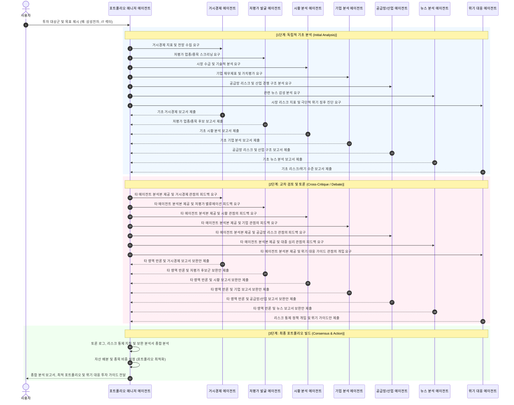
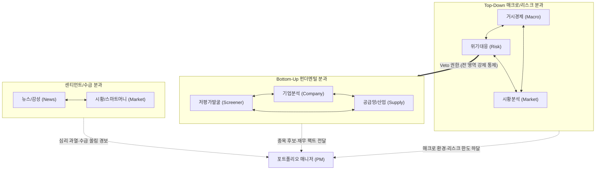
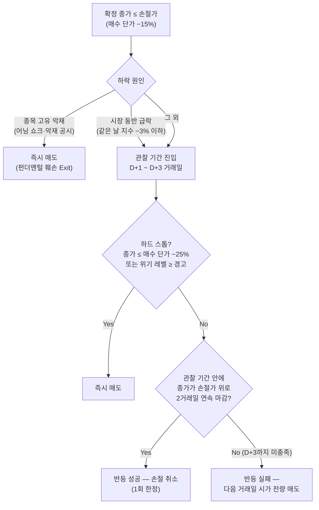
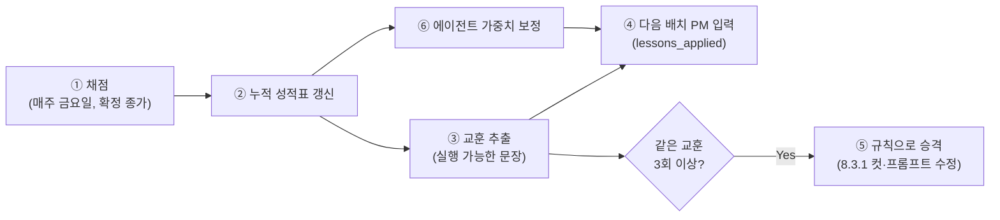
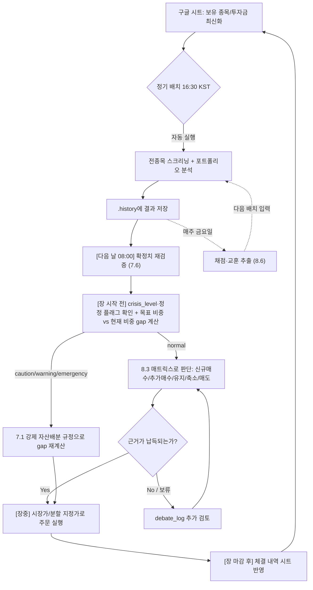

# AI 기반 스마트 주식 투자 에이전트 시스템 아키텍처 설계서

본 설계서는 거시경제, 시황, 기업 분석, 뉴스/감성 분석 데이터를 유기적으로 결합하여 최종 투자 의견 및 포트폴리오를 제안하는 **토론형 멀티 에이전트 시스템**의 설계 구조를 정의합니다.

| 날짜 | 변경 내용 |
|---|---|
| 2026-10-16 | 리포트 워크플로우 운영에서 검증된 설계 원칙 반영 — ① 공급망/산업 에이전트 상세 설계(3.4), ② 데이터 확정성 처리와 2단계 배치(7.6, AgentReport 스키마), ③ 채점·교훈 인계·가중치 보정 피드백 루프(7.4, 8.6), ④ 신규 매수 정량 컷(8.3.1) |
| 2026-10-16 | 설계 보완 2차 — ⑤ 스마트머니 모듈(3.2, 시황 에이전트 하위), ⑥ 투자 가이드 지식 베이스(3.3)와 계좌별 배분(6.2, 8.3.2), ⑦ 멀티 LLM 교차 검토(2.2, 5장), ⑧ 한국 시장 보조 위기 트리거(7.1), ⑨ 미국 시장 정식 범위(3.1), ⑩ 디렉터리 구조 정정과 리포트·이력 분리(4장) |
| 2026-10-16 | 설계 보완 3차 — 한국 보조 위기 트리거 검증(백테스트) 설계(7.7), 손절 "반등 실패" 판정 절차(8.3.3) |
| 2026-10-16 | 설계 보완 4차 — ⑪ 도메인 연합(Cluster) 기반 유향 토론 매트릭스(2.3), ⑫ 코드 계산-LLM 해석 분리 레이어 원칙(2.4), ⑬ 데이터 인프라 회복탄력성·캐싱 TTL 명세(4.1), ⑭ 위기 탈출 및 단계적 재진입(Re-entry) 프로토콜(7.1.1), ⑮ 장중 경량 감시 데몬 및 패스트트랙 분기(8.2.1), ⑯ 포트폴리오 리스크 가중 하이브리드 배분 모델(8.3.4) |

---

## 1. 시스템 개요 (System Overview)

투자 의사결정은 단일 영역의 분석만으로 완전할 수 없습니다. 거시경제 지표가 좋아도 개별 기업의 펀더멘탈이 부실할 수 있고, 기업 실적이 좋아도 단기적인 부정적 뉴스나 시장 수급(시황)이 나쁠 수 있습니다. 또한, 전체 종목 중 어떤 기업과 업종이 실적 대비 저평가되어 있는지 필터링하는 양적(Quant) 분석도 필수적이며, 전쟁이나 전염병, 금융 충격(엔캐리 청산 등)과 같은 블랙 스완 상황에서 자산을 방어하기 위한 위기 대응 가이드도 갖추어야 합니다.
본 시스템은 각 분야의 분석 및 통제를 전문으로 하는 **7대 독립 에이전트**와 이들의 의견을 조율하고 최종 포트폴리오를 구성하는 **포트폴리오 매니저 에이전트**로 구성됩니다.

---

## 2. 핵심 아키텍처: 양방향 토론 워크플로우

단방향의 보고서 취합 방식을 탈피하여, 에이전트 간 피드백을 통해 의견을 조율하고 다각도로 검토된 최종 결과물을 도출하는 **양방향 토론(Debate & Consensus) 프로세스**를 채택합니다.

### 2.1 토론 시퀀스 다이어그램 (Sequence Diagram)



### 2.2 토론 단계별 상세 프로세스

1. **기초 분석 단계 (Initial Analysis)**:
   - 각 에이전트는 담당 영역의 데이터 소스(FRED, KRX, DART, 뉴스 크롤러 등)를 통해 정량/정성 데이터를 확보하고 독자적인 분석 리포트를 작성합니다.
2. **양방향 토론 단계 (Debate Phase)**:
   - 포트폴리오 매니저는 취합된 리포트들을 모아 모든 에이전트에게 전송합니다.
   - 각 에이전트는 다른 에이전트의 주장에 반론을 제기하거나 지원 사격을 합니다. 특히 위기 대응 에이전트는 극단적인 리스크 징후가 있을 때 강력한 '통제권'을 행사하여 토론에 개입합니다.
     - *예시 (거시경제 -> 기업)*: "현재 고금리 기조가 6개월 더 유지될 전망인데, 기업 분석 에이전트가 제시한 부채 비율이 높은 B기업의 순이익 추정치는 너무 낙관적입니다. 이자 비용 증가를 반영해 하향 조정해야 합니다."
     - *예시 (뉴스 -> 시황)*: "최근 3일간 반도체 업계 관련 미디어 감성 지수가 극도로 악화되었습니다. 시황 에이전트가 제시한 단기 골든크로스 매수 시그널은 뉴스 심리 반등 확인 전까지 유보하는 것을 권장합니다."
     - *예시 (위기 대응 -> 전체)*: "중동 지역 전쟁 위기 고조로 유가 폭등 및 공급망 병목이 우려됩니다. 현재 시점에서 주식 비중을 최소 20% 이상 강제 축소하고, 안전 자산(금, 달러) 편입을 지시합니다."
   - **멀티 LLM 교차 검토 (선택 구성):** 같은 에이전트 역할을 서로 다른 LLM(예: Claude, Gemini)이 독립적으로 수행하게 할 수 있습니다.
     - 두 모델의 결론이 같은 종목·항목은 토론 없이 합의로 처리하고, **결론이 갈린 지점만** 토론 안건으로 올립니다. 토론 비용을 줄이면서, 한 모델의 체계적 편향(특정 섹터 낙관, 수치 오독 등)을 다른 모델이 잡게 하는 구조입니다.
     - 모델 간 불일치 자체도 신호로 씁니다. 두 모델이 갈린 종목은 확신도를 한 단계 낮춥니다.
     - 채점(8.6)은 모델별로 따로 집계해, 영역별로 더 잘 맞는 모델을 그 에이전트의 기본 모델로 고릅니다.
     - 두 모델은 서로의 결과를 **참조만** 하고 덮어쓰지 않습니다. 각 모델의 원본 판단이 남아 있어야 사후 비교가 가능하기 때문입니다.
3. **최종 합의 및 포트폴리오 빌드 (Consensus & Optimization)**:
   - 에이전트들은 상대방의 합당한 비판 및 리스크 통제 정책을 수용하여 자신의 보고서를 최종 수정합니다.
   - 포트폴리오 매니저(PM)는 보완된 최종 의견들과 토론 과정의 로그, 그리고 위기 대응 에이전트가 제공하는 **'블랙스완 및 고변동성 국면 행동 강령(투자 가이드)'**을 종합 평가하여, 종목별 추천 강도, 구체적인 포트폴리오 편입 비중(예: 삼성전자 30%, 현대차 20%, 현금 50%) 및 위기 대응 투자 가이드를 최종 제안합니다.

### 2.3 도메인 연합(Cluster) 기반 유향 토론(Directed Critique) 매트릭스

7개 에이전트 전체가 모든 타 에이전트의 보고서를 상호 검토하는 전방위(All-to-All) 방식은 $7 \times 6 = 42$개의 교차 검토 경로를 발생시켜 API 토큰 비용 폭증, 컨텍스트 낭비, 상호 관련성이 낮은 비판(예: 공급망 에이전트가 뉴스 감성 점수를 반박)으로 토론 품질이 저하됩니다. 이를 방지하기 위해 **3대 기능별 분과(Cluster)와 유향 토론(Directed Critique) 매트릭스**를 적용합니다.



| 분과 | 참여 에이전트 | 상호 교차 검토 중점 |
| :--- | :--- | :--- |
| **Top-Down 매크로/리스크** | 거시경제, 시황분석, 위기대응 | 금리·환율·유동성 환경과 지수 변동성(VIX), 시스템 리스크 지표의 정합성 검증 |
| **Bottom-Up 펀더멘털** | 저평가발굴, 기업분석, 공급망/산업 | 저평가 종목의 재무 건전성(밸류트랩 여부), 수출입 실측치와 기업 실적의 정합/시차/단절 검증 |
| **센티먼트/수급** | 뉴스/감성, 시황(스마트머니 모듈) | 주가 급변 및 수급 쏠림과 뉴스 미디어 감성, 대중 과열/공포 지표의 괴리 검증 |

- **분과 간 연계 규칙 (Inter-cluster Paths):** 
  - [Bottom-Up] 분과가 선정한 1차 매수 후보 종목에 대해서만 [Top-Down] 및 [센티먼트] 분과가 거시 환경 및 수급 악화 여부를 검증합니다.
  - 위기대응 에이전트는 독립 분과에 속하면서도, 위기 징후 감지 시 모든 분과에 강제 통제권(Veto)을 즉각 행사합니다.
- **비용 절감 효과:** 전체 상호 검토 경로가 42개에서 10개 내외로 축소되어 토론 지연시간(Latency)을 단축하고 LLM 토큰 소모를 70% 이상 절감합니다.

### 2.4 코드 확정 계산 vs LLM 해석 분리 원칙 (Deterministic Layer vs LLM Reasoning)

금융 수치 연산(등락률, 시가총액, 투자자별 순매수 합산, 이동평균, 볼린저 %B, 손절선 및 목표가 계산 등)을 LLM의 텍스트 생성에 의존하면 사칙연산 오류, 자릿수 왜곡, 과거 데이터 착오 등 치명적인 환각(Hallucination)이 발생합니다. 본 시스템은 **"계산은 파이썬 코드가 확정하고, LLM은 정성적 해석과 추론만 담당한다"**는 엄격한 분리 원칙을 적용합니다.

1. **Deterministic Calculation Engine (파이썬 코드 담당):**
   - 모든 기술적 지표, 밸류에이션 지표(PER/PBR/PEG), 수급 합산 금액, 계좌별 gap 계산, 리스크 지표는 `src/data/` 모듈의 순수 파이썬/Pandas 함수로 계산을 완료합니다.
2. **Fact Sheet 공급 (LLM 입력):**
   - 에이전트 프롬프트에는 코드가 이미 계산을 마친 정형화된 Fact Sheet(수치 확정 테이블 및 JSON)만을 주입합니다. 프롬프트 내에서 LLM에게 추가적인 수치 계산을 요구하지 않습니다.
3. **Pydantic 스키마 검증:**
   - 모든 에이전트의 출력(`AgentReport`)은 Pydantic 모델을 통해 엄격히 유효성을 검증하며, 필드 누락이나 수치 불일치 발생 시 코드가 자동으로 재시도(Retry)하거나 예외를 발생시킵니다.

---

## 3. 에이전트별 역할 및 데이터 설계 (Agent Roles & Data)

| 에이전트 명 | 역할 및 목표 (Goal) | 데이터 소스 (Data Sources) | 주요 분석 항목 (Focus) |
| :--- | :--- | :--- | :--- |
| **거시경제 에이전트**<br>(Macro Analyst) | 글로벌/국내 거시경제 환경을 분석하고 금리, 환율, 인플레이션 주기를 판단합니다. | FRED, 한국은행(ECOS), 관세청(수출입 통계), 야후 파이낸스 | 금리 방향성, 원/달러 환율 추이, 유가 등 원자재 가격, 물가지수(CPI/PPI), 고용 지표, 국내 수출입 동향(품목별/국가별 수출액 및 무역수지), GDP 성장률 |
| **저평가 발굴 에이전트**<br>(Valuation/Screener) | 업종 및 종목 전체를 모니터링하여 실적 대비 밸류에이션이 저평가된 1차 후보군을 발굴합니다. | KRX, Naver/FnGuide 금융 데이터, Fnguide 업종 지표, Yahoo Finance(해외 종목 스크리닝) | 업종별 평균 PER/PBR 대비 저평가주, 이익 성장률 대비 저평가주(PEG), 고ROE 및 고배당 저평가 매력도 스크리닝(국내+해외) |
| **시황 분석 에이전트**<br>(Market Analyst) | 증시의 단기/중기 수급, 기술적 지표, 섹터 로테이션 및 시장 변동성을 분석합니다. | KRX(시세·시가총액·업종 지수), 투자자별 매매 동향, 야후 파이낸스(국내외 지수), 스마트머니 모듈 입력(SEC 13F, 미국 의원 거래 공시, 옵션 체결 데이터, 예탁결제원 SEIBro) | 거래대금 추이, 외인/기관 수급 동향(쌍끌이·손바뀜·공방 시그널, 3.3), 이동평균선/RSI/MACD/볼린저 %B 등 기술적 지표, 시장 변동성 지표(VIX, VKOSPI), 섹터별 상대 강도, 국내 증시와 미국 주요 지수(S&P500, 나스닥) 간 상관관계, **미국 종목 수급 대체 판정(스마트머니 모듈, 3.2)** |
| **기업 분석 에이전트**<br>(Company Analyst) | 발굴된 후보 기업들의 정밀 재무 건전성, 세부 실적 추이, 고유 비즈니스 해자(Moat)를 심층 분석합니다. | DART(전자공시), Naver/FnGuide 금융 데이터, SEC EDGAR/Yahoo Finance(해외 종목 재무 데이터) | 분기 실적 및 세부 항목(매출원가, 판관비 등), 재무 비율 추이, 사업보고서 공시 분석, 개별 리스크 요인 진단, 배당성향 및 잉여현금흐름(FCF) 대비 배당 커버리지(배당 지속가능성 진단) |
| **공급망/산업 에이전트**<br>(Supply Chain Analyst) | 핵심 원자재·부품의 공급망 리스크와 산업 내 경쟁 구도, 업황 사이클을 진단하여 기업 분석에 선행 정보를 제공합니다. | 관세청(품목별 수출입 통계: 잠정치·10일 단위 속보·확정치, 수출입 운송비용), 산업통상부 수출입 동향, 과기정통부 ICT 수출입 동향, 산업별 협회 통계, 경쟁사 공시(DART), 업종 리서치 리포트 | 원자재 가격 및 조달 리스크, 경쟁사 점유율 변화, 산업 사이클(업황 호황/불황) 판단, 대체 공급처 여부 및 공급망 병목 조기 감지, **품목별 수출 통계 ↔ 기업 실적 연계 판정(정합/시차/단절)**, 수출 증감의 물량·단가 분해, 운송비용 부담 (상세: 3.4) |
| **뉴스/감성 에이전트**<br>(News/Sentiment) | 언론사 뉴스 및 커뮤니티 감성 분석을 통해 대중 심리, 시장의 공포/탐욕 수준 및 비정형 리스크를 조기 탐지합니다. | 네이버 뉴스 검색 API, 경제지 RSS, 구글 뉴스, CNN Fear & Greed | 최근 주요 뉴스 키워드 빈도, 뉴스 제목 및 본문 감성 점수(Positive/Negative), 대중 심리 지표(공포와 탐욕 지수), 부정적 루머/리스크 탐지 |
| **위기 대응 에이전트**<br>(Crisis & Risk Manager) | 전쟁, 팬데믹, 엔캐리 청산 등 극단적인 대외 충격 및 변동성 상황을 실시간 감지하여 자산 방어 솔루션과 가이드를 제시합니다. | VIX, 국채 스프레드, 주요 지정학 리스크 뉴스 피드, 글로벌 자금 유입/유출 추이 | 테일 리스크(Tail Risk) 조기 경보, 위기 국면 판정(정상/주의/경고), 안전자산(달러, 금, 채권) 배분 지침 및 위기 대응 행동 지침 작성 |
| **포트폴리오 매니저**<br>(Portfolio Manager) | 토론 과정을 중재하고, 사용자의 현재 포트폴리오 정보를 바탕으로 맞춤형 리밸런싱 지침 및 투자 조언을 생성합니다. | 각 에이전트 토론 로그, 구글 스프레드시트(사용자 포트폴리오 데이터, 계좌 유형 포함), 투자 가이드 지식 베이스(3.3) | **계좌별 배치(8.3.2)**, 리스크 대비 기대수익률 분석, 기존 포트폴리오 진단(수익률, 배당금 분석), 신규 자산 배분 비중 설정 및 매수/매도 리밸런싱 가이드라인 제시, 섹터/종목 집중도 한도 점검(쏠림 리스크), 양도소득세·배당소득세를 고려한 세후 수익률 관점의 리밸런싱 제안 |

### 3.1 분석 대상 시장 범위 (Market Scope)

본 시스템은 **한국(KOSPI·KOSDAQ)과 미국(NYSE·NASDAQ) 상장 종목을 모두 정식 분석 대상**으로 합니다. 두 시장 종목은 하나의 포트폴리오·하나의 성적표(8.6)에서 함께 관리하되, 가격·벤치마크·휴장일·수급 근거는 시장별로 분리해 적용합니다. 미국 시세·재무는 `data/overseas_provider.py`가 전담합니다.

| 항목 | 한국 | 미국 |
| :--- | :--- | :--- |
| **기준 가격** | KRX 확정 종가 (대체거래소 통합 시세는 `provisional`, 7.6) | 정규장 종가. 시간외·프리마켓 가격은 판단·채점에 쓰지 않음 |
| **기준일 표기** | 한국 거래일 | 미국 거래일. 미국 종가는 한국 시간 다음 날 새벽에 확정되므로, 리포트에 **시장별 기준일을 따로** 적음 |
| **벤치마크** | KOSPI / KOSDAQ | S&P 500 또는 나스닥 종합 (종목별로 판단 시점에 지정) |
| **휴장일** | KRX 휴장일 | NYSE 휴장일. 미국은 열리고 한국은 쉬는 날(또는 반대)의 갭을 다음 거래일 판단에 반영 |
| **수급 근거** | 종목별 외국인·기관·개인 순매수 (금액은 확정 종가로 환산) | 투자자별 순매수 데이터가 없으므로 **대체 지표 2개 이상**을 요구: ① 13F 기관 보유 변화, ② 애널리스트 의견·목표가 변경, ③ S&P 500 대비 상대강도·거래량 급증, ④ 한국 투자자 해외주식 순매수 (스마트머니 모듈, 3.2) |
| **채점 통화** | 원화 | **달러 기준으로 채점**하고, 같은 구간 원/달러 변동을 반영한 원화 환산 수익률은 참고로만 병기 |

- **한도는 한미 합산으로 적용합니다.** 섹터 집중 한도, 매수 비중 합계 상한(8.3.1), 위기 레벨 자산배분(7.1)은 두 시장을 합친 포트폴리오 기준입니다.
- **한미 밸류체인 페어 비교:** 같은 테마의 한미 종목(예: 메모리 — 국내 메모리 업체 / 미국 메모리 업체, AI 전력 — 국내 전력기기 / 미국 전력기기)은 함께 비교해, 더 싸거나 촉매가 가까운 쪽을 고릅니다.

### 3.2 스마트머니 모듈 (시황 분석 에이전트 하위)

기관·내부자·대형 옵션 거래처럼 "정보 우위가 있을 수 있는 자금"의 움직임을 추적합니다. 특히 **미국 종목은 투자자별 순매수 데이터가 없어서** 이 모듈이 시황 에이전트의 수급 판단을 대신합니다.

- **독립 에이전트가 아니라 시황 에이전트의 하위 모듈로 둡니다.** 별도 에이전트로 만들면 같은 "수급" 근거가 토론 합의 비율(7.2의 85%, 8.3의 70%)에서 두 번 집계되기 때문입니다. 시황 에이전트가 이 모듈의 결과를 자기 수급 판단에 흡수해 한 표로 냅니다.

| 입력 | 공개 시차 | 쓰임 |
| :--- | :--- | :--- |
| SEC 13F (구루·대형 기관 분기 보유) | 분기 종료 후 최대 45일 | 중기 방향. 신규 편입·전량 매도·비중 급변 종목 |
| 미국 의원 주식 거래 공시 | 거래 후 최대 45일 | 정책 수혜 테마 탐지 보조. 단독 근거로 쓰지 않음 |
| 옵션 특이 거래 (대량 콜/풋, 만기 짧은 OTM) | 당일 | 단기 이벤트 베팅 감지. 실적·이벤트 캘린더와 대조 |
| 나스닥 상장주 기관 매매 동향 | 수시 | 13F 사이 공백 보완 |
| 한국 투자자 해외주식 순매수 (예탁결제원 SEIBro) | 일간~주간 | 국내 개인 쏠림 측정. 과열 경계 지표로도 사용 |

- **시차 규칙:** 13F와 의원 거래는 이미 1~2개월 지난 정보입니다. 단기(1주) 판단의 근거로는 쓰지 않고, 중기 방향 확인용으로만 씁니다.
- **출력:** 종목별 `smart_money_view`(accumulating / distributing / neutral)와 근거 소스 목록, 각 소스의 기준일. 미국 종목의 수급 근거가 2개 미만이면 시황 에이전트는 그 종목의 수급 판단을 `insufficient`로 냅니다.

### 3.3 투자 가이드 지식 베이스 (Knowledge Base)

리포트가 "지금 무슨 일이 일어나고 있나"라면, 투자 가이드는 **"그것을 어떻게 해석해야 하나"** 를 정리한 상시 참조 문서입니다. 에이전트 프롬프트에 해석 규칙을 하드코딩하지 않고 가이드 문서에서 읽어 오게 합니다. 그러면 해석 기준이 바뀔 때 코드를 고치지 않고 가이드만 고치면 됩니다.

- **위치·형식:** 저장소 루트의 `investment_guide/`. 주제별로 연도 없는 파일 하나를 계속 고치고, 문서 상단 업데이트 이력 표로 변경을 추적합니다.
- **로딩:** `src/knowledge.py`가 가이드를 읽어 지정된 에이전트의 system context에 넣습니다. 에이전트는 사용한 가이드의 버전(이력 표 최신 날짜)을 AgentReport `sources`에 기록합니다.

| 가이드 | 받는 에이전트 | 가져가는 규칙 |
| :--- | :--- | :--- |
| **수급 주체별 매매 패턴과 시즈널리티** | 시황 분석, PM | 수급 3대 시그널 정의(쌍끌이 매수 / 손바뀜 / 수급 공방)와 판독 Decision Tree, 주체별(외국인·연기금·투신·금융투자·개인) 매매 성격, 월별 수급 시즈널리티 |
| **연금 투자 가이드** | PM, 위기 대응 | 계좌 유형별 제약과 우선순위(8.3.2), 퇴직연금 위험자산 70% 한도, 장기 자산배분 기준, 인출·과세 규칙 |

- **규칙과 판단의 경계:** 가이드는 해석 기준만 줍니다. 특정 시점의 종목 판단은 가이드에 쓰지 않습니다. 가이드가 오늘의 시장 상황에 오염되지 않게 하기 위해서입니다.

### 3.4 공급망/산업 에이전트 상세 설계

수출입 통계는 발표가 잦고 값이 여러 번 바뀌며, 같은 "수출 호조"라도 기업 실적으로 이어지는 방식이 품목마다 다릅니다. 그래서 이 에이전트는 수치를 요약하는 데 그치지 않고, **"이 통계를 이 기업의 실적 근거로 써도 되는가"** 를 판정해 다른 에이전트에 넘깁니다.

**(1) 입력 데이터와 발표 주기**

| 자료 | 발표 시점 | 상태 |
|---|---|---|
| 관세청·산업통상부 월간 수출입 (잠정치) | 매월 1일 | `provisional` |
| 관세청 10일 단위 수출입 현황 | 매월 11일·21일 | `provisional` (단기 변동 큼, 방향 참고용) |
| 관세청 월간 수출입 현황 (확정치), 수출입 운송비용 | 매월 15일 전후 | `confirmed` (연간 확정 시까지 일부 정정 가능) |
| 과기정통부 ICT 수출입 동향 | 매월 중순 | `confirmed` |

**(2) 처리 규칙**

1. **실적 연계 판정 (핵심 출력):** 품목별로 수출 통계와 대표 기업 실적의 관계를 셋 중 하나로 판정합니다.

   | 판정 | 의미 | 다른 에이전트의 사용법 | 예시 (2026년 9월) |
   |---|---|---|---|
   | **정합 (aligned)** | 수출 증감과 기업 실적이 같은 방향·같은 시점 | 수출 통계를 실적 선행지표로 사용 | 반도체 — 수출 사상 최대, 메모리 업체 분기 영업이익도 사상 최대 |
   | **시차 (lagged)** | 방향은 같으나 실적 반영이 1분기 이상 늦음 | 이번 분기 실적 추정은 보수적으로, 다음 분기 회복 신호로 사용 | 자동차 — 일평균 수출은 회복, 3분기 실적은 파업 손실 반영 |
   | **단절 (decoupled)** | 국내 수출 통계가 기업 실적을 설명하지 못함 | 해당 품목 판단 근거에서 수출 통계 제외, 대체 지표 사용 | 이차전지 — 국내 수출은 감소, 이익은 미국 현지생산·세액공제에서 발생 |

2. **물량·단가 분해:** 수출액 증가가 물량 증가인지 단가 상승인지 나눕니다. 단가만 오른 경우(예: 유가 상승으로 석유제품 수출액은 늘고 물량은 감소)는 업황 개선으로 해석하지 않습니다.
3. **조업일수·기저효과 보정:** 명절 이동 등으로 조업일수가 다르면 일평균 증가율을 기준으로 판단하고, 헤드라인 증가율은 참고로만 씁니다.
4. **정정과 분류 차이 구분:** 잠정치 → 확정치 차이는 "정정"으로 기록합니다. 기관 간 품목 분류 차이(예: 관세청 성질별 분류 vs 산업통상부 MTI 분류)는 정정이 아니라 별도 표기합니다.
5. **운송비용 신호:** 원거리 해상 수출 운임이 급등하면 부피 대비 단가가 낮은 품목(가전·기계·타이어·철강)에 이익률 압박 플래그를, 컨테이너 선사에 수혜 플래그를 붙입니다.
6. **편중도 경보:** 단일 품목의 수출 비중이 임계치(예: 40%)를 넘으면 위기 대응 에이전트에 "수출 편중" 리스크를 전달합니다.

**(3) 출력 (AgentReport의 `items` 확장 필드)**

```json
{
  "item": "반도체",
  "export_usd_bn": 605.0,
  "yoy": 2.603,
  "daily_avg_yoy": null,
  "driver": "volume+price",
  "linkage": "aligned",
  "linked_tickers": ["005930", "000660"],
  "flags": ["concentration_risk"],
  "data_status": "confirmed"
}
```

**(4) 토론에서의 역할:** 기업 분석 에이전트에는 실적 추정의 방향과 시차를, 거시경제 에이전트에는 무역수지와 국가별 흑자 규모(통상 압력 근거)를, 위기 대응 에이전트에는 편중도와 운임 충격을 전달합니다. 특히 **"수출 통계와 실적은 정합하는데 주가는 반대로 움직이는" 경우**를 시황 에이전트와의 교차 검토 안건으로 올립니다. 실적 서프라이즈가 주가로 이어지지 않는 국면을 조기에 잡기 위해서입니다.

---

## 4. 디렉터리 및 코드 구조 설계 (Project Structure)

양방향 토론 방식을 효과적으로 구현하기 위해 프로젝트 소스 디렉터리를 아래와 같이 세분화합니다.

**산출물 저장 원칙 — 사람이 읽는 것과 기계가 읽는 것을 분리합니다.**
- `investment_reports/`: **사람이 읽는 리포트**(마크다운). 시리즈·작성 주체별로 1년에 파일 하나를 두고, 새 회차를 위에 누적합니다(회차 앵커 `entry-YYYYMMDD`). 확정치·정정 같은 후속 내용은 새 회차를 만들지 않고 원래 회차 끝에 덧붙입니다. 과거 회차는 고치지 않습니다.
- `.history/`: **기계가 읽는 이력**(JSON, 7.4). PM의 과거 판단 비교, 채점, 가중치 보정이 이 파일만 읽습니다. 마크다운 리포트를 파싱해 채점하지 않습니다.
- 두 저장소는 같은 `analysis_id`로 연결합니다. 리포트 회차에 `analysis_id`를 적고, JSON에는 리포트 경로와 앵커를 적습니다.

```text
stock-invest-agent/
│
├── docs/                                 # 아키텍처 및 기획 문서
│   ├── investment_agent_architecture_original.md   # (본 설계서)
│   └── 기초자료/                          # 통계 원문 PDF 등 1차 자료 보관 (리포트에 경로 기록)
│
├── investment_guide/                     # 투자 가이드 지식 베이스 (3.3) — 주제별 단일 파일 + 이력 표
├── investment_reports/                   # 사람이 읽는 리포트 (연 단위 누적 마크다운)
├── .history/                             # 기계가 읽는 분석 이력 JSON (7.4)
│
├── src/
│   ├── __init__.py
│   │
│   ├── data/                             # 외부 데이터 연동 모듈
│   │   ├── __init__.py
│   │   ├── cache/                        # 데이터별 TTL 캐싱 디렉터리 (4.1)
│   │   ├── resilience.py                 # 비동기 병렬 수집(asyncio), 재시도, 서킷 브레이커, 타임아웃 (4.1)
│   │   ├── krx_openapi_provider.py       # KRX Open API: 전 종목 시세·시가총액, 지수·업종 지수 (확정치 1차 출처)
│   │   ├── naver_flow_provider.py        # 투자자별 순매수(시장·종목), 일봉 — 금액은 KRX 확정 종가로 환산
│   │   ├── technicals.py                 # 이동평균 배열, 볼린저 %B, 52주 고점 대비, 단기 급등률
│   │   ├── fred_provider.py              # FRED: 미국 금리·물가·고용·스프레드·VIX·DXY·환율
│   │   ├── ecos_provider.py              # 한국은행 ECOS: 기준금리, 원/달러, 국내 주요 통계
│   │   ├── krx_provider.py               # FinanceDataReader 기반 보조 시세 (Open API 장애 시 폴백)
│   │   ├── company_provider.py           # DART 공시, 재무제표, 잠정실적, 이벤트 캘린더
│   │   ├── trade_provider.py             # 관세청·산업통상부 수출입 통계, 운송비용 (3.4)
│   │   ├── smart_money_provider.py       # 13F, 의원 거래, 옵션 특이 거래, SEIBro 해외주식 순매수 (3.2)
│   │   ├── overseas_provider.py          # 미국 시세(정규장 종가)·재무 (3.1)
│   │   ├── news_provider.py              # 네이버/구글 뉴스, 검색트렌드, 종토방 수집
│   │   ├── gsheet_provider.py            # 구글 스프레드시트 연동 (보유 자산·계좌 유형, 6.2)
│   │   └── watchdog.py                   # 장중 경량 감시 데몬 및 패스트트랙 트리거 (8.2.1)
│   │
│   ├── knowledge.py                      # investment_guide/ 로드 → 에이전트 system context (3.3)
│   │
│   ├── agents/                           # 개별 분석 에이전트 정의
│   │   ├── __init__.py
│   │   ├── base_agent.py                 # 에이전트 공통 추상 클래스 (AgentReport 스키마, 7.5)
│   │   ├── llm_backend.py                # LLM 백엔드 추상화 — 모델 교체·멀티 LLM 교차 검토 (2.2)
│   │   ├── macro_agent.py                # 거시경제 분석 에이전트
│   │   ├── screener_agent.py             # 저평가 발굴/스크리너 에이전트
│   │   ├── market_agent.py               # 시황 분석 에이전트
│   │   ├── smart_money_module.py         # 시황 에이전트 하위 스마트머니 모듈 (3.2)
│   │   ├── company_agent.py          # 기업 분석 에이전트
│   │   ├── supply_agent.py           # 공급망/산업 분석 에이전트 (수출-실적 정합/시차/단절 판정, 3.4)
│   │   ├── news_agent.py             # 뉴스 감성 분석 에이전트
│   │   └── risk_agent.py             # 위기 대응/리스크 관리 에이전트
│   │
│   ├── orchestrator.py               # 토론 중재 및 포트폴리오 생성 매니저
│   └── test_data.py                  # 데이터 테스트 스크립트
│
├── .env                              # API Key (KRX_OPENAPI_SECRET_KEY, FRED_API_KEY, ECOS 키, LLM 키, 구글 시트 경로)
├── .gitignore                        # .env, 서비스 계정 키(.json), .history/ 의 민감 정보 제외
└── requirements.txt
```

### 4.1 데이터 인프라 회복 탄력성(Resilience) 및 계층형 캐싱(TTL) 전략

12개 이상의 외부 프로바이더를 순차 동기 호출하면 단일 소스의 응답 지연이 전체 배치를 마비시킵니다. `src/data/resilience.py`를 중심으로 장애 격리와 캐싱 파이프라인을 운영합니다.

1. **비동기 병렬 수집 (`asyncio.gather`):**
   - 네트워크 의존적인 모든 데이터 호출은 비동기 코루틴으로 실행하며, 엔드포인트별 최대 타임아웃(기본 15초)을 적용합니다.
2. **서킷 브레이커 및 폴백 체인:**
   - 1차 소스(KRX Open API) 3회 연속 실패 시 즉시 2차 소스(FinanceDataReader) 또는 3차 소스(네이버 금융)로 자동 절체(Failover)합니다.
3. **데이터 성격별 차등 TTL (Time-To-Live) 캐싱:**
   - 실시간 시세 및 장중 호가: TTL 1~5분
   - 일별 확정 종가 및 수급: TTL 12시간 (야간 재검증까지 유지)
   - 거시경제 통계 (FRED, ECOS): TTL 24시간
   - 관세청 무역통계, DART 재무제표, SEC 13F: TTL 7일 ~ 30일
   - 캐시 히트(Cache Hit) 시 네트워크 호출을 생략하여 배치 소요 시간을 1분 이내로 단축합니다.

---

## 5. 단계별 구현 로드맵 (Roadmap)

*   **Phase 1: 데이터 프로바이더 추가 구축 (Data Gathering)**
    *   FRED / Yahoo Finance 및 공시 수집 인프라 추가
*   **Phase 2: 개별 에이전트의 LLM 프롬프트 디자인 (Single Agent Setup)**
    *   `llm_backend.py`로 LLM 백엔드를 추상화하고(Claude·Gemini 등 교체 가능), 입력된 정량 데이터를 바탕으로 구조화된 마크다운 보고서와 AgentReport JSON을 함께 작성하는 단일 에이전트 프롬프트 템플릿 설계
    *   해석 규칙은 프롬프트에 하드코딩하지 않고 지식 베이스(3.3)에서 로드
*   **Phase 3: 토론 중재 엔진 및 프로토콜 설계 (Debate Engine)**
    *   **1차 구현 — 멀티 LLM 교차 검토(2.2):** 같은 에이전트를 두 모델로 돌려 결론이 갈린 항목만 추리는 단계부터 자동화. 에이전트 간 토론보다 구현이 단순하고, 모델 편향 검증 효과를 먼저 확인할 수 있음
    *   `orchestrator.py` 구현: 에이전트 간 리포트 전달 -> 교차 코멘트 -> 코멘트 반영 리포트 수정 프로세스 파이프라인 자동화
*   **Phase 4: 포트폴리오 최적화(PM) 기능 탑재**
    *   의견 강도에 따른 자산배분 룰베이스/LLM 하이브리드 엔진 탑재
*   **Phase 5: 백테스팅 및 UI 대시보드 연동**
    *   추천 포트폴리오의 실질 수익률 시뮬레이션 및 분석 결과 시각화
    *   **우선 과제:** 한국 보조 위기 트리거 검증(7.7)과 손절 관찰 기간 검증(8.3.3). 이 둘이 끝나기 전에는 보조 트리거가 "참고 플래그"로만 동작해 급락장 방어가 늦다

---

## 6. 구글 스프레드시트 연동 보안 인증 방식 (Google Sheets Security)

개인 투자금, 배당금 등 민감한 개인 자산 데이터를 안전하게 보호하기 위해 **구글 클라우드 서비스 계정(Service Account)을 활용한 보안형 연동** 방식을 채택합니다.

### 6.1 인증 매커니즘 및 환경설정
1. **서비스 계정 인증**: 구글 클라우드 콘솔에서 IAM 서비스 계정을 생성하고, 인증용 비밀 키 파일(`.json`)을 발급받아 로컬 프로젝트 경로에 배치합니다.
2. **시트 액세스 허용**: 발급받은 서비스 계정의 이메일 주소(예: `your-service-account@project.iam.gserviceaccount.com`)를 분석 대상 구글 스프레드시트에 **공유 멤버(뷰어 권한)**로 추가하여, 외부 링크 공개 없이 데이터에 직접 접근할 수 있도록 차단합니다.
3. **환경 변수 구성**: `.env` 파일에 관련 경로 및 시트 ID를 저장하여 코드상 키 유출을 방지합니다.
   - `GOOGLE_SHEET_CREDENTIALS_PATH`: 서비스 계정 키 파일(`.json`) 경로
   - `GOOGLE_SHEET_KEY`: 구글 스프레드시트 고유 ID (스프레드시트 URL 중 `/d/`와 `/edit` 사이의 문자열)

### 6.2 데이터 수집 필드 정의
구글 스프레드시트로부터 파싱할 핵심 열 목록은 다음과 같으며, `gsheet_provider.py`에서 Pandas DataFrame 구조로 정제됩니다.
- **종목 (ticker / name)**: 개별 보유 자산의 고유 종목코드 또는 종목명
- **투자금 (invested_amount)**: 해당 종목에 투입된 총 원금
- **배당금 (dividends_received)**: 현재까지 수령하였거나 예상되는 누적 배당금
- **수익률 (return_rate)**: 평가 손익 비율 (%)
- **계좌 유형 (account_type)**: `pension_savings`(연금저축) / `irp_dc`(IRP·퇴직연금 DC) / `isa` / `general`(일반 위탁). PM의 계좌별 배치(8.3.2)에 필수
- **시장·통화 (market / currency)**: `KR`/`US`, `KRW`/`USD`. 미국 종목은 달러 기준 평가와 원화 환산을 함께 계산(3.1)
- **계좌별 현금 (cash_by_account)**: 계좌마다 즉시 매수 가능한 현금. 다른 계좌의 현금으로는 매수할 수 없으므로 gap 계산(8.2 ①)을 계좌 단위로 수행

---

## 7. 워크플로우 상세 명세 (Workflow Specifications)

### 7.1 위기 대응 에이전트 거부권 발동 기준 (수치 명세)

| 위기 레벨 | 발동 조건 | 토론 처리 방식 | 강제 자산 배분 상한/하한 |
| :---: | :--- | :--- | :--- |
| ⚠️ **주의** (Caution) | VIX ≥ 25 **또는** 국고채 10년-2년 스프레드 역전 진입 | 토론 계속 진행, 경고 플래그 추가 | 주식 ≤ 70%, 안전자산 ≥ 10%, 현금 ≥ 20% |
| 🔴 **경고** (Warning) | VIX ≥ 35 **또는** 지정학 위기 뉴스 감성 극단 악화 (3일 연속 Bearish ≥ 80%) | 토론 최대 1라운드로 제한 | 주식 ≤ 50%, 안전자산 ≥ 20%, 현금 ≥ 30% |
| 🚨 **긴급** (Emergency) | VIX ≥ 50 **또는** 회사채 스프레드 +300bp 이상 급등 **또는** 수익률 커브 역전 심화(-50bp 이하) | 토론 즉시 중단 (Veto 발동) | 주식 ≤ 20%, 현금+금+달러 ≥ 60% |

**한국 시장 보조 트리거 (Korea Supplementary Triggers)**

위 기준은 미국 지표 중심이라, 미국 시장은 평온한데 한국만 급락하는 국면(한국 고유 악재, 외국인의 한국 비중 축소)을 놓칠 수 있습니다. 실제로 2026년 10월에는 미국 S&P 500이 보합권(10/9 → 10/13, -0.08%)이었는데 KOSPI는 5영업일 동안 13% 넘게 빠지고 매도 사이드카가 발동했습니다. 그래서 한국 시장 신호를 보조 트리거로 둡니다.

| 보조 트리거 | 기준 (초기값) | 처리 |
| :--- | :--- | :--- |
| 매도 사이드카 발동 | KOSPI 또는 KOSDAQ에서 발동 | 다음 배치까지 최소 ⚠️ 주의 |
| 서킷브레이커 발동 | 1단계 이상 (지수 -8% 이상, 1분 지속) | 최소 🔴 경고 |
| 지수 단기 급락 | KOSPI 5영업일 누적 -10% 이하 | 최소 ⚠️ 주의 |
| 외국인 대량 순매도 | KOSPI 일간 외국인 순매도가 시가총액의 0.08% 이상 (2026년 10월 기준 약 4조원) | 최소 ⚠️ 주의. 3거래일 연속이면 🔴 경고 |

- **보조 트리거는 최대 🔴 경고까지만 올립니다.** 🚨 긴급(Veto)은 위 본 기준으로만 발동합니다. 한국 단독 급락은 반등도 빠른 경우가 많아, 토론 없이 강제 방어로 가는 것은 과하다고 보기 때문입니다.
- **보조 트리거 2개 이상이 동시에 충족되면 한 단계 더 올립니다.** (예: 사이드카 + 외국인 대량 순매도 → 🔴 경고)
- 외국인 순매도 기준은 금액이 아니라 **시가총액 대비 비율**로 정합니다. 시장 규모가 바뀌어도 기준이 유지되게 하기 위해서입니다.
- **검증 전 운영 방식:** 기준값은 한 번의 급락 사례에서 나온 초기값입니다. Phase 5 백테스트로 과거 급락 구간(오탐·미탐 비율)을 검증하기 전에는, 레벨을 실제로 올리지 않고 **"참고 플래그"로만** 리포트에 표시합니다. 검증 절차와 실제 적용으로 승격하는 기준은 7.7을 따릅니다.

#### 7.1.1 위기 탈출 및 단계적 재진입(Staged Re-entry) 프로토콜

위기 상황 종료 시 주식 비중을 무계획적으로 복원하면 급반등 후 2차 급락(Whipsaw)에 물리거나, 반대로 지나치게 늦게 복원하여 V자 반등의 핵심 수익 구간을 놓치게 됩니다. 이에 따라 **3단계 점진적 재진입(Staged Re-entry)** 절차를 의무 적용합니다.

```mermaid
flowchart TD
    W["🚨 긴급 / 🔴 경고 발동 중<br/>(주식 비중 ≤ 20~50%)"] --> C1{"1단계: 위기 진정 확인<br/>VIX 하향 안정화 AND<br/>지수 3거래일 연속 신저가 미발생?"}
    C1 -->|No| W
    C1 -->|Yes| S1["[1단계 재진입]<br/>현금 비중 20%p 축소 →<br/>시장 대표 지수 ETF (KOSPI200, S&P500) 및<br/>초대형 1위주(삼성전자, 애플 등) 매수"]
    S1 --> C2{"2단계: 수급 정상화<br/>외인/기관 현물 순매수 전환 AND<br/>환율/채권 스프레드 진정?"}
    C2 -->|No (반등 둔화)| S1
    C2 -->|Yes| S2["[2단계 재진입]<br/>주식 비중 50~70%로 확대 →<br/>실적 방어력이 입증된 섹터 주도 대장주 편입"]
    S2 --> C3{"3단계: 완전 복원<br/>위기 트리거 완전 소멸 후<br/>5거래일 경과?"}
    C3 -->|No| S2
    C3 -->|Yes| S3["[3단계 완전 복원]<br/>정상 자산 배분(Normal) 복귀 →<br/>알파 포트폴리오 및 중소형주 개별 매매 정상화"]
```

1. **1단계 (위기 진정 확인):**
   - VIX가 경고선 이하로 내려오고, 지수가 3거래일 연속 신저가를 갱신하지 않으면, 보유 현금 중 20%p를 **지수 패시브 ETF(KOSPI 200, S&P 500) 및 최상위 메가캡**에 1차 분할 투입합니다. (개별 중소형주 진입 금지)
2. **2단계 (수급 정상화):**
   - 외국인 또는 기관의 현물 순매수 전환이 확인되면, 8.3의 주도주 롱 전략 대상인 섹터 1위 대장주를 추가 매수하여 주식 비중을 50~70% 수준으로 복원합니다.
3. **3단계 (완전 복원):**
   - 모든 위기 트리거가 소멸된 후 5거래일이 경과하면 정상 국면(`normal`)으로 공식 전환하고 개별 알파 종목 스크리닝을 완전 정상화합니다.

### 7.2 토론 조기 합의 종료 조건

```
최대 토론 라운드 수 : 2 라운드
조기 합의 판정 기준 : 7개 분석 에이전트 중 동일 outlook 방향 비율 ≥ 85%
긴급 레벨 거부권 발동 시: 즉시 토론 종료 (라운드 무관)
```

### 7.3 실시간 vs 배치 실행 분기 전략

| 모드 | 트리거 | 분석 범위 | 실행 방법 |
| :--- | :--- | :--- | :--- |
| **실시간 (Realtime)** | 사용자 CLI/채팅 명령 | 지정 종목 집중 분석 | `python main.py --mode realtime --tickers 005930 000660` |
| **배치 (Batch)** | 매일 장 마감 후 자동 실행 (16:30 KST) | 전체 KRX 스크리닝 + 포트폴리오 업데이트 | `python main.py --mode batch` |

- 배치 모드는 스크리너 에이전트가 KRX 전종목 스캔 후 후보군을 압축, 나머지 에이전트는 압축된 후보군 대상으로 심층 분석 수행
- 실시간 모드는 스크리너 단계를 Skip하고 지정 종목 바로 분석
- **배치는 2단계로 실행한다(7.6):** 16:30 1차 배치는 당일 잠정 시세로 돌고, 다음 날 08:00 재검증 배치가 KRX 확정치로 교체한다. 실시간 모드 결과는 항상 `provisional`로 표시한다.

### 7.4 분석 이력 저장 구조 (JSON)

분석 이력은 `.history/` 디렉터리(4장)에 날짜/모드별로 JSON 파일로 저장하며, 포트폴리오 매니저가 과거 권고안과 비교 분석 시 참조합니다. 각 판단은 **나중에 채점할 수 있도록** 목표가·손절가·결판 시점·촉매·반증 조건을 함께 남기고, 채점 결과(`scoring`)는 결판 시점이 지난 뒤 같은 파일에 채워 넣습니다(8.6).

```json
{
  "analysis_id": "20260708_batch",
  "date": "2026-07-08",
  "mode": "batch",
  "data_status": "confirmed",
  "target_tickers": ["005930", "000660"],
  "crisis_level": "normal",
  "veto_applied": false,
  "lessons_applied": [
    {"lesson_id": "L-0703-1", "text": "단기 급등주 추격 매수 금지", "applied_as": "000660 매수 → 관망 전환"}
  ],
  "final_portfolio": {
    "allocations": [{
      "ticker": "005930", "name": "삼성전자", "weight": 0.3, "signal": "buy",
      "confidence": "mid", "horizon": "1w",
      "target_price": 0, "stop_price": 0,
      "catalyst": {"date": "2026-07-10", "event": "2분기 잠정실적"},
      "falsifier": "외국인 3거래일 연속 순매도 전환"
    }],
    "cash_weight": 0.2
  },
  "agent_reports": {"macro": "...", "market": "..."},
  "debate_log": [],
  "scoring": {
    "scored_at": "2026-07-15",
    "price_status": "confirmed",
    "results": [{
      "ticker": "005930", "return": 0.0157, "benchmark": "KOSPI", "excess_return": -0.0176,
      "verdict": "hit", "agent_outlooks": {"macro": "bullish", "market": "bearish", "news": "neutral"}
    }],
    "lessons": [{"lesson_id": "L-0715-1", "text": "실행 가능한 문장으로 작성한 다음 분석 반영 사항"}]
  }
}
```

- `target_price`·`stop_price`의 0은 자리 표시용이다. 실제 값은 판단 시점의 확정 종가와 변동성 밴드로 정한다.
- `agent_outlooks`는 판단 당시 각 에이전트의 최종 outlook이다. 에이전트별 적중률(8.6의 가중치 보정)을 이 값으로 계산한다.

### 7.5 에이전트 간 데이터 공유 명세

포트폴리오 매니저(PM)가 중앙 허브 역할을 하며, 아래 순서로 데이터를 배분합니다.

```
[1단계] PM → 전 에이전트 : 분석 대상 종목 코드 + 사용자 포트폴리오 + 분석 기준일
[2단계] 각 에이전트 → PM : 독립 기초 분석 보고서 (AgentReport 스키마)
[3단계] PM → 전 에이전트 : 모든 에이전트의 1단계 보고서 전체 패키지
[4단계] 각 에이전트 → PM : 교차 검토 의견 (critique 보고서)
[5단계] PM → 전 에이전트 : critique 보고서 전체 + 위기 에이전트 판정 결과
[6단계] 각 에이전트 → PM : 최종 수정 보고서
[7단계] PM : 최종 수정 보고서 + 토론 로그 종합 → 포트폴리오 최종 생성
```

**AgentReport 스키마 (모든 에이전트 공통):**

```json
{
  "agent": "supply",
  "as_of": "2026-07-08",
  "data_status": "provisional",
  "sources": [
    {"name": "KRX 일별매매정보", "as_of": "2026-07-07", "status": "confirmed"},
    {"name": "네이버 시세", "as_of": "2026-07-08", "status": "provisional"}
  ],
  "outlook": "bullish",
  "confidence": "mid",
  "tickers": [{"ticker": "005930", "view": "buy", "rationale": "...", "falsifier": "..."}],
  "items": [],
  "flags": [],
  "corrections": [{"field": "9월 수출", "from": 1209.4, "to": 1210.5, "reason": "잠정→확정"}]
}
```

- `data_status`는 보고서 안 가장 낮은 상태를 따른다. 잠정 소스가 하나라도 있으면 보고서 전체가 `provisional`이다.
- `corrections`에는 직전 보고서 대비 정정된 수치를 남긴다. PM은 정정이 판단을 바꿨는지 토론 로그에 기록한다.

### 7.6 데이터 확정성 처리 (Provisional vs Confirmed)

시세와 통계는 처음 나온 값이 최종값이 아닙니다. 예를 들어 KRX 당일 확정 종가는 보통 다음 날 아침에 게시되고, 관세청 월간 수출입은 1일 잠정치 → 15일 확정치로 바뀝니다. 장중·대체거래소 통합 시세는 KRX 확정 종가와 다를 수 있습니다. 그래서 모든 수치에 상태를 붙이고, 확정치가 나오면 다시 확인합니다.

| 상태 | 해당 데이터 | 사용 범위 |
|---|---|---|
| `provisional` | 장중·당일 시세, 대체거래소 통합 시세, 10일 단위 수출입 속보, 월초 잠정치 | 분석·판단에 사용 가능. 리포트에 `(잠정)` 표기. **채점에는 사용 금지** |
| `confirmed` | KRX 확정 종가·시가총액, 관세청 확정치, 공시 확정 실적 | 모든 용도. 채점은 이 상태만 사용 |

**처리 규칙:**
1. **2단계 배치:** 16:30 1차 배치(`provisional`) → 다음 날 08:00 재검증 배치에서 확정치로 교체합니다. 교체 후 종가가 ±1% 이상 달라졌거나 어떤 종목의 `signal`이 바뀌면 PM에 **정정 플래그**를 올리고, 장 시작 전 gap 계산(8.2 ①)을 다시 합니다.
2. **빈 응답은 오류가 아니다:** 확정치 API 응답이 비어 있으면 발행 지연일 수 있습니다. 기존 값을 틀렸다고 단정하지 말고, 다른 소스로 교차검증하면서 `provisional`을 유지합니다.
3. **금액 환산은 확정 가격으로:** 투자자별 순매수 금액처럼 수량 × 가격으로 만드는 값은 확정 종가로 환산합니다. 확정 종가가 없는 날만 잠정 가격을 쓰고 그 행을 `provisional`로 표시합니다.
4. **정정 이력 보존:** 잠정 → 확정 차이는 AgentReport `corrections`와 이력 JSON에 남겨, 어떤 판단이 잠정 데이터에 기대고 있었는지 사후에 추적할 수 있게 합니다.
5. **교차검증:** 시장 전체 투자자별 순매수 같은 핵심 수치는 최소 1거래일 이상 독립 출처(언론 마감시황 등)와 대조하고, 차이가 크면 보고서 `flags`에 남깁니다.

### 7.7 한국 보조 위기 트리거 검증 설계 (Backtest)

7.1의 한국 보조 트리거는 한 번의 급락 사례에서 나온 초기값입니다. 실제 레벨 상향에 쓰기 전에, **과거에 켜졌다면 손실을 줄였는지, 아니면 괜히 주식 비중만 줄여 상승을 놓쳤는지**를 검증합니다.

**(1) 정답 구간(위기 구간) 정의**

트리거가 "맞았는지" 판정하려면 위기를 먼저 정의해야 합니다. 트리거와 무관한 사후 기준으로 정합니다.

- **위기 구간:** 어떤 날 이후 20거래일 안에 KOSPI 종가가 그날 종가 대비 **-10% 이상** 추가 하락하는 경우, 그날을 "위기 진입 전 구간"으로 표시합니다.
- **반드시 포함할 검증 사례 (예):** 2008년 10월, 2011년 8월, 2018년 10월, 2020년 3월, 2024년 8월, 2026년 10월. 과거 데이터 안에서 위 정의로 자동 추출되는 구간도 모두 포함합니다.
- 위기 구간이 아닌데 트리거가 켜진 날은 **오탐**, 위기 구간인데 끝까지 안 켜진 경우는 **미탐**입니다.

**(2) 데이터**

| 데이터 | 출처 | 비고 |
| :--- | :--- | :--- |
| KOSPI 일별 종가·시가총액 | KRX Open API (`krx_openapi_provider`) | 지수 급락·시총 대비 순매도 비율 계산 |
| 시장 전체 외국인 일별 순매수 | 투자자별 매매 동향 (`naver_flow_provider`) | **조회 가능한 과거 기간을 먼저 확인**합니다. 짧으면 KRX 정보데이터시스템 화면 데이터로 보완 |
| 사이드카·서킷브레이커 발동일 | KRX 시장운영 공지, 언론 보도 | 발동일 목록을 수작업으로 만들고 출처를 남김 |
| 미국 본 기준 지표(VIX, 스프레드) | FRED | 본 기준과 보조 트리거의 기여를 분리하기 위해 함께 계산 |

**(3) 비교할 정책 3가지**

같은 기간에 세 정책을 돌려 결과를 비교합니다. 자산배분은 7.1의 레벨별 주식 상한을 그대로 적용하고, 레벨 해제는 트리거 소멸 후 5거래일 경과로 통일합니다.

| 정책 | 내용 |
| :--- | :--- |
| A. 본 기준만 | 미국 지표(VIX·스프레드·커브)로만 위기 레벨 판정 |
| B. 보조 트리거 적용 | A + 7.1 한국 보조 트리거로 레벨 상향 |
| C. 보조 트리거 단일 적용 | A + 보조 트리거 하나씩만 따로 켜서, 트리거별 기여를 분리 |

**(4) 평가 지표**

| 지표 | 정의 | 의미 |
| :--- | :--- | :--- |
| 탐지율 (Recall) | 위기 구간 중 트리거가 진입 전에 켜진 비율 | 놓치지 않는가 |
| 정밀도 (Precision) | 트리거가 켜진 날 중 실제 위기 구간이었던 비율 | 헛경보가 적은가 |
| 리드타임 | 트리거 발동일 → 위기 구간 최저점까지 거래일 수 | 방어할 시간이 있었는가 (발동이 바닥 근처면 오히려 저점 매도) |
| MDD 개선 | 정책 B의 최대 낙폭 − 정책 A의 최대 낙폭 | 실제로 손실을 줄였는가 |
| 기회비용 | 오탐 기간 동안 줄인 주식 비중 때문에 놓친 수익 | 헛경보의 대가 |
| 순효과 | (위기 구간 손실 회피액) − (오탐 기회비용) | 최종 판정 기준 |

**(5) 검증 방법과 승격 기준**

1. **기간 분할:** 앞쪽 기간(예: 2015년 이전)에서 임계값을 고르고, 뒤쪽 기간(2015년 이후)에서 성과를 확인합니다. 같은 기간에서 고르고 평가하면 과최적화됩니다.
2. **임계값 격자 탐색:** 지수 급락(5일 -7% / -10% / -12%), 외국인 순매도(시총 대비 0.05% / 0.08% / 0.12%), 연속 일수(1 / 2 / 3일)를 조합해 시험합니다. 결과가 임계값을 조금만 바꿔도 크게 흔들리면 그 트리거는 채택하지 않습니다.
3. **승격 기준 (트리거별로 판정):** 뒤쪽 기간에서 아래를 모두 만족한 트리거만 "참고 플래그"에서 **실제 레벨 상향**으로 승격합니다.
   - 순효과 > 0
   - 탐지율 ≥ 60% 그리고 정밀도 ≥ 40%
   - 리드타임 중앙값 ≥ 3거래일 (바닥에서 켜지는 트리거 배제)
4. **결과 기록:** 승격·탈락 여부와 근거 수치를 이 설계서 7.1 표 아래에 적고, 채택한 임계값으로 7.1 표를 고칩니다.
5. **재검증:** 매년 1회, 그리고 새 위기 구간이 끝날 때마다 다시 돌립니다. 시장 구조(대체거래소 도입, 외국인 비중 변화 등)가 바뀌면 기준값도 바뀔 수 있기 때문입니다.

---

## 8. 사용자 투자 운영 워크플로우 (User Operating Workflow)

에이전트 시스템이 실제로 구현되었다고 가정할 때, 사용자가 이 시스템을 활용해 투자 의사결정을 내리는 실전 운영 절차입니다.

### 8.1 최초 셋업 (1회성)
1. 구글 스프레드시트에 보유 종목/투자금/배당금 컬럼 채우기 (섹션 6.2 필드 기준)
2. 서비스 계정 키 발급 및 `.env`에 `GOOGLE_SHEET_CREDENTIALS_PATH`, `GOOGLE_SHEET_KEY` 등록
3. 배치 모드 자동 실행 스케줄 등록 (매일 16:30 KST 1차 배치 + 다음 날 08:00 확정치 재검증, 7.6)

### 8.2 일상 루틴 (Daily Loop)

배치 결과 확인과 실제 매매 실행 시점이 다르므로, **장 시작 전 → 장중 → 장 마감 후** 3단계로 나누어 운영합니다.

**① 장 시작 전 (08:00~09:00 KST, Pre-market)**
1. 전일 16:30 배치 결과(`analysis_id`)와 08:00 확정치 재검증 결과를 확인 — 종목별 `signal`(buy/sell/hold), 목표 비중, `crisis_level`, 정정 플래그(7.6) 유무
2. 시황 에이전트가 갱신한 간밤 시황 확인: 미국 증시 마감(다우/나스닥/S&P), 원/달러 환율, KOSPI200 선물 갭 여부
3. **"무엇을, 얼마나" 매매할지 계산** — 목표 비중과 실제 보유 비중의 차이(gap)를 산출
   - 예: 삼성전자 목표 30% vs 현재 22% → 8%p 매수 필요
   - 예: 현대차 목표 20% vs 현재 28% → 8%p 매도 필요
   - `crisis_level`이 `normal`이 아니면 7.1의 강제 상한/하한을 gap 계산에 우선 반영 (8.5 참조)
   - 목표 비중·signal 자체가 어떤 기준으로 정해지는지는 8.3의 판단 매트릭스를 따른다

**② 장중 (09:00~15:30, Intraday)**
1. 시황 에이전트의 실시간 시그널(거래대금 급증, 외국인/기관 순매수 전환, 변동성 급등 등) 모니터링
2. 확정된 gap을 기준으로 주문 실행 방식 결정
   - 확신이 높고 변동성이 낮은 종목: 시장가로 즉시 체결
   - 확신은 있으나 변동성이 큰 종목: 지정가로 분할 매수/매도 (예: 3회 분할, 회당 목표 물량의 1/3)
   - `caution` 이상이면 분할 매수 폭을 축소하고, `emergency`면 신규 매수를 보류 (매도/현금화 우선)
3. 장중 뉴스 에이전트가 실적 쇼크·긴급 공시 등을 감지하면, 계획한 매매를 즉시 재검토

**③ 장 마감 후 (15:30~16:30, Post-market)**
1. 당일 체결 내역(수량, 평단가)을 구글 시트의 보유 종목/투자금/배당금 항목에 즉시 반영
2. 16:30 배치가 갱신된 시트를 입력으로 다음 분석을 수행 → 다음 날 ①로 순환

#### 8.2.1 장중 경량 감시 데몬(Watchdog Daemon) 및 패스트트랙(Fast-Track) 분기

장중(09:00~15:30)에 7개 에이전트 전체를 띄워두는 것은 자원 낭비이며 지연시간이 깁니다. 대신 백그라운드에서 10분 주기로 실행되는 **경량 감시 데몬(`watchdog.py`)**을 배치하여 돌발 악재와 급변에 즉각 대응합니다.

- **감시 트리거 조건 (Watchdog Triggers):**
  1. **주가 이상 변동:** 보유 종목의 당일 등락률이 $\pm 7\%$ 이상 급변하거나, 거래량이 직전 5일 평균 대비 300% 이상 폭증할 때
  2. **DART 긴급 공시 감지:** 감자, 유상증자, 횡령·배임, 소송, 잠정실적 어닝 서프라이즈/쇼크 공시 발생 시
  3. **시장 변동성 급등:** 장중 KOSPI/KOSDAQ 지수 $-3\%$ 이상 급락 또는 매도 사이드카 발동 시
- **패스트트랙 처리 절차 (Fast-Track Assessment):**
  - 전 에이전트 토론을 건너뛰고 **[시황 + 뉴스 + 기업분석] 3개 에이전트만 즉시 호출**하여 30초 이내에 상황 평가서를 생성합니다.
  - 펀더멘털 훼손 판정 시 즉시 사용자에게 데스크톱/텔레그램 알림을 발송하고, 보유 비중 축소(Trim) 또는 긴급 매도(Exit) 주문 제안을 화면에 띄웁니다.

### 8.3 매수/매도 핵심 판단 기준 (Buy/Add/Trim/Sell Decision Matrix)

PM이 8.2에서 제시하는 종목별 `signal`과 목표 비중은 다음 기준에 따라 5가지 판단 중 하나로 귀결됩니다. 신규 종목 발굴(무엇을 살지)과 기존 보유 종목의 증감/청산(더 살지·팔지)을 분리해서 봅니다.

| 판단 | 트리거 조건 | 실행 규칙 |
| :--- | :--- | :--- |
| **신규 매수**<br>(New Buy) | 스크리너가 저평가 후보로 발굴 + 토론 후 7개 분석 에이전트 중 ≥70%가 Bullish + `crisis_level`이 `normal`/`caution` | 목표 비중의 30%만 우선 진입(1차 분할), 3거래일 관찰 후 나머지 편입 |
| **추가 매수**<br>(Add) | 보유 종목의 outlook이 직전 대비 상향 + 현재 비중 < 목표 비중 − 3%p | gap만큼 분할 매수 (8.2 ② 실행 방식 적용) |
| **비중 유지**<br>(Hold) | outlook 변화 없음 + 현재 비중이 목표 비중 ±3%p 이내 | 매매 없음 |
| **비중 축소**<br>(Trim) | outlook 하향 또는 기업/공급망 에이전트가 개별 리스크 플래그 제기 + 현재 비중 > 목표 비중 + 3%p | gap만큼 분할 매도 |
| **전량 매도**<br>(Exit) | 위기 대응 에이전트 Veto 대상 종목 지정, 또는 펀더멘털 훼손(회계 이슈·어닝 쇼크) 감지, 또는 매수 단가 대비 −15% 손절선 도달 후 반등 실패(판정 절차: 8.3.3) | 조건 확인 즉시 시장가 전량 매도 (분할 없이) |

- **신규 매수 후보**는 저평가 발굴 에이전트가 1차 스크리닝 → 기업/공급망/뉴스 에이전트가 교차 검증 → 위 표의 "신규 매수" 조건 충족 시에만 목표 포트폴리오에 편입
- **기존 보유 종목**은 매 배치마다 "추가매수/유지/축소/매도" 4가지 중 하나로 재평가되며, 직전 분석 대비 outlook이 바뀐 경우 그 사유(토론 로그)를 반드시 함께 확인
- 손절선(-15%)과 위기 Veto는 다른 조건보다 **우선순위가 높아** 다른 트리거와 충돌 시 즉시 매도가 우선 적용됨
- **신규 매수와 추가 매수는 8.3.1의 정량 컷을 모두 통과해야** 실행된다. 에이전트 합의(≥70% Bullish)만으로는 매수하지 않는다.

#### 8.3.1 매수 정량 컷 (Quantitative Guardrails)

주간 단위 실전 채점에서 **매수 판단의 적중률이 매도·관망 판단보다 크게 낮았습니다.** 상승 논리는 쉽게 합의되지만 1~4주 단위 검증을 잘 버티지 못했다는 뜻입니다. 그래서 매수 쪽에는 에이전트 합의와 별도로 기계적인 컷을 둡니다.

| 컷 | 규칙 | 걸렸을 때 처리 |
| :--- | :--- | :--- |
| **급등 추격 금지** | 직전 1거래일 +10% 이상, 또는 5거래일 누적 +20% 이상 상승한 종목 | 신규·추가 매수 불가. `hold`(관망)로 전환하고, 눌림 진입 가격을 조건부 주문으로 제시 |
| **촉매 없는 고확신 금지** | 확신도 '상'은 판단 주기(일간 배치는 향후 5거래일, 주간은 대상 주) 안에 **날짜가 특정된 촉매**가 있을 때만 부여 | 촉매가 없으면 확신도를 '중' 이하로 낮추고 목표 비중을 그에 맞춰 축소 |
| **섹터 집중 한도** | 같은 섹터(국내외 합산) 매수 종목은 2개까지 | 초과분은 촉매가 가깝거나 밸류에이션이 싼 쪽만 남김 |
| **매수 비중 합계 상한** | 신규+추가 매수 목표 비중 합계 ≤ 65%. PM의 base case 시나리오가 부정적이면 ≤ 35% | 상한 초과분은 확신도 낮은 순으로 축소. 위기 레벨 상한(7.1)과 겹치면 더 엄격한 쪽 적용 |
| **확신도-비중 밴드** | 확신도별 목표 비중 범위를 고정 (예: 상 12~20% / 중 8~12% / 하 5~8%) | 밴드를 벗어난 비중은 밴드 경계로 조정 |
| **장기 매수 반증 조건** | 결판 시점 1개월 이상인 매수는 반증 조건(무엇이 일어나면 논리가 틀렸다고 볼지)을 반드시 명시. 4주 안에 목표가·손절가 모두 미도달이면 재평가 | 반증 조건이 없으면 매수 불가. 4주 경과 시 그 시점 종가로 채점하고 재판단 |
| **과매도 매도 제한** (매도 쪽 대칭 규칙) | 볼린저 %B < 0.2인 종목은 ① 2주 이상 외국인·기관 동반 순매도, 또는 ② 날짜가 특정된 악재 촉매가 없으면 Trim/Exit 대신 Hold | Hold로 전환. 단, 손절선과 위기 Veto는 이 규칙보다 우선 |

- 임계값(+10%·+20%·65%·35%·%B 0.2 등)은 주간 운영에서 나온 초기값입니다. 일간 배치에 적용하기 전에 Phase 5 백테스트로 다시 검증합니다.
- 컷에 걸려 제외되거나 관망으로 바뀐 종목도 사유와 함께 이력에 남깁니다. 놓친 상승(기회손실)도 채점 대상이기 때문입니다(8.6).

#### 8.3.2 계좌별 배치 (Account-aware Allocation)

사용자의 자산은 하나의 계좌가 아니라 성격이 다른 여러 계좌에 나뉘어 있습니다. 계좌마다 살 수 있는 상품, 위험자산 한도, 과세 방식이 다릅니다. 그래서 PM은 **"무엇을 살지"(종목 판단)와 "어느 계좌에서 살지"(배치)를 분리**합니다. 종목 판단(8.3)은 계좌와 무관하게 정하고, 실행 직전에 계좌별로 배치합니다.

| 계좌 유형 | 담을 수 있는 것 | 주요 제약 | 역할 |
| :--- | :--- | :--- | :--- |
| **연금저축** | 국내 상장 ETF·펀드 | 개별 주식 직접 매수 불가, 레버리지·인버스 ETF 불가 | 장기 자산배분 (과세 이연) |
| **IRP·퇴직연금 DC** | 국내 상장 ETF·펀드, 예금·채권 | 개별 주식 불가, **위험자산 70% 한도** | 장기 자산배분 + 안전자산 축 |
| **ISA** | 국내 상장 주식·ETF·리츠 (중개형) | 해외 주식 직접 매수 불가, 납입 한도 | 국내 개별주·배당주 (비과세·분리과세 한도 내) |
| **일반 위탁** | 국내외 주식·ETF 제한 없음 | 해외 주식 양도차익 과세 | 미국 개별주, 단기 매매 |

*세부 세율·한도는 법 개정으로 바뀌므로 설계서에 숫자로 고정하지 않습니다. 지식 베이스의 연금 가이드(3.3)를 기준으로 하고, 세법이 바뀌면 가이드만 고칩니다.*

**배치 규칙:**
1. **상품 적격성 우선:** 개별 주식 매수 신호는 ISA·일반 위탁에서만 실행합니다. 같은 테마를 연금 계좌에 담아야 하면 해당 테마 ETF로 대체합니다(예: 개별 반도체주 → 반도체 ETF).
2. **장기 배분과 단기 매매 분리:** 연금 계좌(연금저축·IRP)는 장기 자산배분 축으로 두고, 8.3의 단기 신호(1주~1개월)로 흔들지 않습니다. 단기 매매는 일반 위탁·ISA에서 합니다.
3. **위험자산 한도 검사:** IRP·DC 계좌의 위험자산 비중이 70%를 넘는 주문은 실행하지 않고, 초과분을 안전자산(채권형·TDF 등 적격 상품)으로 돌립니다.
4. **리밸런싱 매도는 과세 이연 계좌에서 먼저:** 같은 목표 비중을 맞출 수 있다면, 매도는 과세가 이연·비과세되는 연금·ISA 계좌에서 먼저 하고 일반 위탁 계좌의 차익 실현은 뒤로 미룹니다(세후 수익률 관점, 8.6의 7번).
5. **위기 레벨은 전체 합산 기준:** 7.1의 강제 자산배분 상·하한은 모든 계좌를 합친 기준으로 맞춥니다. 조정은 거래 비용과 세금이 가장 적은 계좌부터 합니다.
6. **gap은 계좌 단위로 계산:** 계좌 간 현금 이동은 즉시 되지 않으므로, 목표 비중 대비 gap(8.2 ①)은 계좌마다 따로 계산하고 실행 가능한 현금 범위 안에서만 주문을 냅니다.

#### 8.3.3 손절 판정 절차 ("반등 실패"의 정의)

손절선에 닿았다고 바로 팔면, 시장 전체가 하루 급락한 날 바닥에서 파는 일이 생깁니다. 반대로 "반등을 기다린다"는 기준이 없으면 손절이 무한정 미뤄집니다. 그래서 손절선 도달 뒤 **정해진 기간만 관찰**하고, 그 안에 회복하지 못하면 기계적으로 매도합니다.



**용어와 규칙:**
1. **도달일(D):** 확정 종가(7.6)가 손절가(매수 단가 −15%) 이하로 마감한 첫 거래일. 장중에 잠깐 손절가를 찍은 것은 도달로 보지 않습니다. 미국 종목은 정규장 종가 기준입니다.
2. **원인 분류 (도달일 당일):**
   - **종목 고유 악재:** 어닝 쇼크, 회계 이슈, 대규모 유상증자 같은 악재 공시가 같은 날 또는 직전 거래일에 있었으면 관찰 없이 **즉시 매도**합니다. 이 경우 반등을 기다릴 근거가 없습니다.
   - **시장 동반 급락:** 같은 날 해당 시장 지수(KOSPI·KOSDAQ, 미국은 S&P 500·나스닥)가 −3% 이하였으면 시장 요인으로 보고 관찰 기간에 들어갑니다.
   - **그 외:** 관찰 기간에 들어갑니다.
3. **관찰 기간:** D+1부터 D+3 거래일까지 3거래일입니다.
4. **반등 성공:** 관찰 기간 안에 확정 종가가 손절가 위에서 **2거래일 연속** 마감하면 손절을 취소하고 보유를 유지합니다. 하루 반짝 회복은 인정하지 않습니다.
5. **반등 실패:** D+3 종가까지 반등 성공 조건을 채우지 못하면, **다음 거래일 시가에 시장가로 전량 매도**합니다.
6. **하드 스톱 (관찰 중단):** 관찰 기간 중 아래 중 하나라도 생기면 기다리지 않고 즉시 매도합니다.
   - 확정 종가가 매수 단가 −25% 이하 (손절선보다 10%p 더 하락)
   - 위기 레벨이 🔴 경고 이상으로 올라감 (7.1)
   - 관찰 기간 중 종목 고유 악재 발생
7. **유예는 1회 한정:** 반등 성공으로 손절이 취소된 종목이 다시 손절선 아래로 마감하면, 두 번째에는 관찰 기간 없이 다음 거래일 시가에 매도합니다. 손절선 근처에서 오르내리며 결정을 계속 미루는 것을 막기 위해서입니다.
8. **다른 규칙과의 관계:** 8.3.1의 "과매도 매도 제한"은 **비중 축소(Trim)** 에만 적용되고, 이 손절 절차에는 적용하지 않습니다. 과매도 반등의 여지는 관찰 기간(3거래일)이 대신 흡수합니다.
9. **기록:** 도달일, 원인 분류, 관찰 결과(성공/실패/하드 스톱), 실제 매도 가격을 이력 JSON에 남겨 채점(8.6)합니다. 특히 "반등 성공으로 유예한 종목의 이후 성과"를 따로 집계해, 관찰 기간이 손실을 줄였는지 키웠는지 확인합니다.

**예시 (2026년 10월 급락 주간에 대입):** 10/2 종가(1,841,000원)에 SK하이닉스를 샀다고 가정합니다. 손절가는 1,564,850원입니다.
- 10/12 종가 1,605,000원은 아직 손절가 위입니다.
- 10/13 종가 1,443,000원(−21.6%)으로 손절가 아래에서 처음 마감했으니 **10/13이 도달일**입니다. 같은 날 KOSPI가 −5.46%였으므로 **시장 동반 급락**으로 분류해 관찰 기간(10/14~10/16)에 들어갑니다.
- 하드 스톱 기준(−25%)은 1,380,750원이라 아직 닿지 않았습니다.
- 이후 10/16까지 종가가 손절가 위에서 2거래일 연속 마감하지 못하면, 10/19 시가에 전량 매도합니다.

**검증:** 관찰 기간(3거래일), 연속 회복 일수(2일), 하드 스톱(−25%), 시장 급락 기준(−3%)도 초기값입니다. 7.7과 같은 방식으로 과거 손절 사례를 다시 돌려 "즉시 매도"보다 손실을 줄였는지 확인하고, 그렇지 않으면 관찰 기간을 줄이거나 없앱니다.

#### 8.3.4 포트폴리오 리스크 가중 하이브리드 배분 모델 (Risk-weighted Hybrid Allocation)

개별 종목의 질적 확신도만으로 비중을 합산하면, 포트폴리오 전체 관점의 변동성 집중 및 특정 섹터 스텔스 쏠림이 발생합니다. PM은 **LLM의 질적 확신도와 정량적 리스크 패리티 원리를 결합한 하이브리드 비중 공식**을 적용합니다.

1. **기본 비중 산정 (확신도 밴드):**
   - 확신도 '상' $\rightarrow 12 \sim 20\%$, '중' $\rightarrow 8 \sim 12\%$, '하' $\rightarrow 5 \sim 8\%$
2. **역변동성 가중 보정 (Inverse Volatility Adjustment):**
   - 종목 $i$의 20일 변동성(ATR 비율 또는 표준편차 $\sigma_i$)의 역수를 곱해 최종 목표 비중 $w_i$를 산출합니다.
   $$w_i \propto \text{BaseWeight}_i \times \frac{1}{\sigma_i}$$
   - 변동성이 큰 고위험 종목은 확신도가 높더라도 목표 비중을 보수적으로 낮추어 개별 종목이 전체 포트폴리오 손익을 좌우하지 않도록 통제합니다.
3. **섹터 상관계수 페널티 (Correlation Penalty):**
   - 포트폴리오 내 서로 다른 섹터라 하더라도 최근 60거래일 상관계수가 $0.75$ 이상이면(예: 반도체와 전력기기), 동일 테마로 간주하여 두 섹터의 합산 비중이 40%를 초과하지 못하도록 제한합니다.
4. **환율 자연 헤지(Natural FX Hedge) 비율 점검:**
   - 미국 주식(달러 자산)과 원/달러 환율 간의 역상관성을 활용하여, 원화 약세 국면에서는 미국 주식 비중을 유지하고, 원화 급격한 강세 국면에서는 환 노출에 따른 수익률 훼손을 PM 리스크 평가 항목에 반영합니다.

### 8.4 특정 종목이 궁금할 때 (Ad-hoc / Realtime)
- 뉴스나 관심 종목이 생기면 실시간 모드로 즉시 조회: `python main.py --mode realtime --tickers 005930 000660`
- 스크리너 단계는 생략되고 지정 종목만 7개 에이전트가 토론 → 결과 즉시 수신
- 배치 결과와 의견이 다르면 `debate_log`를 확인해 어느 에이전트의 반론 때문에 결론이 갈렸는지 판단

### 8.5 위기 상황 대응 (Crisis Response)
1. `crisis_level`이 `caution`/`warning`/`emergency`로 표시되면 섹션 7.1의 강제 자산배분 상한/하한을 확인
2. `emergency`(Veto 발동)인 경우 토론 없이 즉시 방어 지침이 확정되므로, 별도 검토 없이 안전자산 비중 확대를 우선 실행
3. 위기 국면이 `normal`로 해제되면 8.2 일상 루틴으로 복귀

### 8.6 정기 회고 및 피드백 루프 (Weekly/Monthly Review)

회고는 "점검"으로 끝나지 않고, **채점 → 교훈 → 다음 판단의 입력 → 규칙화**로 이어지는 닫힌 루프로 운영합니다.



1. **채점 (매주 금요일 장 마감 후):** 결판 시점이 지난 판단을 **확정 종가**(7.6)로 채점하고 이력 JSON의 `scoring`에 기록합니다.
   - 같은 보유 구간의 벤치마크(KOSPI/KOSDAQ, 미국 종목은 S&P 500·나스닥) 대비 초과수익률을 함께 계산합니다.
   - 의견별 판정 기준은 미리 고정합니다. 예: 매수는 목표가 도달 또는 플러스 수익이면 적중, 손절가 도달이면 실패. 매도는 하락이면 적중. 관망은 트리거 미발동이 원칙이지만, 그 사이 +10% 이상 올랐으면 "기회손실"로 판정합니다.
   - 섹터 전체가 시장을 크게 앞서거나 뒤처졌으면 그 사실을 병기합니다. 초과수익이 종목 선택 덕인지 섹터 쏠림 덕인지 구분하기 위해서입니다.
   - 결판 시점이 1개월 이상인 판단은 목표가·손절가 도달 또는 반증 조건 충족 전까지 "진행중"으로 채점에서 빼고, 4주를 넘기면 그 시점 종가로 강제 채점합니다(8.3.1).
2. **누적 성적표:** 전체·의견별(매수/매도/관망)·확신도별·시장별·**에이전트별** 적중률, 평균 초과수익률, 최근 4주 이동 적중률을 매주 다시 계산합니다. 채점 건수가 20건 미만이면 "표본 부족"으로 표시하고 가중치 보정(⑥)에 쓰지 않습니다.
3. **교훈 추출:** 매 회차 "다음 분석에 반영할 교훈"을 **실행 가능한 문장**으로 남깁니다. "신중하게 판단" 같은 문장은 금지하고, "단일일 +10% 급등주는 매수 대신 관망" 같은 형태로 씁니다.
4. **교훈 인계:** 다음 배치의 PM은 직전 교훈 목록을 입력으로 받아, 항목마다 이번에 어떻게 반영했는지(또는 왜 해당 없음인지)를 `lessons_applied`에 기록합니다. 반영 기록이 없으면 그 배치는 완료로 보지 않습니다.
5. **규칙 승격:** 같은 교훈이 3회 이상 반복되면 "구조적 약점"으로 분류하고, 8.3.1 같은 정량 컷이나 에이전트 프롬프트의 고정 규칙으로 옮깁니다. 반복된다는 것은 교훈만으로는 행동이 바뀌지 않았다는 뜻이기 때문입니다.
6. **에이전트 가중치 보정:** 각 에이전트의 판단 당시 outlook(`agent_outlooks`)과 실제 방향의 일치율을 최근 N건(예: 40건)으로 계산합니다. 이 값을 토론 합의 비율(7.2의 85%, 8.3의 70%) 계산에 가중치로 씁니다. 표본이 20건 미만이면 동일 가중을 유지합니다.
   - **확신도 역전 점검:** 확신도 '상'의 적중률이 '중'·'하'보다 낮으면 확신도 부여 기준 자체를 재검토합니다(8.3.1 "촉매 없는 고확신 금지"가 이런 점검에서 나온 규칙입니다).
7. **세후 실익 점검:** 양도소득세·배당소득세를 반영한 세후 수익률 기준으로 리밸런싱 실익을 재확인합니다.

### 8.7 전체 루프 다이어그램


