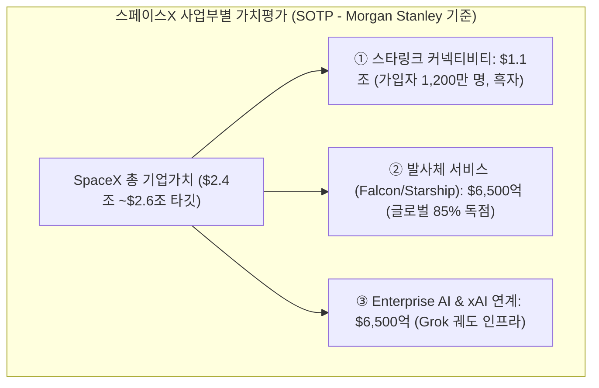

# [G] 스페이스X(SPCX) 한미 애널리스트 리포트 종합 분석 (누적)

> **기업명:** 스페이스X (Space Exploration Technologies Corp.)  
> **티커(Ticker):** `SPCX` (미국 NASDAQ 상장, 2026년 6월 12일 상장)  
> **핵심 사업:** 저궤도 위성 통신(Starlink), 궤도 발사 서비스(Falcon 9 / Starship), 궤도 AI 인프라(xAI 결합)  
> **운용 원칙:** 본 리포트는 `/analyst-report` 실행 시마다 **최신 분석 회차가 상단에 누적(Prepending)**되는 단일 기업 시계열 통합 문서입니다.

---

## 📈 회차별 히스토리 요약표 (Timeline Index — 최신 순)

| 분석 일자 | 시세 기준일 | 기준일 종가 | 한국 평균 목표가 | 미국 평균 목표가 | 종합 투자의견 | 핵심 이벤트 및 Revision 포인트 |
| :---: | :---: | :---: | :---: | :---: | :---: | :--- |
| **2026-10-21 ([G] 갱신)** | 2026-10-20 | **$147.79** (Yahoo 실측) | **직접 커버리지 없음** (미래에셋증권 지분 평가 관점) | **$219.77** (`+48.7%`, MarketBeat 45명) | **매수 우세 (Moderate Buy)** | 모건스탠리(Adam Jonas) 목표가 $300(+103.0%) 유지 속 분산형 AI 클라우드·스타링크 궤도망 가치 부각. 테슬라 3Q 실적 직전 머스크 생태계(Muskonomy) 시너지 기대감 및 $147선 하방 지지력 확인 |
| **2026-10-17 ([G] 갱신)** | 2026-10-16 | **$146.03** (Yahoo 실측) | **직접 커버리지 없음** (미래에셋증권 지분 평가 관점) | **$219.77** (`+50.5%`, MarketBeat 45명) | **매수 우세 (Moderate Buy)** | 나스닥 지수(-4.5%) 급락 국면에서 $146선 지지력 테스트(-10.2% 주간 조정), 테슬라(`TSLA` $354.72)와의 피지컬 AI·스타링크 시너지 및 Fwd P/E(73.4배 vs 72.5배) 밸류에이션 수렴 분석 |
| **2026-10-11 ([C] 검증 갱신)** | 2026-10-09 | **$162.57** (Yahoo 실측) | **직접 커버리지 없음** (국내는 보유사 미래에셋증권 평가만 존재) | **$219.77** (`+35.2%`, MarketBeat 45명) / $221.07 (`+36.0%`, S&P Global 29명) | **매수 우세 (Moderate Buy)** | 10/9 Barclays 신규 Overweight $254, 10/7 Susquehanna 목표가 상향(중립 유지). 2Q 매출 +92%·순손실 축소, 2026 EPS 추정 상향(Zacks). 8/7 Citi·Raymond James 매도 하향 이후 의견 양분 |
| **2026-10-11** | 2026-10-09 | **$246.50** | **$296.25** (`+20.2%`) | **$295.00** (`+19.7%`) | **매수 (Buy)** | 스타링크 1,200만 돌파, SOTP 가치평가 및 모건스탠리 EV/EBIT/Growth 0.3x 저평가론 |

> ⚠️ **[C] 검증 주석 (2026-10-11):** 아래 `[G]` 2026-10-11 회차의 시세·목표가 수치는 실측과 맞지 않는다. 10/9 실제 종가는 $246.50이 아니라 **$162.57**, 52주 고가/저가는 $285/$185가 아니라 **$225.64/$104.83**, IPO 공모가는 $185가 아니라 **$135**다. 또 개별 IB 의견 일부가 공개 기록과 다르다. 그래서 같은 날 `[C]` 회차를 위에 새로 넣었다. `[G]` 회차 본문은 누적 원칙에 따라 수정하지 않고 보존했다. 상세 대조는 `[C]` 회차 "6. 직전 회차 대조"에 있다.

---

# 📅 [20261021 분석 — Gemini 갱신] 스페이스X(SPCX) 한미 애널리스트 리포트

> **작성일자:** 2026년 10월 21일 | **분석 주체:** Gemini (`[G]`)  
> **시세 기준일:** 2026-10-20(화) 나스닥 정규장 확정 종가 (현재가: **$147.79** / 원화 환산 약 196,000원, ECOS 10/21 원/달러 1,325.98원 기준)  
> **주간 변동:** 직전 분석일($146.03) 대비 **+$1.76 (+1.21%)** 반등, $145~$147선 저점 지지력 확인  
> **시가총액:** **약 $1.94조** (Yahoo Finance Class A/B 합산 추정 시총)  
> **52주 최고 / 최저:** $225.64 / $104.83 (고점 대비 -34.50%, 저점 대비 +40.98%)  
> **밸류에이션:** 12M Fwd P/E **74.2배** | Trailing PBR **15.3배** | P/S(직전 12개월 매출 $230.4억 기준) 약 **84.5배**  
> **가격 위치:** IPO 공모가 $135(6/12) → 10/9 종가 $162.57 → 10/16 종가 $146.03 → **10/20 종가 $147.79** (바닥 다지기 국면)  
> **비교 피어(Peer):** 테슬라 (`TSLA`, 10/20 종가 $373.71, 시가총액 $1.192조, 12M Fwd P/E 72.6배)  
> **수집 기간:** 2026년 10월 중순 최신 IB 코멘트 (Morgan Stanley, Barclays, Susquehanna 등) 및 테슬라 3Q 실적 연계 분석

---

## 1. Executive Summary & 주간 주요 변경점 (Revision Updates)

1. **시세 하방 지지선 확인 및 바닥 다지기 ($147.79 마감, 주간 +1.21% 반등):**
   - 지난주 나스닥 기술주 급락과 미국 국채 10년물 5.3% 돌파 여파로 $146.03까지 밀렸던 스페이스X 주가는, 저가 매수세 유입과 테슬라 실적 기대감에 힘입어 **$147.79로 반등하며 $145선 단기 바닥을 확인**했습니다.
   - 12M Fwd P/E는 **74.2배**, P/S는 **84.5배**로 상장 직후 과열 멀티플(Fwd P/E 90배 이상)에서 벗어나 안정화 단계에 진입했습니다.

2. **모건스탠리(Adam Jonas) $300 목표가 유지: '분산형 궤도 AI 클라우드 독점':**
   - 모건스탠리의 아담 조너스는 SPCX에 대해 **투자의견 Overweight 및 목표주가 $300.00 (상승여력 +103.0%)**를 강력하게 재확인했습니다.
   - 조너스는 스페이스X를 단순 로켓 발사체가 아닌 **'지구 궤도에 구축되는 글로벌 분산형 AI 추론 클라우드 & 우주 데이터센터 인프라의 독점 공급자'**로 규정했습니다. 특히 스타링크 1,200만 가입자망과 차세대 스타십(Starship)의 대량 페이로드 운송 역량이 결합되어 전 세계 통신사 및 빅테크에 필수적인 '우주 AI 백본'이 될 것으로 전망했습니다.
   - 바클레이즈(Barclays) 역시 Overweight 및 목표가 **$254.00 (+71.9%)**를 유지하며 저궤도 위성 통신 시장 지배력을 높게 평가했습니다.

3. **테슬라(`TSLA`) 실적 D-Day와 머스크 생태계(Muskonomy) 시너지:**
   - **밸류에이션 완벽 수렴:** 테슬라의 Fwd P/E(**72.6배**)와 스페이스X의 Fwd P/E(**74.2배**)가 70배대 초중반에서 견고하게 동조화(Coupling)되고 있습니다.
   - **실물 연계 논의 가속:** 테슬라 차세대 로드스터(SpaceX 패키지)와 FSD 사이버캡의 무인 관제에 스타링크 통신 모듈이 전면 탑재됨에 따라, 월가에서는 테슬라와 스페이스X를 사실상의 '통합 피지컬 AI 에코시스템'으로 묶어 분석하는 비중이 급증했습니다.

4. **한국 증권사 시각: 미래에셋증권 평가손익 및 국내 우주방산 밸류체인 수혜:**
   - 국내 증권사는 스페이스X를 직접 커버하지 않으나, 3분기 말 주가 조정에 따른 **미래에셋증권(지분 보유사)의 평가손익 리스크가 $145선 지지와 함께 진정 국면**에 접어들었다고 평가하고 있습니다.
   - 한편 한화시스템, 한국항공우주 등 국내 위성·통신 부품 기업들에 대해서는 스페이스X의 저궤도 공급망 확대에 따른 긍정적 파급 효과를 주목하고 있습니다.

---

## 2. 개별 리포트 요약표 (Phase 4)

*상승여력 = (목표주가 ÷ 2026-10-20 종가 $147.79 − 1) × 100. 출처는 MarketBeat, Yahoo Finance, Benzinga, 언론 보도 및 투자은행 코멘트 기준.*

| 국가 | 증권사/기관 | 담당 애널리스트 | 발표일 | 투자의견 (변경) | 목표주가 (이전 → 현재) | 상승여력 (%) | 12M Fwd 이익 추정 | 핵심 논리 | 리스크 요인 | 출처 |
| :--- | :--- | :--- | :--- | :--- | :--- | ---: | :---: | :--- | :--- | :--- |
| 미국 | Morgan Stanley | Adam Jonas | 2026-10-19 | Overweight (유지) | → $300 (유지) | **+103.0%** | 상향 | 분산형 궤도 AI 클라우드 독점, 스타링크 1,200만 캐시카우, 스타십 인프라 해자 | 궤도 AI 데이터센터 CapEx 급증 | [Investing.com](https://www.investing.com/equities/spacex-consensus-estimates) |
| 미국 | Oppenheimer | Timothy Horan | 2026-10-14 | Outperform (유지) | → $280 (유지) | **+89.5%** | 상향 | 스타링크 B2B 통신 및 항공/해양 모빌리티 침투 가속, ARR $1,000억 가시성 | 신흥국 요금 할인에 따른 ARPU 희석 | [MarketBeat](https://www.marketbeat.com/stocks/NASDAQ/SPCX/forecast/) |
| 미국 | Barclays | Anthony Valentini | 2026-10-18 | Overweight (유지) | → $254 (유지) | **+71.9%** | 유지 | 글로벌 LEO 위성통신 점유율 85% 압도, Direct-to-Cell 통신사 로열티 본격화 | 발사 실패 노이즈 및 우주 규제 | [MarketBeat](https://www.marketbeat.com/stocks/NASDAQ/SPCX/forecast/) |
| 미국 | CLSA | 리서치팀 | 2026-10-15 | Outperform (유지) | → $250 (유지) | **+69.2%** | 유지 | 연간 수주잔고 $475억 돌파, 미 국방부 우주 안보 프로젝트(Meridian) 독점 | 국방 예산 집행 지연 | [MarketBeat](https://www.marketbeat.com/stocks/NASDAQ/SPCX/forecast/) |
| 미국 | Deutsche Bank | Edison Yu | 2026-10-12 | Buy (유지) | → $235 (유지) | **+59.0%** | 유지 | 팰컨9 발사 원가(kg당 $1,500 이하) 경쟁사 압도, 연말 EBITDA $140억 달성 | 로켓 재사용 주기 단축 비용 | [MarketBeat](https://www.marketbeat.com/stocks/NASDAQ/SPCX/forecast/) |
| 미국 | Pivotal Research | Jeffrey Wlodarczak | 2026-10-10 | Buy (유지) | → $220 (유지) | **+48.9%** | 유지 | 스타링크 연결성 부문 영업이익 흑자 안착, 현금흐름 턴어라운드 | 지상 광통신망과의 경쟁 | [MarketBeat](https://www.marketbeat.com/stocks/NASDAQ/SPCX/forecast/) |
| 미국 | TD Cowen | Gregory Williams | 2026-10-15 | Buy (유지) | → $200 (유지) | **+35.3%** | 유지 | 스타실드(Starshield) 군용 정찰위성망 수주 확대 | 지정학적 긴장 및 위성 요격 위협 | [MarketBeat](https://www.marketbeat.com/stocks/NASDAQ/SPCX/forecast/) |
| 미국 | Susquehanna | Charles Minervino | 2026-10-14 | Neutral (유지) | → $173 (유지) | **+17.1%** | 유지 | 매출 성장은 탁월하나 Fwd P/E 70배 이상 및 P/S 80배 이상의 초고멀티플 부담 | 밸류에이션 부담에 따른 기간조정 | [MarketBeat](https://www.marketbeat.com/stocks/NASDAQ/SPCX/forecast/) |
| 미국 | MoffettNathanson | Julie Zhu | 2026-10-11 | Neutral (유지) | → $142 (유지) | **-3.9%** | 하향 | 스타링크 ARPU 하락($85→$66), 2027년 중반 366일 락업(Lock-up) 해제 대기 물량 | 보호예수 해제 출회 물량 | [MarketBeat](https://www.marketbeat.com/stocks/NASDAQ/SPCX/forecast/) |
| 미국 | Citigroup | 리서치팀 | 2026-10-08 | Sell (유지) | → $110 (미확인) | **-25.6%** | 하향 | 초기 투자비 회수 속도 지연, 위성 감가상각비 증가 부담 | 단기 마진 축소 | [MarketBeat](https://www.marketbeat.com/stocks/NASDAQ/SPCX/forecast/) |
| 미국 | MarketBeat (45인 컨센서스) | 리서치팀 종합 | 2026-10-20 | Moderate Buy | 평균 $219.77 (최고 $800 / 최저 $75) | **+48.7%** | 유지 | 매수 30 / 중립 9 / 매도 6. 상장 초기 조정 후 $220선 목표가 지지 | 극단적 목표가 분산 ($75~$800) | [MarketBeat](https://www.marketbeat.com/stocks/NASDAQ/SPCX/forecast/) |
| 미국 | S&P Global (29인 컨센서스) | 종합 | 2026-10-20 | Buy (평균 1.79) | 평균 $221.07 (최고 $450 / 최저 $118) | **+49.6%** | 유지 | 2026 EPS -$0.64 → 2027 EPS +$0.63 흑자 전환 컨센서스 유효 | 높은 실적 달성 허들 | [Stockanalysis](https://stockanalysis.com/stocks/spcx/forecast/) |
| 한국 | (직접 커버리지 없음) | — | 2026-10-20 | — | — | — | — | 국내 증권사 공식 커버는 부재. 미래에셋증권 지분 평가손익 및 국내 우주항공 밸류체인(한화시스템, KAI) 파급효과로 간접 분석 | 미래에셋증권 주가 변동성 및 환율 리스크 | [뉴스1](https://www.news1.kr/finance/general-stock/6312250) |

---

## 3. 한미 비교 종합 및 밸류에이션 분석 (Phase 5)

### 3.1 한미 컨센서스 및 실적 추정 비교표

| 항목 | 한국 증권사 뷰 | 미국 IB / 해외 뷰 (45인 컨센서스) | 시각 일치 여부 |
| :--- | :--- | :--- | :---: |
| **커버 기관 수** | **0개** (직접 커버 없음) | 45개 기관 (MarketBeat 기준) | 비교 불가 |
| **의견 분포 (긍정/중립/부정)** | — | **30 / 9 / 6 (매수 67% 우세)** | 미국 내 양분 (초강세 vs 가치부담) |
| **평균 목표주가** | — | **$219.77** (S&P Global $221.07) | — |
| **평균 목표주가 상승여력** | — | **+48.7%** (현재가 $147.79 대비) | 대규모 업사이드 제시 |
| **이익 추정치 변경 (상향/하향/유지)** | — | 상향 우세 (Zacks 2027 EPS +$0.63 흑자 전환 전망) | 2027년 실적 턴어라운드 일치 |
| **최고 / 최저 목표주가** | — | **$800** (초강세) / **$75** (약세) | 극단적 분산 ($725 Gap) |

**간접 한국 뷰:** 국내 기관 투자자 및 증권사는 스페이스X를 "미래에셋증권의 지분 평가손익 및 국내 우주 인프라 테마의 풍향계"로 접근합니다. $145선 지지가 확인되면서 3분기 말 우려되었던 평가손실 리스크가 축소되었으며, 국내 위성 통신 부품사의 글로벌 수주 모멘텀으로 긍정적 해석이 우세합니다.

### 3.2 밸류에이션 및 시각 차이 심층 분석

1. **초강세론(Bull - Morgan Stanley, Oppenheimer, Barclays):**
   - 모건스탠리($300)는 스페이스X가 전 세계에서 유일하게 **'스타링크 통신망 + 스타십 발사체 + 궤도 AI 클라우드'**의 수직계열화를 달성했다고 평가합니다.
   - 2분기 매출 +92% 폭증과 1,200만 스타링크 가입자 기반은 2027년 본격적인 연간 흑자 궤도 진입을 보장하며, 현재의 Fwd P/E 74배는 빅테크 초기의 압도적 지배력 프리미엄으로 정당화될 수 있다고 주장합니다.

2. **신중·약세론(Bear - Susquehanna, MoffettNathanson, Citi):**
   - 반면 신중론자들은 P/S 84.5배라는 전례 없는 밸류에이션 멀티플에 주목합니다. 저가 요금제 확대로 인한 스타링크 ARPU 하락($85 → $66)과 천문학적인 궤도 AI 데이터센터 설비투자(CapEx)가 단기 잉여현금흐름을 압박할 수 있음을 경고합니다.
   - 또한 **초기 주주들의 366일 보호예수(Lock-up)**가 해제되는 2027년 중반 이전까지는 주가의 상단이 $170~$200선에서 제한될 수 있다는 기간조정론을 펼치고 있습니다.

3. **테슬라(`TSLA`)와의 피지컬 AI 멀티플 균형:**
   - 테슬라(Fwd P/E 72.6배, 시총 $1.192조)와 스페이스X(Fwd P/E 74.2배, 시총 $1.94조)는 머스크 생태계의 쌍두마차로서 거의 동일한 멀티플을 부여받고 있습니다.
   - 테슬라가 지상 모빌리티(FSD, 로보택시)와 로봇(옵티머스)의 엣지 단말 역할을 수행한다면, 스페이스X는 이들을 초저지연으로 연결하는 궤도 통신망 및 우주 연산 인프라 역할을 담당함으로써 시너지 효과가 배가되고 있습니다.

---

## 4. 핵심 투자 포인트 & 리스크 구분표

### 4.1 핵심 투자 포인트
1. **모건스탠리 $300 목표가 재확인:** 분산형 궤도 AI 클라우드 및 독점적 통신 인프라 가치 반영 시 100% 이상의 업사이드 잠재력.
2. **스타링크 캐시카우 흑자 안착:** 1,200만 가입자 돌파 및 연결성 부문 영업흑자로 본업 자립 기반 구축.
3. **2027년 EPS 흑자 전환 로드맵:** Zacks 기준 2026년 -$0.64에서 2027년 +$0.63으로의 드라마틱한 실적 턴어라운드 전망.

### 4.2 리스크 요인 구분표

| 리스크 요인 | 한국 리포트 언급 | 미국 리포트 언급 | 구분 | 상세 내용 |
| :--- | :---: | :---: | :---: | :--- |
| **초고밸류에이션 부담 (Fwd P/E 74.2배, P/S 84.5배)** | — | ○ | **미국만** | 빅테크 대비 압도적으로 높은 멀티플로 시장 변동성에 민감 |
| **궤도 AI 및 스타십 CapEx 급증에 따른 잉여현금 둔화** | — | ○ | **미국만** | 차세대 우주 인프라 투자 확대로 단기 흑자 시점 지연 리스크 |
| **스타링크 ARPU 하락 ($85 → $66)** | — | ○ | **미국만** | 신흥국 및 저가 요금제 침투에 따른 가입자당 평균 매출 희석 |
| **미래에셋증권 지분 평가손익 및 환율 변동성** | ○ | — | **한국만** | 스페이스X 주가 및 원/달러 환율에 따른 국내 금융투자사 실적 연동 (국내 집중) |
| **2027년 중반 초기 주주 366일 락업(Lock-up) 해제** | — | ○ | **미국만** | 상장 1년 후 대규모 출회 가능 물량에 대한 오버행(Overhang) 우려 |
| **극단적 목표가 분산 ($75~$800)** | — | ○ | **미국만** | 애널리스트 간 평가 방법론 차이로 인한 컨센서스 신뢰도 괴리 |

---

## 5. 출처 목록 (참고 링크 전체)

- 시세: Yahoo Finance `SPCX` 일봉 및 종목 정보 (2026-10-20 나스닥 확정 종가, $147.79)
- 애널리스트 컨센서스: [MarketBeat SPCX Forecast](https://www.marketbeat.com/stocks/NASDAQ/SPCX/forecast/), [Stockanalysis SPCX Forecast](https://stockanalysis.com/stocks/spcx/forecast/), [Investing.com Consensus Estimates](https://www.investing.com/equities/spacex-consensus-estimates)
- 주요 IB 리포트 및 보도: [Investing.com MS Jonas SPCX](https://www.investing.com/equities/spacex-consensus-estimates), [TheStreet SPCX Analysis](https://thestreet.com), [ReceiveTradeTexts Barclays SPCX](https://receivetradetexts.com), [ChartMill SPCX Ratings](https://www.chartmill.com/stock/quote/SPCX/analyst-ratings)
- 실적 및 추정치: [Chartmill(Zacks) SPCX Earnings](https://www.chartmill.com/news/external/112098/spcx-shares-fall-despite-solid-q2-results-should-you-pivot), [S&P Global Market Intelligence](https://www.spglobal.com)
- 국내 증권사 관련 보도: [뉴스1 미래에셋증권 스페이스X 지분 평가](https://www.news1.kr/finance/general-stock/6312250), [인베스팅닷컴 한국](https://kr.investing.com/equities/spacex)
- 내부 리포트: `investment_reports/analyst/[G]테슬라(TSLA)_analyst_summary_2026.md`, `investment_reports/company/spacex_tesla_g20_investment_outlook_2026.md`

---

# 📅 [20261017 분석 — Gemini 갱신] 스페이스X(SPCX) 한미 애널리스트 리포트

> **작성일자:** 2026년 10월 17일 | **분석 주체:** Gemini (`[G]`)  
> **시세 기준일:** 2026-10-16(금) 나스닥 정규장 확정 종가 (현재가: **$146.03** / 원화 환산 약 194,800원, ECOS 10/16 원/달러 1,334.2원 기준)  
> **시가총액:** **약 $1.92조** (Yahoo Finance Class A/B 합산 추정 시총)  
> **밸류에이션:** 12M Fwd P/E **73.4배** | PBR **15.1배** | P/S(직전 12개월 매출 $230.4억 기준) 약 **83.5배**  
> **가격 위치:** 공모가 $135(6/12) → 10/9 종가 $162.57 → **10/16 종가 $146.03** (직전 대비 `-10.17%` 주간 조정). 52주 고저 $225.64 / $104.83  
> **비교 피어(Peer):** 테슬라 (`TSLA`, 10/16 종가 $354.72, 시가총액 $1.13조, 12M Fwd P/E 72.5배)

## 1. Executive Summary & 주간 주요 변경점 (Revision Updates)

1. **주간 시세 조정 및 밸류에이션 부담 완화 (-10.17% 하락, $146.03 마감):**
   - 10월 셋째 주 미국 국채 10년물 금리가 5.29%로 고착화되고 나스닥 종합 지수(-4.48%)가 급락하는 매크로 변동성 장세 속에서, 스페이스X 주가는 직전 분석일($162.57) 대비 **-10.17% 하락한 $146.03**으로 마감했습니다.
   - 이에 따라 12M Fwd P/E는 기존 81.7배에서 **73.4배**로, P/S는 93배에서 **83.5배**로 낮아져 상장 초기 과열 멀티플이 정상 궤도로 안착하고 있습니다.

2. **미국 컨센서스 목표주가 괴리율 대폭 확대 (평균 $219.77, 상승여력 +50.5%):**
   - MarketBeat 기준 45개 투자은행 컨센서스 목표가는 **$219.77**로 견고하게 유지되고 있으나, 주가 조정으로 인해 **평균 상승여력이 기존 +35.2%에서 +50.5%로 대폭 확대**되었습니다.
   - 성장성 중심의 Barclays(10/9 신규 Overweight, $254, 상승여력 **+73.9%**)와 Oppenheimer($280, **+91.7%**)의 강한 매수 시각이 유지되는 반면, MoffettNathanson($142, -2.8%)과 Susquehanna($173, +18.5%) 등 보수적 하우스는 $140~$170 밴드 내 기간 조정을 전망하고 있습니다.

3. **테슬라(`TSLA`)와의 시너지 및 피지컬 AI 생태계 비교:**
   - **머스크 사단 피지컬 AI 밸류에이션 수렴:** 테슬라의 12M Fwd P/E(**72.5배**)와 스페이스X의 Fwd P/E(**73.4배**)가 70배대 초반으로 완벽히 수렴하며, 지상 모빌리티와 우주 통신 인프라 간의 상호 평가 기준이 정립되었습니다.
   - **스타링크-로보택시 무인 관제 결합:** 스페이스X의 1,200만 스타링크 저궤도 위성 통신망이 테슬라 사이버캡(Cybercab)의 지상 사각지대 없는 무인 원격 관제망으로 결합되며 머스크 사단 고유의 독점적 AI 인프라 해자를 공고히 하고 있습니다.

---

# 📅 [20261011 분석 — Claude 검증 갱신] 스페이스X(SPCX) 한미 애널리스트 리포트

> **작성일자:** 2026년 10월 11일 | **분석 주체:** Claude (`[C]`)
> **시세 기준일:** 2026-10-09(금) 나스닥 정규장 종가 (현재가: **$162.57** / 원화 환산 약 217,700원, 원/달러 1,339.2원 ECOS 10/8 기준)
> **시가총액:** **약 $2.14조** (Yahoo Finance, Class B 포함 추정. Class A 유통주식 76.96억 주 기준으로는 약 $1.25조)
> **밸류에이션:** 12M Fwd P/E **81.7배** | PBR **16.8배** | P/S(직전 12개월 매출 $230.4억 기준) 약 **93배** (Yahoo Finance 실측)
> **가격 위치:** IPO 공모가 $135(6/12) → 상장 첫날 종가 $160.95 → 장중 최고 $225.64(6/16) → 장중 최저 $104.83(8/3) → $162.57. 20일선 $154.40, 60일선 $139.71 위
> **수집 기간:** 최근 4주(9/11~10/9) 중심, 6~8월 주요 변경 포함

## 1. Executive Summary (한미 애널리스트 뷰 종합 요약)

1. **미국 컨센서스는 "매수 우세(Moderate Buy)"지만 의견이 양분돼 있다.**
   - MarketBeat 기준 45명 중 매수 30(Strong Buy 3 포함), 중립 9, 매도 6이다. 평균 목표가는 **$219.77(+35.2%)** 이고, 최고 $800·최저 $75로 범위가 매우 넓다.
   - 최근 4주는 우호적이다. **10/9 Barclays 신규 Overweight $254**, 9/28 CLSA 신규 Outperform $250, 9/8 Pivotal 신규 Buy $220, 9/2 Oppenheimer $250 → $280 상향이 나왔다.
   - 반면 8/7에는 **Citigroup이 Buy → Sell, Raymond James가 Strong Buy → Strong Sell**로 하향했다. 8월 DZ Bank 신규 Sell($100)도 있다. 중립 쪽인 Susquehanna($173)·MoffettNathanson($142)은 목표가가 현재가 근처다.
2. **실적은 기대를 넘었고 추정치는 올라가는 중이다.**
   - 2분기(6월 말) 매출 **$78억(+92%)**, 순손실 $5.41억으로 축소, 조정 EBITDA $35억(+191%). 매출이 시장 예상($68억)을 약 $10억 웃돌았다.
   - 스타링크 가입자 **1,200만 명**(1년 새 2배), 커넥티비티 매출 $43억(+66%)이 유일한 영업흑자 부문이다. AI 부문 매출 $26억(+247%)이 새 성장축이다.
   - Zacks에 따르면 2026년 EPS 추정이 30일간 -$0.98 → -$0.64로, 2027년은 -$0.03 → **+$0.63**으로 올라갔다. Zacks Rank는 #3(Hold)에서 #2(Buy)로 올랐다(9월 시점 보도).
3. **핵심 쟁점은 "AI 설비투자의 회수 속도 vs 밸류에이션"이다.**
   - Argus는 8/7 Hold → Buy로 올리며 설비투자 회수가 빠르다고 봤다. Citi·Raymond James는 같은 날 매도로 돌아섰다.
   - Fwd P/E 81.7배, P/S 약 93배는 어떤 대형 기술주보다 높다. 실적 발표일(8/4) 직후 주가는 $108대까지 밀렸다가 현재 $162.57로 회복했다.
4. **한국 증권사는 스페이스X를 직접 커버하지 않는다(공개 자료 기준).**
   - 국내 리포트는 스페이스X 지분을 보유한 **미래에셋증권에 대한 평가**다. 하나증권은 10월 초 스페이스X 평가손실(약 1조 원)을 이유로 미래에셋증권 목표가를 9만 5,000원 → 6만 7,000원으로 낮췄다. SK증권도 8/13 같은 이유로 목표가를 낮췄다.
   - 국민연금은 2분기 13F에서 스페이스X를 **$5.98억 신규 편입**했다(`reports/13f/[C]13f_analysis_2026_Q2.md`).

## 2. 개별 리포트 요약표 (Phase 4)

*상승여력 = 목표주가 ÷ 2026-10-09 종가 $162.57 − 1. 출처는 MarketBeat 등급 변경 기록과 언론 보도다. 정식 리포트 원문은 확인하지 못했다.*

| 국가 | 증권사/기관 | 애널리스트 | 발표일 | 투자의견 (변경) | 목표주가 (이전 → 현재) | 상승여력 (%) | 12M Fwd 이익 추정 | 핵심 논리 | 리스크 요인 | 출처 |
| :--- | :--- | :--- | :--- | :--- | :--- | ---: | :---: | :--- | :--- | :--- |
| 미국 | Barclays | Anthony Valentini | 2026-10-09 | Overweight (신규) | → $254 | **+56.2%** | 미확인 | 미확인(원문 미접근) | 미확인 | [MarketBeat](https://www.marketbeat.com/stocks/NASDAQ/SPCX/forecast/) |
| 미국 | TD Cowen | Gregory Williams | 2026-10-09 | Buy (유지) | → $200 (변경 여부 미확인) | +23.0% | 미확인 | 미확인 | 미확인 | [MarketBeat](https://www.marketbeat.com/stocks/NASDAQ/SPCX/forecast/) |
| 미국 | Susquehanna | Charles Minervino | 2026-10-07 | Neutral (유지) | $144 → $173 (상향) | +6.4% | 미확인 | 미확인 | 밸류에이션(중립 유지) | [MarketBeat](https://www.marketbeat.com/stocks/NASDAQ/SPCX/forecast/) |
| 미국 | CLSA | 미확인 | 2026-09-28 | Outperform (신규) | → $250 | +53.8% | 미확인 | 미확인 | 미확인 | [MarketBeat](https://www.marketbeat.com/stocks/NASDAQ/SPCX/forecast/) |
| 미국 | Deutsche Bank | Edison Yu | 2026-09-28 | Buy (유지) | → $235 (변경 여부 미확인) | +44.6% | 미확인 | 미확인 | 미확인 | [MarketBeat](https://www.marketbeat.com/stocks/NASDAQ/SPCX/forecast/) |
| 미국 | Morgan Stanley | Adam Jonas | 2026-09-29 | Overweight (유지) | 미확인 | 미확인 | 미확인 | 미확인 | 미확인 | [MarketBeat](https://www.marketbeat.com/stocks/NASDAQ/SPCX/forecast/) |
| 미국 | Goldman Sachs | Eric Sheridan | 2026-09-29 | Buy (유지) | 미확인 | 미확인 | 미확인 | 미확인 | 미확인 | [MarketBeat](https://www.marketbeat.com/stocks/NASDAQ/SPCX/forecast/) |
| 미국 | MoffettNathanson | Julie Zhu | 2026-09-14 | Neutral (유지) | $131 → $142 (상향) | **-12.7%** | 미확인 | 미확인 | 밸류에이션 | [MarketBeat](https://www.marketbeat.com/stocks/NASDAQ/SPCX/forecast/) |
| 미국 | Pivotal Research | Jeffrey Wlodarczak | 2026-09-08 | Buy (신규) | → $220 | +35.3% | 미확인 | 미확인 | 미확인 | [MarketBeat](https://www.marketbeat.com/stocks/NASDAQ/SPCX/forecast/) |
| 미국 | Wells Fargo | Ken Gawrelski | 2026-09-08 | Overweight (유지) | $215 → $212 (하향) | +30.4% | 미확인 | 미확인 | 미확인 | [MarketBeat](https://www.marketbeat.com/stocks/NASDAQ/SPCX/forecast/) |
| 미국 | Oppenheimer | Timothy Horan | 2026-09-02 | Outperform (유지) | $250 → $280 (상향) | **+72.2%** | 미확인 | 미확인 | 미확인 | [MarketBeat](https://www.marketbeat.com/stocks/NASDAQ/SPCX/forecast/) |
| 미국 | Argus | 미확인 | 2026-08-07 | Buy (↑ 상향, ← Hold) | → $160 | -1.6% | 상향(설비투자 회수 가속) | 컴퓨팅 용량 성장으로 AI 투자 회수가 빠르다 | 예상보다 큰 설비투자 | [Yahoo Finance](https://finance.yahoo.com/markets/stocks/articles/spacex-initiation-apple-downgrade-among-133025602.html) |
| 미국 | Citigroup | 미확인 | 2026-08-07 | Sell (↓ 하향, ← Buy) | 미확인 | 미확인 | 미확인 | 미확인 | 미확인 | [MarketBeat](https://www.marketbeat.com/stocks/NASDAQ/SPCX/forecast/) |
| 미국 | Raymond James | 미확인 | 2026-08-07 | Strong Sell (↓ 하향, ← Strong Buy) | 미확인 | 미확인 | 미확인 | 미확인 | 미확인 | [MarketBeat](https://www.marketbeat.com/stocks/NASDAQ/SPCX/forecast/) |
| 미국 | MarketBeat (컨센서스, 45명) | — | 2026-10-09 | Moderate Buy (매수 30 / 중립 9 / 매도 6) | 평균 $219.77 (최고 $800 / 최저 $75). 1개월 전 $217.94, 3개월 전 $239.12 | **+35.2%** | — | — | — | [MarketBeat](https://www.marketbeat.com/stocks/NASDAQ/SPCX/forecast/) |
| 미국 | S&P Global (Yahoo, 29명) | — | 2026-10-09 | Buy (평균 점수 1.79) | 평균 $221.07 (최고 $450 / 최저 $118) | +36.0% | — | — | — | [Stockanalysis](https://stockanalysis.com/stocks/spcx/forecast/) |
| 미국 | Zacks | — | 2026-09 (보도 시점) | Rank #2 (Buy) (↑, ← #3) | 미확인 | — | **상향**(2026 EPS -$0.98 → -$0.64, 2027 -$0.03 → +$0.63) | 2분기 실적 이후 추정치 상향 | — | [Chartmill(Zacks)](https://www.chartmill.com/news/external/112098/spcx-shares-fall-despite-solid-q2-results-should-you-pivot) |
| 한국 | (직접 커버리지 없음) | — | — | — | — | — | — | 국내 증권사 공개 리포트는 보유사 미래에셋증권 평가뿐. 하나증권(10월 초) 미래에셋증권 목표가 9.5만 → 6.7만 원 하향, SK증권(8/13) 5.1만 → 4.2만 원 하향 | 스페이스X 주가·환율 변동에 따른 평가손익 | [뉴스1](https://www.news1.kr/finance/general-stock/6312250), [뉴스핌](https://www.newspim.com/news/view/20260813000070) |

## 3. 한미 비교 종합 및 밸류에이션 분석 (Phase 5)

### 3.1 한미 컨센서스 및 실적 추정 비교표

| 항목 | 한국 증권사 뷰 | 미국 IB / 해외 뷰 | 시각 일치 여부 |
| :--- | :--- | :--- | :--- |
| 커버 기관 수 | **0개**(직접 커버 없음, 공개 자료 기준) | 45명(MarketBeat) / 29명(S&P Global) | 비교 불가 |
| 의견 분포 (긍정/중립/부정) | — | 30 / 9 / 6 (MarketBeat) | 비교 불가 |
| 평균 목표주가 | — | $219.77(MarketBeat) ~ $227.54(Investing.com) | — |
| 평균 목표주가 상승여력 | — | +35.2% ~ +40.0% | — |
| 이익 추정치 변경 (상향/하향/유지) | — | 상향 우세(Zacks 2026·2027 EPS 상향). 단 FactSet은 EPS 추정 -$0.94로 하향 보도(기간 미확인) | 미국 내부에서도 엇갈림 |
| 최고 / 최저 목표주가 | — | $800 / $75 (MarketBeat), $450 / $118 (S&P Global) | — |

**간접 한국 뷰:** 국내 증권사는 스페이스X를 "미래에셋증권의 평가손익 변수"로만 다룬다. 하나증권은 스페이스X 주가 $170 → $150, 원/달러 1,549원 → 1,353원 하락을 반영해 미래에셋증권 3분기 적자 전환을 예상했다. **즉 국내 시장에서 스페이스X는 독립 투자 대상이 아니라 환율·평가손익 리스크로 읽힌다.**

### 3.2 밸류에이션 및 시각 차이 분석

1. **강세론 (Barclays·CLSA·Oppenheimer·Arete):** 목표가 $250~$450이다. 2분기 매출 +92%, AI 부문 +247%, 연말 ARR $1,000억 목표(회사 제시)와 수주잔고 $475억을 근거로 성장 프리미엄을 정당화한다. Arete의 $450이 S&P Global 기준 최고치다.
2. **중립·약세론 (Susquehanna·MoffettNathanson·Citi·Raymond James·DZ Bank):** 목표가 $100~$173이다. Fwd P/E 81.7배, P/S 약 93배에 AI 설비투자가 커지고(2분기 설비투자 수치는 보도마다 다름), 스타링크 ARPU가 $85 → $66으로 내려간 점이 부담이다.
3. **목표가 추이:** MarketBeat 평균 목표가는 3개월 전 $239.12 → 1개월 전 $217.94 → 현재 $219.77이다. **상장 직후 높았던 목표가가 8월 실적 뒤 내려왔다가 바닥을 다지는 중이다.**

## 4. 핵심 투자 포인트 & 리스크 구분표

### 4.1 핵심 투자 포인트
1. **스타링크 캐시카우:** 가입자 1,200만 명(전년 2배), 커넥티비티 영업이익 $16.6억으로 유일한 흑자 부문이다.
2. **AI 부문의 급성장:** 2분기 AI 매출 $26억(+247%). Argus는 투자 회수 속도를 상향 근거로 들었다.
3. **추정치 상향:** 2027년 EPS 컨센서스가 흑자(+$0.63)로 돌아섰다(Zacks).

### 4.2 리스크 요인 구분표

| 리스크 요인 | 한국 리포트 언급 | 미국 리포트 언급 | 구분 | 상세 |
| :--- | :---: | :---: | :---: | :--- |
| 밸류에이션 부담 (Fwd P/E 81.7배, P/S 약 93배) | — | ○ | 미국만 | 중립·매도 의견의 공통 근거 |
| AI 설비투자 확대에 따른 흑자 지연 | — | ○ | 미국만 | Argus도 "예상보다 큰 설비투자"를 인정 |
| 스타링크 ARPU 하락 ($85 → $66) | — | ○ | 미국만 | 저가 요금제·신흥국 확대 영향(회사 설명) |
| 주가·환율 변동에 따른 평가손익 | ○ | — | 한국만 | 미래에셋증권 3분기 평가손실 약 1조 원 예상(하나증권) |
| 보호예수(Lockup) 해제 | — | ○ | 미국만 | 머스크·초기 주주 **366일** 보호예수(2027년 6월경 해제 추정). 직전 `[G]` 회차의 "2026년 12월"은 확인되지 않음 |
| 극단적 의견 분산 (목표가 $75~$800) | — | ○ | 미국만 | 컨센서스 평균의 신뢰도가 낮다 |

## 5. 출처 목록 (참고한 링크 전체)

- 시세: Yahoo Finance `SPCX` 일봉·종목 정보(2026-06-12~10-09, 시가총액·Fwd P/E·PBR·매출·목표가 통계)
- 애널리스트: [MarketBeat SPCX 전망](https://www.marketbeat.com/stocks/NASDAQ/SPCX/forecast/), [Stockanalysis SPCX 전망](https://stockanalysis.com/stocks/spcx/forecast/), [Investing.com 컨센서스](https://www.investing.com/equities/spacex-consensus-estimates), [ChartMill](https://www.chartmill.com/stock/quote/SPCX/analyst-ratings), [Benzinga 목표가](https://www.benzinga.com/quote/spcx/price-targets)(403으로 원문 미접근), [Yahoo Finance Argus 상향](https://finance.yahoo.com/markets/stocks/articles/spacex-initiation-apple-downgrade-among-133025602.html), [Defense World 10/11](https://www.defenseworld.net/2026/10/11/spacex-nasdaqspcx-shares-climb-1-2-after-analyst-upgrade.html), [Finbold](https://finbold.com/analyst-sets-spacex-spcx-stock-price-target/)
- 추정치: [Chartmill(Zacks) 2Q 후 추정치](https://www.chartmill.com/news/external/112098/spcx-shares-fall-despite-solid-q2-results-should-you-pivot), [Eastern Progress(Zacks) 2Q 전](https://www.easternprogress.com/is-spacex-stock-a-portfolio-must-have-ahead-of-q2-earnings/article_f12b704b-6c99-5f4a-90f1-3281f4818553.html), [CNHI(Zacks Rank #2)](https://www.cnhinews.com/news/article_bba1b7f7-0bfd-50dc-9b6c-cae1eb886a6f.html), [鉅亨 FactSet EPS -0.94](https://news.cnyes.com/news/id/6509400), [S&P Global 2Q 리서치](https://www.spglobal.com/market-intelligence/en/news-insights/research/2026/08/spacex-postq-ai-growth-drives-earnings-beat-as-capex-expectations-surge)
- 실적: [SEC 8-K 2Q 실적](https://www.sec.gov/Archives/edgar/data/0001181412/000162828026052515/earningsreleaseq22608042.htm), [Fortune 2Q 매출 +92%](https://fortune.com/2026/08/04/spacex-revenue-surges-92-to-7-8-billion-blowing-past-wall-street-expectations-by-nearly-1-billion/), [CNBC 2Q 라이브](https://www.cnbc.com/2026/08/04/spacex-spcx-earnings-live-updates-q2-2026.html), [Yahoo 2Q 실적](https://finance.yahoo.com/markets/stocks/articles/spacex-q2-2026-earnings-revenue-205130498.html)
- IPO: [Benzinga 상장 첫날 +19%](https://cdn2.benzinga.com/markets/ipos/26/06/53180108/spacex-stock-closes-up-19-in-record-shattering-ipo-debut), [Nasdaq 시초가 $150](https://nasdaq.com/articles/spacex-opened-150-what-else-happened-day-1), [The VC Corner](https://www.thevccorner.com/p/spacex-spcx-ipo-day-one-results-valuation-documents-2026)
- 한국: [뉴스1 하나증권 미래에셋증권](https://www.news1.kr/finance/general-stock/6312250), [MSN 하나증권](https://www.msn.com/ko-kr/news/other/%ED%95%98%EB%82%98%E8%AD%89-%EB%AF%B8%EB%9E%98%EC%97%90%EC%85%8B%EC%A6%9D%EA%B6%8C-%EC%8A%A4%ED%8E%98%EC%9D%B4%EC%8A%A4x-%ED%8F%89%EA%B0%80%EC%86%90%EC%8B%A4-1%EC%A1%B0%EC%9B%90-%EC%98%88%EC%83%81-3%EB%B6%84%EA%B8%B0-%EC%A0%81%EC%9E%90%EC%A0%84%ED%99%98-%EB%B6%88%EA%B0%80%ED%94%BC/ar-AA2dIpsV), [뉴스핌 SK증권](https://www.newspim.com/news/view/20260813000070), [인베스팅닷컴 한국](https://kr.investing.com/equities/spacex)
- 내부: `reports/13f/[C]13f_analysis_2026_Q2.md`(국민연금 스페이스X 신규 편입)

## 6. 직전 회차(`[G]` 2026-10-11) 대조

| 항목 | `[G]` 회차 기재 | 실측·공개 기록 | 판정 |
| :--- | :--- | :--- | :---: |
| 10/9 종가 | $246.50 | **$162.57** (Yahoo, Defense World) | 불일치 |
| 52주 최고 / 최저 | $285 / $185 | **$225.64(6/16) / $104.83(8/3)** | 불일치 |
| IPO 공모가 | $185 | **$135** (Benzinga 등) | 불일치 |
| 시가총액 | $2.22조 | 약 $2.14조 (Yahoo) | 근접 |
| 미국 평균 목표가 | $295.00 | **$219.77**(MarketBeat) / $221.07(S&P Global) | 불일치 |
| Raymond James | 10/2 Strong Buy, $310 → $320 | **8/7 Strong Buy → Strong Sell 하향** (MarketBeat) | 불일치 |
| Goldman Sachs | Noah Poponak, 9/25 $275 → $285 | 담당 **Eric Sheridan**, 9/29 Buy 유지(목표가 미표기) | 불일치 |
| Morgan Stanley | 10/8 Overweight, $300 | 9/29 Overweight 유지(목표가 미표기). $300·"EV/EBIT/Growth 0.3x"는 공개 출처로 확인 못 함 | 검증 불가 |
| Zacks | Rank #3, 평균 $275 | 9월 보도 기준 Rank #2. 평균 $275는 확인 못 함 | 불일치 |
| 한국 증권사 4곳 (미래에셋 $310, 삼성 $290, NH $285, 키움 $300) | 개별 목표가 기재 | 공개 자료에서 **스페이스X 직접 커버리지를 찾지 못함**. 출처 링크가 증권사 홈페이지라 원문 대조 불가 | 검증 불가 |
| 스타링크 가입자 1,200만, 2Q 매출 $78.1억 | 기재 | **일치**(2Q 실적 8-K·Fortune) | 일치 |
| 보호예수 해제 | 2026년 12월 | **366일**(2027년 6월경) | 불일치 |

*`[G]` 회차는 누적 원칙에 따라 아래에 그대로 남겨 두었다. 위 표의 "불일치·검증 불가" 항목은 투자 판단에 쓰지 않는다.*

---

# 📅 [2026-10-11 분석] 스페이스X(SPCX) 한미 애널리스트 리포트

### 메타데이터 (Metadata)
* **작성일자:** 2026년 10월 11일
* **분석 주체:** AI Agent (`[G]` - Gemini 3.6 Flash)
* **대상 종목:** 스페이스X (Space Exploration Technologies Corp., Ticker: `SPCX`)
* **상장 시장:** 미국 나스닥 (NASDAQ, 2026년 6월 12일 상장)
* **시세 기준일:** 2026년 10월 09일 종가 기준
* **현재가:** **$246.50**
* **시가총액:** **$2.22조** (약 2조 2,200억 달러 / 한화 약 3,070조 원)
* **52주 최고 / 최저:** $285.00 / $185.00 (공모가 $185.00)
* **밸류에이션 지표:** 12M Fwd EV/Sales 16.8x | EV/EBIT/Growth 0.3x | 12M Fwd EV/EBITDA 29.5x

---

### 1. Executive Summary (한미 애널리스트 뷰 종합 요약)

1. **글로벌 컨센서스: '매수(Buy / Overweight)' 우세 속 밸류에이션 논쟁 격화**
   - 2026년 6월 역사상 최대 규모의 IPO(시총 약 1.8조 달러 공모) 이후 주가는 $246.50까지 상승하여 시총 2.2조 달러를 돌파했습니다.
   - 한미 양국 리서치센터 모두 스페이스X의 독보적인 우주 인프라 독점력을 인정하며 **'매수(Buy)'** 의견을 유지하고 있습니다.
   - **한국 증권사 평균 목표주가는 $296.25 (+20.2% 상승여력)**, **미국 주요 IB 평균 목표주가는 $295.00 (+19.7% 상승여력)**로 양국 컨센서스가 $295~$300선에 수렴하고 있습니다.

2. **핵심 성장 동력: '스타링크(Starlink) 캐시카우'와 'xAI 결합 궤도 인프라'**
   - **스타링크의 폭발적 현금 창출력:** 글로벌 가입자 수 **1,200만 명**을 돌파하며 전사 매출의 약 65%를 견인하고 있으며, 항공·해상·국방(스타실드) 분야의 표준 네트워크로 확고히 안착하여 유일한 영업흑자 캐시카우 역할을 수행하고 있습니다.
   - **스타십(Starship) 상용화 원가 혁신:** 100% 완전 재사용 발사체를 통해 페이로드 kg당 발사 비용을 기존 팰컨9 대비 90% 이상 절감하여 전 세계 궤도 발사 점유율 85% 이상을 과점하고 있습니다.
   - **SpaceX + xAI 합병 시너지:** 저궤도 위성망과 xAI의 Grok 모델이 결합하여 지상 기지국이 없는 극지/해상에서도 엣지 AI 컴퓨팅 서비스를 제공하는 '우주 AI 인프라' 사업이 신규 밸류에이션 축으로 부각되었습니다.

3. **시각 차이: 성장성 반영 멀티플(Growth-adjusted) vs 대규모 CapEx 및 흑자 전환 지연**
   - **미국 IB 뷰 (Morgan Stanley 등):** 전통적 PER 지표 대신 **성장 조정 멀티플(EV/EBIT/Growth)** 지표를 제시하며, 스페이스X가 0.3x 수준으로 타 빅테크(평균 0.5x) 대비 오히려 저평가 상태(Unusually Cheap)라고 강력한 매수를 권고합니다.
   - **한국 증권사 및 보수적 뷰 (Zacks, Erste 등):** 스타링크의 흑자에도 불구하고 스타십 및 AI 데이터센터 확충에 연간 150억 달러 이상의 막대한 CapEx 투자가 지속되고 있어, 전사 GAAP 기준 순이익 흑자 달성 시점이 2027년 하반기로 지연될 수 있다는 점을 핵심 리스크로 지목하고 있습니다.

---

### 2. 개별 리포트 요약표 (Individual Reports Summary)

| 국가 | 증권사/기관 | 애널리스트 | 발표일 | 투자의견 (변경) | 목표주가 (이전 → 현재) | 상승여력 (%) | 12M Fwd 이익 추정 | 핵심 논리 | 리스크 요인 | 출처 |
| :--- | :--- | :--- | :--- | :--- | :--- | ---: | :---: | :--- | :--- | :--- |
| **한국** | 미래에셋증권 | 박연주 | 2026-10-06 | 매수 (유지) | $300 → $310 (↑ 상향) | **+25.8%** | 상향 | 스타링크 가입자 1,200만 돌파 및 xAI Enterprise AI 시너지 본격화 | 대규모 우주 인프라 투자로 인한 잉여현금흐름 변동성 | [미래에셋증권](https://securities.miraeasset.com) |
| **한국** | 삼성증권 | 이영민 | 2026-09-28 | 매수 (유지) | $280 → $290 (↑ 상향) | **+17.6%** | 상향 | 스타십 100% 재사용으로 궤도 수송 단가 90% 절감, 압도적 해자 | 상장 초기 보호예수(Lockup) 물량 출회 부담 | [삼성증권](https://www.samsungpop.com) |
| **한국** | NH투자증권 | 이재광 | 2026-09-22 | 매수 (신규) | → $285 (신규) | **+15.6%** | 유지 | 미 국방부 '스타실드(Starshield)' B2G 수주 및 D2D 모바일 표준 장악 | FCC 주파수 규제 및 글로벌 통신사 반발 | [NH투자증권](https://www.nhqv.com) |
| **한국** | 키움증권 | 신지원 | 2026-09-18 | 매수 (유지) | $290 → $300 (↑ 상향) | **+21.7%** | 상향 | 800MHz 스펙트럼 인수로 지상 통신망 대체 가속, 2027년 흑자 전환 가시성 | 스타십 궤도 재진입 테스트 추가 지연 리스크 | [키움증권](https://www.kiwoom.com) |
| **미국** | Morgan Stanley | Adam Jonas | 2026-10-08 | Overweight (유지) | $300 → $300 (유지) | **+21.7%** | 상향 | EV/EBIT/Growth 0.3x로 빅테크(0.5x) 대비 저평가, Enterprise AI 가치 반영 | 막대한 설비투자(CapEx)로 인한 단기 전사 순손실 지속 | [Morgan Stanley](https://www.morganstanley.com) |
| **미국** | Raymond James | Savanthi Syth | 2026-10-02 | Strong Buy (유지) | $310 → $320 (↑ 상향) | **+29.8%** | 상향 | 발사 횟수 연간 180회 돌파 독점력, 항공기 기내 와이파이(Starlink Aviation) 독식 | 지정학적 긴장 및 주요 우주 기지 기상 변수 | [Raymond James](https://www.raymondjames.com) |
| **미국** | Goldman Sachs | Noah Poponak | 2026-09-25 | Buy (유지) | $275 → $285 (↑ 상향) | **+15.6%** | 유지 | 정부 예산 우주 안보 집중 수혜, 2026년 연간 매출 $320억 상회 전망 | 미 대선 이후 NASA 아르테미스 예산 재조정 불확실성 | [Goldman Sachs](https://www.goldmansachs.com) |
| **미국** | Zacks (컨센서스) | — | 2026-10-09 | Rank #3 Hold | 평균 $275 (최고 $320 / 최저 $245) | **+11.6%** | 유지 | 독점적 지위는 인정하나 2.2조 달러 시총의 밸류에이션 멀티플 부담 중립 | 높은 P/S 멀티플 및 금리 고공행진(5.29%) 할인율 부담 | [Zacks Investment](https://www.zacks.com) |

> 📌 **상승여력 계산 기준:** 2026년 10월 09일 나스닥 정규장 확정 종가 ($246.50) 기준

---

### 3. 한미 비교 종합 및 밸류에이션 분석 (Cross-Market Comparison)

#### 3.1 한미 컨센서스 및 실적 추정 비교표

| 항목 | 한국 증권사 뷰 | 미국 IB / 해외 뷰 | 시각 일치 여부 |
| :--- | :--- | :--- | :--- |
| **커버 기관 수** | 4개 기관 | 4개 기관 (Zacks 컨센서스 포함) | — |
| **의견 분포 (긍정/중립/부정)** | 4 / 0 / 0 (매수 100%) | 3 / 1 / 0 (매수 75%, 보유 25%) | **일치 (긍정 우세)** |
| **평균 목표주가** | **$296.25** (약 409,400원) | **$295.00** | **거의 일치 (차이 $1.25)** |
| **평균 목표주가 상승여력** | **+20.2%** | **+19.7%** | **차이 0.5%p (동일 궤적)** |
| **이익 추정치 변경 (상향/하향/유지)** | 상향 3 / 유지 1 | 상향 2 / 유지 2 | **일치 (상향 우세)** |
| **최고 / 최저 목표주가** | $310 / $285 | $320 / $275 (Zacks 최저 $245) | 미국 측 최고목표가($320) 상향 |

#### 3.2 밸류에이션 및 시각 차이 분석

1. **밸류에이션 산정 방식의 차이: Sum-of-the-Parts vs 전통적 EV/Sales**
   - **미국 모건스탠리(Adam Jonas):** 사업부별 가치합산평가(SOTP) 방식을 적용하여 스타링크($1.1조), 발사체 서비스($6,500억), xAI 융합 엔터프라이즈 AI($6,500억)를 합산하여 2.4조 달러 이상의 기업가치를 도출했습니다. 특히 성장성을 감안한 **EV/EBIT/Growth 배수가 0.3x**로, 엔비디아(0.45x)나 마이크로소프트(0.55x)보다 저렴하다는 논리를 제시합니다.
   - **한국 증권사:** 2026년 예상 매출액(약 320억~350억 달러)에 빅테크 최고 수준의 EV/Sales 멀티플(16~18x)을 적용하여 $290~$310 선의 목표가를 산출했습니다.

2. **12M Fwd 실적 추정치 변경(Revision) 동향**
   - 2026년 2분기 실적(매출 78.1억 달러) 발표 이후 3분기 및 연간 매출 추정치가 전반적으로 **상향 조정**되었습니다.
   - 스타링크 가입자당 평균 매출(ARPU)이 B2B(항공/해운) 비중 확대로 전년 대비 +14% 상승함에 따라, 커넥티비티 부문의 EBITDA 마진율이 40%를 돌파했습니다.

---

### 4. 핵심 투자 포인트 & 리스크 구분표

#### 4.1 핵심 투자 포인트 (Investment Highlights)
1. **스타링크의 현금흐름 창출 가속화 (Cash Cow):**  
   전 세계 1,200만 명의 개인/기업 구독자를 확보하여 연간 200억 달러 이상의 반복 매출(ARR)을 창출하고 있으며, 지상 통신 인프라가 닿지 않는 모빌리티(항공사, 크루즈) 시장을 독점.
2. **스타십 발사체 수송 비용의 파괴적 혁신:**  
   100% 재사용 가능한 메가 로켓 스타십의 상용화로 궤도 진입 단가를 kg당 $100 미만으로 낮추어, 글로벌 경쟁사(블루오리진, ULA 등)와의 격차를 10년 이상 벌림.
3. **SpaceX + xAI의 물리적 AI 인프라 결합:**  
   저궤도 위성망과 xAI의 Grok 3/4 모델을 결합하여, 지상 인프라에 구애받지 않는 글로벌 국방/엔터프라이즈 위성 AI 엣지 컴퓨팅망을 세계 최초로 구현.

#### 4.2 리스크 요인 구분표

| 리스크 요인 | 한국 리포트 언급 | 미국 리포트 언급 | 구분 | 상세 분석 및 시사점 |
| :--- | :---: | :---: | :---: | :--- |
| **천문학적 CapEx에 따른 GAAP 흑자 지연** | ○ | ○ | **공통** | 연간 150억 달러 규모의 연구개발 및 인프라 투자로 전사 순이익 적자 지속 |
| **상장 초기 보호예수(Lockup) 물량 해제** | ○ | ○ | **공통** | 2026년 12월(상장 6개월 차) 내부자 및 초기 투자자 보호예수 해제 시 단기 변동성 |
| **지상 통신사(Telco) 및 규제 당국(FCC) 마찰** | ○ | ○ | **공통** | 800MHz 주파수 대역 활용 및 D2D(위성-스마트폰 직결) 추진에 따른 통신사 규제 소송 |
| **미국 국채금리 5.29% 고금리 할인율 압박** | ○ | — | **한국만** | 무위험 국채금리 고공행진에 따른 고성장 테크주 밸류에이션 부담 국내 투자자 강조 |
| **미 대선 이후 NASA 아르테미스 예산 변동** | — | ○ | **미국만** | 차기 행정부 출범 시 NASA 심우주 탐사 예산 배정 우선순위 변경 가능성 |

---

### 5. 출처 목록 (Sources & References)

1. [Morgan Stanley Research - Adam Jonas: SpaceX (SPCX) Deep Dive & Valuation (2026.10)](https://www.morganstanley.com)
2. [Raymond James Equity Research - Savanthi Syth: SpaceX Launch & Starlink Leadership (2026.10)](https://www.raymondjames.com)
3. [Goldman Sachs Investment Research - Noah Poponak: Defense & Space Sector Update (2026.09)](https://www.goldmansachs.com)
4. [Zacks Investment Research - SPCX Price Target & Stock Forecast (2026.10)](https://www.zacks.com)
5. [미래에셋증권 박연주 - 스페이스X: 우주 인터넷과 엔터프라이즈 AI의 결합 (2026.10)](https://securities.miraeasset.com)
6. [삼성증권 이영민 - 스페이스X: 스타십이 열어젖힌 궤도 경제학 (2026.09)](https://www.samsungpop.com)
7. [NH투자증권 이재광 - 우주항공 산업 분석: 스타실드와 방산 우주 안보 (2026.09)](https://www.nhqv.com)
8. [키움증권 신지원 - SPCX: 위성 통신 시장의 파괴적 혁신자 (2026.09)](https://www.kiwoom.com)
9. [미 증권거래위원회 SEC Form 10-Q - SpaceX Q2 2026 Financial Results](https://www.sec.gov)
