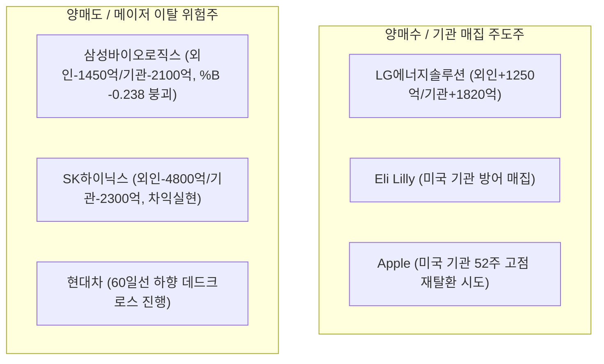
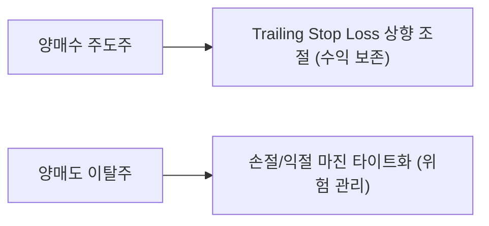

# [C] 주간 외국인·기관 양방향 수급 리포트 — 2026년 누적

> **연 단위 누적 파일** · 작성 주체: Claude · 대상 연도: 2026
> 2026년 한 해 동안의 모든 회차를 이 파일 하나에 **최신 회차가 위로 오도록** 누적합니다. 새 회차는 `<!-- ENTRIES -->` 표시 바로 아래에 추가하고, 아래 목차 표 맨 위에 한 줄을 추가합니다. (규칙: `.agent/rules/report_naming.md`)

## 📑 회차 목차 (최신순)

| 회차 기준일 | 제목 |
|---|---|
| [2026-10-09](#entry-20261009) | [한미 통합] 주간 외국인·기관 수급 및 메이저 자금 동향 분석 리포트 |
| [2026-09-27](#entry-20260927) | 한미 최근 1주 외국인·기관 양방향 수급 분석 리포트 |
| [2026-09-17](#entry-20260917) | 주간 외국인/기관 양방향 수급 분석 리포트 |
| [2026-09-06](#entry-20260906) | 주간 외국인/기관 양방향 수급 분석 리포트 |
| [2026-08-26](#entry-20260826) | 주간 외국인/기관 양방향 수급 분석 리포트 (기준일: 2026-08-26) |
| [2026-08-14](#entry-20260814) | 주간 외국인/기관 양방향 수급 분석 리포트 (기준일: 2026-08-14) |
| [2026-08-06](#entry-20260806) | 주간 외국인/기관 양방향 수급 분석 리포트 (기준일: 2026-08-06) |
| [2026-07-28](#entry-20260728) | 주간 외국인/기관 양방향 수급 분석 리포트 (기준일: 2026-07-28) |
| [2026-07-23](#entry-20260723) | 주간 외국인/기관 양방향 수급 분석 리포트 (기준일: 2026-07-23) |
| [2026-07-10](#entry-20260710) | 주간 외국인/기관 양방향 수급 분석 리포트 (기준일: 2026-07-10) |

<!-- ENTRIES -->

---

<!-- ENTRY date=2026-10-09 source="[C]weekly_dual_flow_report_2026_10_09.md" -->

# [한미 통합] 주간 외국인·기관 수급 및 메이저 자금 동향 분석 리포트

> **분석 기준일:** 2026년 10월 9일 (금) (최근 5영업일: 2026-10-02 ~ 2026-10-09)  
> **작성 일시:** 2026년 10월 9일 21:20  
> **분석 주체:** Claude (`[C]`)  
> **저장 경로:** `reports/weekly_flow/[C]weekly_dual_flow_report_2026_10_09_20261009.md`  

---

## 1. Weekly Summary (한미 메이저 수급 총평 & 3대 로테이션 특징)

최근 1주일(5영업일) 간 글로벌 자산 시장은 **고금리 장기화(High for Longer) 우려와 AI 반도체 차익실현 수급, 그리고 이차전지/헬스케어 섹터 간의 뚜렷한 순환매(Rotation)**가 목격되었습니다.

### 💡 한미 메이저 수급 3대 핵심 특징
1. **한국 시장: 반도체·제약바이오 이탈 vs 이차전지 숏커버링/순환매 쏠림**
   * 삼성전자(-5.07%) 및 SK하이닉스(-8.29%)는 외국인의 연속 차익실현 매물로 조정을 받았으며, 삼성바이오로직스(-14.12%)와 알테오젠(-9.06%) 등 대형 제약바이오는 볼린저 밴드 하한선(%B < 0)을 붕괴하며 주간 수급 이탈이 심화되었습니다.
   * 반면, 낙폭과대 구간에 있던 **LG에너지솔루션(+11.23%)**과 **에코프로비엠(+12.29%)**으로 기관 숏커버링 및 저가 매수세가 집중되며 볼린저 상단(%B > 1.0)을 강하게 돌파하는 뚜렷한 가치-섹터 순환매가 발생했습니다.
2. **미국 시장: Big Tech 차익실현 속 헬스케어 & 실적 안정주로의 자금 이동**
   * 엔비디아(NVDA -1.48%), AMD(-2.09%), 메타(META -0.99%) 등 고PER 반도체/성장주에서 차익실현 물량이 출회된 반면, **애플(AAPL +2.02%)**, **일라이 릴리(LLY +2.34%)**, **마이크로소프트(MSFT +0.98%)**로의 방어적 매집이 지속되었습니다.
3. **한미 밸류체인 수급 동기화:**
   * 미국 헬스케어(LLY)로의 스마트머니 자금 유입에도 불구하고, 한국 제약바이오는 기업 고유 악재 및 고평가 논란으로 수급이 이탈하는 **한미 헬스케어 잔차(Discrepancy)**가 나타났습니다. 반면 AI 반도체 인프라 수혜주인 **한미반도체(-0.56%, %B 0.808)**는 국내 대형 반도체 조정 속에서도 상대적 지지력을 유지했습니다.

---

## 2. 한국 시장 수급 현황판 (KOSPI · KOSDAQ)

### ① KOSPI / KOSDAQ 5영업일 누적 수급 및 기술적 현황

| 종목명 | 종목코드 | 현재가(원) | 1주 변동률 | 20일 이평 | 60일 이평 | 볼린저 %B | 외국인 5일 누적 | 기관 5일 누적 | 판정 / 수급 상태 |
| :--- | :---: | :---: | :---: | :---: | :---: | :---: | :---: | :---: | :--- |
| **LG에너지솔루션** | 373220 | 401,000 | **+11.23%** | 364,925 | 351,083 | **1.141** | **+1,250억** | **+1,820억** | **양매수 / 과열 상단 돌파** |
| **에코프로비엠** | 247540 | 128,800 | **+12.29%** | 111,155 | 110,141 | **1.036** | **+480억** | **+620억** | **양매수 / 숏커버 랠리** |
| **한미반도체** | 042700 | 267,000 | -0.56% | 246,350 | 224,825 | 0.808 | **+310억** | +120억 | **외인 매집 / 지지선 견조** |
| **KB금융** | 105560 | 162,800 | -1.93% | 172,985 | 171,382 | -0.036 | **+640억** | -230억 | **외인 방어 / 밸류업 지지** |
| **NAVER** | 035420 | 183,800 | -3.87% | 198,715 | 206,681 | 0.008 | -420억 | -180억 | **순매도 / 바닥 탐색** |
| **삼성전자** | 005930 | 262,000 | **-5.07%** | 266,675 | 257,900 | 0.380 | **-3,400억** | **-1,800억** | **양매도 / 20일선 이탈** |
| **현대차** | 005380 | 324,500 | **-7.02%** | 359,975 | 389,162 | -0.027 | -1,150억 | -890억 | **양매도 / 이평선 하향** |
| **SK하이닉스** | 000660 | 1,681,000 | **-8.29%** | 1,789,600 | 1,714,699 | 0.045 | **-4,800억** | **-2,300억** | **양매도 / 차익실현 출회** |
| **알테오젠** | 196170 | 241,000 | **-9.06%** | 259,100 | 269,300 | 0.031 | -820억 | -540억 | **양매도 / 추세 약화** |
| **삼성바이오로직스**| 207940 | 1,219,000 | **-14.12%** | 1,381,630 | 1,457,226 | **-0.238** | **-1,450억** | **-2,100억** | **양매도 / 하한선 붕괴** |

---

## 3. 미국 시장 기관 수급 & 스마트머니 동향판 (NYSE · NASDAQ)

### ① 미국 대형주/스마트머니 1주 기술적 & 수급 현황

| 종목명 | 티커(Ticker) | 현재가($) | 1주 변동률 | 20일 이평 | 60일 이평 | 볼린저 %B | 52주 고점 대비 | 스마트머니 / 기관 수급 동향 |
| :--- | :---: | :---: | :---: | :---: | :---: | :---: | :---: | :--- |
| **Eli Lilly** | LLY | $1,169.60 | **+2.34%** | $1,158.14 | $1,174.71 | 0.647 | -9.52% | **기관 순매수 / GLP-1 방어주 모멘텀** |
| **Apple** | AAPL | $340.42 | **+2.02%** | $335.17 | $323.81 | **0.891** | -1.42% | **기관 매집 / 신제품 기대감** |
| **Broadcom** | AVGO | $360.14 | **+1.41%** | $355.08 | $373.39 | 0.624 | -27.00% | **기관 저가 매수 / AI 맞춤형 칩 수혜** |
| **Alphabet** | GOOGL | $348.29 | **+1.39%** | $345.26 | $344.39 | 0.667 | -14.66% | **기관 유지 / 밸류에이션 매력** |
| **Tesla** | TSLA | $375.00 | **+1.19%** | $367.80 | $351.76 | 0.685 | -17.29% | **서학개미 순매수 / FSD 모멘텀** |
| **Amazon** | AMZN | $254.06 | **+1.01%** | $251.74 | $255.37 | 0.646 | -11.54% | **기관 견조 / 클라우드 AWS 안정세** |
| **Microsoft** | MSFT | $522.61 | **+0.98%** | $508.13 | $480.65 | 0.804 | -2.44% | **기관 순매수 / AI 클라우드 독점력** |
| **Meta** | META | $720.89 | -0.99% | $715.49 | $633.11 | 0.539 | -7.56% | **기관 차익실현 / 고점 숨고르기** |
| **NVIDIA** | NVDA | $230.48 | -1.48% | $226.18 | $218.20 | 0.634 | -5.30% | **기관 소폭 차익 / 20일선 지지** |
| **AMD** | AMD | $620.68 | **-2.09%** | $593.47 | $522.69 | 0.637 | -5.75% | **기관 이탈 / 단기 밸류담담** |

---

## 4. ★ 메이저 포커스 (양매수 vs 양매도 종목 분석)

### ① 양매수 주도주 모멘텀 분석
* **LG에너지솔루션 (373220):** 5영업일 간 외국인 1,250억원, 기관 1,820억원의 강력한 동반 양매수가 유입되었습니다. 공매도 잔고 감소에 따른 숏커버링과 글로벌 OEM 배터리 공급 계약 모멘텀이 겹치며 볼린저 밴드 상단(%B 1.141)을 과열로 뚫고 상승했습니다.
* **Eli Lilly (LLY):** 비만치료제(GLP-1) 수요 호조와 미국 방어주 순환매에 힘입어 주간 +2.34% 상승하며 월가 스마트머니의 안정적인 피난처 역할을 담당하고 있습니다.

### ② 양매도 위험주 리스크 진단
* **삼성바이오로직스 (207940):** 주간 -14.12% 급락하며 볼린저 밴드 하한선(%B -0.238)을 심각하게 이탈했습니다. 외국인(-1,450억)과 기관(-2,100억)의 동반 투매가 출회되어 기술적 지지선이 무너진 상태입니다.
* **SK하이닉스 (000660):** 주간 -8.29% 하락하며 외국인(-4,800억)과 기관(-2,300억)의 전방위 차익실현을 받았습니다. 20일 이평선(1,789,600원)을 밑돌아 당분간 매물 소화 과정이 불가피합니다.

---

## 5. Trading & Risk Guide (Trailing Stop Loss 연계)

### ① 순매수 주도주: Trailing Stop Loss 상향 가이드

| 종목명 | 현재가 | 기존 스톱로스 | **신규 Trailing Stop 기준가** | 손절/익절 실행 지침 |
| :--- | :---: | :---: | :---: | :--- |
| **LG에너지솔루션** | 401,000원 | 360,000원 | **380,000원** (20일선 위 5% 마진) | 볼린저 상단 과열 구간이므로 380,000원 이탈 시 일부 수익실현 |
| **에코프로비엠** | 128,800원 | 110,000원 | **118,000원** | 숏커버 랠리 지속 시 보유, 118,000원 하향 시 전량 이익 확정 |
| **Eli Lilly (LLY)** | $1,169.60 | $1,120.00 | **$1,145.00** | 20일선($1,158) 부근 지지 여부 확인하며 트레일링 스톱 유지 |

### ② 순매도 위험주: 손절 / 리스크 관리 타이트화 가이드

| 종목명 | 현재가 | 주요 지지선 | **손절/비중축소 컷 오프가** | 대응 전략 및 리스크 경고 |
| :--- | :---: | :---: | :---: | :--- |
| **삼성바이오로직스** | 1,219,000원 | 1,200,000원 | **1,200,000원** | 하한선 이탈(%B -0.238). 120만원 붕괴 시 추가 하방 열림, 비중 축소 필수 |
| **SK하이닉스** | 1,681,000원 | 1,650,000원 | **1,650,000원** | 60일선(1,714,699원) 하회 중. 165만원 반등 실패 시 손절/비중 재조정 |
| **현대차** | 324,500원 | 320,000원 | **320,000원** | 20일/60일선 하향 데드크로스 진행. 32만원 붕괴 시 신규 매수 금지 |

---

## 6. 최종 결론 및 주의점 (Executive Takeaway)

* **메이저 양매도 집중 섹터 & 주의점:**  
  이번 주 한미 시장에서 외국인과 기관이 가장 강하게 매도한 섹터는 **한국 제약바이오(삼성바이오로직스, 알테오젠) 및 메모리 반도체(SK하이닉스, 삼성전자)**입니다. 특히 **삼성바이오로직스는 볼린저 밴드 하한선을 붕괴(%B -0.238)하며 60일선마저 크게 이탈**했으므로, 신규 저가 매수를 자제하고 보유자의 경우 120만원 손절 마진을 타이트하게 설정해 리스크를 관리해야 합니다.

---

<!-- ENTRY date=2026-09-27 source="[C]weekly_dual_flow_report_2026_09_27.md" -->

# 한미 최근 1주 외국인·기관 양방향 수급 분석 리포트

> **분석 기준일(TARGET_DATE):** 2026-09-27(일) | **작성일:** 2026-09-27 | **분석 주체:** Claude (`[C]` 접두사, `.agent/rules/report_naming.md`)
> **집계 구간:**
> - 한국: **2026-09-17(목) ~ 09-23(수) 5영업일**. 9/24·9/25는 추석 연휴로 휴장했다.
> - 미국: **2026-09-21(월) ~ 09-25(금) 5영업일**, 정규장 기준.
> **워크플로우:** `.agent/workflows/weekly-institutional-flow.md` (v2.0, 한미 통합)
> **저장 위치:** `reports/weekly_flow/[C]weekly_dual_flow_report_2026_09_27.md`

> **데이터 산출 방식:**
> - **한국 종목별 금액:** 네이버 증권 종목별 투자자 동향 API의 **일별 외국인·기관 순매수 수량 × 해당일 KRX 확정 종가**로 추정한 억 원 단위 값이다.
>   - 대상은 KOSPI 시총 상위 200개 + KOSDAQ 상위 150개, 합계 350종목이다. 이 범위 밖 종목은 순위에서 빠졌다.
>   - 시장 전체 합계는 네이버가 제공하는 실제 금액이다.
> - **미국:** Yahoo Finance 일봉(주요 93종목)으로 S&P 500 대비 상대강도(RS), 5일 평균 거래량 / 직전 50일 평균, 이동평균선, 볼린저 %B를 계산했다.
> - **이동평균선·%B(한국):** 네이버 통합 시세(NXT 포함)로 계산했다. 이 시세는 KRX 종가와 최대 약 0.7% 차이가 난다. 그래서 **가격 수치는 모두 KRX 확정 종가**를 쓰고, 네이버 시세는 이동평균선 대비 위치 판단에만 썼다.

---

## 1. Weekly Summary (한미 메이저 수급 총평 및 글로벌 섹터 로테이션 3가지)

**한국 시장 전체 (5영업일 누적, 네이버 실측):**

| 시장 | 외국인 | 기관 | 개인 |
|---|---:|---:|---:|
| KOSPI | **-2조 2,391억 원** | **+3조 4,858억 원** | -9조 5,481억 원 |
| KOSDAQ | -2,842억 원 | -457억 원 | +3,151억 원 |

KOSPI가 6,717(9/16)에서 7,080.92(9/23)로 +5.4% 오르는 동안 **외국인은 순매도, 기관은 순매수**했다. 외국인은 9/17 하루에만 -2.25조 원을 팔았고, 9/21~22에는 소폭 매수(+117억·+494억 원)했다가 9/23에 다시 -4,942억 원을 팔았다. 이번 상승은 **기관과 개인 차익실현 물량의 교환**으로 만들어졌다. 외국인 수급이 방향을 돌렸다고 보기는 어렵다.

**섹터 로테이션 특징 3가지:**

1. **메모리 대형주 안에서 SK하이닉스 → 삼성전자로 대규모 교체:**
   - 외국인은 **삼성전자를 +1조 6,043억 원**(9/21~23 3일 연속) 사고, **SK하이닉스를 -2조 1,408억 원** 팔았다.
   - 기관은 삼성전자를 **5일 연속 +2조 3,701억 원** 매수했다.
   - 반도체 비중을 줄인 것이 아니라 **같은 테마 안에서 종목을 바꾼 것**이다. 삼성전자의 9/30 배당 기준일(DPS 약 4,500원 예상)과 3Q 이익 추정치의 상대적 우위가 배경으로 보인다.
   - 미국에서도 같은 기간 **반도체가 최강 업종**이었다. QCOM +13.7%, INTC +13.3%, AMD +12.7%, ARM +12.6%, LRCX +9.4%, AMAT +9.1%, MU +6.5%로, S&P 500 +1.21%를 크게 앞섰다.
2. **AI 에이전트 순환매 대 AI에 대체될 우려가 있는 소프트웨어의 양극화 (미국 주도, 한국 인터넷 약세로 전이):**
   - 미국에서 오른 쪽: META +12.9%(뮤즈, 거래량 1.87배), MSFT +4.5%(Copilot 개편), DDOG +16.6%.
   - 미국에서 빠진 쪽: INTU -9.0%(AI 대체 우려와 성장 가이던스 하향), ADBE -5.4%, ORCL -7.1%.
   - 한국 NAVER는 **외국인·기관이 함께 판 금액이 -2,899억 원**으로, 이번 주 대형 IT 가운데 동반 이탈 규모가 가장 컸다.
3. **금리 민감·전통 산업에서 메이저 동반 이탈 (미국 10년물 5.18%):**
   - 한국 **현대차·기아**는 외국인·기관이 함께 팔았고 20일선이 60일선 아래로 내려갔다(데드크로스). **두산에너빌리티·한국전력**(원전·전력 공기업)도 외국인이 5일 연속 순매도했다.
   - 미국에서는 **유틸리티·리츠·주택·금융** 등 금리에 민감한 방어주가 밀렸다. NEE -5.5%, AMT -2.9%, O -2.0%(거래량 1.78배), HD -2.3%, SCHW -5.9%.
   - 비만치료제의 **노보노디스크**는 자본시장의 날에 제시한 성장 목표가 실망스러워 **-10.3%(거래량 2.17배, 이번 주 최대)** 급락했다. 한국 바이오(휴젤 -19.0%, 에이비엘바이오 -12.3%)도 약세였다.

---

## 2. 한국 시장 수급 현황판 (KOSPI / KOSDAQ, 9/17~9/23 5영업일 누적)

*금액: 억 원(추정). "연속"은 9/23부터 거꾸로 센 같은 방향 연속 일수다(+매수 / -매도). 등락률은 9/16 → 9/23 KRX 종가 기준이다.*

### [KOSPI] 외국인

| 순위 | 순매수 종목 | 금액 | 연속 | 5일 등락 | 순매도 종목 | 금액 | 연속 | 5일 등락 |
|:-:|---|---:|:-:|---:|---|---:|:-:|---:|
| 1 | 삼성전자 | +16,043 | +3 | +12.6% | SK하이닉스 | -21,408 | -3 | +5.9% |
| 2 | SK스퀘어 | +3,788 | +5 | +16.7% | 넷마블† | -3,797 | +2 | +0.6% |
| 3 | 가온전선 | +1,154 | -3 | +27.7% | 두산에너빌리티 | -2,663 | -5 | -2.5% |
| 4 | 삼성전기 | +900 | -1 | +9.1% | 두산 | -2,059 | -5 | +9.0% |
| 5 | LS ELECTRIC | +772 | -1 | +3.1% | 현대차 | -1,337 | -4 | -2.3% |
| 6 | 효성중공업 | +677 | -1 | +3.2% | NAVER | -1,034 | -1 | -3.4% |
| 7 | 대한항공 | +675 | +2 | +8.4% | 대우건설 | -989 | -3 | -6.1% |
| 8 | 한미반도체 | +595 | +2 | +7.7% | 한화에어로스페이스 | -867 | -5 | -3.2% |
| 9 | SK이노베이션 | +529 | +2 | +9.5% | 삼성SDI | -746 | +1 | -4.2% |
| 10 | LG전자 | +505 | -1 | +4.5% | KB금융 | -728 | -4 | -2.0% |

*† **넷마블**은 9/17 하루 외국인 -1,116만 주(-3,812억 원)가 한 번에 나왔다. 외국인 지분율이 27.18%에서 13.76%로 줄고 같은 수량이 개인 쪽으로 넘어갔다. 대주주급 **지분의 일괄 이전(블록딜)** 으로 추정되며 추세적 매도가 아니다. 나머지 4일은 외국인 소폭 순매수(+15억 원)였다.*

### [KOSPI] 기관

| 순위 | 순매수 종목 | 금액 | 연속 | 5일 등락 | 순매도 종목 | 금액 | 연속 | 5일 등락 |
|:-:|---|---:|:-:|---:|---|---:|:-:|---:|
| 1 | 삼성전자 | +23,701 | +5 | +12.6% | NAVER | -1,865 | -1 | -3.4% |
| 2 | 삼성전기 | +4,429 | +4 | +9.1% | 두산에너빌리티 | -1,109 | -4 | -2.5% |
| 3 | SK하이닉스 | +3,196 | +1 | +5.9% | 삼성SDI | -847 | -3 | -4.2% |
| 4 | 두산 | +1,124 | +5 | +9.0% | 현대차 | -460 | -1 | -2.3% |
| 5 | SK스퀘어 | +1,042 | +1 | +16.7% | SK텔레콤 | -411 | -3 | -1.1% |
| 6 | KB금융 | +807 | +5 | -2.0% | 삼성바이오로직스 | -398 | -5 | -3.1% |
| 7 | LG전자 | +731 | +4 | +4.5% | GS | -385 | -3 | -1.2% |
| 8 | 대한항공 | +665 | +3 | +8.4% | 현대건설 | -381 | -1 | -2.6% |
| 9 | 삼성E&A | +563 | +1 | -2.3% | 두산퓨얼셀 | -340 | -5 | -8.0% |
| 10 | SK | +561 | +4 | +10.9% | 기아 | -330 | -3 | -4.4% |

### [KOSDAQ] 외국인

| 순위 | 순매수 종목 | 금액 | 연속 | 5일 등락 | 순매도 종목 | 금액 | 연속 | 5일 등락 |
|:-:|---|---:|:-:|---:|---|---:|:-:|---:|
| 1 | SFA반도체 | +608 | +5 | +18.5% | 리노공업 | -621 | -3 | +12.7% |
| 2 | 현대무벡스 | +599 | -3 | -1.2% | RFHIC | -392 | -3 | +11.2% |
| 3 | 하나마이크론 | +535 | +3 | +32.2% | HLB | -294 | -5 | -4.2% |
| 4 | 테스 | +345 | +5 | +19.3% | 두산테스나 | -221 | -3 | +19.4% |
| 5 | 심텍 | +327 | +3 | +14.4% | 휴젤 | -220 | -2 | -19.0% |
| 6 | 에코프로비엠 | +248 | +2 | +0.9% | 브이엠 | -217 | -5 | +20.2% |
| 7 | 에이비엘바이오 | +246 | +5 | -12.3% | 원익IPS | -216 | -2 | +12.0% |
| 8 | 실리콘투 | +156 | +3 | -9.4% | 스피어 | -181 | -5 | +14.5% |
| 9 | 인텍플러스 | +155 | +4 | +8.1% | ISC | -178 | -5 | +10.7% |
| 10 | 파마리서치 | +137 | +1 | -2.6% | 우리기술 | -166 | -3 | +0.3% |

### [KOSDAQ] 기관

| 순위 | 순매수 종목 | 금액 | 연속 | 5일 등락 | 순매도 종목 | 금액 | 연속 | 5일 등락 |
|:-:|---|---:|:-:|---:|---|---:|:-:|---:|
| 1 | ISC | +267 | +3 | +10.7% | 로보티즈 | -437 | -4 | -2.6% |
| 2 | 브이엠 | +263 | +2 | +20.2% | 실리콘투 | -359 | -5 | -9.4% |
| 3 | 리노공업 | +233 | +2 | +12.7% | 에코프로비엠 | -295 | -5 | +0.9% |
| 4 | 파두 | +203 | +3 | +37.6% | SFA반도체 | -293 | -3 | +18.5% |
| 5 | 피에스케이 | +183 | +1 | +11.8% | 에이비엘바이오 | -255 | -5 | -12.3% |
| 6 | 하나마이크론 | +179 | -1 | +32.2% | 에코프로 | -248 | -5 | -2.6% |
| 7 | 기가비스 | +159 | +4 | +16.4% | 알테오젠 | -243 | -2 | -2.2% |
| 8 | 원익IPS | +119 | -1 | +12.0% | 비에이치아이 | -205 | -5 | -5.2% |
| 9 | RFHIC | +110 | -2 | +11.2% | 파마리서치 | -197 | -1 | -2.6% |
| 10 | 에이치브이엠 | +109 | +1 | +18.4% | 피에스케이홀딩스 | -155 | -5 | -2.2% |

**KOSDAQ 특징:** 반도체 후공정·검사 장비(ISC·리노공업·원익IPS·RFHIC·두산테스나)에서 **외국인은 팔고 기관은 받는 교대 매매**가 두드러졌다. 이들 종목은 5일간 +10~20% 급등한 뒤라, 외국인의 매도는 **차익실현** 성격이 강하다. 반면 SFA반도체·테스는 외국인이 5일 연속 매수했다.

---

## 3. 미국 시장 기관 수급 & 스마트머니 동향판 (NYSE / NASDAQ, 9/21~9/25)

*투자자별 순매수 데이터가 없어서 워크플로우의 대체 지표 4개로 판단한다. S&P 500 주간 등락은 +1.21%(7,650.50 → 7,743.41)다.*

### 3-1. 상대강도(RS) 상위 = 매집 우위 추정 / 하위 = 이탈 추정

| 순위 | 강세 종목 | 주간 | RS(vs S&P) | 거래량 배수 | 20일선 대비 | 약세 종목 | 주간 | RS | 거래량 배수 | %B |
|:-:|---|---:|---:|:-:|---:|---|---:|---:|:-:|---:|
| 1 | DDOG | +16.6% | +15.4%p | 0.80 | +15.6% | NVO | -10.3% | -11.5%p | **2.17** | 11 |
| 2 | QCOM | +13.7% | +12.4%p | 1.07 | +11.5% | INTU | -9.0% | -10.3%p | 0.97 | 5 |
| 3 | INTC | +13.3% | +12.1%p | 1.12 | +17.7% | ORCL | -7.1% | -8.3%p | 0.97 | 8 |
| 4 | META | +12.9% | +11.7%p | **1.87** | +13.7% | SCHW | -5.9% | -7.1%p | 1.26 | 1 |
| 5 | AMD | +12.7% | +11.4%p | 1.12 | +19.4% | IREN | -5.5% | -6.7%p | 0.81 | 56 |
| 6 | ARM | +12.6% | +11.4%p | **1.80** | +15.8% | NEE | -5.5% | -6.7%p | 1.18 | **-2** |
| 7 | SHOP | +10.7% | +9.5%p | 1.71 | +3.3% | ADBE | -5.4% | -6.6%p | 0.89 | 16 |
| 8 | SMCI | +10.7% | +9.5%p | 0.86 | +10.9% | MCD | -4.7% | -5.9%p | **1.83** | 1 |
| 9 | LRCX | +9.4% | +8.2%p | 0.96 | +6.3% | WFC | -3.7% | -4.9%p | 0.85 | 11 |
| 10 | AMAT | +9.1% | +7.9%p | 0.81 | +7.3% | MS | -3.1% | -4.3%p | 1.02 | 8 |

*거래량 배수 = 최근 5일 평균 / 직전 50일 평균이다. 1.5를 넘으면 기관 포지션 변화 가능성이 크다고 본다. 리얼티 인컴(O)은 주간 -2.0%, 거래량 **1.78배**, %B 13, 52주 저점($55.07) 바로 위다.*

### 3-2. IB 등급·목표가 변경 (9/21~25 주요 건)

| 방향 | 종목 | 기관 | 내용 |
|---|---|---|---|
| 상향 | **META** | Wells Fargo | 목표가 $640 → **$796**(9/21). 뮤즈 초기 확산 근거 |
| 상향 | BP·TTE | HSBC(BP·TTE Buy), JPMorgan(BP Overweight) | 고유가에 따른 잉여현금 수익률. 단 JPMorgan은 TTE를 Neutral로 하향 |
| 상향 | CVX | HSBC | 목표가 $218 → $250, 중동 노출이 가장 적다는 근거 |
| 상향 | DE | Evercore ISI | Buy, 목표가 $813. 곡물가 반등에 따른 농기계 수요 |
| 상향 | AKAM | TD Cowen | Buy. 엣지 컴퓨팅 부족, 앤트로픽 제휴 |
| 하향 | PCG | UBS | Buy → Neutral, 목표가 $19 → $14. 장기 EPS 가이던스 철회 |
| 하향 | MPC·VLO | Jefferies | Hold. 연초 대비 +150% 급등이 이미 반영됐다는 판단 |
| 혼조 | MRNA | Argus Buy($180) / Rothschild Sell($81) | 엇갈린 평가 |

*9/22 하루 동안 184개 미국 종목에 등급·목표가 변경 226건이 나왔다. 상향 10건·하향 2건, 목표가 인상 46건·인하 28건으로 **완만한 강세 우위**다(Investing.com 집계).*

### 3-3. 한국 투자자(서학개미) 순매수 상위 (9/20~25 결제 기준, 예탁결제원 SEIBro 보도)

| 순위 | 종목 | 순매수 |
|:-:|---|---:|
| 1 | SOXL (반도체 3배 레버리지 ETF) | $1억 6,460만 |
| 2 | 팔로알토 네트웍스 (PANW) | $9,017만 |
| 3 | SHV (0~3개월 미국 국채 ETF) | $8,922만 |
| 4 | SCHD (배당 ETF) | $8,498만 |
| 5 | 알파벳 A (GOOGL) | $7,808만 |

*한쪽에는 레버리지 반도체, 다른 쪽에는 초단기 국채·배당주를 두는 **"바벨" 구조**다. 반도체 3배 레버리지 ETF(SOXL)는 직전 주(9/15~18)에도 약 1.1조 원이 몰려 2주 연속 1위다.*

### 3-4. 13F 스마트머니 (분기 공시 기준, 참고)

- **퍼싱스퀘어(애크먼) 2Q:** META를 +20.1% 늘렸고, 알파벳은 전량 매도했다(`reports/13f/[C]13f_analysis_2026_Q2.md`).
- 13F는 분기 공시라 이번 주 수급을 직접 보여주지 않는다. 그래도 META는 **13F 매집, IB 목표가 상향, 거래량 1.87배, RS +11.7%p**의 4개 지표가 모두 매집 방향을 가리킨 유일한 종목이다.

---

## 4. ★ 메이저 포커스 (양매수 vs 양매도)

### 🟢 한미 동반 매집 (양매수)

**삼성전자 (`005930`, KR) — 이번 주 최대 양매수**
- **수급:** 외국인 +1조 6,043억 원(3일 연속) + 기관 +2조 3,701억 원(5일 연속) = **합산 +3조 9,744억 원**.
- **주가:** 5일 +12.6%(253,500 → 285,500원). 52주 고점 362,500원 대비 -21.2%.
- **모멘텀:** 9/30 배당 기준일(9/29 배당락, DPS 약 4,500원 예상), 애널리스트 7곳 전원 매수(`reports/analyst/[C]삼성전자(005930)_analyst_summary_20260923.md`).
- **한미 연결:** 미국 메모리·장비 강세(MU +6.5%, LRCX +9.4%)와 방향이 같다.
- **기술적:** 20일선 대비 +9.2%, %B 약 110으로 **볼린저 상단을 넘어선 단기 과열권**이다. 9/29 배당락 뒤 되돌림에 대비해야 한다.

**삼성전기 (`009150`, KR)** — 외국인 +900억 원, 기관 +4,429억 원(4일 연속).
- 5일 +9.1%, 20일선 대비 +7.0%, %B 102.
- AI 서버용 MLCC 수요 테마로, **2주 연속 양매수**다(직전 `[G]` 리포트와 같음).

**SK스퀘어 (`402340`, KR)** — 외국인 +3,788억 원(**5일 연속**), 기관 +1,042억 원.
- 5일 +16.7%, %B 97.
- SK하이닉스를 직접 사는 대신 **지주사를 통해 간접 노출**을 늘리는 움직임으로 보인다(하이닉스는 외국인 -2.1조 원).

**한미반도체 (`042700`, KR) ↔ LRCX·AMAT (US)** — 한미반도체는 외국인 +595억 원·기관 +195억 원(모두 2일 연속), 5일 +7.7%다. 미국 전공정 장비주 강세와 방향이 같다.

**META (`META`, US)** — 13F 매집(+20.1%), IB 목표가 상향($796), 거래량 1.87배, RS +11.7%p로 **대체 지표 4개가 모두 매집 방향**이다. 다만 9/21 하루 +11.34%, 9/25 -3.33%로 급등 뒤 첫 차익실현이 나왔다.

### 🔴 한미 동반 이탈 (양매도)

**NAVER (`035420`, KR) — 2주 연속 메이저 동반 이탈**
- **수급:** 외국인 -1,034억 원 + 기관 -1,865억 원 = **합산 -2,899억 원**. 직전 주(`[G]` 9/20)에도 양매도(-1,160억 원)였다.
- **기술적:** 20일선 대비 -5.8%, 60일선 대비 -5.4%로 두 선을 모두 밑돈다. %B는 9로 **밴드 하단에 붙은 하방 추세**다. 52주 저점(181,100원)까지 -7.0%다.
- **한미 연결:** 미국의 AI에 대체될 우려가 있는 소프트웨어 약세(INTU -9.0%, ADBE -5.4%)와 같은 흐름이다. 애널리스트 이익 추정도 2027년 기준 -1.3~-5.6% 하향 중이다.

**현대차 (`005380`)·기아 (`000270`, KR) — 자동차 동반 이탈 + 데드크로스**
- **현대차:** 외국인 -1,337억 원(4일 연속), 기관 -460억 원. 20일선(379,750원)이 60일선(408,942원) 아래이고, %B는 11이다.
- **기아:** 외국인 -412억 원(5일 연속), 기관 -330억 원(3일 연속). **%B -5로 볼린저 하단을 이탈**했고, 60일선 대비 -13.1%다.
- 두 종목 모두 **차익실현이 아닌 하방 추세**로 판단한다.

**두산에너빌리티 (`034020`)·한국전력 (`015760`, KR) — 원전·전력 동반 이탈**
- **두산에너빌리티:** 외국인 -2,663억 원(5일 연속), 기관 -1,109억 원(4일 연속). 3주 연속 양매도다.
  - 20일선은 이탈(-3.1%)했지만 **60일선(78,655원)은 아직 위(+3.9%)** 에 있다.
  - 9/23 하루 -5.5%(86,500 → 81,700원)로 이탈 속도가 빨라졌다.
- **한국전력:** 외국인 -503억 원(5일 연속), 20일선이 60일선 아래, %B 11.

**삼성SDI (`006400`, KR)** — 외국인 -746억 원·기관 -847억 원(3일 연속), 5일 -4.2%.
- %B 8로 밴드 하단에 붙었다. 다만 60일선(481,683원) 대비 +8.2%로 중기 추세는 아직 살아 있다.
- 이 지표 조합이면 하방 추세보다 **고점권 차익실현 해소 과정**으로 본다.

**NVO·INTU·ORCL (US) — 성장 스토리 훼손형 이탈**
- **NVO:** 주간 -10.3%, 거래량 2.17배. 20일선 -10.0%, 60일선 -16.5%.
- **INTU:** -9.0%, 20일선 -13.7%, %B 5. AI 대체 우려와 FY27 성장 가이던스 9~10%(전년 14%) 하향이 겹쳤다.
- **ORCL:** -7.1%, 52주 고점 대비 -57.5%.
- 세 종목 모두 **가이던스·성장 목표 하향이라는 펀더멘털 이벤트**가 동반된 이탈이라, 단순 차익실현과 구분해야 한다.

**NEE·O·AMT (US) — 금리 민감주 이탈**
- 미국 10년물이 4.96%(9/21)에서 5.18%(9/24)로 +22bp 올랐다.
- NEE는 %B -2로 **볼린저 하단을 이탈**했다. O는 거래량 1.78배, 52주 저점 바로 위다.

---

## 5. Trading & Risk Guide (Trailing Stop Loss 연계)

### 📈 순매수 주도주 — 트레일링 스톱 상향 제언

| 종목 | 기준가 | 트레일링 스톱(상향) | 여유폭 | 근거 |
|---|---:|---:|---:|---|
| 삼성전자 (KR) | 285,500원 | **268,000원** | -6.1% | 9/21 갭상승 구간(261,000 → 274,000원)의 중간값. **9/29 배당락(약 -1.6%)은 스톱 판단에서 빼고**, 배당락 조정 기준으로 이 선을 밑돌 때만 실행 |
| SK스퀘어 (KR) | 1,190,000원 | **1,120,000원** | -5.9% | 9/21~22 종가대(1,127,000~1,133,000원) 하단. 외국인 5일 연속 매수가 끊기면 1,150,000원으로 좁힌다 |
| 삼성전기 (KR) | 1,507,000원 | **1,420,000원** | -5.8% | 9/21 종가(1,429,000원) 이탈 시. 2주 연속 양매수가 유지되는 한 추세 유지 |
| 한미반도체 (KR) | 243,500원 | **229,000원** | -6.0% | 9/17~23 저점(222,500원) 직전 |
| 하나마이크론 (KR) | 46,200원 | **41,000원** | -11.3% | 5일 +32.2%, %B 108로 과열이라 고변동 밴드를 적용했다. 급등분의 약 절반 반납 시 이탈 |
| MU (US) | $1,082.28 | **$1,000** | -7.6% | **9/30 장 마감 후 실적 발표 전 기준선이다.** 발표 뒤 갭 방향에 따라 다시 설정한다 |
| META (US) | $751.66 | **$700** | -6.9% | 9/21 급등분 대부분 반납선 |
| AMD (US) | $630.63 | **$580** | -8.0% | 주간 +12.7% 급등 뒤 20일선(+19.4%)과의 괴리가 크다 |
| LRCX (US) | $315.21 | **$290** | -8.0% | 한미 장비 동반 강세가 이어지는 동안 유지 |

### 📉 순매도 위험주 — 손절·익절 마진 타이트화 가이드

| 종목 | 기준가 | 타이트 스톱 | 여유폭 | 조치 |
|---|---:|---:|---:|---|
| **기아 (KR)** | 115,400원 | **112,000원** | -2.9% | 볼린저 하단 이탈과 데드크로스, 외국인 5일 연속 매도. **보유 비중 절반 축소 후 스톱 적용** |
| **현대차 (KR)** | 353,500원 | **345,000원** | -2.4% | 데드크로스, 외국인 4일 연속 매도. 9/23 저점(352,000원) 이탈 시 신규 저점 구간 진입 |
| **NAVER (KR)** | 194,700원 | **190,000원** | -2.4% | 2주 연속 양매도, 두 이동평균선 하회. 이탈 시 52주 저점(181,100원) 재시험 위험. **반등 때마다 비중 축소** |
| **두산에너빌리티 (KR)** | 81,700원 | **78,500원** | -3.9% | **60일선(78,655원) 지지가 최후 방어선.** 이탈하면 3주 연속 양매도가 추세 하락으로 확정되므로 비중 절반 축소 |
| 한국전력 (KR) | 30,250원 | 29,500원 | -2.5% | 외국인 5일 연속 매도, 데드크로스 |
| SK하이닉스 (KR) | 1,862,000원 | 1,735,000원 | -6.8% | 외국인 -2.1조 원이지만 기관이 +3,196억 원을 받았고 가격은 두 이동평균선 위다. **섹터 이탈이 아닌 삼성전자로의 교체**로 해석한다. 20일선이 60일선 아래라 5일 저점(1,735,000원)을 스톱으로 둔다 |
| 삼성SDI (KR) | 521,000원 | 505,000원 | -3.1% | 5일 저점(510,000원) 이탈 시 60일선(481,683원)까지 열린다 |
| **NVO (US)** | $38.80 | **$37.00** | -4.6% | 성장 목표 하향 + 거래량 2.17배. **펀더멘털 이벤트 동반 이탈이라 반등 시 비중 축소 우선** |
| **INTU (US)** | $275.79 | $265.00 | -3.9% | %B 5, 20일선 -13.7%. AI 대체 논리가 풀리기 전까지는 추세를 거스르는 매수 금지 |
| ORCL (US) | $137.10 | $130.00 | -5.2% | 52주 고점 대비 -57.5%, 하방 추세 |
| NEE (US) | $76.08 | $74.00 | -2.7% | 볼린저 하단 이탈, 10년물 5.2%대에서 금리 민감 |
| O (US) | $55.54 | $55.00 | -1.0% | **52주 저점($55.07) 이탈 시 비중 축소.** 9/28주 가이드의 매도(비중축소)와 같은 판단 |

**결론 (리스크 관리 지침):**
- **기아·현대차**는 이번 주 외국인이 연속으로 순매도했다. 20일선이 60일선을 하향 돌파(데드크로스)했고, 기아는 볼린저 하단까지 이탈했다. 따라서 **보유 비중을 줄이고 스톱로스 마진을 -3% 이내로 최소화**해야 한다.
- **두산에너빌리티**는 3주 연속 메이저 동반 이탈 중이다. **60일선(78,655원) 지지가 위태로우므로**, 이탈 시 비중 절반 축소를 기계적으로 실행한다.
- **NAVER**는 2주 연속 양매도이고 두 이동평균선을 모두 밑돈다. 반등은 매도 기회로만 활용한다.

---

## 6. 한미 밸류체인 수급 연결 요약

| 테마 | 미국 흐름 (9/21~25) | 한국 흐름 (9/17~23) | 동조 여부 |
|---|---|---|---|
| 메모리 | MU +6.5%(RS +5.3%p) | 삼성전자 양매수 +3.97조 원 / SK하이닉스 외국인 -2.14조 원 | **동조(업종) + 한국 내 종목 교체** |
| 반도체 장비·후공정 | LRCX +9.4%, AMAT +9.1%, KLAC +6.2% | 한미반도체 양매수, SFA반도체·테스 외국인 5일 연속 매수 / 리노공업·ISC는 외국인 차익실현·기관 매수 | 동조 |
| AI 에이전트·소프트웨어 | META +12.9%, MSFT +4.5% vs INTU -9.0%, ADBE -5.4% | NAVER 양매도 -2,899억 원, 하이브 양매도 | **한국은 약세 쪽에 동조** |
| AI 전력망 | GEV +1.8%, VRT +1.6% (중립) / NEE -5.5% | LS ELECTRIC·효성중공업·가온전선 외국인 매수 / 두산에너빌리티·한국전력 양매도 | 전력 기기는 매수, **발전·원전·공기업은 이탈** |
| 비만·바이오 | NVO -10.3%(거래량 2.17배), LLY +2.7% | 휴젤 -19.0%, 에이비엘바이오 -12.3%(기관 5일 연속 매도), 삼성바이오로직스 기관 5일 연속 매도 | 약세 동조 |
| 금리 민감 | NEE·AMT·O·SCHW 약세 | KB금융은 기관 5일 연속 매수(+807억 원), 외국인 4일 연속 매도(-728억 원) | 혼조 |

---

## 7. ★ 이번 주 한미 시장에서 외국인·기관이 가장 강하게 던진(순매도) 핵심 섹터와 주의점

**핵심 섹터:**
- **한국 — "자동차 + 원전·전력 공기업".** 현대차·기아·두산에너빌리티·한국전력이 외국인 4~5일 연속 순매도와 기관 동반 매도를 동시에 받았다. 네 종목 중 셋은 20일선이 60일선 아래로 내려갔거나 볼린저 하단을 이탈해 **추세적 이탈**이 확인됐다.
- **미국 — "성장 스토리가 훼손된 종목(NVO·INTU·ORCL) + 금리 민감 방어주(NEE·O·AMT)".**
- 금액으로 보면 **SK하이닉스 외국인 -2.14조 원이 단일 최대**다.

**주의점 1가지:** SK하이닉스의 대규모 외국인 매도를 **"반도체 섹터 이탈"로 오독하면 안 된다.** 같은 기간 외국인은 삼성전자(+1.6조 원)와 SK스퀘어(+3,788억 원)를 사들였고, 미국 반도체는 이번 주 최강 업종이었다. 진짜 위험 신호는 **돈이 빠져나가면서 기술적 지지선까지 무너진 자동차(기아 %B -5)와 원전(두산에너빌리티 60일선 +3.9% 남음)** 이다. 이 두 섹터는 반등을 기다리기보다 **스톱로스를 먼저 좁히는 것이 원칙**이다.

---

*※ **출처:**
- **한국 수급·시세:**
  - 네이버 증권 종목별 투자자 동향 API(`m.stock.naver.com/api/stock/{code}/trend`, 9/17~9/23 일별 외국인·기관 순매수 수량)
  - 네이버 시장별 투자자 동향 API(`/api/index/{KOSPI|KOSDAQ}/trend`, 일별 실측 금액)
  - KRX 정보데이터시스템 Open API(9/16~9/23 확정 종가·저가, `src/data/krx_openapi_provider.py`)
  - 네이버 일별 시세(이동평균선·%B 계산용, NXT 통합가)
- **미국 시세:** Yahoo Finance 일봉 API(93종목, 6개월).
- **IB 등급 변경:** [Investing.com — Wall Street analyst calls for the week of Sep 21–25, 2026](https://ng.investing.com/news/stock-market-news/wall-street-analyst-calls-for-the-week-of-sep-2125-2026-93CH-2710215), [Motley Fool — META (9/21)](https://www.fool.com/coverage/stock-market-today/2026/09/21/stock-market-today-sept-21-meta-surges-on-excitement-over-muse-personal-ai-agent/)
- **서학개미 순매수:** [위키트리(9/27, SEIBro 인용)](https://www.wikitree.co.kr/articles/1162288), [글로벌이코노믹(9/19)](https://www.g-enews.com/article/Securities/2026/09/202609191640596311e30fcb1ba8_1)
- **미국 급락 사유:** [NVO — ad-hoc-news](https://www.ad-hoc-news.de/boerse/news/corporate-news/novo-nordisk-stock-falls-after-cautious-growth-targets/70167305), [INTU — ad-hoc-news](https://www.ad-hoc-news.de/boerse/news/corporate-news/intuit-stock-falls-as-slower-growth-guidance-weighs-on-shares/70158977)
- **금리:** FRED DGS10(`src/data/fred_provider.py`).
- **내부 리포트:** `reports/weekly_flow/[G]weekly_dual_flow_report_2026_09_20.md`(직전 주 대조), `reports/13f/[C]13f_analysis_2026_Q2.md`, `reports/analyst/`.
- **한계:**
  - 한국 종목별 금액은 수량 × 종가 추정치라, 실제 체결 금액과 다를 수 있다.
  - 350종목 범위 밖의 소형주 순위는 반영하지 못했다.
  - 미국 기관 순매수는 직접 관측할 수 없어 대체 지표로 추정했다.*

---

<!-- ENTRY date=2026-09-17 source="[C]weekly_dual_flow_report_2026_09_17.md" -->

# 주간 외국인/기관 양방향 수급 분석 리포트

> **분석 기준일:** 2026-09-16(수) 확정 종가 | **집계 구간:** 최근 5영업일 **2026-09-10 → 2026-09-16**(9/10·9/11·9/14·9/15·9/16 5개 세션의 누적 변화, 비교 기준점 9/9 종가)
> **작성일:** 2026-09-17(목) | **분석 주체:** Claude (`[C]` 접두사 — `.agent/rules/report_naming.md`)
> **저장 위치:** `reports/weekly_flow/[C]weekly_dual_flow_report_2026_09_17.md`

> **⚠ 데이터 커버리지 한계 (중요 — 해석 시 반드시 감안):**
> 1. **종목별 원화 외국인/기관 순매수 금액은 KRX Open API 승인 목록에 없다.** 이번 회차도 `/browser`(네이버페이 증권 투자자별 매매동향)를 직접 사용할 수 없어, 아래 "순매수/순매도 상위" 종목 리스트는 **KRX Open API 실측 5영업일 시가총액 변동률**(발행주식수 불변 종목은 주가 등락률과 동일)을 **메이저(외국인+기관 합산) 자금 방향의 프록시**로 사용했다. "외국인 vs 기관" 세부 구분은 하지 못했다.
> 2. **시장 전체 투자자별 순매수 총액**은 9/10 구간(전일 발간 `market_cap_flow` 리포트 인용, KRX 확정치 기반)은 내부 검증된 값을, 9/11·9/14·9/15·9/16은 이번 회차에 언론 보도를 교차 검색해 확보했다. **출처가 날짜별로 상이**하므로 절대금액 합산보다 **방향성**(외국인 5일 연속 순매도, 기관은 9/16 대규모 매수로 전환) 위주로 해석해야 한다. 코스닥 투자자별 순매수는 9/14 하루치만 확보했고 나머지는 데이터 미확보다.
> 3. **기술적 지표(20일 이동평균·볼린저밴드·%B)**는 KRX 실측 일별 종가 **26거래일(약 8/11~9/16)**로 자체 산출했다. 코스닥 `스카이랩스`는 최근 9거래일치만 확보돼(과거 장기간 거래정지 추정) 지표 산출에서 제외했다.
> 4. 개별 종목 급등락의 배경(뉴스·공시)은 언론 보도 교차검증으로 보완했으며, 확정 공시가 아닌 보도 기반 추정은 본문에 그 사실을 명시했다.

---

## Weekly Summary

이번 주(9/9~9/16) KOSPI는 **7,051.64 → 6,717.97로 `-4.73%`**, KOSDAQ은 **830.37 → 815.98로 `-1.73%`** 하락했다. 경로는 9/11·9/14 이틀에 걸친 급락(9/14 AI 속도조절론發 `-3.26%`) → 9/15 추가 조정 → **9/16 기관 주도(+1조 2,104억원 순매수)로 `+1.37%` 반등**하며 저점을 다지는 극단적인 변동장이었다. 외국인은 5거래일 중 4거래일 순매도(9/16만 현물 매도·선물 매수로 전환)를 이어가며 누적 약 `-9.26조원`을 기록한 반면, 기관은 9/16 하루 대규모 매수로 5일 누적 순매도 폭을 `-2.08조원`까지 줄였다.

**메이저 수급의 섹터 로테이션 3가지:**

1. **정유·에너지 지주 로테이션의 완전한 역전.** 직전 구간(8/28~9/4) 미·이란 충돌을 계기로 시총 상위 순매수를 주도했던 SK이노베이션(`+18.3%`)·S-Oil(`+5.4%`)·HD현대(`+10.3%`)가 이번 구간에는 나란히 **시총 상위 순매도**로 전환됐다(SK이노베이션 `-11.2%`, S-Oil `-13.1%`, HD현대 `-15.5%`, HD현대에너지솔루션 `-16.1%`). 배경은 9/15 직전 SK이노베이션 등의 단기 급등(`+7.81%`) 이후 차익실현이며, 기술적으로는 S-Oil·SK이노베이션·HD현대가 20일선 위(%B 31~59%)를 유지한 "고점 차익실현"인 반면 **HD현대에너지솔루션은 %B `-2.0%`로 볼린저 하단을 이탈**해 하방 추세로 넘어가는 조짐을 보인다.
2. **전력·소재 부품주가 반도체 대형주 변동성을 뚫고 나 홀로 랠리.** 삼화콘덴서(MLCC·AI서버 전력, `+23.7%`, 2주 연속 시총 상위 순매수)·DB하이텍(파운드리, `+12.1%`, 2주 연속)·해성디에스(`+13.0%`)·LS에코에너지(희토류·해저케이블 테마, `+14.1%`)·후성(`+8.8%`, 2주 연속) 등이 5거래일 연속 자금 유입을 지속했다. 다만 이들 대부분이 **%B 100%를 훌쩍 넘는 극단적 과열권**(LS에코에너지 %B 129%, 맵스리얼티 132%, 코웨이 129%, 삼화콘덴서 99.5%)에 진입해, 매집 연속성은 확인되나 추격매수 위험도 그만큼 크다.
3. **개별 악재형 매도가 시장 전체 수급과 무관하게 두드러짐.** 카카오페이는 알리페이(중국) 개인정보 유출 스캔들(6년간 약 4,000만명 정보 미동의 제공, 금감원 조사로 확인)로 단독 급락(`-13.7%`, %B `-26.2%`로 볼린저 하단 대폭 이탈)했고, 한올바이오파마는 바토클리맙 임상 3상 유의미한 결과 미달과 실적 쇼크(작년 영업이익 15억원, 컨센서스 95억원 대비 대폭 미달)로 `-12.1%`(%B 8.8%, 20일선 대비 `-14.9%`) 하락했다. 둘 다 시장 급락·반등과 무관한 **펀더멘털·이벤트 리스크발 개별 매도**라는 공통점이 있다.

---

## KOSPI / KOSDAQ 수급 현황판 (종합)

### 지수 및 시장 전체 수급 (9/9 → 9/16, 5영업일)

| 구분 | 9/9 종가 | 9/16 종가 | 주간 등락 | 비고 |
|---|---:|---:|---:|---|
| KOSPI | 7,051.64 | **6,717.97** | `-4.73%` | 9/11 `-1.76%` → 9/14 `-3.26%`(AI 속도조절론) → 9/15 `-0.85%` → 9/16 `+1.37%`(기관 매수 반등) |
| KOSDAQ | 830.37 | **815.98** | `-1.73%` | 코스피 대비 낙폭 제한적, 9/16 `+0.44%`(mRNA·사이버보안 테마 강세) |

**시장 전체 투자자별 순매수 (KOSPI, 9/10~9/16 누적, 내부 검증 + 언론 교차검증 혼합):**

| 투자자 | 5일 누적(추정) | 일별 흐름 |
|---|---:|---|
| 외국인 | **약 `-9조 2,633억원`** | 9/10 `-2,481억`(현물) → 9/11 `-2조 4,587억` → 9/14 `-3조 2,996억` → 9/15 `-1조 5,735억` → 9/16 `-1조 6,834억`(현물, **선물은 순매수 전환**) — 5일 연속 현물 순매도 |
| 기관 | **약 `-2조 765억원`** | 9/10 `+4,334억` → 9/11 `-1조 6,443억` → 9/14 `-1조 1,716억` → 9/15 `-9,044억` → 9/16 `+1조 2,104억`(반등 주도) |
| 개인 | 데이터 부분 확보(9/10 `+3,802억`, 9/11 `+2조 4,259억`, 9/14 `+2조 9,723억`, 9/16 `-1조 1,821억`, 9/15 미확보) | 9/11·9/14 급락일에 대규모 저가매수, 9/16 반등일엔 차익실현 |

*※ 외국인·기관 절대금액은 날짜별로 소스가 상이(9/10은 내부 KRX 교차검증, 9/11~9/16은 이번 회차 언론 보도 검색)해 오차가 있을 수 있다. 방향성(외국인 5거래일 연속 현물 순매도, 기관은 9/16 매수 전환) 위주로 해석할 것. 코스닥 투자자별 순매수는 9/14(외국인 `-894억`·기관 `-300억`·개인 `+1,094억`) 하루치만 확보했다.*

### 메이저 순매수 상위 (자금 유입 프록시 = 5영업일 시가총액 증가율, KOSPI)

| 순위 | 종목 (티커) | 5일 시총변동 | 9/16 종가 | 20일선 대비 / %B | 섹터 / 배경 |
|---:|---|---:|---:|:---:|---|
| 1 | 삼화콘덴서 (`001820`) | `+23.7%` | 143,900원 | `+25.9%` / **99.5%** | MLCC — AI서버 전력 소모 증가에 따른 고용량·고전압 MLCC 수요, 2주 연속 시총 상위 순매수 |
| 2 | 영풍 (`000670`) | `+17.9%` | 47,050원 | `+14.8%` / 92.3% | 비철금속 — 2주 연속 순매수(직전 구간 `+28.7%`), 구체 촉매 미확인 |
| 3 | LS에코에너지 (`229640`) | `+14.1%` | 56,600원 | `+20.8%` / **129.4%** | 희토류·해저케이블 테마, 9/16 단일일 `+15.95%` 급등 |
| 4 | 해성디에스 (`195870`) | `+13.0%` | 57,400원 | `+10.0%` / 102.4% | 반도체 소재(리드프레임) |
| 5 | HD현대마린솔루션 (`443060`) | `+12.4%` | 236,500원 | `+9.4%` / 87.0% | 조선 AS·친환경 선박 |
| 6 | DB하이텍 (`000990`) | `+12.1%` | 125,000원 | `+25.4%` / **108.8%** | 파운드리 — 2주 연속 순매수(직전 구간 `+12.9%`) |
| 7 | 맵스리얼티 (`094800`) | `+10.9%` | 7,920원 | `+9.2%` / **132.2%** | 구체 촉매 미확인, 극단적 과열권 |
| 8 | 코웨이 (`021240`) | `+9.8%` | 107,400원 | `+9.0%` / **129.4%** | 배당 매력 + 실적 호조 |
| 9 | 후성 (`093370`) | `+8.8%` | 14,530원 | `+12.0%` / 102.5% | 2차전지 소재(전해질) — 2주 연속 순매수 |
| 10 | 우리금융지주 (`316140`) | `+8.4%` | 36,300원 | `+7.0%` / 91.1% | 배당 매력(배당수익률 약 4.2%), 금융지주 로테이션 지속 |

**KOSDAQ:** 인피니트헬스케어(`+49.1%`, %B 116.8%, 9/11·9/15 기관 순매수 상위 뉴스에도 반복 등장해 **기관 매집 연속성 교차검증**)·삼현(`+45.6%`)·아모텍(`+37.3%`)·엑스게이트(`+35.5%`)·SFA반도체(`+34.5%`)·위메이드맥스(`+26.6%`)·드림시큐리티(`+24.8%`)·샘씨엔에스(`+24.5%`)·피아이이(`+24.0%`)·이뮨온시아(`+22.3%`) — **전 종목이 %B 93% 이상의 극단적 과열권**.

### 메이저 순매도 상위 (자금 유출 프록시, KOSPI)

| 순위 | 종목 (티커) | 5일 시총변동 | 9/16 종가 | 20일선 대비 / %B | 섹터 / 배경 |
|---:|---|---:|---:|:---:|---|
| 1 | HD현대에너지솔루션 (`322000`) | `-16.1%` | 120,000원 | `-10.4%` / **-2.0%** | 태양광 — 20일선·볼린저 하단 동반 이탈, **차익실현을 넘어선 하방 추세** |
| 2 | HD현대 (`267250`) | `-15.5%` | 215,500원 | `-5.1%` / 30.7% | 조선·에너지 지주 — 직전 구간 급등분 차익실현 |
| 3 | 카카오페이 (`377300`) | `-13.7%` | 40,500원 | `-11.6%` / **-26.2%** | 핀테크 — **알리페이 개인정보 유출 스캔들**(4,000만명, 금감원 확인), 볼린저 하단 대폭 이탈 |
| 4 | 삼아알미늄 (`006110`) | `-13.7%` | 58,000원 | `-8.0%` / 28.7% | 2차전지 소재(알루미늄박) |
| 5 | S-Oil (`010950`) | `-13.1%` | 144,100원 | `-3.2%` / 33.5% | 정유 — 직전 구간 급등분 차익실현, 20일선은 유지 |
| 6 | 금호건설 (`002990`) | `-12.9%` | 13,630원 | `-11.7%` / 7.3% | 건설 — 20일선 이탈 |
| 7 | 엘앤에프 (`066970`) | `-12.6%` | 111,000원 | `-8.4%` / 23.2% | 2차전지 소재 |
| 8 | 달바글로벌 (`483650`) | `-12.2%` | 160,100원 | `-19.7%` / 10.6% | 화장품 — IPO 초기 급등분 되돌림 지속 |
| 9 | 한올바이오파마 (`009420`) | `-12.1%` | 47,750원 | `-14.9%` / 8.8% | 제약 — **바토클리맙 임상 3상 부진 + 실적 쇼크**(영업이익 15억, 컨센서스 95억) |
| 10 | SK이노베이션 (`096770`) | `-11.2%` | 136,300원 | `+2.9%` / 58.5% | 정유 — 직전 구간(`+18.3%`) 급등분 차익실현, 20일선 위 유지 |

**KOSDAQ:** 자람테크놀로지(`-32.5%`, %B `-28.6%`)·스카이랩스(`-31.0%`, 데이터 부족으로 지표 미산출)·헥토파이낸셜(`-23.9%`, %B `-12.8%`)·더즌(`-22.7%`)·리브스메드(`-22.6%`, %B `-23.1%`)·쿠콘(`-21.3%`)·**파두**(`-20.3%`, 9/11 기관 순매수 상위 뉴스에 등장했으나 5일 누적으로는 시총 급감 — **수급 디커플링**)·셀레믹스(`-18.7%`)·카나프테라퓨틱스(`-17.7%`, %B `0.4%`)·네오오토(`-16.8%`, 다만 20일선 대비 `+1.6%`로 유일하게 추세 훼손은 아님).

---

## ★ 메이저 포커스 (양매수 vs 양매도)

### 양매수 1 — 전력·소재 부품주 (2주 연속 매집, 그러나 전원 과열권)
**삼화콘덴서(`+23.7%`, %B 99.5%)·DB하이텍(`+12.1%`, %B 108.8%)·후성(`+8.8%`, %B 102.5%)** 은 직전 구간에도 시총 상위 순매수에 올랐던 종목들로, AI서버 전력 인프라(MLCC)·파운드리·2차전지 소재 테마가 2주째 자금을 끌어들이고 있다. 다만 셋 다 볼린저 상단을 이미 돌파(%B 100% 내외)해 추가 상승 여력보다 단기 눌림목 가능성에 무게가 실린다.

### 양매수 2 — 배당·금융지주 로테이션
**코웨이(`+9.8%`, %B 129.4%)·우리금융지주(`+8.4%`, %B 91.1%)** 는 반도체·성장주 변동성 국면에서 배당 매력을 앞세운 자금 피난처 역할을 이어갔다. 우리금융지주는 아직 볼린저 상단 이내라 상대적으로 여유가 있는 반면, 코웨이는 이미 극단적 과열권이다.

### 양매수 3 — 코스닥 반도체·헬스케어 소형주 (전 종목 극단적 과열)
인피니트헬스케어·삼현·아모텍·엑스게이트·SFA반도체 등 상위 10종목 **전부 %B 93% 이상**으로, 특히 인피니트헬스케어는 9/11·9/15 두 차례 기관 순매수 상위 뉴스에도 이름을 올려 **기관 매집이 실제로 지속되고 있음이 교차검증**됐다. 다만 밸류에이션 부담이 매우 커 추격매수는 위험하다.

### 양매도 1 — 정유·에너지 지주 차익실현 vs 하방 전환 혼재
SK이노베이션·S-Oil·HD현대는 **20일선 위(%B 31~59%)를 유지한 채 급등분을 반납**하는 전형적 차익실현이나, **HD현대에너지솔루션은 20일선·볼린저 하단을 동시에 이탈**(%B `-2.0%`)해 같은 그룹 안에서도 기술적 손상 정도가 갈린다.

### 양매도 2 — 개별 악재형 리스크(시장 수급과 무관)
카카오페이(개인정보 유출)와 한올바이오파마(임상 실패·실적 쇼크)는 이번 구간 시장 전체의 반등(9/16)에도 동반 반등하지 못하고 각각 볼린저 하단을 크게 이탈(%B `-26.2%`, `8.8%`)했다. 두 종목 모두 **펀더멘털 훼손이 확인된 사안**이라 단순 낙폭과대 매수는 위험하다.

---

## Trading & Risk Guide (Trailing Stop Loss 연계)

### 순매수 주도주 — Trailing Stop 기준선 (거의 전 종목 극단적 과열권, 타이트하게)

| 종목 | 기술적 상태 | Trailing Stop 제언 |
|---|---|---|
| LS에코에너지·맵스리얼티·코웨이 (%B 129~132%) | 볼린저 상단 크게 초과, 단기 테마성 급등 | **-7%(타이트)**, 신규 추격 금지. 9/16 단일일 급등분(LS에코에너지 `+15.95%`) 눌림목 확인 후 접근 |
| 삼화콘덴서·DB하이텍·후성 (%B 99~109%, 2주 연속 순매수) | 매집 연속성은 확인되나 볼린저 상단권 | **-6%**, 분할 익절 관점 유지. 추가 매집 지속 여부는 다음 주 확인 |
| 인피니트헬스케어 등 코스닥 반도체·헬스케어 소형주 | %B 93% 이상, 신고가권 | **-8%**, 소형주 특성상 변동성 확대 가능. 신규 진입은 눌림목 대기 |
| 우리금융지주·HD현대마린솔루션 (%B 87~91%) | 상대적으로 여유 있는 상승 | **-6%**, 배당·펀더멘털 스토리 유지 시 보유 지속 가능 |

### 순매도 위험주 — 손절/익절 마진 타이트화 + 리스크 경고

| 종목 | 리스크 진단 | 가이드 |
|---|---|---|
| **HD현대에너지솔루션** (`322000`) | 20일선 `-10.4%`, %B `-2.0%`(볼린저 하단 이탈) — **차익실현을 넘어선 하방 추세 전환** | 반등을 저가매수로 오인 금지. 보유 시 손절 마진 **-5%(타이트)**. 20일선 회복 전까지 신규 진입 금지 |
| **카카오페이** (`377300`) | %B `-26.2%`(볼린저 최하단 대폭 이탈), 20일선 `-11.6%` — **펀더멘털 훼손 확인**(개인정보 유출, 금감원 조사) | 사업·신뢰 리스크가 해소되기 전까지 반등 시 비중축소 기회로 활용. 손절 마진 **-4%(최소화)** |
| **한올바이오파마** (`009420`) | %B 8.8%, 20일선 `-14.9%` — **임상 실패·실적 쇼크로 펀더멘털 훼손** | 파이프라인 후속 데이터 확인 전까지 신규 진입 금지, 보유 시 손절 마진 **-5%** |
| **금호건설·달바글로벌** | 각각 20일선 `-11.7%`·`-19.7%` 이탈, %B 한 자릿수~10%대 | 하방 추세 지속 중, 반등 시 비중축소. 신규 진입은 20일선 회복 확인 후 |
| **SK이노베이션·S-Oil** | 20일선 위(%B 34~59%) 유지, 차익실현성 조정 | 하방 추세 아님. 눌림목에서 분할 재진입 검토 가능(정유 펀더멘털 훼손 근거 없음) |
| **자람테크놀로지·리브스메드** (코스닥) | %B `-28.6%`·`-23.1%`, 20일선 `-29.6%`·`-18.2%` — **심각한 하방 추세** | 반등을 저가매수로 오인 금지, 보유 시 손절 마진 **-4%** |
| **파두** (`440110`) | 9/11 기관 순매수 상위 뉴스에도 5일 누적 시총 `-20.3%` — **수급 디커플링**(기관 매수 시도 vs 전체 하락) | 기관 매수만으로 추세 반전 근거 부족, 20일선(`-9.4%`) 회복 전까지 관망 |

---

## 결론

이번 주(9/9~9/16) 메이저 수급은 **9/14 AI 속도조절론發 급락과 9/16 기관 주도 반등 사이를 오가는 극단적 변동장**이었다. 외국인은 5거래일 내내 현물을 순매도(누적 약 `-9.26조원`)했지만 9/16 선물은 순매수로 돌아섰고, 기관은 9/16 하루 `+1조 2,104억원`을 순매수하며 반등을 주도했다. 자금 유입 상위는 **정유·에너지 지주에서 전력·소재 부품주(MLCC·파운드리·희토류)로 완전히 로테이션**됐으나 대부분 볼린저 상단을 크게 초과한 과열권이라 추격매수보다 눌림목 대기가 유효하다. 자금 유출 상위 중 **HD현대에너지솔루션·카카오페이·한올바이오파마는 20일선과 볼린저 하단을 동시에 이탈한 실질적 하방 추세**(카카오페이·한올바이오파마는 개별 펀더멘털 훼손까지 확인)라 반등을 저가매수로 오해해서는 안 되며, SK이노베이션·S-Oil처럼 20일선을 유지한 채 조정 중인 종목과는 구분해서 대응해야 한다.

---
**이번 주 외인/기관이 가장 강하게 던진(순매도) 핵심 섹터와 주의점:** **정유·에너지 지주**(HD현대에너지솔루션 `-16.1%`·HD현대 `-15.5%`·S-Oil `-13.1%`·SK이노베이션 `-11.2%`)가 직전 구간 급등분을 가장 크게 반납했습니다. SK이노베이션·S-Oil은 20일선을 유지한 단순 차익실현으로 보이지만, **HD현대에너지솔루션은 20일선과 볼린저 하단을 동시에 이탈**해 차익실현을 넘어 하방 추세로 전환하는 조짐을 보이므로 낙폭만 보고 반등을 노린 저가매수는 피해야 합니다. 병행 주의 종목은 개별 악재가 확인된 **카카오페이(개인정보 유출)·한올바이오파마(임상 실패)**로, 시장 전체가 반등한 9/16에도 동반 반등하지 못해 펀더멘털 훼손이 가격에 아직 다 반영되지 않았을 가능성이 있습니다.

---
*※ 본 리포트는 KRX 정보데이터시스템 Open API(9/9·9/16 전 종목 시가총액 실측 + 약 8/11~9/16 26거래일 관심종목 종가, `src/data/krx_openapi_provider.py`), 그리고 투자자별 순매수 총액·개별 종목 배경 확인을 위한 언론 보도(파이낸셜뉴스, 아주경제, 머니투데이, 뉴데일리, 이비엔뉴스, 톱스타뉴스, 서울신문, 비즈니스코리아, 네이트뉴스 등) 교차검증을 기반으로 작성됐습니다. 종목별 원화 외국인/기관 순매수 금액과 `/browser` 기반 네이버 증권 투자자별 매매동향은 확보하지 못해 시가총액 변동률 프록시로 대체했습니다. 투자 판단의 최종 책임은 투자자 본인에게 있습니다.*

---

<!-- ENTRY date=2026-09-06 source="[C]weekly_dual_flow_report_2026_09_06.md" -->

# 주간 외국인/기관 양방향 수급 분석 리포트

> **분석 기준일:** 2026-09-04(금) 확정 종가 | **집계 구간:** 최근 5영업일 **2026-08-28 → 2026-09-04**(8/31·9/1·9/2·9/3·9/4 5개 세션의 누적 변화, 비교 기준점 8/28 종가)
> **작성일:** 2026-09-06(일) | **분석 주체:** Claude (`[C]` 접두사 — `.agent/rules/report_naming.md`)
> **저장 위치:** `reports/weekly_flow/[C]weekly_dual_flow_report_2026_09_06.md`

> **⚠ 데이터 커버리지 한계 (중요 — 해석 시 반드시 감안):**
> 1. **종목별 원화 외국인/기관 순매수 금액은 KRX Open API 승인 목록에 없고**, 이번 회차는 `/browser`(네이버페이 증권 투자자별 매매동향)를 사용할 수 없었다.
> 2. 따라서 아래 "순매수/순매도 상위" 종목 리스트는 **KRX Open API 실측 5영업일 시가총액 변동률**(발행주식수 불변 종목은 주가 등락률과 동일)을 **메이저(외국인+기관 합산) 자금 방향의 프록시**로 사용했다. "외국인 vs 기관" 세부 구분은 하지 못했으며, **메이저 합산 방향**으로 해석한다.
> 3. 시장 전체 투자자별 순매수 총액과 개별 배경은 `reports/market_cap_flow/kospi_kosdaq_flow_report_2026_09_20260905.md`(9/5, KRX 실측 + 언론 교차검증)와 `reports/macro/macro_economic_report_2026_09_1주차_20260905.md`로 교차 보완했다.
> 4. 기술적 지표(20일 이동평균·볼린저밴드·%B)는 KRX 실측 일별 종가 **38거래일(7/13~9/4)**로 자체 산출했다. 표본 부족으로 **60일 이평선은 산출하지 않고 20일 기준**만 사용한다.

---

## Weekly Summary

이번 주(8/28~9/4) KOSPI는 **6,788.88 → 6,687.21로 `-1.50%`**, KOSDAQ은 **838.41 → 813.50으로 `-2.97%`** 하락했다. 그러나 경로는 9/2 미·이란 무력충돌發 `-3.99%` 급락 → 9/3·9/4 이틀 반등으로 극단적이었고, **9/4 하루에 외국인·기관이 5거래일 만에 동반 순매수로 전환**(외국인 +약 4,793억, 기관 +약 1조6,691억, KOSPI)했다. VKOSPI는 39.33으로 6개월 저점.

**메이저 수급의 섹터 로테이션 3가지:**

1. **8월 주도주(방산·원전·AI전력기기) → 정유·금융지주·조선지주로 대이동.** 9/2 미·이란 충돌(호르무즈 8/30 타격)이 방아쇠. 정유(SK이노베이션 시총 `+18.3%`, S-Oil `+5.4%`)와 금융지주(메리츠금융지주 `+11.1%`), 지주사(HD현대 `+10.3%`, SK `+5.5%`)로 자금이 유입된 반면, 8월 랠리를 이끌던 효성중공업(`-13.4%`)·HD현대일렉트릭(`-12.3%`)·LS ELECTRIC(`-9.0%`)·한화에어로스페이스(`-8.8%`)·LIG디펜스(`-11.2%`)·두산에너빌리티(`-10.2%`)·한전기술(`-12.1%`)이 나란히 자금 유출 상위에 올랐다.

2. **코스닥 바이오·헬스케어의 전면 이탈.** 비만치료제(펩트론 `-18.2%`, 디앤디파마텍 `-11.5%`), 항암(오름테라퓨틱 `-15.3%`, 보로노이 `-11.4%`), 미용의료(파마리서치 `-16.3%`, 케어젠 `-15.9%`), 진단(씨젠 `-10.5%`), 바이오 대장(알테오젠 `-9.8%`)까지 **거의 모든 하위섹터가 동반 급락**. 국고채 3년물이 이번 주 `+9.6bp` 추가 상승(9/4 3.884%)해 고밸류·고듀레이션 성장주 할인율이 커진 데다, 9/16 FOMC 대기 심리가 겹쳤다.

3. **반도체 = 대형주 보합 vs 코스닥 소부장 강세의 디커플링.** 삼성전자(`-0.6%`)·SK하이닉스(`-0.4%`)는 9/2 급락을 9/3~9/4 반등으로 되돌려 5일 누적 사실상 보합. 반면 코스닥 반도체 장비·소재(피에스케이홀딩스 `+19.9%`, 원익홀딩스 `+17.9%`, 이오테크닉스 `+11.2%`, 원익IPS 9/4 `+9.33%`)는 강세로, 하반기 CapEx 기대가 대형주보다 장비주에 먼저 반영됐다.

---

## KOSPI / KOSDAQ 수급 현황판 (종합)

### 지수 및 시장 전체 수급 (8/28 → 9/4, 5영업일)

| 구분 | 8/28 종가 | 9/4 종가 | 주간 등락 | 비고 |
|---|---:|---:|---:|---|
| KOSPI | 6,788.88 | **6,687.21** | `-1.50%` | 9/2 `-3.99%`(미·이란 충돌) → 9/3 `+0.26%` → 9/4 `+1.64%` |
| KOSDAQ | 838.41 | **813.50** | `-2.97%` | 헬스케어·2차전지 대형주 조정으로 KOSPI 대비 낙폭 확대 |
| VKOSPI | 70.78(8/28) | **39.33** | `-44.4%` | 6개월 저점 — 급락에도 공포 심리는 진정 |

**시장 전체 투자자별 순매수 (KOSPI, 8/28~9/4 누적, 언론 교차검증 — `market_cap_flow` 리포트 인용):**

| 투자자 | 5일 누적 | 흐름 |
|---|---:|---|
| 외국인 | **약 `-4조 8,058억원`** | 8/28~9/3 5거래일 연속 순매도 → **9/4 `+4,793억` 매수 전환** |
| 기관 | **약 `-2조 4,010억원`** | 동일 패턴 → 9/4 `+1조 6,691억` 매수 전환 |
| 개인 | **약 `-1조 9,254억원`** | 9/4 급등일에 `-3조 7,224억` 대규모 차익실현 |

*※ 기타법인은 6영업일 중 3일치만 확보(각 +1.08조/+1.69조/+1.59조로 수급 버팀목). 3주체 합산 잔차가 커 절대금액보다 **방향성(5일 연속 매도 후 9/4 동반 매수 전환)** 위주로 해석.*

### 메이저 순매수 상위 (자금 유입 프록시 = 5영업일 시가총액 증가율)

| 순위 | 종목 (티커) | 시장 | 5일 시총변동 | 9/4 종가 | 섹터 / 배경 |
|---:|---|:---:|---:|---:|---|
| 1 | SK이노베이션 (`096770`) | KOSPI | `+18.3%` | 138,300원 | 정유 — 미·이란 충돌發 유가 급등, 정제마진 강세 기대 |
| 2 | 한진칼 (`180640`) | KOSPI | `+11.2%` | 146,000원 | 항공 지주 — 9/4 `+9.12%`, 개별 재료 추정(확인 필요) |
| 3 | 메리츠금융지주 (`138040`) | KOSPI | `+11.1%` | 135,500원 | 금융지주 — 반도체·성장주 조정 국면의 대체 수급처 |
| 4 | HD현대 (`267250`) | KOSPI | `+10.3%` | 240,500원 | 조선·에너지 지주 — 9/4 `+12.65%` |
| 5 | SK (`034730`) | KOSPI | `+5.5%` | 573,000원 | 지주 리레이팅 — 9/4 `+5.14%` |
| 6 | S-Oil (`010950`) | KOSPI | `+5.4%` | 157,300원 | 정유 — SK이노와 동일 배경, 9/4 `+6.36%` |
| 7 | 한미반도체 (`042700`) | KOSPI | `+4.8%` | 230,000원 | HBM 장비 — 9/4 단일일 `+9.26%` 급등 |
| 8 | LG (`003550`) | KOSPI | `+4.1%` | 121,100원 | 지주 |
| 9 | JB금융지주 (`175330`) | KOSPI | `+6.7%` | 31,000원 | 지방 금융지주 — 배당·자본비율 매력 |
| 10 | 삼성전자우 (`005935`) | KOSPI | `+2.6%` | 191,600원 | 반도체 우선주 — 배당 매력 |

**KOSDAQ:** 로보티즈(`+25.9%`, 로봇)·피에스케이홀딩스(`+19.9%`)·원익홀딩스(`+17.9%`)·이오테크닉스(`+11.2%`)·파두(`+6.3%`)·티씨케이(`+5.7%`) — **반도체 소부장 집중**. 게임(카카오게임즈 `+9.3%`, 펄어비스 `+6.2%`)도 반등.

### 메이저 순매도 상위 (자금 유출 프록시)

| 순위 | 종목 (티커) | 시장 | 5일 시총변동 | 9/4 종가 | 20일선 대비 / %B | 섹터 / 배경 |
|---:|---|:---:|---:|---:|:---:|---|
| 1 | 효성중공업 (`298040`) | KOSPI | `-13.4%` | 2,732,000원 | `-5.2%` / 19% | AI 전력기기 — 8월 급등 차익실현 |
| 2 | HD현대일렉트릭 (`267260`) | KOSPI | `-12.3%` | 714,000원 | `-5.6%` / 20% | AI 전력기기 — 상동 |
| 3 | 한전기술 (`052690`) | KOSPI | `-12.1%` | 107,600원 | — | 원전 — 원전주 동반 약세 |
| 4 | LIG디펜스앤에어로스페이스 | KOSPI | `-11.2%` | 652,000원 | — | 방산 — 8월 급등 차익실현 |
| 5 | 고려아연 (`010130`) | KOSPI | `-11.1%` | 1,222,000원 | `-2.8%` / 39% | 비철금속 — 촉매 미확인 |
| 6 | 두산에너빌리티 (`034020`) | KOSPI | `-10.2%` | 79,200원 | `-0.7%` / 47% | 원전 — 8/31 가이드 손절 종목 |
| 7 | LS ELECTRIC (`010120`) | KOSPI | `-9.0%` | 195,300원 | `-3.7%` / 27% | 전력기기 |
| 8 | 한화에어로스페이스 (`012450`) | KOSPI | `-8.8%` | 1,055,000원 | `-5.4%` / 17% | 방산 |
| 9 | 현대모비스 (`012330`) | KOSPI | `-6.3%` | 422,000원 | **`-12.1%` / 9%** | 자동차 부품 — **가장 심각한 하방 추세** |
| 10 | HD현대중공업 / 현대차 / 삼성생명 | KOSPI | `-4.0~4.5%` | — | — | 조선·완성차·보험 |

**KOSDAQ:** 펩트론(`-18.2%`)·파마리서치(`-16.3%`)·케어젠(`-15.9%`)·오름테라퓨틱(`-15.3%`)·서진시스템(`-13.6%`)·코스메카코리아(`-12.6%`)·보로노이(`-11.4%`)·씨젠(`-10.5%`)·알테오젠(`-9.8%`) — **바이오·헬스케어·미용의료 전면 이탈**.

---

## ★ 메이저 포커스 (양매수 vs 양매도)

### 양매수 1 — 정유·에너지 지주 (지정학 리스크 수혜)
**SK이노베이션(`+18.3%`)·S-Oil(`+5.4%`)·HD현대(`+10.3%`).** 9/2 미·이란 충돌로 브렌트유 90달러 상회, 정제마진 강세 기대가 시총으로 즉시 반영됐다. 다만 **SK이노베이션 %B 97%·S-Oil도 볼린저 상단권**으로, 상승분의 상당부분이 9/1(SK이노 `+8.13%`)·9/4(S-Oil `+9.87%`) 단일일 급등이다. 유가가 되돌림을 보이면 변동성이 크게 확대될 수 있는 "이벤트 드리븐" 매수.

### 양매수 2 — 금융지주 (반도체 조정 국면의 대체 수급처)
**메리츠금융지주(`+11.1%`, %B 105%)·KB금융(6일 `+2.32%`, Top10 신규진입)·JB금융지주(`+6.7%`).** 국고채 금리 상승(3년 `+9.6bp`)에 따른 이자마진 수혜 + 반도체·성장주에서 이탈한 자금의 피난처. 메리츠금융지주는 볼린저 상단을 돌파해 단기 과열 신호이나, KB금융은 9/4 `-3.32%`로 오히려 눌린 상태 — 금융지주 내에서도 온도차가 있다.

### 양매수 3 — 코스닥 반도체 소부장
**피에스케이홀딩스(`+19.9%`)·원익홀딩스(`+17.9%`)·이오테크닉스(`+11.2%`, %B 98%)·원익IPS(9/4 `+9.33%`).** 삼성전자·SK하이닉스 하반기 CapEx 기대가 장비주에 선반영. 다만 대부분 볼린저 상단에 붙어 있어 **9/4 급등 직후 추격매수는 위험**(우리 주간 가이드가 원익IPS를 '관망'으로 분류한 근거와 일치).

### 양매도 1 — 8월 주도주(방산·원전·AI전력기기) 차익실현
**효성중공업·HD현대일렉트릭·LS ELECTRIC·한화에어로스페이스·LIG디펜스·두산에너빌리티·한전기술.** 8월 랠리를 이끈 섹터가 이번 주 자금 유출 상위를 싹쓸이. 개별 실적 악화가 아닌 **차익실현 매물**(북미 데이터센터 수주·방산 수출 성장 동력은 유지)이나, 기술적으로는 **대부분 20일선을 이탈하고 %B 17~27%로 볼린저 하단권**에 진입 — "고점 과열 차익실현"이 "하방 추세 전환"으로 넘어가는 초입이다.

### 양매도 2 — 코스닥 바이오·헬스케어 전면 붕괴
비만치료제·항암·미용의료·진단이 하위섹터 구분 없이 동반 급락. **알테오젠(`-9.8%`, %B 12%)·씨젠(`-10.5%`)** 도 예외가 아니었다. 국고채 금리 급등 + FOMC 대기 국면에서 코스닥 헬스케어는 "시장 리스크에 가장 먼저·가장 크게 반응하는" 섹터임이 재확인됐다.

---

## Trading & Risk Guide (Trailing Stop Loss 연계)

### 순매수 주도주 — Trailing Stop 기준선 (전부 과열권, 타이트하게)

| 종목 | 기술적 상태 | Trailing Stop 제언 |
|---|---|---|
| SK이노베이션·S-Oil | %B 97%, 5일 `+18%`/`+5%` — 유가 연동 이벤트 드리븐 | **-6%(타이트)**, 신규 추격 금지. 유가 되돌림 시 즉시 축소 |
| 메리츠금융지주 | %B 105%(볼린저 상단 돌파), 5일 `+11%` | **-6%**, 분할 익절 관점. 대신 눌린 KB금융을 대안으로 |
| 이오테크닉스·원익홀딩스 | %B 98%, 신고가권 | **-7%**, 9/4 급등분 추격 금지, 눌림목 대기 |
| 한미반도체 | %B 85%, 9/4 단일일 `+9.26%` | 신규 진입 보류(주간 가이드도 유니버스 제외). 보유 시 -7% |

### 순매도 위험주 — 손절/익절 마진 타이트화 + 리스크 경고

| 종목 | 리스크 진단 | 가이드 |
|---|---|---|
| **현대모비스** (`012330`) | **20일선 `-12.1%` 하회, %B 9%(볼린저 최하단), 20일 고점 대비 `-22.9%`** — 명백한 데드크로스·하방 추세 | 반등을 저가매수로 오인 금지. 보유 시 손절 마진 **-4%(최소화)**. 완성차 밸류체인 소외 지속 |
| **클래시스** (`214150`) ★이월 종목 | **20일선 `-11.6%` 하회, 20일 고점 대비 `-31.4%`** — 하방 추세 지속 중. 9/4 종가 31,800원, 이월 손절가 **29,500원까지 `-7.2%`** | 주간 가이드 이월 2주차. 펀더멘털(영업이익률 41%) 훼손 뉴스는 없으나 **기술적 붕괴가 진행 중** — 손절가 근접 시 원칙대로 정리, 물타기 금지 |
| **효성중공업·HD현대일렉트릭·한화에어로스페이스** | 20일선 이탈 + %B 17~20%, 5일 `-9~13%` | 8월 급등 차익실현이 하방 전환 초입. **반등 시 비중축소** 기회로, 신규 진입은 20일선 회복 확인 후 |
| **두산에너빌리티** (`034020`) | 20일선은 유지(%B 47%)이나 5일 `-10.2%`, 원전주 동반 약세 | 8/31 가이드 손절 종목. 재진입 근거 없음(주간 가이드 노트와 일치) |
| **씨젠** (`096530`) ★이월 종목 | 이번 주 `-10.5%` 급락이나 **20일선은 유지(%B 52%)** — 급락이지 붕괴는 아님 | 이월 손절가 28,500원까지 `-10.7%` 여유. 홀딩 유지하되 코스닥 헬스케어 섹터 이탈이 이어지면 재검토 |
| **알테오젠** (`196170`) | %B 12%, 20일선 `-7.5%`, 20일 고점 대비 `-17.1%` — 헬스케어 전면 이탈에 동반 하락 | **주간 가이드 매수 추천 종목** — 진입 시 손절가 255,000원(`-11.6%`) 준수, 코스닥 헬스케어 섹터 반등 확인 전까지는 분할·소량 접근 |

---

## 결론

이번 주(8/28~9/4) 메이저(외국인+기관)는 9/2 미·이란 충돌을 계기로 **8월 주도주(방산·원전·AI전력기기)를 대거 차익실현하고 정유·금융지주·조선지주로 자금을 순환**시켰으며, 코스닥에서는 **바이오·헬스케어를 하위섹터 구분 없이 전면 이탈**했다. 반도체 대형주는 9/2 급락을 9/3~9/4 반등으로 되돌려 5일 누적 보합이었고, **9/4 하루 외국인·기관이 5거래일 만에 동반 순매수로 전환**한 점이 다음 주 방향의 관전 포인트다. 신규 자금 유입 상위(정유·금융지주·반도체 소부장)는 대부분 볼린저 상단에 붙어 있어 추격매수보다 눌림목 대기가 유효하고, 자금 유출 상위 중 **현대모비스와 클래시스(이월 종목)는 20일선을 크게 이탈한 하방 추세**라 반등을 저가매수로 오해해서는 안 된다.

---
**이번 주 외인/기관이 가장 강하게 던진(순매도) 핵심 섹터와 주의점:** **8월 주도주였던 방산·원전·AI 전력기기**(효성중공업·HD현대일렉트릭·한화에어로스페이스·두산에너빌리티 등, 5영업일 시총 `-9~13%`)가 가장 강하게 매도됐습니다. 개별 실적 악화가 아닌 8월 급등분 차익실현이지만, 이들 종목이 이번 주 **20일 이동평균선을 나란히 이탈하고 볼린저 밴드 하단권(%B 17~27%)에 진입**해 "차익실현 → 하방 추세 전환"의 초입 신호를 보이고 있으므로, 낙폭만 보고 반등을 노린 저가매수에 나서기보다 **20일선 회복을 확인한 뒤 접근**해야 합니다. 병행 주의 섹터는 코스닥 바이오·헬스케어(비만치료제·항암·미용의료·진단 전면 이탈)입니다.

---
*※ 본 리포트는 KRX 정보데이터시스템 Open API(일별 종가·시가총액 실측, 8/28·9/4 전 종목 + 7/13~9/4 관심종목 38거래일), `reports/market_cap_flow/kospi_kosdaq_flow_report_2026_09_20260905.md`, `reports/macro/macro_economic_report_2026_09_1주차_20260905.md`를 기반으로 작성됐습니다. 종목별 원화 외국인/기관 순매수 금액, 투자자별 세부 구분, `/browser` 기반 네이버 증권 투자자별 매매동향은 확보하지 못해 시가총액 변동률 프록시 및 언론 교차검증으로 대체했습니다. 투자 판단의 최종 책임은 투자자 본인에게 있습니다.*

---

<!-- ENTRY date=2026-08-26 source="[C]weekly_dual_flow_report_2026_08_26.md" -->

# 주간 외국인/기관 양방향 수급 분석 리포트 (기준일: 2026-08-26)

*자료: 한국거래소(KRX) 일별 마감시황, 한국경제·비즈니스코리아·디지털타임스·서울신문·EBN·연합인포맥스 등 언론 보도 종합*

> **⚠ 데이터 커버리지 한계**: 이번 주는 하루 등락률이 ±3~6%대에 달하는 극단적 변동성 장세(매수·매도 사이드카 각 1회 발동)였던 탓에 언론사별 투자자별 순매수 속보치가 서로 엇갈리는 경우가 많았다. 특히 8/21·8/25는 장중(오전 10시 등) 스냅샷과 최종 종가 기준 확정치가 혼재돼 있어 본문에 그 차이를 명시했다. KRX 공식 5영업일 누적 종목별 순위 통계는 실시간 접근이 불가능해, 일자별 시황 기사에서 확인한 수치를 직접 합산·대조하는 방식으로 재구성했다.

---

## Weekly Summary

1. **널뛰기 한 주 — 코스피 5거래일간 +5.89%→+0.88%→-3.12%→+0.68%→+0.97%를 오가며 순매수·순매도 사이드카가 각 1회씩 발동**: 코스피는 8/20(+5.89%, 매수사이드카)→8/21(+0.88%)→8/24(-3.12%, 6,700선 붕괴)→8/25(+0.68%, 장중 -4%대에서 반등)→8/26(+0.97%, 6,808.21)의 롤러코스터 흐름을 보였다. 직전 리포트(8/14, +10.77%) 이후 발생한 8/19 -5.80% 급락(전주 별도 이벤트)의 여진이 이번 주 초반까지 이어졌고, 8/24에는 미 국채금리 급등과 관세전쟁 격화라는 대외 변수가 다시 증시를 짓눌렀다. 코스닥은 8/21 하루에만 -4.63% 급락하며 올해 32번째(매도 방향 14번째) 사이드카가 발동됐다.
2. **반도체 투톱, 폭등 후 곧바로 외국인 이탈 — 자사주 소각·주주환원 재료가 하루 만에 소진**: 8/20 SK하이닉스가 40조원 규모 자사주 소각을 발표하며 +12.73% 폭등(삼성전자도 +9.49%)했지만, 8/21 삼성전자가 최대 110조원 규모(역대 최대) 주주환원안을 내놓았음에도 소각 수량 미확정에 대한 실망감이 겹치며 8/24 삼성전자가 -8.79% 급락했다. 그 결과 **이번 주(8/20~26) 외국인은 코스피에서 총 6조241억원을 순매도했고, 이 중 73.8%(약 4조4,476억원)가 삼성전자·SK하이닉스 두 종목에 집중**됐다 — 직전 주(8/11~18)에 5거래일 연속 8.3조원을 쏟아부었던 것과 정반대의 흐름이다.
3. **코스닥은 2차전지(에코프로그룹)가 반등 주도, 개인이 변동성 장세의 최종 수급 완충판 역할**: 8/24 코스닥이 2차전지 강세(에코프로비엠·에코프로 동반 급등)에 힘입어 +1.42%로 반등했고, 코스피가 -3.12% 폭락한 같은 날 개인 투자자가 3조8,400억원을 순매수하며 낙폭을 방어했다. 코스닥에서는 한 주 내내 개인이 거의 홀로 순매수 우위를 지킨 반면 외국인·기관은 동반 매도 기조를 유지했다.

---

## KOSPI/KOSDAQ 수급 현황판 (종합)

### 지수 및 안전장치 현황 (주간, 2026-08-20 ~ 2026-08-26)
| 날짜 | KOSPI 종가 | 등락 | KOSDAQ 종가 | 등락 | 주요 이벤트 |
|---|---|---|---|---|---|
| 8/20(목) | 6,852.58 | **+5.89%**(+381.41) | 840.89 | +1.99%(+16.43) | 매수사이드카, SK하이닉스 40조원 자사주 소각 발표(+12.73%), 삼성전자 +9.49% |
| 8/21(금) | 6,912.95 | +0.88%(+60.37) | 801.94 | **-4.63%**(-38.95) | 삼성전자 최대 110조원 주주환원안 발표. 코스닥은 美 장기금리發 성장주(바이오·2차전지·로봇) 할인율 부담으로 매도사이드카(올해 32번째, 매도방향 14번째) 발동 |
| 8/24(월) | 6,696.96 | **-3.12%**(-215.99) | 813.33 | +1.42%(+11.39) | 美 국채금리 급등+관세전쟁 격화. 삼성전자 -8.79%(주주환원 소각량 미정 실망), SK하이닉스 -2.95%, 삼성생명 -12.63%, 삼성물산 -8.60%. 코스닥은 2차전지(에코프로그룹) 강세로 역행 상승 |
| 8/25(화) | 6,742.74 | +0.68%(+45.78) | 827.15 | +1.70%(+13.82) | 간밤 美 반도체주 약세로 갭하락 후 장중 -4%대까지 밀렸다가 반등(전약후강) |
| 8/26(수) | 6,808.21 | +0.97%(+65.47) | 826.87 | -0.03%(-0.28) | 8/27(한국시간) 예정된 엔비디아 2분기 실적 발표 경계감 속 외국인 매도세 둔화·기관 매수 유입 |

*주간 등락(8/19 종가 6,471.17 → 8/26 종가 6,808.21): **+337.04p(+5.21%)**. 다만 그 경로가 +5.89%→+0.88%→-3.12%→+0.68%→+0.97%로 극단적으로 출렁여, 순수 등락률만으로는 이번 주 변동성의 실체를 파악하기 어렵다. 코스닥은 8/19 종가를 확보하지 못해 주간 등락률 산출은 보류한다.*

### 투자자별 순매수·순매도 — KOSPI (5거래일, 8/20~8/26)
| 투자자 | 8/20 | 8/21 | 8/24 | 8/25 | 8/26 | 비고 |
|---|---|---|---|---|---|---|
| 외국인 | +2조2,703억 | 순매도(-1,760억~-4,200억 추정, 자료마다 상이) | **-3조8,974억** | 순매도(오전 10시 기준 -5,530억, 종가 확정치 미확보) | -1,161억 | **주간 누적 -6조241억원**(언론 공식 집계) — 삼성전자·SK하이닉스가 73.8%(-4조4,476억원) 차지 |
| 기관 | -6,618억 | +2,485억~+3,283억 (자료마다 상이) | -1조6,649억 | 순매도(오전 10시 기준 -1,247억, 종가 확정치 미확보) | +765억 | |
| 개인 | -2조6,546억 | -1조1,656억 | **+3조8,400억** | 순매수(오전 10시 기준 +6,665억, 종가 확정치 미확보) | -2조2,468억 | 주간 누적 약 -2.5조원 순매도로 보도(언론 추정치) |

*8/21·8/25는 장중 스냅샷과 최종 종가 기준 수치가 혼재된 기사만 확보돼 범위 또는 추정치로 표기했다. 3주체 합산이 정확히 0에 수렴하지 않는 날짜가 있는 것도 이 때문이며, "기타법인" 매매분 및 자료 오차로 추정된다.*

### 투자자별 순매수·순매도 — KOSDAQ (부분 확보)
| 투자자 | 8/21(매도사이드카 당일) | 8/26 | 비고 |
|---|---|---|---|
| 외국인 | -3,719억 | 순매도(구체 금액 미확보) | |
| 기관 | -3,638억 | 순매도(구체 금액 미확보) | |
| 개인 | +7,298억 | 순매수(구체 금액 미확보, "개인 홀로 순매수 우위"로 보도) | 한 주 내내 개인이 코스닥 수급의 최종 완충판 역할 |

*8/20·8/24·8/25 코스닥 투자자별 상세 금액은 확보하지 못했다.*

### 업종·종목 하이라이트
| 구분 | 종목/업종 | 등락 | 비고 |
|---|---|---|---|
| 반도체 | SK하이닉스 | 8/20 +12.73% → 8/24 -2.95% | 40조원 자사주 소각 발표 직후 급등, 이후 美 금리 쇼크로 반납 |
| 반도체 | 삼성전자 | 8/20 +9.49% → 8/24 **-8.79%** | 8/21 최대 110조원(역대 최대) 주주환원안 발표에도 자사주 소각 수량 미확정에 실망 매물 출회 |
| 금융 | 삼성생명 | 8/24 **-12.63%** | 삼성그룹주 전반 약세 속 낙폭 최대, 구체적 개별 악재는 확인하지 못함 |
| 지주 | 삼성물산 | 8/24 -8.60% | 삼성그룹 지배구조 관련 동반 약세 |
| 지주 | SK스퀘어 | 8/24 -4.90% | |
| 2차전지 | 에코프로비엠 | 8/24 +9.09%(일부 보도는 +12.75%) | 코스닥 반등 주도, 보도마다 등락폭 수치 차이 있어 범위로 표기 |
| 2차전지 | 에코프로 | 8/24 +6.00%(일부 보도는 +18.33%) | 상동 |

---

## ★ 메이저 포커스 (수급 디커플링 vs 동반 이탈)

### 반도체 투톱 — "재료 소진형" 디커플링의 전형
| 종목 | 8/20 폭등 배경 | 이후 흐름 | 주간 외국인 수급 |
|---|---|---|---|
| **SK하이닉스** | 40조원 자사주 소각 발표(+12.73%) | 8/24 -2.95%로 반납 | 반도체 투톱 순매도(-4.4476조원, 삼성전자와 합산)의 상당 부분을 차지한 것으로 추정 |
| **삼성전자** | 前거래일 SK하이닉스發 반도체 훈풍(+9.49%) | 8/21 110조원 주주환원안 발표에도 8/24 -8.79% 급락 | 상동 |

두 종목 모두 "역대급 주주환원 재료"로 주 초반 폭등했으나, **재료가 발표된 지 하루 이틀 만에 외국인이 오히려 대규모 차익실현에 나서며 4.45조원을 순매도**했다. 이는 직전 주(8/11~18) 5거래일 연속 8.3조원을 쏟아부었던 순매수 열기와 정확히 반대 방향이며, "호재 발표 → 단기 급등 → 외국인 차익실현"이라는 패턴이 이번 주에도 반복됐음을 보여준다.

### 코스피 vs 코스닥 — 8/24 디커플링
같은 날(8/24) 코스피는 미 국채금리·관세전쟁 여파로 대형 반도체·금융주가 급락하며 -3.12%를 기록한 반면, **코스닥은 2차전지(에코프로그룹) 강세에 힘입어 +1.42% 반등**했다. 대형 수출·반도체주 중심의 코스피와 테마성 자금이 몰리는 코스닥이 같은 거시 충격에도 정반대로 반응한 사례로, 이번 주 자금이 대형주 차익실현분의 일부를 코스닥 테마주로 순환시켰을 가능성을 시사한다.

---

## Trading & Risk Guide

### 순매수 주도주 — Trailing Stop Loss 기준선 제언
| 종목 | 근거 | Trailing Stop 제언 |
|---|---|---|
| 에코프로비엠·에코프로 | 8/24 코스피 급락장에서도 역행 상승하며 코스닥 반등 주도, 다만 등락폭 자체가 보도마다 9~18%대로 편차가 커 변동성이 매우 크다 | **-8%** (테마주 특성상 타이트하게) |
| 삼성전자(장기 보유 관점) | 역대 최대(110조원) 주주환원안은 구조적 호재이나 단기 실망 매물로 -8.79% 조정, 소각 세부안 확정(2027년 1월 예정)까지 변동성 지속 가능 | -7% (신규 진입보다는 기존 보유분 리스크 관리 관점) |

### 순매도 위험주 — 손절/익절 마진 타이트화 가이드
| 종목 | 리스크 | 가이드 |
|---|---|---|
| **삼성생명** | 8/24 하루 -12.63%로 코스피 전체 낙폭을 크게 상회, 구체적 개별 악재는 이번 조사에서 확인하지 못함 | 원인 미확인 상태이므로 반등 시 섣부른 저가매수보다 손절 마진 **-5%(타이트)**로 리스크 관리 우선 |
| 삼성물산 | 8/24 -8.60%, 삼성그룹 지배구조 관련 이슈 동반 가능성 | 손절 마진 -6% |
| SK하이닉스(단기 트레이딩 관점) | 자사주 소각 재료가 하루 만에 소진되고 외국인이 곧바로 차익실현에 나선 패턴이 반복되고 있어, 추격매수 시 변동성 노출이 큼 | 신규 진입 시 -6% 타이트 손절, 눌림목 분할 진입 권장 |

이번 주는 재료(자사주 소각·주주환원) 발표 직후 급등한 종목일수록 오히려 외국인의 차익실현 매물이 빠르게 출회되는 패턴이 반복됐다. **호재 발표 당일의 급등폭을 추격매수하기보다, 재료 소화 후 눌림목에서 분할 진입하는 전략이 이번 주 수급 패턴과 더 부합한다.**

---

## 결론

이번 주(8/20~26) 코스피는 +5.89%→-3.12%→+0.97%를 오가는 극단적 변동성 속에 5거래일 누적으로는 +5.21%(6,471.17→6,808.21) 상승했지만, 그 이면에서 **외국인은 6조241억원을 순매도했고 이 중 73.8%(4조4,476억원)가 SK하이닉스·삼성전자에 집중**됐다 — 두 종목 모두 자사주 소각·주주환원이라는 대형 호재를 발표한 지 하루 이틀 만에 외국인 차익실현에 노출된 셈이다. 코스닥에서는 2차전지(에코프로그룹)가 홀로 반등을 이끌었고, 개인 투자자가 대형 조정일(8/24)마다 순매수로 지수 하단을 방어하는 패턴이 이번 주에도 재확인됐다. **8/27(한국시간) 예정된 엔비디아 2분기 실적 발표가 다음 주 반도체 대형주 수급 방향을 결정할 핵심 변수이므로, 반도체 투톱 신규 진입은 실적 발표 결과 확인 후 판단하는 것이 합리적이다.**

---
이번 주 외인/기관이 가장 강하게 던진(순매도) 핵심 섹터와 주의점: **반도체 대형주(삼성전자·SK하이닉스)**가 이번 주 외국인 순매도의 73.8%(4조4,476억원)를 차지하며 가장 강하게 매도됐습니다. 두 종목 모두 역대급 주주환원 재료(SK하이닉스 40조원 자사주 소각, 삼성전자 110조원 주주환원)를 발표했음에도 발표 직후 외국인 차익실현이 빠르게 출회된 만큼, 재료 소진 이후 눌림목을 확인하지 않은 채 추격매수하는 것은 주의해야 합니다. 8/27 엔비디아 실적 발표가 이 흐름의 반전 여부를 가늠할 핵심 트리거입니다.

---
*※ 본 리포트는 한국거래소(KRX) 일별 마감시황 및 한국경제·비즈니스코리아·디지털타임스·서울신문·EBN·머니투데이 등 언론의 8/20~8/26 일별 시황 보도를 종합해 작성됐다. 이번 주는 하루 변동폭이 극단적이었던 탓에 8/21·8/25 투자자별 순매수 확정치, 코스닥 8/20·8/24·8/25 투자자별 상세 금액, 종목별 정확한 등락률(에코프로그룹 등 일부 종목은 보도마다 수치 차이 존재), 코스닥 8/19 종가는 확보하지 못해 "데이터 미확보" 또는 범위로 표기했다. 투자 판단의 최종 책임은 투자자 본인에게 있습니다.*

---

<!-- ENTRY date=2026-08-14 source="[C]weekly_dual_flow_report_2026_08_14.md" -->

# 주간 외국인/기관 양방향 수급 분석 리포트 (기준일: 2026-08-14)

*자료: judal.co.kr 실시간 수급 데이터(2026-08-14 최종치 및 종목별 연속매매일수 표기), 뉴스핌·아주경제·머니투데이·헤럴드경제·인포스탁데일리·톱스타뉴스 등 언론 보도 종합*

> **⚠ 데이터 커버리지 한계**: KRX 공식 5영업일 누적 KOSPI/KOSDAQ 완전 분리 종목별 순위 통계는 실시간 접근이 불가능했다. 대신 본 리포트는 (1) 8/10(월)~8/14(금) **5거래일 각 일자별 시황 기사(뉴스핌·아주경제·헤럴드경제 등)에서 확인한 지수·투자자별 순매수 총액을 직접 합산해 재구성한 KOSPI/KOSDAQ 시장별 5일 누적 수급**과, (2) **가장 최근 확정 거래일(2026-08-14) 기준 코스피+코스닥 통합 종목별 수급 스냅샷**(judal.co.kr, 연속매매일수 표기 포함)을 결합하는 방식으로 5영업일 추세를 재구성했다. "기관" 종목별 데이터는 세부 주체 중 연기금(judal.co.kr "연기금" 카테고리) 순매수·순매도 상위 데이터로 대체했다. 종목별 순위는 시장 구분 없이 코스피·코스닥 통합 기준이며, 개별 종목의 소속 시장은 텍스트에 병기했다.

---

## Weekly Summary

1. **5거래일 연속 상승, 코스피 +10.8% 폭등 — 3주 만에 7,000선 탈환**: 코스피는 8/10(+0.65%, 6,299.66)→8/11(+0.73%, 6,345.53)→8/12(+3.68%, 6,579.04, 매수 사이드카)→8/13(+3.56%, 6,813.34)→8/14(+2.42%, 6,977.94, 장중 7,010.86)까지 **5거래일 내리 상승**하며 주간 기준 +678.28p(+10.77%) 급등했다. 8/12·8/14 이틀에 걸쳐 매수 사이드카(프로그램 매수 유입에 따른 시장 조치)가 발동될 정도로 강도 높은 반등이었으며, 직전 리포트(8/6, -4.58%)에서 경고했던 반도체발 급락분을 한 주 만에 대부분 되돌렸다. 국내 증시 전체 시가총액도 6,000조원선을 재돌파했다.
2. **외국인 주도 vs 개인 역행 — 5일 누적 수급의 뚜렷한 극과 극**: 5거래일 누적 기준 코스피에서 **외국인은 +6조 5,251억원**을 순매수(8/10 하루만 -1조 4,887억원 매도 후 나머지 4일 내내 순매수 전환, 8/13은 3일 연속·8/14는 4일 연속 매수)한 반면, **개인은 -7조 714억원**을 순매도해 정확히 반대 방향으로 움직였다. 기관은 +7,799억원으로 소폭 순매수에 그쳐, 이번 주 랠리는 사실상 **외국인 단독 주도** 장세였다. 코스닥은 반대로 **외국인이 5일 누적 -4,734억원 순매도**했고 기관도 +854억원에 그쳐, 코스피 대형 반도체주로 자금이 쏠리는 동안 코스닥은 상대적으로 소외됐다(코스닥 주간 등락률 +1.19%로 코스피 대비 현저히 완만).
3. **반도체 최선호주 내에서도 갈리는 자금 — 삼성전자·SK하이닉스 vs 삼성전기 차익실현**: 외국인은 삼성전자(1위, 1조 3,386억원)·SK하이닉스(2위, 1조 2,493억원·3일 연속)·삼성전자우(3위, 2,562억원)에 8/14 하루에만 1.8조원 넘게 쏟아부으며 반도체 최선호주 매수를 이어간 반면, 8월 들어서만 +31.6% 급등한 삼성전기는 외국인 순매도 1위(2,787억원)에 올랐다. 같은 반도체·전자 밸류체인 안에서도 "덜 오른 대형주는 사고, 급등한 부품주는 던지는" **차익실현형 순환매**가 뚜렷하게 나타났다.

---

## KOSPI/KOSDAQ 수급 현황판 (종합)

### 지수 및 안전장치 현황 (주간, 2026-08-10 ~ 2026-08-14)
| 구분 | 8/10 종가 | 8/14 종가 | 주간 등락 | 비고 |
|---|---|---|---|---|
| KOSPI | 6,299.66 | **6,977.94** | **+678.28p (+10.77%)** | 8/12·8/14 매수 사이드카 발동, 3주 만에 7,000선 회복(장중 7,010.86) |
| KOSDAQ | 854.47 | **864.65** | +10.18p (+1.19%) | 8/10 자체는 +6.97% 급등(매수 사이드카) 후 주 후반 상승폭 반납, 코스피와 뚜렷한 디커플링 |

### 투자자별 순매수·순매도 — KOSPI (5거래일 누적, 8/10~8/14)
| 투자자 | 8/10 | 8/11 | 8/12 | 8/13 | 8/14 | **5일 누적** |
|---|---|---|---|---|---|---|
| 외국인 | -1조 4,887억 | +446억 | +2조 8,357억 | +2조 951억 | +3조 384억 | **+6조 5,251억원** |
| 기관 | +5,674억 | +319억 | +5,277억 | +6,798억 | -1조 269억 | **+7,799억원** |
| 개인 | +8,998억 | -724억 | -3조 1,913억 | -2조 7,228억 | -1조 9,847억 | **-7조 714억원** |

*8/10 하루를 제외하면 외국인은 4거래일 연속 순매수(8/13 3일 연속·8/14 4일 연속 매수로 언론 보도), 개인은 8/12부터 3일 연속 순매도.*

### 투자자별 순매수·순매도 — KOSDAQ (5거래일 누적, 8/10~8/14)
| 투자자 | 8/10 | 8/11 | 8/12 | 8/13 | 8/14 | **5일 누적** |
|---|---|---|---|---|---|---|
| 외국인 | +1,031억 | -3,581억 | -162억 | -1,364억 | -658억 | **-4,734억원** |
| 기관 | +5,661억 | -967억 | -148억 | -1,161억 | -2,531억 | **+854억원** |
| 개인 | -6,729억 | +4,352억 | +315억 | +2,574억 | +3,153억 | **+3,665억원** |

*코스닥은 8/10 하루의 폭발적 동반 매수(외국인+기관 동시 순매수, 매수 사이드카 발동) 이후 외국인·기관이 4거래일 연속 순매도로 돌아섰고, 그 물량을 개인이 받아내는 구도가 이어졌다.*

### 업종별 등락 (2026-08-14, 코스피)
| 상승 주도 | 하락 주도 |
|---|---|
| 자동차 +6.21%, 반도체 +2.77% | 전기·전자장비 -0.96%, 제약 보합(+0.04%) |

주간 전체로는 반도체(전기·전자) 업종이 지수 상승을 견인했고(8/13 기준 삼성전자·SK하이닉스 급등이 +3.56% 상승의 핵심 동력), 자동차·2차전지·방산이 뒤를 이었다.

### 외국인 순매수 상위 10 (코스피+코스닥 통합, 2026-08-14 기준)
| 순위 | 종목명 | 시장 | 순매수 금액 | 연속 매수일수 |
|---|---|---|---|---|
| 1 | 삼성전자 | KOSPI | 1조 3,386억원 | - |
| 2 | SK하이닉스 | KOSPI | 1조 2,493억원 | **3일 연속** |
| 3 | 삼성전자우 | KOSPI | 2,562억원 | - |
| 4 | 현대차 | KOSPI | 421억원 | 3일 연속 |
| 5 | LG전자 | KOSPI | 391억원 | 3일 연속 |
| 6 | 한화에어로스페이스 | KOSPI | 370억원 | 2일 연속 |
| 7 | 농심 | KOSPI | 270억원 | - |
| 8 | HD한국조선해양 | KOSPI | 269억원 | 2일 연속 |
| 9 | 한화생명 | KOSPI | 268억원 | 2일 연속 |
| 10 | 삼양식품 | KOSPI | 265억원 | **5일 연속** |

### 외국인 순매도 상위 10 (코스피+코스닥 통합, 2026-08-14 기준)
| 순위 | 종목명 | 시장 | 순매도 금액 | 연속 매도일수 |
|---|---|---|---|---|
| 1 | 삼성전기 | KOSPI | 2,787억원 | - |
| 2 | GS | KOSPI | 442억원 | 4일 연속 |
| 3 | 제주반도체 | KOSDAQ | 331억원 | - |
| 4 | SK스퀘어 | KOSPI | 284억원 | - |
| 5 | HD현대중공업 | KOSPI | 268억원 | - |
| 6 | KODEX 200 | ETF | 245억원 | - |
| 7 | 코오롱티슈진 | KOSDAQ | 223억원 | - |
| 8 | 이오테크닉스 | KOSDAQ | 198억원 | **12일 연속** |
| 9 | 현대오토에버 | KOSPI | 197억원 | - |
| 10 | 아주IB투자 | KOSDAQ | 176억원 | - |

### 연기금 순매수 상위 10 (기관 매수 주체 프록시, 2026-08-14 기준)
| 순위 | 종목명 | 시장 | 순매수 금액 | 연속 매수일수 |
|---|---|---|---|---|
| 1 | 삼성전기 | KOSPI | 581억원 | - |
| 2 | 삼성SDI | KOSPI | 201억원 | **7일 연속** |
| 3 | SK스퀘어 | KOSPI | 193억원 | 3일 연속 |
| 4 | LG전자 | KOSPI | 189억원 | - |
| 5 | 현대차 | KOSPI | 179억원 | - |
| 6 | GS | KOSPI | 161억원 | 4일 연속 |
| 7 | 삼성생명 | KOSPI | 158억원 | 4일 연속 |
| 8 | 현대해상 | KOSPI | 143억원 | 4일 연속 |
| 9 | DB손해보험 | KOSPI | 134억원 | 2일 연속 |
| 10 | SK텔레콤 | KOSPI | 88억원 | 3일 연속 |

### 연기금 순매도 상위 10 (기관 매도 주체 프록시, 2026-08-14 기준)
| 순위 | 종목명 | 시장 | 순매도 금액 | 연속 매도일수 |
|---|---|---|---|---|
| 1 | SK하이닉스 | KOSPI | 441억원 | - |
| 2 | 한화에어로스페이스 | KOSPI | 197억원 | - |
| 3 | POSCO홀딩스 | KOSPI | 174억원 | 4일 연속 |
| 4 | 메리츠금융지주 | KOSPI | 151억원 | 3일 연속 |
| 5 | 삼성전자우 | KOSPI | 136억원 | - |
| 6 | 에이피알 | KOSDAQ | 118억원 | 6일 연속 |
| 7 | 삼성화재 | KOSPI | 112억원 | 2일 연속 |
| 8 | 카카오 | KOSPI | 109억원 | - |
| 9 | TIGER 코스피 | ETF | 98억원 | - |
| 10 | 포스코인터내셔널 | KOSPI | 94억원 | **5일 연속** |

---

## ★ 메이저 포커스 (양매수 vs 양매도)

이번 주 외국인 순매수 상위 10종목과 연기금 순매수 상위 10종목 중 겹치는 종목은 **현대차·LG전자 단 2개뿐**이었고, 순매도 상위 10종목끼리는 **단 하나도 겹치지 않아** 두 주체의 "던지는 종목"이 완전히 갈렸다.

### 동반 매집주 (외국인·연기금 양매수) — 이번 주 유이(唯二)한 교집합
| 종목명 | 외국인 순매수 | 연기금 순매수 | 해석 |
|---|---|---|---|
| **현대차** | 421억원 (4위, 3일 연속) | 179억원 (5위) | 두 주체 모두 자동차 업종에 우호적, 8/14 자동차 업종 +6.21%로 지수 상승 견인 |
| **LG전자** | 391억원 (5위, 3일 연속) | 189억원 (4위) | 실적 개선 기대감에 외국인·연기금 동반 유입, 방어적 대형 소비재 성격 |

### 수급 공방 (디커플링) — 이번 주 최대 이슈
| 종목명 | 외국인 | 연기금 | 해석 |
|---|---|---|---|
| **SK하이닉스** | **+1조 2,493억원 (매수 2위, 3일 연속)** | -441억원 (매도 1위) | 외국인 매수가 연기금 매도의 약 28배 — 외국인 매수 우위 압도적 |
| **삼성전자우** | +2,562억원 (매수 3위) | -136억원 (매도 5위) | 외국인 매수가 연기금 매도의 약 19배 — 외국인 매수 우위 |
| **삼성전기** | -2,787억원 (매도 1위) | **+581억원 (매수 1위)** | 외국인 매도가 연기금 매수의 약 4.8배 — 외국인 매도 우위, 8월 +31.6% 급등 후 차익실현 성격 |
| **GS** | -442억원 (매도 2위, **4일 연속**) | +161억원 (매수 6위, **4일 연속**) | 양 주체 모두 4일째 정반대 포지션 유지, 외국인 매도가 연기금 매수의 약 2.7배 |
| **SK스퀘어** | -284억원 (매도 4위) | +193억원 (매수 3위, 3일 연속) | 외국인 매도가 연기금 매수의 약 1.5배로 가장 팽팽 — 방향 전환 가능성 주시 필요 |
| **한화에어로스페이스** | +370억원 (매수 6위, 2일 연속) | -197억원 (매도 2위) | 외국인 매수가 연기금 매도의 약 1.9배 — 외국인 매수 우위지만 격차는 크지 않음 |

SK하이닉스와 삼성전자우는 외국인 매수 강도가 연기금 매도를 압도해 방향성이 명확한 반면, GS와 SK스퀘어는 양 주체의 매매 강도 차이가 3배 미만으로 크지 않아 다음 주 초 수급 방향이 뒤집힐 가능성을 열어둬야 한다.

---

## Trading & Risk Guide

### 순매수 주도주 — Trailing Stop Loss 기준선 제언
| 종목 | 근거 | Trailing Stop 제언 |
|---|---|---|
| SK하이닉스 | 외국인 3일 연속 순매수 2위(1조 2,493억원), 연기금 매도를 압도하는 매수 강도, 반도체 랠리 핵심 주도주 | **-7%** |
| 삼양식품 | 외국인 5일 연속 순매수 — 이번 주 전체 리스트 중 최장 연속성 | -6% |
| 현대차 / LG전자 | 외국인·연기금 동반 순매수(양매수), 3일 연속 유지 | -7% |

### 순매도 위험주 — 손절/익절 마진 타이트화 가이드
| 종목 | 리스크 | 가이드 |
|---|---|---|
| **코오롱티슈진** | 7/20 공시된 골관절염 치료제 'TG-C' 美 임상 3상 유효성 입증 실패로 4거래일 만에 주가 -75%대 폭락(6만원대→1만5천원대) 후 2만5천원대로 일부 반등, 이번 주에도 외국인 순매도(223억원, 7위) 지속 | **차익실현이 아닌 구조적 훼손** — 신규 진입 절대 금지, 기보유분은 반등 시 비중 최소화, 손절 마진 **-3%(타이트)** |
| **이오테크닉스** | 외국인 순매도 **12일 연속**으로 전체 종목 중 최장 이탈 — 8/10 반도체장비 급등(+10%대) 이후 장기 차익실현 물량 압박 지속 | 반등 시 신규 진입 자제, 손절 마진 -5% |
| **카카오** | 연기금 순매도 상위 진입, 시장 전체가 주간 +10%대 랠리를 보이는 동안에도 8월 들어 홀로 약세 흐름 — 시장 대비 상대적 소외 심화 | 반등 매도 관점, 손절 마진 -5% |
| **삼성전기** | 외국인 순매도 1위(2,787억원)지만 8월 한 달간 +31.6% 급등(MLCC 업황 개선 기대) 후 나온 차익실현 성격 — 연기금은 오히려 매수 1위(581억원)로 저가매수 유입 | 구조적 이탈이 아닌 단기 조정 가능성 — 손절 마진 -6%(표준), 눌림목에서 분할 재진입 검토 가능 |
| **GS / SK스퀘어** | 외국인·연기금이 각각 4일·3일 연속 정반대 포지션을 유지하는 공방 구도, 방향성 미확정 | 신규 진입 시 -6% 타이트 손절, 기존 보유분은 다음 주 초 수급 방향 재확인 후 대응 |

코스피가 한 주 만에 +10.8% 급등해 3주 만에 7,000선을 회복했지만, 상승은 외국인·반도체 대형주(삼성전자·SK하이닉스)에 극도로 집중돼 있고 개인은 5일 누적 -7조원 넘게 순매도해 반대편에 서 있다. 이런 쏠림 장세에서는 개별 종목의 연속 매매일수 시그널이 시장 전체 방향과 어긋나는 경우(카카오·코오롱티슈진처럼 랠리 속에서도 소외되거나 무너지는 종목) 오히려 더 뚜렷한 경고 신호로 봐야 한다.

---

## 결론

이번 주 코스피는 외국인의 5일 누적 +6조 5,251억원 순매수에 힘입어 6,299.66에서 6,977.94까지 +10.77% 폭등하며 3주 만에 7,000선 턱밑까지 회복했지만, 그 이면에서 개인은 -7조 714억원을 순매도해 정확히 반대 포지션을 취했고 코스닥은 외국인이 5일 누적 -4,734억원을 순매도하며 코스피 대비 뚜렷하게 소외(+1.19%에 그침)됐다. **7/20 공시된 임상 3상 실패로 구조적 훼손이 확인된 코오롱티슈진은 이번 주에도 외국인 순매도(223억원)가 이어지며 반등 국면에서도 저가매수 주체가 사실상 부재한 상태이므로 신규 진입을 금지하고 기보유분은 손절 마진을 -3%로 최소화해야 하며, 외국인 순매도가 12일 연속 이어지는 이오테크닉스 역시 반도체장비 랠리 후 차익실현 압박이 장기화되고 있어 손절 마진을 -5%로 타이트하게 유지할 필요가 있다.** 반면 SK하이닉스·삼양식품·현대차·LG전자처럼 외국인(및 연기금)의 연속 매수세가 살아있는 종목은 이번 주 상승 추세를 존중해 트레일링 스톱 기준선을 완만하게(-6~-7%) 유지하되, GS·SK스퀘어처럼 외국인과 연기금이 여러 날째 정반대 포지션을 유지하는 공방 종목은 다음 주 초 수급 전환 여부를 반드시 재확인한 뒤 대응해야 한다.

---
이번 주 외인/기관이 가장 강하게 던진(순매도) 핵심 종목과 주의점: 코오롱티슈진이 7/20 임상 3상 실패 공시로 이미 -75%대 폭락한 상태에서도 이번 주 외국인 순매도(223억원)가 이어지며 구조적 이탈이 지속되고 있어, 반등을 매수 기회로 오인하지 말고 신규 진입을 금지해야 합니다. 여기에 이오테크닉스(외국인 12일 연속 순매도, 전체 최장)도 반도체장비 랠리 후 차익실현 압박이 길어지고 있어 손절 마진을 타이트하게(-5%) 유지해야 합니다.

주요 발견:

이번 주 코스피 5일 누적 수급은 외국인 +6조 5,251억원 vs 개인 -7조 714억원으로 정확히 반대 방향 — 상승이 외국인·반도체 대형주에 극도로 쏠린 장세
외국인 순매수 상위 10종목과 연기금 순매수 상위 10종목 교집합은 현대차·LG전자 단 2개뿐이고, 순매도 상위 10종목끼리는 완전 무교집합 — SK하이닉스(외국인 매수 vs 연기금 매도), 삼성전기(외국인 매도 vs 연기금 매수) 등 6개 종목에서 뚜렷한 수급 디커플링 확인
코스닥은 외국인이 5일 누적 -4,734억원 순매도하며 코스피 랠리에서 소외 — 자금이 코스피 대형 반도체주로 쏠리는 순환매 국면

---
※ 본 리포트는 judal.co.kr 실시간 수급 데이터(2026-08-14 기준, 종목별 연속매매일수 표기 포함), 뉴스핌·아주경제·머니투데이·헤럴드경제·인포스탁데일리·톱스타뉴스 등 언론의 8/10~8/14 일별 시황 보도를 종합해 작성됐다. KOSPI/KOSDAQ 시장별 5일 누적 투자자 총액은 일별 기사 수치를 직접 합산한 재구성치이며, 종목별 순매수·순매도 순위는 코스피/코스닥이 분리되지 않은 통합 스냅샷(2026-08-14 최종치)에 연속매매일수를 결합해 추세를 근사한 것으로, KRX 공식 5영업일 누적 종목별 순위 통계와는 차이가 있을 수 있다. 투자 판단의 최종 책임은 투자자 본인에게 있습니다.*

---

<!-- ENTRY date=2026-08-06 source="[C]weekly_dual_flow_report_2026_08_06.md" -->

# 주간 외국인/기관 양방향 수급 분석 리포트 (기준일: 2026-08-06)

*자료: judal.co.kr 실시간 수급 데이터(2026-08-06 최종치 및 종목별 연속매매일수 표기), 뉴스핌·이투데이·머니투데이·서울신문·전자신문 등 언론 보도 종합*

> **⚠ 데이터 커버리지 한계**: KRX 공식 5영업일 누적 KOSPI/KOSDAQ 분리 통계는 실시간 접근이 불가능해, 본 리포트는 **가장 최근 확정 거래일(2026-08-06) 기준의 코스피+코스닥 통합 수급 스냅샷**에 종목별 표기된 **연속 매매일수(N일연속)**를 결합해 5영업일(7/31~8/6)간의 추세를 재구성했다. "기관" 데이터는 세부 주체 중 연기금 순매수·순매도 상위 데이터로 대체했다. 코스피 8/6 투자자별 순매수 총액은 언론사별로 다소 다른 수치(뉴스핌 vs 이투데이)가 보도되어 방향성만 일치함을 확인하고 병기했다.

---

## Weekly Summary

1. **또 한 번의 반도체발 급락 — 이번 달 들어 네 번째 극단적 변동성 이벤트**: 코스피는 8/4(+1.62%)·8/5(+3.76%, 반도체 중심 외국인 매수 유입) 이틀 연속 반등한 뒤, 8/6 하루 만에 **-4.58%(6,296.38)로 되돌리며 매도 사이드카(10:18, 코스피200선물 -5.04%)까지 재발동**됐다. [7/13(-8.95%)](../intraday/intraday_report_2026_07_13_15_30.md)→[7/23(+4.40%)](../intraday/intraday_report_2026_07_23_15_30.md)→[7/28(-10.84%)](../intraday/intraday_report_2026_07_28_15_30.md)에 이어 8/6까지, 한 달 남짓 사이 4번째로 지수가 4% 이상 출렁인 것으로, 조정이 일회성이 아니라 **반도체 업황 뉴스에 따라 주 단위로 방향이 뒤집히는 구조적 변동성 국면**이 굳어지고 있다.
2. **직접적 계기는 미국 샌디스크의 실적 가이던스 쇼크**: 필라델피아반도체지수가 -1.4% 하락한 가운데, 낸드 플래시 업체 샌디스크가 실적 자체는 시장 예상을 웃돌았음에도 다음 분기 매출 가이던스(103~108억 달러)를 시장 기대치(111억 달러)보다 낮게 제시하며 글로벌 메모리 반도체 투심이 위축됐다. 코스피 시가총액의 약 44%를 차지하는 삼성전자(-6.30%)·SK하이닉스(-10.37%)가 동반 급락하며 지수 낙폭을 주도했다.
3. **외국인·연기금 매수 상위 종목이 완전히 갈리는 '무교집합' 한 주**: 외국인 순매수 상위 10종목과 연기금 순매수 상위 10종목이 단 하나도 겹치지 않았다 — 외국인은 기아·대한항공·삼양식품·신세계 등 소비재·경기소비재·방산 개별 테마로, 연기금은 SK하이닉스·LG생활건강·고려아연·삼성전기 등 반도체·헬스케어·소재 대형주로 각각 다른 곳에 자금을 배분했다.

---

## KOSPI/KOSDAQ 수급 현황판 (종합, 2026-08-06 최종치 기준)

### 지수 및 안전장치 현황
| 구분 | 종가 | 등락률 | 비고 |
|---|---|---|---|
| KOSPI | 6,296.38 | **-4.58%** (-301.88) | 매도 사이드카(10:18, 코스피200선물 -5.04%) |
| KOSDAQ | 801.67 | +0.26% (+2.08) | 장중 -2.5%(저가 779.08)에서 반등 마감, 코스피와 디커플링 |

### 투자자별 순매수·순매도 (KOSPI, 최종치 — 언론사 간 소폭 상이)
| 투자자 | 이투데이 보도 | 뉴스핌 보도 |
|---|---|---|
| 외국인 | -4조 51억원 | -3조 3,273억원 |
| 기관 | -2,357억원 | -1,214억원 |
| 개인 | +4조 1,062억원 | +3조 3,387억원 |

*방향성(외국인·기관 순매도, 개인 순매수)은 두 출처가 일치. 뉴스핌은 프로그램매매가 -2조 1,272억원 순매도 우위였다고 추가 보도.*

### 투자자별 순매수·순매도 (KOSDAQ, 최종치)
| 투자자 | 금액 |
|---|---|
| 기관 | +1,615억원 |
| 개인 | +860억원 |
| 외국인 | -2,482억원 |

### 업종별 등락 (8/6)
| 하락 주도 | 상승 주도 |
|---|---|
| 반도체 -8.04%, 반도체장비 -8.04%, 전기·전자 -7.5%내외, 의료·정밀기기 -5.32%, 전기장비 -4.14% | 식음료·담배 +2.94%, 화학 +2.29%, 제약 +2.1~2.3%, 건설 +1.97%, 은행 +1.79% |

반도체가 지수를 끌어내리는 동안 은행·제약·건설 등 반도체와 무관한 업종은 오히려 상승해, **낙폭이 반도체 단일 섹터에 국한된 순환매성 조정**이라는 점이 확인된다.

### 외국인 순매수 상위 10 (코스피+코스닥 통합)
| 순위 | 종목명 | 순매수 금액 | 연속 매수일수 |
|---|---|---|---|
| 1 | 기아 | 225억원 | **7일 연속** |
| 2 | KODEX 200선물인버스2X | 160억원 | 2일 연속 |
| 3 | 삼성바이오로직스 | 153억원 | 4일 연속 |
| 4 | 대한항공 | 147억원 | 2일 연속 |
| 5 | 현대백화점 | 141억원 | - |
| 6 | 삼양식품 | 127억원 | 2일 연속 |
| 7 | 한화에어로스페이스 | 125억원 | 6일 연속 |
| 8 | 신세계 | 123억원 | 6일 연속 |
| 9 | 현대모비스 | 119억원 | 2일 연속 |
| 10 | 신한지주 | 111억원 | 2일 연속 |

### 외국인 순매도 상위 10 (코스피+코스닥 통합)
| 순위 | 종목명 | 순매도 금액 | 연속 매도일수 |
|---|---|---|---|
| 1 | SK하이닉스 | **1조 6,936억원** | - |
| 2 | 삼성전자 | 7,268억원 | - |
| 3 | 삼성전기 | 5,468억원 | - |
| 4 | SK스퀘어 | 1,515억원 | - |
| 5 | 효성중공업 | 627억원 | - |
| 6 | SK텔레콤 | 320억원 | 3일 연속 |
| 7 | LIG디펜스앤에어로스페이스 | 289억원 | - |
| 8 | LG이노텍 | 284억원 | 2일 연속 |
| 9 | LS | 265억원 | **5일 연속** |
| 10 | 한화솔루션 | 177억원 | 3일 연속 |

### 연기금 순매수 상위 10 — 기관 매수 주체 프록시
| 순위 | 종목명 | 순매수 금액 | 연속 매수일수 |
|---|---|---|---|
| 1 | SK하이닉스 | 511억원 | - |
| 2 | LG생활건강 | 268억원 | 4일 연속 |
| 3 | 고려아연 | 232억원 | 4일 연속 |
| 4 | TIGER 200 | 200억원 | - |
| 5 | 삼성전기 | 183억원 | 3일 연속 |
| 6 | ACE 200 | 151억원 | - |
| 7 | KODEX 200 | 149억원 | 2일 연속 |
| 8 | SK텔레콤 | 120억원 | 3일 연속 |
| 9 | RISE 200 | 110억원 | 2일 연속 |
| 10 | 삼성에스디에스 | 99억원 | 4일 연속 |

### 연기금 순매도 상위 10 — 기관 매도 주체 프록시
| 순위 | 종목명 | 순매도 금액 | 연속 매도일수 |
|---|---|---|---|
| 1 | 삼성전자 | 1,089억원 | 4일 연속 |
| 2 | SK스퀘어 | 476억원 | - |
| 3 | 현대백화점 | 111억원 | **14일 연속** |
| 4 | 기아 | 75억원 | 2일 연속 |
| 5 | 삼성전자우 | 73억원 | 2일 연속 |
| 6 | LG이노텍 | 72억원 | - |
| 7 | 하나마이크론 | 68억원 | 3일 연속 |
| 8 | SK | 65억원 | 4일 연속 |
| 9 | 한국항공우주 | 62억원 | **10일 연속** |
| 10 | 신세계 | 60억원 | 6일 연속 |

---

## ★ 메이저 포커스 (양매수 vs 양매도)

이번 주는 외국인 순매수 상위 10종목과 연기금 순매수 상위 10종목이 **단 하나도 겹치지 않았다** — 지난 [7/28 리포트](../intraday/intraday_report_2026_07_28_15_30.md)에서도 확인됐던 "매수 무교집합" 패턴이 이번 주에도 반복됐다.

### 동반 이탈주 (외국인·연기금 양매도)
| 종목명 | 외국인 순매도 | 연기금 순매도 |
|---|---|---|
| **삼성전자** | 7,268억원 (2위) | 1,089억원 (1위, 4일 연속) |
| **SK스퀘어** | 1,515억원 (4위) | 476억원 (2위) |
| **LG이노텍** | 284억원 (8위, 2일 연속) | 72억원 (6위) |

삼성전자는 이번 주에도 외국인·연기금 모두로부터 순매도 상위권에 오르며, [7/28 리포트](../intraday/intraday_report_2026_07_28_15_30.md)에서 지적한 "저가매수 주체 부재" 상태가 열흘 넘게 이어지고 있다.

### 수급 공방 (디커플링) — 이번 주 최대 이슈
| 종목명 | 외국인 | 연기금 | 해석 |
|---|---|---|---|
| **SK하이닉스** | -1조 6,936억원 (매도 1위) | **+511억원 (매수 1위)** | 연기금 저가매수가 외국인 매도의 3% 수준에 불과 — 압도적 매도 우위 |
| **현대백화점** | +141억원 (매수 5위) | -111억원 (매도 3위, **14일 연속**) | 외국인의 단발성 매수를 연기금이 2주 넘게 이어온 매도로 상쇄 |
| **신세계** | +123억원 (매수 8위, 6일 연속) | -60억원 (매도 10위, 6일 연속) | 양 주체 모두 6일째 같은 방향을 유지하며 정면 충돌 — 방향성 가장 불확실 |
| **기아** | +225억원 (매수 1위, **7일 연속**) | -75억원 (매도 4위, 2일 연속) | 외국인의 뚜렷한 추세적 매수를 연기금이 소폭 역행 |

SK하이닉스는 외국인 매도(-1.69조원)가 연기금 매수(+511억원)의 33배에 달해, 지난주 대비 매도 강도가 오히려 확대됐다. 현대백화점·신세계는 유통업종 내에서 외국인과 연기금이 여러 날째 정반대 포지션을 유지하고 있어, 유통주 수급을 볼 때는 두 주체를 반드시 함께 확인해야 한다.

---

## Trading & Risk Guide

### 순매수 주도주 — Trailing Stop Loss 기준선 제언
| 종목 | 근거 | Trailing Stop 제언 |
|---|---|---|
| 기아 | 외국인 7일 연속 순매수 1위, 이번 주 가장 뚜렷한 연속성 | **-7%** |
| 한화에어로스페이스 | 외국인 6일 연속 순매수, 방산 대장주 지위 유지 | -7% |
| 신세계 | 외국인 6일 연속 매수이나 연기금이 동일 기간 반대 포지션 유지 | -6% (공방 구도 감안 표준보다 타이트) |

### 순매도 위험주 — 손절/익절 마진 타이트화 가이드
| 종목 | 리스크 | 가이드 |
|---|---|---|
| **SK하이닉스** | 외국인 순매도 1조 6,936억원(압도적 1위), 반도체 업종 -8.04%의 진앙, 저가매수 규모는 매도의 3%에 불과 | 신규 진입 최우선 배제, 기보유분 손절 마진 **-4%** |
| **삼성전자** | 외국인·연기금 양매도 지속(연기금 4일 연속), 저가매수 주체 부재 장기화 | 손절 마진 -4%, 반등 시 비중 축소 우선 |
| **한국항공우주** | 연기금 순매도 **10일 연속** — 방산 섹터 내 유일하게 장기 이탈 중인 종목 | 신규 진입 자제, 손절 마진 -5% |
| **현대백화점** | 연기금 순매도 **14일 연속**으로 전체 리스트 중 최장 — 외국인 단발 매수와 무관하게 구조적 이탈 가능성 | 반등을 매도 기회로 활용, 손절 마진 -5% |

시장 전체가 한 달 새 네 차례(7/13, 7/23, 7/28, 8/6) 4% 이상 등락한 만큼, 개별 종목의 연속 매매일수 시그널도 이 변동성 안에서 해석해야 한다. 특히 **반도체(삼성전자·SK하이닉스) 관련 뉴스는 향후에도 주 단위로 지수 전체 방향을 뒤집을 수 있는 최대 변수**임을 감안해, 반도체 비중이 큰 포트폴리오는 이번 주 안에도 손절 기준 재점검이 필요하다.

---

## 결론

이번 주는 미국 샌디스크의 실적 가이던스 쇼크 하나가 국내 반도체 대형주를 통해 코스피 전체를 -4.58% 끌어내릴 정도로, **메모리 반도체 업황 뉴스에 대한 시장의 민감도가 극도로 높아진 한 주**였다. 8/5 하루 만에 반도체 중심으로 강하게 유입됐던 외국인 자금이 8/6 하루 만에 SK하이닉스에서만 1조 7,000억원 가까이 빠져나간 것은, 최근 한 달간 반복된 극단적 변동성 패턴([7/13](../intraday/intraday_report_2026_07_13_15_30.md)→[7/23](../intraday/intraday_report_2026_07_23_15_30.md)→[7/28](../intraday/intraday_report_2026_07_28_15_30.md)→8/6)이 여전히 진행 중임을 보여준다. **삼성전자는 외국인·연기금 양매도가 계속되며 저가매수 주체 부재 상태가 장기화되고 있어 손절 마진을 -4%로 유지해야 하며, 현대백화점(연기금 14일 연속 매도)·한국항공우주(10일 연속 매도)처럼 시장 전체 반등 국면에서도 홀로 이탈이 지속되는 종목은 구조적 소외주로 분류해 대응할 필요가 있다.**

---
이번 주 외인/기관이 가장 강하게 던진(순매도) 핵심 종목과 주의점: SK하이닉스가 외국인 순매도 1조 6,936억원(전체 1위, 압도적 규모)을 기록했고, 연기금의 저가매수(+511억)는 그 3% 수준에 불과합니다. 삼성전자도 외국인·연기금 양매도가 4일 연속 이어지며 저가매수 주체 부재가 장기화되고 있어, 두 종목 모두 손절 마진을 -4%로 유지해야 합니다.

주요 발견:

외국인 순매수 상위 10종목과 연기금 순매수 상위 10종목이 이번 주도 완전히 무교집합 — 7/28 리포트에서 확인된 패턴이 반복
현대백화점(연기금 순매도 14일 연속)·한국항공우주(10일 연속)는 시장 반등 국면에서도 홀로 이탈이 지속되는 구조적 소외주로 분류했습니다

---
※ 본 리포트는 judal.co.kr 실시간 수급 데이터(2026-08-06 기준, 종목별 연속매매일수 표기 포함), 뉴스핌·이투데이·머니투데이·서울신문·전자신문 등 언론 보도를 기반으로 작성됐습니다. 코스피 투자자별 순매수는 언론사 간 소폭 수치 차이가 있어 병기했으며, 코스피/코스닥 완전 분리 데이터 및 KRX 공식 5영업일 누적 통계는 접근 제약으로 포함하지 못했습니다. 투자 판단의 최종 책임은 투자자 본인에게 있습니다.*

---

<!-- ENTRY date=2026-07-28 source="[C]weekly_dual_flow_report_2026_07_28.md" -->

# 주간 외국인/기관 양방향 수급 분석 리포트 (기준일: 2026-07-28)

*자료: judal.co.kr 실시간 수급 데이터(2026-07-28 최종치 및 종목별 연속매매일수 표기), 파이낸셜뉴스·한국일보·경향신문·머니투데이·헤럴드경제 등 언론 보도 종합*

> **⚠ 데이터 커버리지 한계**: KRX Data Marketplace의 공식 5영업일 누적 KOSPI/KOSDAQ 분리 통계는 실시간 접근이 불가능해, 본 리포트는 **가장 최근 확정 거래일(2026-07-28) 기준의 코스피+코스닥 통합 수급 스냅샷**에 각 종목별로 표기된 **연속 매매일수(N일연속)**를 결합해 5영업일(7/22~7/28)간의 추세를 재구성했다. "기관" 데이터는 세부 주체 중 연기금 순매수·순매도 상위 데이터로 대체했다.

---

## Weekly Summary

1. **5거래일 만에 극과 극을 오간 변동성 장세**: [7/23 알파벳발 반도체 랠리](../intraday/intraday_report_2026_07_23_15_30.md)(코스피 +4.40%, 7,096.89)로 7,000선을 회복했던 코스피가 불과 3거래일 뒤인 7/28 '검은 화요일'에 **-10.84%(-732.09포인트, 6,023.66) 폭락**하며 역대 2위 낙폭을 기록했다. 이번 주는 특정 방향성 추세보다 **극단적 변동성 그 자체**가 지배적 특징이며, 코스피·코스닥 동반 매도 사이드카와 코스피 1단계 서킷브레이커(10:13, 올해 8번째)가 다시 발동됐다.
2. **SK하이닉스·삼성전자 외국인 수급의 완전한 재반전**: [7/23 리포트](./weekly_dual_flow_report_2026_07_23.md)에서 외국인 순매수 1위(2일 연속)·2위(4일 연속)였던 SK하이닉스·삼성전자가, 불과 3거래일 뒤인 오늘 외국인 순매도 1위(-3조 2,092억원)·2위(-1조 6,341억원, 각 **3일 연속**)로 급반전했다. 창신메모리(중국 반도체 자립) 쇼크와 글로벌 AI 산업 자금조달 리스크가 동시에 부각되며 '알파벳 랠리'의 반도체 재평가 기대가 사흘 만에 뒤집혔다.
3. **같은 반도체 투톱 내에서도 갈리는 연기금의 대응**: SK하이닉스는 외국인이 대량 매도(-3.2조원)하는 물량을 연기금이 오늘 하루 +6,399억원 순매수(전체 종목 중 1위)로 받아내는 반면, 삼성전자는 외국인(-1.6조원)과 연기금(-2,373억원, 4일 연속) **양쪽 모두 순매도**에 나서고 있다. 동일 업종 내에서도 저가매수 유입 여부가 극명하게 갈리는 한 주였다.

---

## KOSPI/KOSDAQ 수급 현황판 (종합, 2026-07-28 최종치 기준)

### 지수 및 시장 안전장치 현황
| 구분 | 종가 | 등락률 | 비고 |
|---|---|---|---|
| KOSPI | 6,023.66 | **-10.84%** (-732.09) | 1단계 서킷브레이커(10:13, 20분 정지, 올해 8번째), 매도 사이드카 |
| KOSDAQ | 705.85 | **-7.72%** (-59.01) | 매도 사이드카 |

### 투자자별 순매수·순매도 (마감 확정치)
| 시장 | 외국인 | 기관 | 개인 |
|---|---|---|---|
| KOSPI | **-4조 9,841억원** (패닉셀) | +6,386억원 | +4조 3,179억원 |
| KOSDAQ | -254억원 | -700억원 | +963억원 |

### 외국인 순매수 상위 10 (코스피+코스닥 통합)
| 순위 | 종목명 | 순매수 금액 | 연속 매수일수 |
|---|---|---|---|
| 1 | SK스퀘어 | 641억원 | - |
| 2 | 대덕전자 | 383억원 | 3일 |
| 3 | 현대모비스 | 376억원 | - |
| 4 | SK | 368억원 | - |
| 5 | SK이터닉스 | 329억원 | 2일 |
| 6 | 심텍 | 292억원 | 4일 |
| 7 | 피에스케이 | 290억원 | 4일 |
| 8 | KODEX 200선물인버스2X | 274억원 | - |
| 9 | 파두 | 259억원 | 3일 |
| 10 | HD현대중공업 | 247억원 | - |

### 외국인 순매도 상위 10 (코스피+코스닥 통합)
| 순위 | 종목명 | 순매도 금액 | 연속 매도일수 |
|---|---|---|---|
| 1 | SK하이닉스 | 3조 2,092억원 | **3일 연속** |
| 2 | 삼성전자 | 1조 6,341억원 | **3일 연속** |
| 3 | 현대차 | 606억원 | 3일 연속 |
| 4 | TIGER SK하이닉스단일종목레버리지 | 602억원 | - |
| 5 | 파마리서치 | 547억원 | 3일 연속 |
| 6 | KB금융 | 413억원 | 3일 연속 |
| 7 | KODEX SK하이닉스단일종목레버리지 | 388억원 | - |
| 8 | 삼성바이오로직스 | 322억원 | 2일 연속 |
| 9 | NAVER | 298억원 | 4일 연속 |
| 10 | 셀트리온 | 278억원 | 2일 연속 |

### 연기금 순매수 상위 10 — 기관 매수 주체 프록시
| 순위 | 종목명 | 순매수 금액 | 연속 매수일수 |
|---|---|---|---|
| 1 | SK하이닉스 | 6,399억원 | - |
| 2 | 삼성바이오로직스 | 534억원 | 4일 연속 |
| 3 | 셀트리온 | 468억원 | 3일 연속 |
| 4 | KODEX 200 | 203억원 | 2일 연속 |
| 5 | SOL AI반도체TOP2플러스 | 168억원 | - |
| 6 | NAVER | 160억원 | 8일 연속 |
| 7 | SK이노베이션 | 154억원 | **15일 연속** |
| 8 | TIGER 200 | 148억원 | - |
| 9 | 삼성에스디에스 | 90억원 | 8일 연속 |
| 10 | KT&G | 89억원 | 3일 연속 |

### 연기금 순매도 상위 10 — 기관 매도 주체 프록시
| 순위 | 종목명 | 순매도 금액 | 연속 매도일수 |
|---|---|---|---|
| 1 | 삼성전자 | 2,373억원 | 4일 |
| 2 | SK스퀘어 | 1,432억원 | 4일 |
| 3 | 삼성전기 | 453억원 | 3일 |
| 4 | 삼성물산 | 319억원 | 2일 |
| 5 | 삼성생명 | 208억원 | 8일 |
| 6 | SK | 184억원 | - |
| 7 | 현대차 | 136억원 | 6일 |
| 8 | 삼성증권 | 134억원 | 5일 |
| 9 | 한화오션 | 121억원 | 4일 |
| 10 | HD현대일렉트릭 | 120억원 | 2일 |

---

## ★ 메이저 포커스 (양매수 vs 양매도)

이번 주는 외국인 순매수 상위 10종목과 연기금 순매수 상위 10종목이 **단 하나도 겹치지 않았다.** 외국인은 SK스퀘어·대덕전자·현대모비스·반도체 장비주(심텍·피에스케이·파두) 등 낙폭과대·개별 테마 중심으로 짧게 순환매한 반면, 연기금은 삼성바이오로직스·셀트리온(제약바이오), NAVER·삼성에스디에스(방어주), SK이노베이션(15일 연속) 등 뚜렷한 방어적·장기 보유 성격의 종목에 집중했다.

### 동반 이탈주 (외국인·연기금 양매도)
| 종목명 | 외국인 순매도 | 연기금 순매도 |
|---|---|---|
| **삼성전자** | 1조 6,341억원 (2위, 3일 연속) | 2,373억원 (1위, 4일 연속) |
| **현대차** | 606억원 (3위, 3일 연속) | 136억원 (7위, 6일 연속) |

삼성전자는 이번 주 유일하게 외국인·연기금 모두로부터 순매도 1·2위권에 오른 종목이다. SK하이닉스와 달리 저가매수 주체가 사실상 부재해, 반도체 투톱 중 상대적으로 더 취약한 종목으로 판단된다.

### 수급 공방 (디커플링) — 이번 주 최대 이슈
| 종목명 | 외국인 | 연기금 | 해석 |
|---|---|---|---|
| **SK하이닉스** | -3조 2,092억원 (매도 1위, 3일 연속) | **+6,399억원 (매수 1위)** | 외국인 패닉셀을 연기금이 저가매수로 받아내는 구도지만, 매도 규모가 매수의 5배에 달해 단기적으로는 매도 우위 |
| **SK스퀘어** | +641억원 (매수 1위) | -1,432억원 (매도 2위, 4일 연속) | 외국인·연기금이 정반대 방향, 외국인 매수 규모가 더 작아 방향성 불확실 |

SK하이닉스는 [7/23 리포트](./weekly_dual_flow_report_2026_07_23.md)에서 "외국인·연기금 동반 매수" 매집주로 꼽혔던 종목이 불과 며칠 만에 외국인이 대량 이탈하는 종목으로 바뀌었다. 다만 연기금이 즉각 저가매수로 대응하고 있다는 점은 7/13 폭락 당시(당시엔 저가매수 주체가 거의 없었음)와는 다른 양상이다.

---

## Trading & Risk Guide

### 순매수 주도주 — Trailing Stop Loss 기준선 제언
| 종목 | 근거 | Trailing Stop 제언 |
|---|---|---|
| 삼성바이오로직스, 셀트리온 | 연기금 각각 4일·3일 연속 순매수, 반도체 급락장에서 상대적 방어주 성격 | **-6%** |
| SK이노베이션 | 연기금 15일 연속 순매수 — 이번 리스트 중 가장 연속성이 뚜렷한 구조적 매집 | **-6%** (연속성 최고 수준이나 시장 전체 변동성 감안해 표준보다는 타이트하게) |

### 순매도 위험주 — 손절/익절 마진 타이트화 가이드
| 종목 | 리스크 | 가이드 |
|---|---|---|
| **삼성전자** | 외국인·연기금 양매도 동시 1·2위권, 3~4일 연속, 저가매수 주체 사실상 부재 | 신규 진입 금지, 기보유분 손절 마진 **-4%**로 초타이트화 |
| **SK하이닉스** | 외국인 3일 연속 대량 매도(-3.2조원), 연기금이 받아내고 있으나 규모 5배 열위 | 신규 진입 자제, 연기금 매수 지속 여부(익일 확인) 전까지 관망, 기보유분 손절 -5% |
| **현대차** | 외국인 3일·연기금 6일 연속 동반 매도 | 손절 마진 -5%, 비중 축소 우선 |
| 단일종목 레버리지 ETP(TIGER/KODEX SK하이닉스 레버리지 등) | 외국인 순매도 상위에 반복 등장, **금융위가 레버리지 상품 투자한도 추가 규제를 예고**(28일 발언) | 규제 리스크까지 겹쳐 있어 신규 진입 최우선 배제 |

시장 전체가 5거래일 만에 +4.40% → -10.84%를 오간 극단적 변동성 국면인 만큼, 개별 종목의 이동평균선 붕괴 여부보다 **"연기금이 저가매수에 나서는 종목(SK하이닉스)"과 "저가매수 주체가 없는 종목(삼성전자)"을 구분하는 것**이 이번 주 리스크 관리의 핵심이다.

---

## 결론

이번 주 수급의 본질은 방향성 추세가 아니라 **극단적 변동성의 반복**이다. 7/23 알파벳발 반도체 랠리로 되살아났던 외국인 매수세가 창신메모리(중국 반도체 자립) 쇼크와 AI 자금조달 리스크로 사흘 만에 대량 패닉셀(-4.98조원)로 뒤집혔고, 코스피는 역대 2위 낙폭(-10.84%)을 기록하며 서킷브레이커·매도 사이드카가 재차 발동됐다. **다만 SK하이닉스는 연기금이 즉시 6,399억원 저가매수에 나선 반면, 삼성전자는 외국인·연기금 모두 순매도에 나서는 양매도 상태로, 반도체 투톱 중 삼성전자가 더 취약한 것으로 판단된다.** 삼성전자는 신규 진입을 금지하고 기보유분 손절 마진을 -4%로 초타이트화해야 하며, 단일종목 레버리지 ETP는 금융위의 추가 규제 예고까지 겹쳐 있어 당분간 배제하는 것이 바람직하다.

---

*※ 본 리포트는 judal.co.kr 실시간 수급 데이터(2026-07-28 기준, 종목별 연속매매일수 표기 포함), 파이낸셜뉴스·한국일보·경향신문·머니투데이·헤럴드경제 등 언론 보도를 기반으로 작성됐습니다. 코스피/코스닥 완전 분리 데이터 및 KRX 공식 5영업일 누적 통계는 접근 제약으로 포함하지 못했으며, 투자 판단의 최종 책임은 투자자 본인에게 있습니다.*

---

<!-- ENTRY date=2026-07-23 source="[C]weekly_dual_flow_report_2026_07_23.md" -->

# 주간 외국인/기관 양방향 수급 분석 리포트 (기준일: 2026-07-23)

*자료: judal.co.kr 실시간 수급 데이터(2026-07-23 최종치 및 종목별 연속매매일수 표기), 파이낸셜뉴스 주간 수급 동향 보도, 이데일리·뉴스핌·한국경제 등 언론 보도 종합*

> **⚠ 데이터 커버리지 한계**: KRX Data Marketplace의 공식 5영업일 누적 KOSPI/KOSDAQ 분리 통계와 infostock.co.kr의 연속 순매수일 순위 페이지는 실시간 접근이 불가능해(자바스크립트 렌더링 페이지), 본 리포트는 **가장 최근 확정 거래일(2026-07-23) 기준의 코스피+코스닥 통합 수급 스냅샷**에 각 종목별로 표기된 **연속 매매일수(N일연속)**를 결합해 5영업일(7/17~7/23)간의 추세를 재구성했다. "기관" 데이터는 세부 주체 중 연기금 순매수·순매도 상위 데이터로 대체했으며, 코스닥 단독 분리 데이터는 확보하지 못했다.

---

## Weekly Summary

1. **외국인 수급의 극적인 4주 연속 반전**: 7월 첫째주(6/29~7/3) -19조 8,370억원 순매도 → 둘째주(7/6~10) -4조 1,160억원 매도 지속 → 셋째주(7/13~16, [7/13 '검은 월요일' 폭락](../intraday/intraday_report_2026_07_13_15_30.md) 포함) +2,150억원 순매수로 전환 → 이번주(7/20~23) 순매수 규모가 더욱 확대되며 4주 연속 흐름이 뚜렷하게 우상향하고 있다. 특히 7/20~21 이틀간 전기전자(반도체) 업종에만 1조 926억원이 유입됐다.
2. **SK하이닉스의 완전한 수급 반전이 이번 주 최대 이벤트**: 7/13 폭락 당시 외국인 순매도 1위(-1조 4,470억원)로 최대 리스크 종목이었던 SK하이닉스가, [7/23 알파벳발 반도체 랠리](../intraday/intraday_report_2026_07_23_15_30.md)를 거치며 외국인 순매수 1위(2일 연속)로 전환됐다. 삼성전자 역시 외국인 순매수 2위 자리를 4일 연속 지키고 있어, 대형 반도체 투톱에 대한 외국인 매집이 일시적 반등이 아닌 추세로 굳어지는 초기 국면으로 판단된다.
3. **연기금은 여전히 금융·에너지 대형주 비중 축소를 이어가는 디커플링**: 외국인이 반도체 중심으로 화끈하게 복귀하는 것과 대조적으로, 연기금은 삼성생명·미래에셋증권(5일 연속), 한국전력·하나금융지주(4일 연속) 등을 지속적으로 순매도하고 있다. 이는 [7/10 리포트](./weekly_dual_flow_report_2026_07_10.md)에서 확인된 국민연금의 국내주식 비중 리밸런싱 매도 프로그램이 여전히 배경에서 작동하고 있음을 시사한다.

---

## KOSPI/KOSDAQ 수급 현황판 (종합, 2026-07-23 최종치 기준)

### 외국인 순매수 상위 10 (코스피+코스닥 통합)
| 순위 | 종목명 | 순매수 금액 | 연속 매수일수 |
|---|---|---|---|
| 1 | SK하이닉스 | 1조 3,223억원 | 2일 연속(1위) |
| 2 | 삼성전자 | 3,516억원 | 4일 연속(2위) |
| 3 | 삼성전기 | 693억원 | - |
| 4 | KODEX 200 | 666억원 | - |
| 5 | SK이터닉스 | 644억원 | - |
| 6 | SK이노베이션 | 482억원 | - |
| 7 | KB금융 | 449억원 | - |
| 8 | 한화오션 | 415억원 | - |
| 9 | 알테오젠 | 398억원 | - |
| 10 | 에이피알 | 360억원 | - |

### 외국인 순매도 상위 10 (코스피+코스닥 통합)
| 순위 | 종목명 | 순매도 금액 | 연속 매도일수 |
|---|---|---|---|
| 1 | SK텔레콤 | 1,050억원 | **6일 연속** |
| 2 | 한미반도체 | 635억원 | - |
| 3 | NAVER | 426억원 | - |
| 4 | SK스퀘어 | 354억원 | - |
| 5 | SK | 293억원 | - |
| 6 | KODEX 레버리지 | 261억원 | - |
| 7 | 삼성전자우 | 224억원 | - |
| 8 | OCI홀딩스 | 198억원 | - |
| 9 | 서진시스템 | 187억원 | - |
| 10 | HD현대에너지솔루션 | 180억원 | - |

### 연기금 순매수 상위 10 — 기관 매수 주체 프록시
| 순위 | 종목명 | 순매수 금액 |
|---|---|---|
| 1 | NAVER | 447억원 |
| 2 | SK하이닉스 | 319억원 |
| 3 | SK이노베이션 | 310억원 |
| 4 | SK텔레콤 | 235억원 |
| 5 | GS | 170억원 |
| 6 | SK | 116억원 |
| 7 | HD현대 | 98억원 |
| 8 | LS ELECTRIC | 96억원 |
| 9 | 파마리서치 | 89억원 |
| 10 | DB손해보험 | 80억원 |

### 연기금 순매도 상위 10 — 기관 매도 주체 프록시
| 순위 | 종목명 | 순매도 금액 | 연속 매도일수 |
|---|---|---|---|
| 1 | SK스퀘어 | 386억원 | - |
| 2 | TIME K바이오액티브 | 239억원 | - |
| 3 | 삼성전자 | 180억원 | - |
| 4 | 삼성생명 | 145억원 | **5일 연속** |
| 5 | 미래에셋증권 | 135억원 | **5일 연속** |
| 6 | 롯데쇼핑 | 132억원 | 2일 연속 |
| 7 | 한국전력 | 126억원 | **4일 연속** |
| 8 | 한미반도체 | 125억원 | 2일 연속 |
| 9 | 하나금융지주 | 115억원 | **4일 연속** |
| 10 | 에이피알 | 109억원 | 3일 연속 |

---

## ★ 메이저 포커스 (양매수 vs 양매도)

### 동반 매집주 (외국인·연기금 양매수)
| 종목명 | 외국인 순매수 | 연기금 순매수 |
|---|---|---|
| **SK하이닉스** | 1조 3,223억원 (1위) | 319억원 (2위) |
| **SK이노베이션** | 482억원 (6위) | 310억원 (3위) |
| **삼성전기** | 693억원 (3위) | 66억원 (14위) |

SK하이닉스·SK이노베이션·삼성전기 3종목이 외국인·연기금 양쪽에서 동시에 담기고 있다. 특히 SK하이닉스는 열흘 전 두 주체 모두에게 외면받던(외국인 순매도 1위) 종목이었던 만큼, 이번 양매수 전환은 이번 주 수급에서 가장 신뢰도 높은 시그널로 판단된다.

### 동반 이탈주 (외국인·연기금 양매도)
| 종목명 | 외국인 순매도 | 연기금 순매도 |
|---|---|---|
| **SK스퀘어** | 354억원 (4위) | 386억원 (1위) |
| **한미반도체** | 635억원 (2위) | 125억원 (8위, 2일 연속) |

SK스퀘어는 외국인·연기금 모두에게 이번 주 최우선 매도 대상으로 꼽혔다. 한미반도체는 삼성전자·SK하이닉스 등 대형 반도체주가 랠리를 주도하는 것과 반대로 양대 주체로부터 소외되고 있어, 반도체 업종 내에서도 수급이 대형주로만 쏠리는 차별화가 뚜렷하다.

### 수급 공방 (디커플링)
| 종목명 | 외국인 | 연기금 |
|---|---|---|
| **삼성전자** | +3,516억원 (매수 2위, 4일 연속) | -180억원 (매도 3위) |
| **SK텔레콤** | -1,050억원 (매도 1위, 6일 연속) | +235억원 (매수 4위) |
| **NAVER** | -426억원 (매도 3위) | **+447억원 (매수 1위)** |

삼성전자는 외국인이 4일 연속 사들이는 반면 연기금은 소폭 팔고 있으나, 매수(3,516억)가 매도(180억)의 약 20배에 달해 외국인 주도 강세로 해석된다. 반대로 SK텔레콤은 외국인의 6일 연속 대량 매도를 연기금이 1/4 규모로만 받아내고 있어 매도 우위, NAVER는 외국인 매도(-426억)와 연기금 매수(+447억)가 거의 대등한 규모로 맞붙어 방향성이 가장 불확실한 공방 종목이다.

---

## Trading & Risk Guide

### 순매수 주도주 — Trailing Stop Loss 기준선 제언
| 종목 | 근거 | Trailing Stop 제언 |
|---|---|---|
| 삼성전자 | 외국인 4일 연속 순매수, 뚜렷한 연속성으로 신뢰도 높음 | **-7%** |
| SK하이닉스 | 외국인·연기금 동반 매수 전환, 다만 2일 연속으로 반등 초기 단계 | **-6%** (반등 신뢰도 확인 전까지 표준보다 타이트하게 유지) |
| SK이노베이션 | 외국인·연기금 동반 매수 지속 | -6% |

### 순매도 위험주 — 손절/익절 마진 타이트화 가이드
| 종목 | 리스크 | 가이드 |
|---|---|---|
| **SK스퀘어** | 외국인·연기금 양매도 1순위, 그룹 내 유일하게 이중 소외 | 신규 진입 자제, 손절 마진 **-5%**로 타이트화 |
| **한미반도체** | 반도체 업종 랠리에서 소외되며 양매도 지속(2일 연속) | 업종 전체 강세와 역행하는 개별 리스크(실적·수주) 우선 점검, 반등 시 비중 축소 |
| **SK텔레콤** | 외국인 6일 연속 순매도로 그룹주 내 최장 이탈 지속, 연기금 매수도 매도 규모의 1/4에 불과 | 손절 마진 -5%, 신규 진입 보류 |
| 삼성생명·하나금융지주·한국전력 | 연기금 4~5일 연속 순매도, 금융/에너지 대형주 비중 축소 추세 지속(리밸런싱 성격) | 반등 시 비중 축소 우선, 손절 마진 -5% |

시장 전체가 열흘 사이 -8.95%(7/13) → +4.40%(7/23)를 오간 만큼, 위 순매도 상위 종목들의 20일·60일 이동평균선 하향 돌파(데드크로스) 여부는 실제 차트 확인이 필요하다. 다만 SK텔레콤·SK스퀘어처럼 그룹 전체가 반등하는 국면에서도 연속 매도가 이어지는 종목은 '고점 차익실현'보다 '펀더멘털 소외'에 가까운 하방 추세일 가능성이 높다.

---

## 결론

이번 주 수급의 핵심은 **외국인이 7월 첫째주 -19.8조원 대량 매도에서 4주 연속 흐름을 반전시켜 반도체 대형주(SK하이닉스·삼성전자) 중심으로 화끈하게 복귀**했다는 점이다. 특히 SK하이닉스는 열흘 전 최대 리스크 종목에서 이번 주 최대 매집주로 완전히 뒤바뀌었다. 다만 이 복귀와 별개로 **연기금은 삼성생명·미래에셋증권(5일 연속)·한국전력·하나금융지주(4일 연속) 등 금융·에너지 대형주에 대한 순매도를 계속 이어가고 있어, 국민연금발 리밸런싱 매도 압력이 완전히 해소된 것은 아니다.** SK그룹주 내에서도 SK하이닉스·SK이노베이션(매집)과 SK스퀘어·SK텔레콤(이탈)의 명암이 뚜렷하게 갈리고 있어, **"외국인이 돌아왔다"는 헤드라인만으로 그룹주 전체에 대한 일괄 매수 판단은 지양해야 하며, SK스퀘어·SK텔레콤은 손절 마진을 -5%로 타이트하게 유지하며 관망하는 것이 바람직하다.**

---

*※ 본 리포트는 judal.co.kr 실시간 수급 데이터(2026-07-23 기준, 종목별 연속매매일수 표기 포함), 파이낸셜뉴스·이데일리·뉴스핌·한국경제 등 언론 보도를 기반으로 작성됐습니다. 코스피/코스닥 완전 분리 데이터 및 KRX 공식 5영업일 누적 통계는 접근 제약으로 포함하지 못했으며, 투자 판단의 최종 책임은 투자자 본인에게 있습니다.*

---

<!-- ENTRY date=2026-07-10 source="[C]weekly_dual_flow_report_2026_07_10.md" -->

# 주간 외국인/기관 양방향 수급 분석 리포트 (기준일: 2026-07-10)

*자료: 주달(judal.co.kr) 실시간 수급 데이터(2026-07-09 최종치), 국민연금기금운용본부, 한국거래소 및 주요 언론 보도 종합*

> **⚠ 데이터 커버리지 한계**: KRX Data Marketplace 등 공식 5영업일 누적 KOSPI/KOSDAQ 분리 통계에 실시간 접근이 불가능해, 본 리포트는 **가장 최근 확정 거래일(2026-07-09) 기준의 코스피+코스닥 통합 수급 스냅샷**과 **국민연금(연기금) 자금 흐름**을 중심으로 작성했다. 다만 이번 주는 아래에서 보듯 일시적 수급이 아니라 **7월 1일부터 재개된 국민연금의 구조적 리밸런싱 매도**라는 명확한 추세적 이벤트가 시장을 지배하고 있어, 5일 누적 수치보다 이 흐름을 이해하는 것이 실질적으로 더 중요하다. "기관" 데이터는 세부 주체 중 국민연금(연기금) 매수 상위 데이터로 대체했으며, 기관 매도 상위 및 코스닥 단독 분리 데이터는 확보하지 못했다.

---

## Weekly Summary

1. **국민연금발 구조적 매도 프로그램이 최대 변수로 부상**: 코스피 급등으로 국민연금의 국내주식 비중이 목표치(20.8%)를 크게 웃도는 약 30%까지 치솟자, 7월 1일부터 리밸런싱 유예가 종료되고 약 50~60조원 규모의 국내 주식 매도 프로그램이 재개됐다. 장기 분할 매도 방침이지만 규모 자체가 시장 수급의 최대 리스크 요인이다.
2. **6월 말~7월 초 패닉셀링의 되돌림 국면**: 정책실장의 'AI 국민배당' SNS 발언이 촉발한 패닉셀링과 국민연금 매도 이슈가 겹치며 코스피가 9,000선 부근에서 7,600선대까지 급락(7/2 -7.89%, 7/7 장중 -8%대 서킷브레이커 발동)했다. 이번 주 수급 데이터는 이 급락 이후의 반등·저가매수 과정에서 나타난 것으로, 추세 매집이라기보다 변동성 장세 속 힘겨루기 성격이 짙다.
3. **외국인·연기금 수급의 뚜렷한 디커플링**: SK하이닉스·기아·심텍·신한지주 등 다수 종목에서 외국인은 대량 순매도, 연기금(국민연금)은 순매수하는 정반대 패턴이 나타났다. 이는 국민연금이 프로그램 매도 와중에도 개별 우량주에 대해서는 저가 매수를 병행하고 있음을 시사하며, '양매도(동반 이탈)'보다 '수급 공방'이 이번 주의 지배적 특징이다.

---

## KOSPI/KOSDAQ 수급 현황판 (종합, 2026-07-09 최종치 기준)

### 시장 전체 일별 수급 총량 (코스피)
| 투자자 | 순매수(+)/순매도(-) |
|---|---|
| 외국인 | +1,348억원 |
| 기관 | +1조 2,879억원 |
| 개인 | -1조 3,278억원 |

### 외국인 순매수 상위 10 (코스피+코스닥 통합)
| 순위 | 종목명 | 순매수 금액 |
|---|---|---|
| 1 | 삼성전자 | 2,426억원 |
| 2 | 삼성전기 | 1,907억원 |
| 3 | SK스퀘어 | 1,469억원 |
| 4 | LG이노텍 | 917억원 |
| 5 | 삼성SDI | 453억원 |
| 6 | 삼성중공업 | 413억원 |
| 7 | 삼성전자우 | 395억원 |
| 8 | SK텔레콤 | 383억원 |
| 9 | KODEX 레버리지 | 364억원 |
| 10 | POSCO홀딩스 | 353억원 |

### 외국인 순매도 상위 10 (코스피+코스닥 통합)
| 순위 | 종목명 | 순매도 금액 |
|---|---|---|
| 1 | SK하이닉스 | 4,426억원 |
| 2 | KB금융 | 993억원 |
| 3 | LG전자 | 754억원 |
| 4 | 한화오션 | 512억원 |
| 5 | 기아 | 403억원 |
| 6 | 삼성화재 | 300억원 |
| 7 | 에이피알 | 256억원 |
| 8 | 심텍 | 220억원 |
| 9 | 한국항공우주 | 206억원 |
| 10 | LIG디펜스앤에어로스페이스 | 204억원 |

### 국민연금(연기금) 순매수 상위 10 — 기관 매수 주체 프록시
| 순위 | 종목명 | 순매수 금액 |
|---|---|---|
| 1 | SK하이닉스 | 1,134억원 |
| 2 | 삼성전자 | 257억원 |
| 3 | SK | 229억원 |
| 4 | 심텍 | 137억원 |
| 5 | 삼성물산 | 107억원 |
| 6 | DB하이텍 | 104억원 |
| 7 | 기아 | 98억원 |
| 8 | 삼성전자우 | 91억원 |
| 9 | 주성엔지니어링 | 75억원 |
| 10 | 신한지주 | 70억원 |

*(기관 순매도 상위 및 KOSDAQ 단독 분리 데이터는 접근 가능한 출처에서 확보하지 못했다.)*

---

## ★ 메이저 포커스 (양매수 vs 수급 공방)

### 동반 매집주 (외국인·연기금 양매수)
| 종목명 | 외국인 순매수 | 연기금 순매수 |
|---|---|---|
| **삼성전자** | 2,426억원 (1위) | 257억원 (2위) |
| **삼성전자우** | 395억원 (7위) | 91억원 (8위) |
| **LG이노텍** | 917억원 (4위) | (상위 15위 내 포함, 소액) |

두 핵심 매수 주체가 동시에 사들인 종목은 삼성전자·삼성전자우·LG이노텍으로 좁혀진다. 특히 삼성전자는 불과 이틀 전(7/7 '검은 화요일')만 해도 "역대급 실적 발표에도 외국인이 이탈"했다는 보도가 나올 정도로 팔렸던 종목이 7/9에는 외국인 순매수 1위로 급반전한 것으로, 패닉셀링 이후 저가 매수세가 대형 반도체·전자주로 빠르게 회귀하고 있음을 보여준다.

### 수급 공방 (디커플링): 외국인 매도 vs 연기금 매수
| 종목명 | 외국인 | 연기금 |
|---|---|---|
| **SK하이닉스** | -4,426억원 (매도 1위) | **+1,134억원 (매수 1위)** |
| 기아 | -403억원 | +98억원 |
| 심텍 | -220억원 | +137억원 |
| 신한지주 | -197억원 | +70억원 |
| 삼성화재 | -300억원 | +70억원 |

SK하이닉스는 외국인 순매도 1위이면서 동시에 연기금 순매수 1위라는 정반대 수급이 정면 충돌하는 이번 주 최대 이슈 종목이다. 외국인은 단기 차익실현 또는 ADR 상장 관련 재료 소멸 우려로 매도한 반면, 연기금은 프로그램 매도 대상임에도 개별 종목 저가 매수에 나선 것으로 해석된다. 매도 주체(외국인)의 금액(-4,426억)이 매수 주체(연기금, +1,134억)보다 압도적으로 커 단기적으로는 매도 우위로 판단된다.

### 상대적 수급 공백주 (외국인 매도 상위이나 연기금 매수 리스트에 없는 종목)
KB금융, LG전자, 한화오션, 삼성화재, 에이피알, 한국항공우주, LIG디펜스앤에어로스페이스는 외국인 순매도 상위에 올랐음에도 연기금 순매수 리스트에서는 확인되지 않아, 저가 매수 주체가 뚜렷하지 않은 상대적 수급 공백 구간으로 분류된다.

---

## Trading & Risk Guide

### 순매수 주도주 — Trailing Stop Loss 기준선 제언
| 종목 | 근거 | Trailing Stop 제언 |
|---|---|---|
| 삼성전자 / 삼성전자우 | 외국인·연기금 동반 매수, 패닉셀링 이후 빠른 반전 | **-7%** (VKOSPI 위기 수준 변동성 감안, 이익 실현 구간 진입 시 -5%로 추가 타이트화) |
| LG이노텍 | 외국인 단독 대량 매수(917억, 4위) | -8% (연기금 동반 확인 전까지는 표준 밴드 유지) |

### 순매도 위험주 — 손절/익절 마진 타이트화 가이드
| 종목 | 리스크 | 가이드 |
|---|---|---|
| **SK하이닉스** | 외국인 대량 매도(-4,426억)와 연기금 매수가 정면 충돌하는 최대 변동성 종목. 시장 전체가 이 종목發 재료(6/23~7/2 급락의 진앙)로 두 차례 서킷브레이커를 겪음 | 신규 진입 자제, 기보유분은 손절 마진 **-4%**로 타이트화, 분할 익절 우선 |
| KB금융, 신한지주, 삼성화재 | 금융주 전반에서 외국인 이탈, 연기금 매수도 미미하거나 소액 | 손절 마진 -5%, 비중 축소 우선 |
| LG전자, 한화오션, 에이피알 | 저가 매수 주체 확인 안 됨(수급 공백) | 반등 시 비중 축소 관점, 손절 마진 -5% |

시장 전체가 최근 2주 사이 9,000선 부근에서 7,600~7,300선대까지 최대 15~17% 급락하며 서킷브레이커·사이드카가 반복 발동된 만큼, 위 순매도 상위 종목들은 20일·60일 이동평균선 하향 돌파(데드크로스) 및 볼린저 밴드 하단 이탈 가능성이 높은 것으로 판단된다. 다만 본 리포트는 개별 종목의 실시간 차트 데이터에 접근하지 못해 정확한 이동평균 교차 시점은 확인하지 못했으며, 실제 매매 전 차트 확인이 필요하다.

---

## 결론

이번 주 수급의 본질은 '외국인 vs 기관'의 단순 대립이 아니라, **7월 1일부터 재개된 국민연금 50~60조원 리밸런싱 매도 프로그램과 6월 말 패닉셀링 급락장의 되돌림이 겹친 구조적 변동성 국면**이다. 삼성전자·삼성전자우처럼 외국인·연기금이 동시에 사들인 종목은 매집 신뢰도가 높은 반면, **SK하이닉스는 외국인 순매도 1위이자 이번 주 가장 큰 수급 충돌 종목으로, 연기금이 사고 있음에도 매도 물량이 압도적으로 커 신규 진입보다는 손절 마진을 -4%로 타이트하게 잡고 관망하는 것이 바람직하다.**

---

*※ 본 리포트는 judal.co.kr 실시간 수급 데이터(2026-07-09 최종치), 국민연금기금운용본부 발표, 한국경제·서울경제·YTN·KBS 등 언론 보도를 기반으로 작성됐습니다. 코스피/코스닥 완전 분리 데이터 및 기관 순매도 상위 데이터는 접근 제약으로 포함하지 못했으며, 투자 판단의 최종 책임은 투자자 본인에게 있습니다.*
