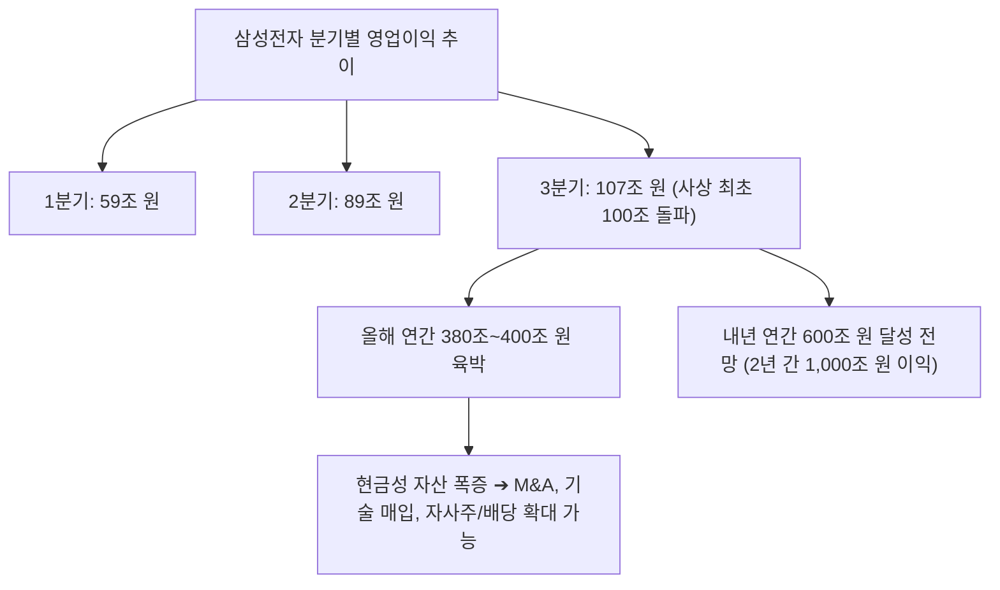
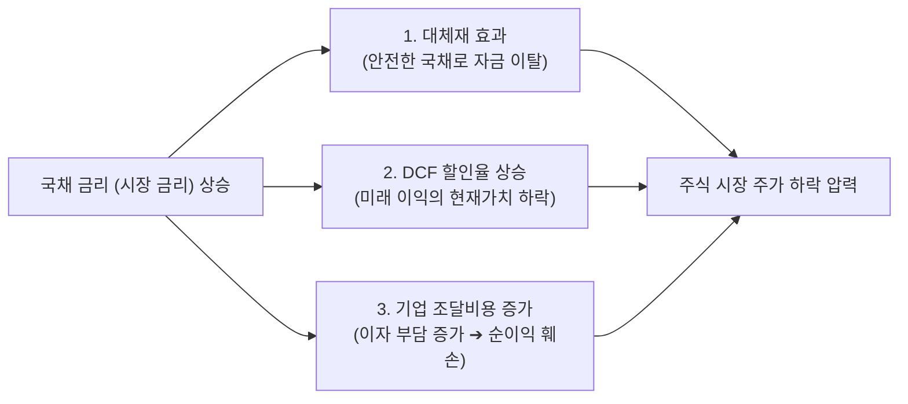
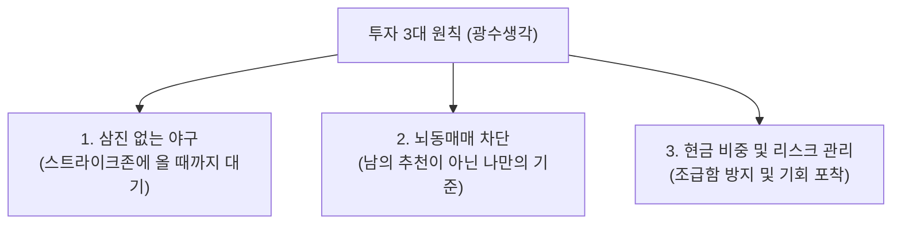
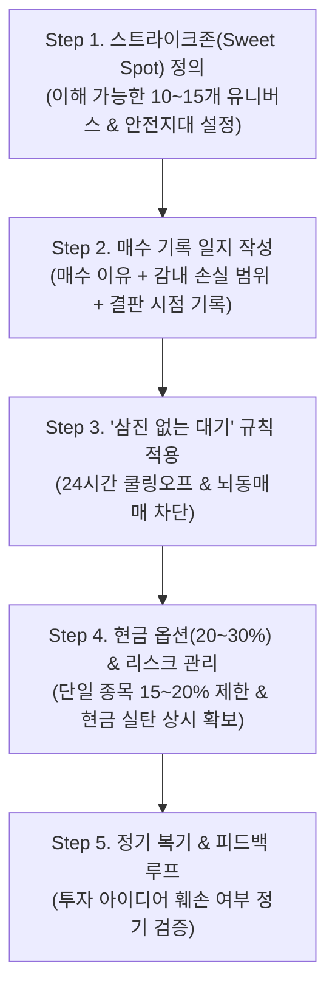
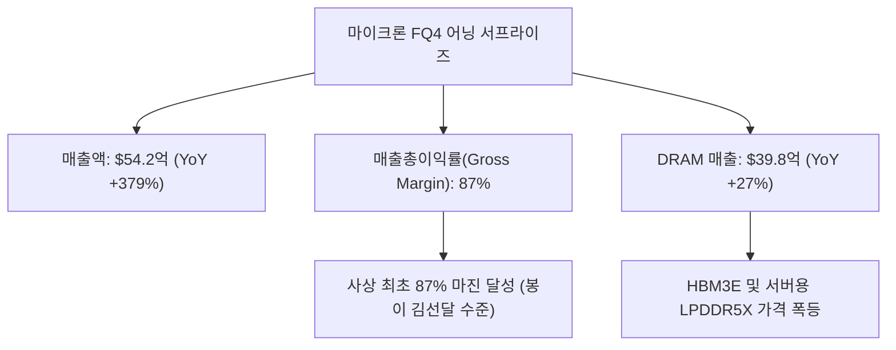
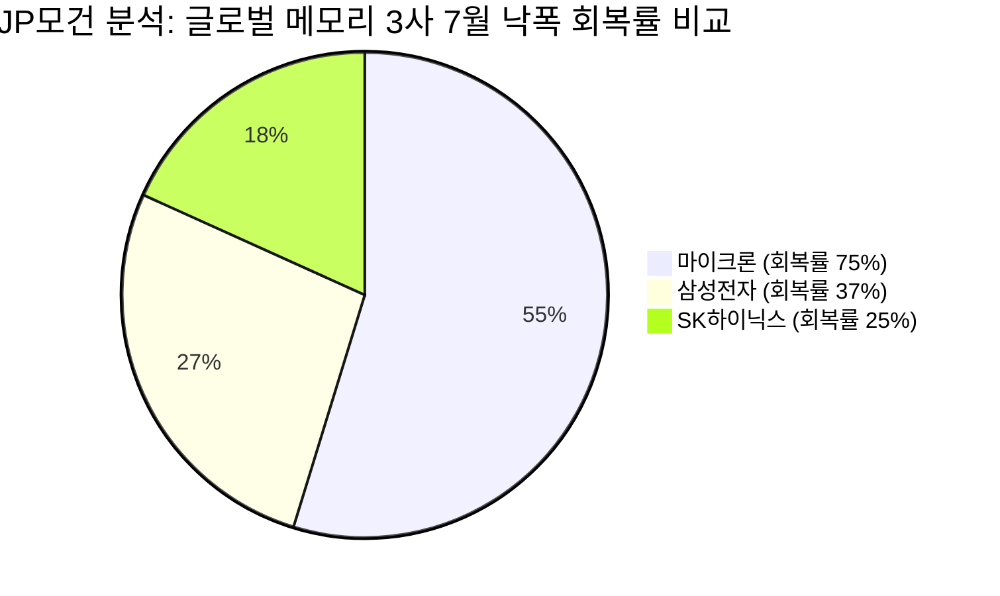
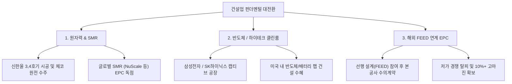

# [G] 겸손은힘들다 12시에만나요 리포트 — 2026년 누적

> **연 단위 누적 파일** · 작성 주체: GEMINI · 대상 연도: 2026
> 2026년 한 해 동안의 모든 회차를 이 파일 하나에 **최신 회차가 위로 오도록** 누적합니다. 새 회차는 `<!-- ENTRIES -->` 표시 바로 아래에 추가하고, 아래 목차 표 맨 위에 한 줄을 추가합니다. (규칙: `.agent/rules/report_naming.md`)

## 📑 회차 목차 (최신순)

| 회차 기준일 | 제목 |
|---|---|
| [2026-10-09](#entry-20261009) | 🎬 [김어준의 겸손은힘들다 뉴스공장 '12시에 만나요'] 금리 특강 & 투자 원칙 "투자란 삼진 없는 야구다" 심층 분석 |
| [2026-10-01](#entry-20261001) | 🎬 [김어준의 겸손은힘들다 뉴스공장 '12시에 만나요'] 마이크론 어닝 서프라이즈 & 반도체 슈퍼사이클 심층 분석 |
| [2026-09-28](#entry-20260928) | 🎬 [김어준의 겸손은힘들다 뉴스공장 '12시에 만나요'] 주간 증시 브리핑 & 건설 섹터 심층 분석 |

<!-- ENTRIES -->

---

<!-- ENTRY date=2026-10-09 source="[G]겸손은힘들다_12시에만나요_금리특강_투자원칙_20261009.md" -->

# 🎬 [김어준의 겸손은힘들다 뉴스공장 '12시에 만나요'] 금리 특강 & 투자 원칙 "투자란 삼진 없는 야구다" 심층 분석

**방송 채널:** 김어준의 겸손은힘들다 뉴스공장  
**코너명:** 12시에 만나요 (1부: 정오의 머니뉴스 / 2부: 이광수T 금리 특강 / 3부: 광수생각)  
**방송 일자:** 2026년 10월 09일 (금요일, 한글날 휴장 맞이 공개방송 다시보기 특집)  
**진행자:** 메인 MC 이광수 소장(이광수T), 박시동 대표(경제평론가), 권다영 앵커 (특별학생: 권민정 아나운서)  
**원본 영상:** [https://www.youtube.com/watch?v=x6kKvZm-93s&list=PLpDZdhM6kelSHHNdphTwAWuxxwbI4kGyX&index=1](https://www.youtube.com/watch?v=x6kKvZm-93s&list=PLpDZdhM6kelSHHNdphTwAWuxxwbI4kGyX&index=1)

---

## 1. Executive Summary

2026년 10월 9일 한글날 휴장을 맞이하여 방송된 **김어준의 겸손은힘들다 뉴스공장 '12시에 만나요'**에서는 삼성전자의 사상 최대 3분기 영업이익 발표 및 월가의 메모리 멀티플 논쟁 분석과 함께, 개인 투자자들이 반드시 알아야 할 **'금리가 주식시장에 미치는 영향'** 및 **'투자 3대 원칙(삼진 없는 야구)'**에 대한 심층 특강을 진행하였습니다.

* **삼성전자 3분기 영업이익 107조 원 돌파 & 압도적 볼륨감:** 1분기 59조 원 → 2분기 89조 원 → 3분기 107조 원으로 영업이익 폭증. 올해 연간 영업이익 약 380조~400조 원, 내년 600조 원 육박 전망. 압도적 현금흐름(FCF)에 기반한 자사주 매입 및 배당 수익률 6~7% 육박 가능성 제기.
* **월가 DA 데이비슨(DA Davidson)의 마이크론 파격 리포트 ($3,000 목표가):** "If you don't buy it, they will" (당신이 안 사면 남들이 다 살 것). 포워드 PER 5.2배에서 엔비디아급 멀티플(PER 19배) 적용을 주장하며 목표가 $3,000 제시. 한국 삼성전자/SK하이닉스(포워드 PER 4.1배)의 극단적 저평가 재조명.
* **[이광수T 금리 특강] 금리와 주식시장의 3대 핵심 메커니즘:** 금리는 "돈에 붙는 이자". 시장 금리(온도계)와 기준 금리(온도 조절기)의 개념 정립 및 국채 금리 상승이 주가를 누르는 3가지 이유(대체재 효과, DCF 할인율 상승, 기업 조달/이자 비용 증가) 정밀 해설.
* **[광수생각] "투자란 삼진 없는 야구다":** 워런 버핏의 명언 인용. 주식 시장에는 3스트라이크 아웃이 없으므로, 남들의 조급함에 휘둘리지 않고 내가 가장 잘 아는 스트라이크존(확실한 밸류/타점)에 공이 올 때까지 기다릴 줄 아는 정석 투자의 중요성 강조.

---

## 2. 1부: 정오의 머니뉴스 — 삼성전자 107조 영업이익 & 월가 멀티플 논쟁

### 2.1 삼성전자 3분기 실적 및 압도적 볼륨감(Volume)

| 실적 항목 | 2026년 분기별 / 연간 수치 | 시장 평가 및 시사점 |
| :--- | ---: | :--- |
| **3분기 영업이익** | **107조 원** | 사상 최초 단일 분기 100조 원 영업이익 돌파 (지구상 최상위 이익) |
| **올해 연간 예상 영업이익** | **380조 ~ 400조 원** | 사상 최대 실적 경신 |
| **내년 연간 예상 영업이익** | **약 600조 원** | 2년 간 누적 영업이익 1,000조 원 도달 전망 |
| **포워드 PER (주가수익비율)** | **4.1 배** | 미국 월마트(33배), 마이크론(5.2배) 대비 극단적 저평가 |
| **주주환원 여력 (배당/자사주)** | **FCF 50% 주주환원 시 6~7%** | 배당 수익률 측면에서도 고배당 배당성장주 가치 확보 |

* **압도적 볼륨감이 주는 전지전능함:** 일부 여의도 시각에서 "증가율이 둔화되었다"고 트집 잡는 것은 어불성설. 100조 원이 넘는 이익 볼륨은 부족한 기술 M&A, 인재 영입, 공급망 내 핵심 자산을 모두 사들일 수 있는 전지전능한 재무 체력을 의미함.
* **배당 수익률 6~7%의 하방 버팀목:** 현 주가 수준에서 FCF의 50%를 주주 환원할 경우 배당 수익률이 6~7%에 육박하게 되어 주가의 강력한 하방 지지선 역할을 하게 됨.

---

### 2.2 월가 DA 데이비슨(DA Davidson)의 마이크론 $3,000 목표가 리포트 분석

* **리포트 제목:** `"If you don't buy it, they will"` (당신이 안 사면, 다른 사람들이 다 살 것이다)
* **목표주가 상향:** 기존 $2,100 ➔ **$3,000** (월가 최고 목표가)
* **핵심 분석 요지:**
  1. 매출 추정치를 더 올린 것이 아니라, **PER 멀티플을 기존 7~8배에서 엔비디아급인 19배로 상향** 적용.
  2. 메모리 반도체 공급 부족(Shortage)이 2028년까지 지속되고, 매출의 50% 이상이 장기 공급 계약으로 체결되어 실적 하방이 철통 보장됨.
  3. 시클리컬(경기순환주) 관점이 아닌 **구조적 고성장주(Growth Stock)**로 재평가해야 함을 역설.
* **한국 반도체주와의 비교:** 마이크론 포워드 PER이 5.2배인데 반해, 한국의 삼성전자와 SK하이닉스는 4.1배 수준으로 더욱 심각하게 저평가되어 있음.

---

## 3. 2부: 이광수T 금리 특강 — 금리와 주식시장의 핵심 매커니즘

### 3.1 금리의 정의와 두 가지 종류

1. **금리의 한 줄 정의:** "돈에 붙는 이자 (돈을 빌리거나 빌려줄 때의 비율)"
2. **시장 금리 vs 기준 금리 비교:**

| 구분 | 시장 금리 (Market Rate) | 기준 금리 (Base Rate) |
| :--- | :--- | :--- |
| **비유** | **온도계 (Thermometer)** | **온도 조절기 (Thermostat)** |
| **결정 주체** | 국채 및 금융 시장의 수요와 공급 | 중앙은행 (한국은행, 연준 등) |
| **특징** | 매일 실시간으로 변동함 | 중앙은행 정책 회의에서 결정 개입 |
| **목적** | 현재 시장의 자금 수급 현황 측정 | 탐욕과 과열을 방지하고 물가/경기 조절 |

* **중앙은행 개입의 본질:** 시장은 본질적으로 탐욕적이기 때문에 자율에만 맡기면 금리가 극단으로 치달을 수 있음. 중앙은행이 인위적으로 기준금리를 조절하여 통화량과 경제 온도를 관리함.

---

### 3.2 국채 금리가 오르면 주가가 떨어지는 3가지 이유

1. **대체재 관계 (Opportunity Cost):**
   - 주식은 원금 손실 위험이 있는 자산인 반면, 국채는 국가가 원리금을 보장하는 안전 자산.
   - 국채 금리가 오르면 굳이 위험을 무릅쓰고 주식을 살 이유가 줄어들어 주식 시장에서 자금이 이탈함.
2. **미래 이익 할인율(Discount Rate) 상승:**
   - 주식의 가치는 '미래에 벌어들일 현금흐름의 현재 가치'로 산정됨 (DCF 모델).
   - 금리(할인율)가 분모에 들어가므로, 금리가 상승하면 미래 이익의 현재 가치가 급격히 감소하여 특히 성장주/기술주 타격이 큼.
3. **기업의 조달 비용 및 이자 부담 증가:**
   - 기업이 설비투자나 운영자금을 차입할 때 부담해야 하는 이자 비용이 늘어남.
   - 영업이익이 동일하더라도 이자 비용이 증가하면 당기순이익이 훼손됨.

---

## 4. 3부: [광수생각] "투자란 삼진 없는 야구다" (투자 3대 원칙)

### 4.1 워런 버핏의 명언: "Investing is a game with no strikeouts"

* **야구와 투자의 결정적 차이:**
  - 일반 야구에서는 스트라이크가 3개 들어가면 삼진 아웃(Strikeout)당함.
  - **그러나 주식 투자에는 삼진 아웃이 없음.** 공(주가/종목)이 10개, 100개, 1,000개 지나가도 내가 확실히 아는 스트라이크존(원하는 밸류에이션과 타점)이 올 때까지 가만히 배트를 내리고 기다려도 아무도 나를 아웃시키지 않음.
* **개인 투자자가 실패하는 이유:**
  - 남들이 배트를 휘두르는 모습을 보고 조급해하며, 자신이 알지도 못하는 공(지나가는 테마주/급등주)에 무작위로 배트를 휘두르기 때문.

---

### 4.2 실전 투자를 위한 3대 계율

1. **자신만의 스트라이크존(원하는 주가/밸류)을 명확히 설정하라.**
   - 내가 이해하고 펀더멘털을 확신할 수 있는 기업만 타격 범위에 넣는다.
2. **남의 말이나 주변 친구의 추천으로 사지 마라.**
   - 남의 추천으로 사면 주가가 하락할 때 공포를 견디지 못하고 손절하게 된다.
3. **현금 비중을 절대 제로(0)로 만들지 말고 기다림을 즐겨라.**
   - 자금이 묶여(방치되어) 있으면 좋은 기회가 왔을 때 배트를 휘두를 수 없다. 현금은 그 자체로 훌륭한 옵션이다.

---

## 5. 이광수 대표의 '삼진 없는 야구' 기반 실전 투자 Action Plan

이광수 대표가 강조한 **"투자는 삼진 아웃이 없는 야구"** 철학과 **"과정 중심의 기록 관리"**를 실전 주식 투자에 적용하기 위한 5단계 개인 액션 플랜(Action Plan)입니다.

### 5.1 5단계 실전 투자 Action Plan 상세

#### Step 1: 자신만의 스트라이크존(Sweet Spot) 정의
- **핵심 철학:** 지나가는 공(급등주·테마주)에 무작위로 배트를 휘두르지 않고, 내가 가장 잘 아는 스트라이크존에 들어오는 공만 친다.
- **실전 규칙:**
  1. 사업 모델과 재무구조를 온전히 이해하는 기업 10~15개로 제한된 **'관심 유니버스'** 구성.
  2. **안전지대(Margin of Safety) 컷 매수 기준:** 포워드 PER 5배 이하, PBR 1배 이하 등 현저한 저평가 구간 진입 시에만 매수 타점으로 인정.

#### Step 2: 매수전 3대 기록 일지 작성 (Journaling) `[05:13]`, `[05:27]`, `[05:45]`
- **핵심 철학:** 단기 결과에 연연하기보다 매수 과정과 감내 가능한 리스크를 명문으로 기록하여 시장 흔들림에 대응한다.
- **실전 규칙 (매수 전 작성 필수 서식):**
  - ① **매수 아이디어(Thesis):** 해당 기업을 왜 사는지 펀더멘털·실적 촉매 3가지 서술.
  - ② **감내 가능한 손실 범위(Acceptable Loss):** "이 종목에서 감내할 수 있는 최대 손실은 -X%(-Y원)"로 명시하고, 손절/재검토 라인 설정.
  - ③ **예상 결판 시점:** 단기 모멘텀(1주~1개월) vs 장기 펀더멘털 투자(1년~3년) 구분.

#### Step 3: 조급함 차단과 24시간 쿨링오프 (Cooling-off) `[58:33]`
- **핵심 철학:** 투자는 삼진 아웃이 없으므로 좋은 공이 올 때까지 10년이고 기다려도 아웃되지 않는다. 시장에서 오랫동안 살아남는 것이 최우선이다.
- **실전 규칙:**
  1. 남의 추천이나 방송/뉴스만 보고 당일 즉시 매수하는 뇌동매매 절대 금지.
  2. 타인 추천 종목은 반드시 **24시간 자숙 기간**을 거쳐 직접 분석 일지를 작성한 후 편입 여부 결정.
  3. 장중 주가창 확인 횟수 1일 1회(장 마감 후)로 제한 ➔ 단기 주가 소음에 따른 심리적 왜곡 차단.

#### Step 4: 현금 옵션(20~30%) & 비중 조절
- **핵심 철학:** 현금은 방치된 돈이 아니라 시장 폭락 시 최고 타점의 공을 칠 수 있게 해주는 가장 강력한 투자 옵션이다.
- **실전 규칙:**
  1. 포트폴리오 내 **현금 비중 20~30% 상시 유지** (과열 시장일수록 현금 비중 상향).
  2. 단일 종목 최대 비중 15~20% 이하, 동일 섹터 최대 2종목 제한 ➔ 리스크 분산.

#### Step 5: 주간/월간 복기 및 피드백 루프 (Feedback Loop)
- **핵심 철학:** 과정에 집중하고 기록을 되돌아볼 때 지속 가능한 장기 투자 성과가 완성된다.
- **실전 규칙:**
  1. 매주 금요일 장 마감 후 **'매수 일지 vs 실제 주가 궤적'** 대조 점검.
  2. **아이디어 훼손(Thesis Broken)** 시 주가와 관계없이 원칙적 매도/손절.
  3. **단순 주가 하락(시장 노이즈)** 이고 투자 아이디어가 유효하며 스트라이크존 깊숙이 들어온 경우 분할 매수 실행.

---

### 5.2 개인 투자자를 위한 실전 대응 가이드 및 체크리스트

| 구 분 | 핵심 점검 항목 | 실전 액션 가이드 |
| :--- | :--- | :--- |
| **삼성전자 / 반도체** | PER 4.1배 극단적 저평가 및 3Q 107조 이익 | 단기 주가 횡보 시 분할 매수 모아가는 관점 유지 |
| **금리 모니터링** | 미 국채 10년물 금리 및 한국 국고채 금리 | 국채금리 안정을 확인하며 성장주/배당주 비중 밸런싱 |
| **매매 태도** | 조급함 및 뇌동매매 방지 | 삼진 없는 야구 원칙 적용 ➔ 확실한 타점까지 현금 보유 |

---

- **저장 경로:** [`reports/youtube/[G]겸손은힘들다_12시에만나요_금리특강_투자원칙_20261009.md`](file:///c:/Users/권기달/MyProject/stock-invest-agent/reports/youtube/%5BG%5D%EA%B2%B8%EC%86%90%EC%9D%80%ED%9E%98%EB%93%A4%EB%8B%A4_12%EC%8B%9C%EC%97%90%EB%A7%8C%EB%82%98%EC%9A%94_%EA%B8%88%EB%A6%AC%ED%8A%B9%EA%B0%95_%ED%85%AC%EC%9E%90%EC%9B%90%EC%B9%99_20261009.md)

---

<!-- ENTRY date=2026-10-01 source="[G]겸손은힘들다_12시에만나요_마이크론실적_20261001.md" -->

# 🎬 [김어준의 겸손은힘들다 뉴스공장 '12시에 만나요'] 마이크론 어닝 서프라이즈 & 반도체 슈퍼사이클 심층 분석

**방송 채널:** 김어준의 겸손은힘들다 뉴스공장  
**코너명:** 12시에 만나요 (1부: 정오의 머니뉴스 / 2부: 12시 사랑방)  
**방송 일자:** 2026년 10월 01일 (목요일)  
**진행자:** 메인 MC 이광수, 박시동 경제평론가(대표), 권다영 앵커  
**원본 영상:** [https://www.youtube.com/watch?v=Pz_sP9FFiBE](https://www.youtube.com/watch?v=Pz_sP9FFiBE)  

---

## 1. Executive Summary

2026년 10월 1일 방송된 **김어준의 겸손은힘들다 뉴스공장 '12시에 만나요'**는 마이크론(Micron)의 4분기 어닝 서프라이즈 발표와 10월 1일 산자부 발표 한국 9월 수출입 통계(사상 최초 월 1,200억 달러 수출 돌파)를 집중 분석하였습니다.

* **마이크론(MU) 어닝 서프라이즈 & 피크론 불식:** 매출총이익률(Gross Margin) 87%라는 역사상 전무후무한 숫자를 기록. 주가 오버나이트 보합 반응은 매크로 금리 압박과 1분기 성과급/재고 반영에 따른 착시일 뿐, 펀더멘털은 사상 최고 수준.
* **마이크론 IR의 전향적 3대 신규 멘트:** ① **2031년까지 AI 메모리 슈퍼사이클 지속 가이던스**, ② **장기계약(Long-term Contract) 고객사 26개로 확대**, ③ **클린룸(건설) 위주 Capex 투자로 무분별한 증설 자제 ➔ 고마진 유지 전략 확립**.
* **한국 반도체주(SK하이닉스·삼성전자) 극심한 디스카운트 (JP모건/골드만 뷰):** 마이크론이 전고점 대비 낙폭의 75%를 회복한 반면, SK하이닉스는 낙폭의 25%만 회복하여 향후 전고점 대비 **+65%의 독보적 상승 여력**을 보유함.

---

## 2. 1부: 정오의 머니뉴스 (이광수, 박시동, 권다영)

### 2.1 마이크론(Micron) FQ4 실적 발표 세부 분석

| 실적 지표 항목 | 마이크론 발표 수치 (FQ4) | 시장 컨센서스 (예상치) | YoY / QoQ 증감 | 비고 및 평가 |
| :--- | ---: | ---: | :--- | :--- |
| **매출액 (Revenue)** | **54.2억 달러** | 51.0억 달러 | **YoY +379%** / QoQ +31% | 어닝 서프라이즈 달성 |
| **매출 총이익률 (Gross Margin)** | **87.0%** | 86.1% | QoQ +2.1%p | **역사상 사상 최초 87% 마진 달성** |
| **DRAM 매출액** | **39.8억 달러** | - | QoQ +27% | 전체 매출의 73% 차지 (HBM3E 포함) |
| **다음 분기 가이던스 (매출)** | **61.5억 달러** | 60.0억 달러 | - | 견조한 성장세 지속 제시 |
| **다음 분기 가이던스 (마진)** | **86.25%** | 86.40% | QoQ -0.75%p | 성과급 및 제반 비용 반영 착시 (피크아웃 아님) |

#### 시장 오버나이트 보합의 진실 & 피크아웃 논란 해명
* **피크론 우려의 허구성:** 일각에서는 다음 분기 마진 가이던스가 86.25%로 0.75%p 낮아진 것을 두고 "피크아웃"이라고 주장하나, 이는 마이크론 측이 1분기에 성과급 및 일시적 재고 정리 비용을 몰아서 반영했기 때문임.
* **마이크론 경영진의 손놀림:** 마이크론 IR은 "1분기가 연중 마진 바닥이며 2분기부터는 87% 이상으로 재상승할 것"이라고 공식 확인.

---

### 2.2 마이크론 IR이 밝힌 4대 파격적 신규 모멘텀
1. **2031년까지 AI 메모리 슈퍼사이클 가이던스 공식화:** 기존 2027~2028년 보증을 넘어 주요 반도체 메이커 중 최초로 **2031년까지 공급 부족(Shortage) 장기화**를 언급.
2. **장기 계약(Long-term Contract) 수량 폭증:** 직전 분기 16개사에서 이번 분기 **26개사로 장기 계약 고객 확대**.
3. **비(非) 하이퍼스케일러 기업으로 저변 확대:** 메타, 아마존 등 빅테크 외에 일반 기업 및 중소형 컴퓨팅사들까지 더 높은 가격에 장기 계약 체결 중.
4. **스마트한 Capex 투자 전략:** 장비 수급을 무작위로 늘려 공급 과잉을 부르는 대신, 공장 껍데기(클린룸/건설) 위주로 유연하게 투자하여 반도체 ASP(평균판매단가) 고마진 유지.

---

### 2.3 미 PCE 물가, 미 국채금리(5.29%) & 한국 9월 수출입 통계
* **미 8월 PCE 물가 지수:** 헤드라인 3.4%로 예상 하회했으나, 연내 개정 산출 기준 변경(0.1~0.2%p 낮아지는 효과) 및 GDP 호조로 미 10년물 국채금리가 5.29%, 30년물이 5.6%를 터치하며 고공행진 지속.
* **한국 9월 수출입 동향 (10/1 발표 통관 잠정치):**
  * **수출:** 사상 최초 월 **1,209.4억 달러 (+83.5% YoY)** 돌파.
  * **반도체 수출:** 단일 품목 최초 월 **603억 달러 (+262.8% YoY)** 돌파 (전체 수출의 49.9%).
  * **무역수지:** **498.5억 달러 흑자** (역대 최고 기록).

---

### 2.4 반도체 소부장 ETF 컨닝 투자 전략 (이광수 팁)
* **투자 팁:** 투자는 발명하는 것이 아니라 우량 자금의 궤적을 쫓아가는 것. 국내 대표 반도체 ETF(KODEX 반도체, TIGER 반도체 등) 보유 비중에서 삼성전자/SK하이닉스를 제외한 **소부장 종목 중 최근 비중(Flow)이 꾸준히 늘어나는 종목**을 발굴해 투자하는 전략 제언.

---

## 3. 2부: 12시 사랑방 - JP모건/골드만 뷰 & 국내 메모리 디스카운트 분석

### 3.1 글로벌 IB (JP모건/골드만삭스) 분석 리포트 요약
* **마이크론 vs SK하이닉스/삼성전자 주가 회복률 격차:**
  * **마이크론 (MU):** 7월 주가 조정 이후 전고점 대비 **낙폭의 70~75% 회복** 완료. (전고점까지 +10% 상승여력)
  * **SK하이닉스 (000660):** 전고점 대비 **낙폭의 25%만 회복**한 상태. (전고점 탈환 시 **+65%의 독보적 상승 여력** 보유)
  * **삼성전자 (005930):** 전고점 대비 **낙폭의 37% 회복**한 상태. (전고점 탈환 시 **+35%의 상승 여력** 보유)

### 3.2 12시 사랑방 핵심 결론
* 한국 대표 메모리주(SK하이닉스, 삼성전자)는 실적 이익 체력(영업이익률 40%+) 대비 글로벌 시장에서 과도하게 억눌려 있는 상태.
* 마이크론의 실적 어닝 서프라이즈와 2031년 슈퍼사이클 확인은 국내 반도체 대장주 및 우량 소부장주의 강력한 주가 상향 리레이팅(Re-rating) 촉매로 작용할 것.

---

## 4. 종합 시사점 및 투자자 가이드라인

1. **마이크론 실적 착시 불식:** 1분기 가이던스 마진 소폭 하락(86.25%)에 현혹되지 말고 2031년까지 이어질 AI 메모리 수급 쇼티지에 주목.
2. **국내 반도체 대장주 밸류에이션 갭 메우기 베팅:** SK하이닉스(상승여력 +65%) 및 삼성전자(상승여력 +35%)의 밸류에이션 갭 메우기 구간 진입 시 매수 유지.
3. **반도체 소부장 ETF 유입 종목 스크리닝:** 반도체 ETF 상위 비중 증가 소부장 종목 분할 매수.

---

<!-- ENTRY date=2026-09-28 source="[G]겸손은힘들다_12시에만나요_건설분석_20260928.md" -->

# 🎬 [김어준의 겸손은힘들다 뉴스공장 '12시에 만나요'] 주간 증시 브리핑 & 건설 섹터 심층 분석

**방송 채널:** 김어준의 겸손은힘들다 뉴스공장  
**코너명:** 12시에 만나요 (1부: 정오의 머니뉴스 / 2부: 12시 사랑방)  
**방송 일자:** 2026년 09월 28일 (월요일)  
**진행자:** 메인 MC 이광수, 박시동 경제평론가(대표), 권다영 앵커  
**출연 게스트:** 신영증권 박세라 연구원 (건설 섹터 수석 애널리스트)  
**원본 영상:** [https://www.youtube.com/watch?v=xn1oy_azv6s](https://www.youtube.com/watch?v=xn1oy_azv6s)  

---

## 1. Executive Summary

2026년 9월 28일 방송된 **김어준의 겸손은힘들다 뉴스공장 '12시에 만나요'**는 **[1부: 정오의 머니뉴스]**와 **[2부: 12시 사랑방 - 건설 섹터 심층 분석]**으로 진행되었습니다.

* **글로벌 매크로 & 정치·경제 뷰:** 미중 정상회담의 '갈등 관리(무역 휴전 2027년 1월 10일까지 연장)' 및 미-이란 대치로 유가가 93달러 선으로 재상승하고 미 10년물 국채 금리가 5.2%를 터치하며 금융 시장 부담 지속.
* **AI & 증시 이벤트:** 메타(Meta) AI 비서 '뮤즈(Muse)'의 폭발적 흥행(+36% 주가 상승)과 스마트 글래스 밸류체인 부각, 10월 1일 목요일 마이크론(Micron) 실적 발표 및 미 9월 고용보고서가 이번 주 증시의 핵심 변수.
* **건설 섹터 심층 뷰 (신영증권 박세라 연구원):** 2024년 비관론("건설만 아니면 된다")에서 **2026년 "건설 빅사이클의 시작"**으로 시각 전환. 지난 2년간 부실 현장 정리(빅배스)를 완료하고 **원자력(신한울 3·4호기, 체코 원전, SMR)**, **반도체/하이테크 공장 클린룸**, **해외 FEED 연계 EPC**로 체질 개선에 성공.

---

## 2. 1부: 정오의 머니뉴스 (이광수, 박시동, 권다영)

### 2.1 미중 정상회담 결과 복기: "갈등의 해소가 아닌 갈등의 관리"
* **핵심 내용:** 방미 일정으로 치러진 미중 정상회담은 화려한 외관 대비 실질적 딜(Deal) 타결은 없었습니다. 양국 발표에서 중국은 8가지 협력 성과를, 미국은 무역관세/에너지/투자 협력을 언급했습니다.
* **시사점:** 당초 11월 10일 예정이었던 무역 전쟁 휴전시한을 **2027년 1월 10일까지 2달 연유 유예**한 것이 실질 성과입니다. 히토류 및 AI 관련 규제 등 핵심 전략 현안은 포함되지 않은 채 확전을 막는 현상 유지 관리 수준에서 종료되었습니다.

### 2.2 이스라엘-이란 군사 긴장 & 고유가·고금리 압박
* **이란 7일 휴전안 거부:** 이란이 UN 총회 계기 미국에 7일간의 호르무즈 해협 휴전안을 제안했으나 트럼프 대통령이 거부하고 중간선거 이후 재폭격을 준비 중이라는 월스트리트저널 보도가 이어졌습니다.
* **유가 및 금리여파:** WTI 유가가 93달러 선을 위협하고, **미국 10년물 국채 금리가 5.2%를 터치**하며 시장을 압박하고 있습니다. 연준의 연내 2회 금리 인상 가능성까지 반영되며 금리 하방 경직성이 강화되었습니다.

### 2.3 메타(Meta) AI 비서 '뮤즈(Muse)' 흥행 & 하드웨어 밸류체인
* **뮤즈(Muse) 흥행 서비스:** 메타가 공개한 AI 에이전트 서비스 '뮤즈'가 출시 15일 만에 300만 다운로드를 돌파하여 챗GPT(160만) 및 제미나이(30~40만)를 압도했습니다. 이에 따라 9월 메타 주가는 +36% 폭등했습니다.
* **스마트 글래스 & 밸류체인:** 레이벤 메타 글래스, 뮤즈참(목걸이형 하드웨어) 등 웨어러블 디바이스가 공개되면서 LG이노텍, 카메라 모듈, MLCC, 기판, 투명 디스플레이 등 국내 관련 부품주의 수혜가 기대됩니다.

### 2.4 이번 주 마켓 캘린더 & 체크포인트
1. **월요일 (9/28):** BOJ 의사록 공개, 유럽 당뇨학회
2. **화요일 (9/29):** 미 JOLTS 구인건수 발표
3. **수요일 (9/30):** 미 PCE 물가지수 & 3Q GDP 수정치 발표
4. **목요일 (10/1):** **마이크론(Micron) 실적 발표 (한국시간 오전 6시)**, 한국 9월 수출입 동향, 중국 국경절 휴장 시작(~10/7)
5. **금요일 (10/2):** 미국 9월 노동부 고용보고서 발표

---

## 3. 2부: 12시 사랑방 - 건설 섹터 빅사이클 진입 심층 분석 (신영증권 박세라 연구원)

### 3.1 건설 애널리스트 10년 회고 & 시각 전환 이유
* **2024년 비관론 ("건설만 아니면 된다"):** 커버리지 10년 차 보고서에서 실적 불확실성, 무차별화, 미흡한 주주환원 3가지를 비판하며 비관론 유지.
* **2026년 반등론 ("건설 빅사이클의 시작"):** 2024~2025년에 걸쳐 주택 및 PF 부실 현장 정리를 완료하고, 저가 수주(Low-cost bidding) 경쟁 탈피 및 3대 신성장 동력을 확보하면서 펀더멘털 대전환에 진입.

### 3.2 건설업 펀더멘털을 바꾼 3대 신성장 동력

1. **원자력 발전 및 SMR (소형모듈원전):**
   * 신한울 3·4호기 시공 본격화 및 체코 원전 최종 수주에 따른 대형 원전 모멘텀.
   * 현대건설, 대우건설 등을 중심으로 글로벌 SMR 설계·시공 수주 잔고 급증.
2. **반도체 및 하이테크 공장 (Cleanroom):**
   * 단순 민간 주택을 넘어 삼성전자, SK하이닉스 및 미국 내 팹(Fab) 인프라 공사 수주.
   * 고난도 클린룸 기술을 보유한 대형 건설사의 안정적 이익 창출원 역할.
3. **해외 FEED 연계 EPC 수주 구조 개편:**
   * 과거 10년 전 부실 원인이었던 최저가 입찰(Low-cost)을 완전히 폐지.
   * 선행 기본설계(FEED) 단계부터 참여하여 본 공사 EPC 수의계약으로 전환함에 따라 10% 이상의 고마진 확보.

### 3.3 주요 건설사 동향 및 분석
* **현대건설 (000720):** 신한울 3·4호기 시공 현장 투어 확인 결과 공사 순항 중. 중동 초대형 플랜트 및 글로벌 SMR 분야 독보적 선도.
* **대우건설 (047040):** 체코 원전 및 해외 고마진 플랜트 매출 인식이 본격화되며 주가 강세 반등 중.
* **DL이앤씨 & HDC현대산업개발:** 1조원 상당의 순현금 재무구조 및 광운대 역세권 등 고마진 자체 개발 사업 착공으로 턴어라운드 진입.

---

## 4. 종합 시사점 및 투자자 가이드라인

1. **매크로 불안 속 실적주 압축:** 국채 금리 5.2% 터치 및 고유가 지속 상황에서는 지수 대응보다 마이크론 실적 및 한국 수출 지표 확인 후 실적 우량주로 압축 대응.
2. **건설 섹터 포트폴리오 재편 전략:**
   * 지방 민간 주택 도급 비중이 높은 중소형사는 밸류 트랩 유의.
   * **원전/SMR 수주 모멘텀이 확실한 대장주(현대건설 등)** 및 **순현금 보유 턴어라운드 가치주(DL이앤씨, HDC현대산업개발 등)** 중심의 선별적 접근 제언.
