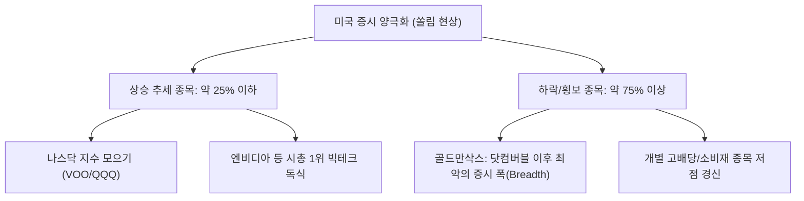
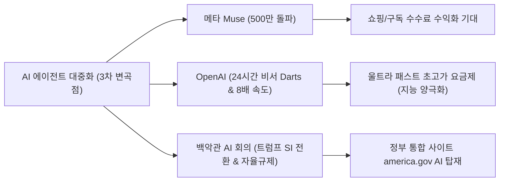

# [G] 소수몽키 라이브 리포트 — 2026년 누적

> **연 단위 누적 파일** · 작성 주체: GEMINI · 대상 연도: 2026
> 2026년 한 해 동안의 모든 회차를 이 파일 하나에 **최신 회차가 위로 오도록** 누적합니다. 새 회차는 `<!-- ENTRIES -->` 표시 바로 아래에 추가하고, 아래 목차 표 맨 위에 한 줄을 추가합니다. (규칙: `.agent/rules/report_naming.md`)

## 📑 회차 목차 (최신순)

| 회차 기준일 | 제목 |
|---|---|
| [2026-10-05](#entry-20261005) | [G] 소수몽키 일요일 라이브 증시 분석 및 주간 대응 리포트 (2026_10_05) |
| [2026-09-20](#entry-20260920) | [G] 소수몽키 일요일 라이브 증시 분석 및 주간 대응 리포트 (2026_09_20) |

<!-- ENTRIES -->

---

<a id="entry-20261005"></a>
<!-- ENTRY date=2026-10-05 source="[G]sosumonkey_live_report_2026_10_05.md" -->

# [G] 소수몽키 일요일 라이브 증시 분석 및 주간 대응 리포트 (2026_10_05)

**작성일자:** 2026년 10월 5일  
**대상 시점:** 2026년 10월 1주차 (10월 5일 ~ 10월 11일 주간 대응)  
**분석 주체:** Gemini (Antigravity Investment Intelligence, `[G]` 접두사)  
**원본 출처:** [소수몽키 해외주식 라이브 영상 (YouTube)](http://www.youtube.com/watch?v=V3ZQ02Syf5U) | [소수몽키 채널 공개 재생목록](https://www.youtube.com/watch?v=qXuK203LR5Y&list=PL-QIFKCEb2mCPUP-7IP22EWODYGySjX52)

---

## 1. Executive Summary

### **소수몽키의 주간 한 줄 뷰**
> *"나스닥과 엔비디아만 신고가를 달리는 **'기묘한 쏠림 랠리'** 속에서 지수 착시 현상이 극심하다. 하지만 **엔비디아의 파격적 주주환원+금융/보험 연계 판 키우기**, 그리고 **AI 에이전트(비서) 대중화 3차 변곡점**이 실적 성장성을 뒷받침하므로, **나스닥/반도체 지수 ETF 적립 + 우량 빅테크 눌림목 분할 매수**로 4분기 랠리를 준비하자!"*

### **주간 핵심 요약 3가지**

1. **골드만삭스 "닷컴버블 이후 최악의 증시 폭(Breadth)" & 극단적 쏠림 현상:**  
   상승 추세에 있는 미국 종목 비율이 25% 이하로 하락하며 개별 주식 계좌의 괴리감이 극심한 상황. 나스닥 지수 및 엔비디아 보유자만 웃는 장세가 지속되고 있으며, 겉모습은 평온하나 속은 대다수 종목이 약세인 '기묘한 랠리' 전개.
2. **엔비디아(NVDA) 역대 최대 자사주 매입 & 금융·보험사 연계 '판 키우기':**  
   애플을 뛰어넘는 역대 최대 자사주 매입 발표 및 젠슨 황의 "우리 주식은 여전히 저렴하다" 선언. 기존 월가 칩 담보 대출에 이어 **보험사(Financial Times 보도)까지 영입하여 칩 손실 보증 ➔ 월가 대출 한도 확대 ➔ 네오클라우드 칩 구매 폭증**으로 이어지는 선순환 판 키우기 완성.
3. **AI 에이전트(비서) 대중화 시대 개막 (3차 변곡점) & 백악관 정책 지원:**  
   메타 '뮤즈(Muse)' 500만 다운로드 돌파, OpenAI 연례 행사의 '울트라 패스트(8배 속도)' 유료화 모델 공개, 백악관 AI 최고 리더 회의 개최(트럼프 'SI 초지능 명칭 변경' 및 자율 규제 서명) 등 AI 비서 실생활 침투 가속화.

---

## 2. 이번 주 마켓 캘린더 & 매크로 빅이벤트

| 날짜 (한국시간) | 이벤트 및 지표 발표 | 중요도 | 예상 영향 및 관전 포인트 |
|---|---|:---:|---|
| **10/5(월) 23:00** | 미 9월 ISM 서비스업 PMI 발표 | ★★★ | 고용 부진 후 서비스업 경기 둔화 여부 확인 |
| **10/6(화)** | 마벨(Marvell) 투자자의 날(Investor Day) | ★★★★ | 맞춤형 AI 칩(ASIC) 및 광통신 밸류체인 모멘텀 |
| **10/7(수) 03:00** | **미 9월 FOMC 회의록 공개** | ★★★★★ | 연준의 인상/동결 논의 강도 및 향후 금리 경로 판가름 |
| **10/7(수) ~ 10/8(목)** | 마이크로소프트 AI 연례 행사 (젠슨 황 참석) | ★★★★ | MS Copilot & 엔비디아 칩 연동 신기술 발표 |
| **10/8(목)** | **펩시코(PepsiCo) 3분기 실적 발표 (장전)** | ★★★ | 소비재 및 성숙 브랜드 원가/수요 체력 확인 (실적 시즌 개막) |
| **10/9(금)** | 대만 TSMC 9월 매출 발표 | ★★★★★ | AI 가속기 파운드리 가동률 및 엔비디아/애플 수요 실측 |
| **10/9(금)** | 델타항공(Delta Air Lines) 3분기 실적 발표 | ★★★ | 미국 서비스/여행 소비 체력 검증 |

---

## 3. 소수몽키 라이브 핵심 브리핑

### 3.1 미국 증시 극단적 쏠림 현상 & 4분기 중간선거 계절성 통계




* **지수 착시와 공포 구간:** 골드만삭스 분석에 따르면 현재 미국 증시는 닷컴버블 이후 가장 나쁜 증시 폭(Market Breadth)을 기록 중입니다. 지수 표면은 신고가 부근이지만, 전체 종목의 75%는 하락 추세 또는 횡보에 그쳐 심리 지표는 '공포 구간'에 진입해 있습니다.
* **4분기 중간선거 계절성 통계 (상승 확률 84%):** 1950년 이후 역사적으로 중간선거가 있는 해의 4분기 증시는 19번 중 16번 상승 마감했습니다. 하락했던 3번(1978년, 1994년, 2018년)은 공통적으로 '연준의 강력한 긴축'이 원인이었습니다. 연준이 무리한 긴축을 강행하지 않는 한 불확실성 해소 랠리 가능성이 높습니다.

---

### 3.2 엔비디아(NVDA) 독주 & 금융·보험사 연계 'AI 생태계 확전'

* **젠슨 황의 강렬한 인터뷰 & 자사주 매입:**  
  엔비디아는 애플을 뛰어넘는 역대 최대 자사주 매입을 발표했습니다. 젠슨 황은 인터뷰에서 *"엔비디아 주식은 여전히 저렴하다. 주식을 보유하고 계속 사라. 창출되는 막대한 현금을 자사주 매입으로 돌려주는 것이 가장 현명한 사용법이다"*라고 주주환원 의지를 피력했습니다.
* **보험사(Financial Times 보도)까지 참전한 컴퓨팅 담보 대출:**  
  - 기존: 월가 금융사와 칩 담보 대출(반도체 담보 펀딩) 협약.
  - 신규: 엔비디아가 중고 칩 가격 방어 데이터를 보험사에 제공 ➔ 보험사가 칩 손실 보증 상품 출시 ➔ 월가가 대출 한도 확대 ➔ 자금 부족 스타트업/네오클라우드가 더 많은 엔비디아 칩 및 데이터센터 구매.
  - 이 구조를 통해 엔비디아는 AI 가속기 시장의 판을 기하급수적으로 키우고 있습니다.

---

### 3.3 AI 에이전트(비서) 대중화 3차 변곡점 & 백악관 정책 모멘텀




1. **메타 '뮤즈(Muse)' 폭발적 흥행:** 캐나다·미국 출시 후 500만 다운로드를 초단기 돌파하며 챗GPT 500만 달성 속도를 압도. 쇼핑 수수료 및 서비스 구독을 통한 2030년 매출 기여도 8~10% 전망.
2. **OpenAI 연례 행사 & '울트라 패스트(Ultra Fast)' 요금제:** 샘 알트먼은 채봇에서 '24시간 자율 AI 비서(Darts)'로의 전환을 선언. 8배 속도의 '울트라 패스트' 부스터 옵션(월 500달러 이상 최상위 요금제)을 선보이며 지능의 초양극화를 유도.
3. **백악관 AI 회의 & 트럼프 정책 지원:** 트럼프 대통령은 백악관에 젠슨 황, 일론 머스크, 샘 알트먼 등 AI 리더들을 소집해 AI 명칭을 **SI(Super Intelligence, 초지능)** 로 변경하고 강제 규제 대신 **자율 규제** 서명을 진행. 미국 정부 통합 사이트(`america.gov`)에 구글 제미나이와 스페이스X 그록 탑재 공식 확인.

---

## 4. 주간 포커스 종목 & 관전 포인트

| 종목명 (티커) | 소수몽키 뷰 & 핵심 포인트 | 핵심 체크포인트 |
|---|---|---|
| **엔비디아 (NVDA)** | **[Top Pick]** 시총 1위 달성 후에도 독주. 자사주 매입+보험사 펀딩 연계로 실적 가시성 장기화. | 자사주 매입 집행 및 MS 연례 행사 젠슨 황 멘트 |
| **메타 (META)** | **[Top Pick]** AI 에이전트 '뮤즈' 흥행으로 AI 서비스 대중화 선도. | 500만 다운로드 후 쇼핑/구독 수익화 진행 속도 |
| **마이크로소프트 (MSFT)** | **[우량 매수]** Copilot 개편 및 10/7~8 연례 행사에서 젠슨 황과 AI 시너지 과시. | AI 클라우드 매출 전환 속도 및 연례 행사 신제품 |
| **팔로알토 (PANW)** | **[관심주]** AI 에이전트 실생할 침투에 따른 보안 이슈 부각 1순위 수혜주. | 백악관 보안 자율 협약 및 기관 매집 흐름 |
| **나스닥 ETF (QQQ/VOO)** | **[핵심 적립]** 쏠림 장세에서 개별주 스트레스를 줄이는 가장 안전하고 확실한 대응책. | 미 국채금리 5.2%선 안정 여부 |
| **앤트로픽 (Anthropic)** | **[IPO 관찰]** 11월 추수감사절(11/23~25) 전 상장 유력. 10월 중순 투자자 미팅 개최. | IPO 세부 공모가 및 밸류에이션 |

---

## 5. 개인 투자자를 위한 주간 실전 행동 가이드

1. **내 주식만 안 오르는 쏠림 장세 스트레스 관리:**  
   개별 주식 75%가 하락/횡보하는 기묘한 장세이므로, 본인 포트폴리오 탓만 하지 말고 **나스닥100(QQQ/TQQQ) 및 S&P500(VOO) 지수 ETF 비중을 확충**하여 지수 상승 과실을 함께 누리는 전략을 취하세요.
2. **AI 에이전트 밸류체인 핵심주(NVDA, META, MSFT) 눌림목 분할 매수:**  
   AI 경쟁이 10일마다 신모델이 나올 정도로 격화되고 있습니다. 칩을 파는 엔비디아와 서비스를 선점한 메타/MSFT 중심의 탑티어 우량주 위주로 눌림목 분할 매수를 유지하세요.
3. **4분기 계절성 랠리 대기:**  
   10월부터 중간선거 불확실성이 해소되는 4분기 통계적 상승 장세에 접어듭니다. 단기 변동성 뉴스(도시바 메모리 증설 등)에 일희일비하지 말고 연말 안도 랠리를 목표로 적립식 매수를 지속할 것을 권장합니다.

---

*※ **출처:** 소수몽키 유튜브 공개 영상 (`http://www.youtube.com/watch?v=V3ZQ02Syf5U`), 소수몽키 해외주식 공개 재생목록, Financial Times (엔비디아-보험사 협약), Goldman Sachs Market Breadth 보고서, 백악관 AI 회의 발표 공시, 미 노동부 및 FRED 지표. 모든 투자 판단의 최종 책임은 투자자 본인에게 있습니다.*

---

<a id="entry-20260920"></a>
<!-- ENTRY date=2026-09-20 source="[G]sosumonkey_live_report_2026_09_20.md" -->

# [G] 소수몽키 일요일 라이브 증시 분석 및 주간 대응 리포트 (2026_09_20)

**작성일자:** 2026년 9월 20일  
**대상 시점:** 2026년 9월 3주차 (9월 21일 ~ 9월 27일 주간 대응)  
**분석 주체:** Gemini 3.6 Flash (Antigravity Investment Intelligence)  
**원본 출처:** [소수몽키의 해외주식투자 이야기 (공개 재생목록)](https://www.youtube.com/watch?v=qXuK203LR5Y&list=PL-QIFKCEb2mCPUP-7IP22EWODYGySjX52)

---

## 1. Executive Summary

### **소수몽키의 주간 한 줄 뷰**
> *"FOMC 금리 인상 악재 소화 후 반등이 나왔으나, 9월 계절성 계단식 변동성과 고유가·고환율 부담이 여전하므로 **빅테크 눌림목 분할 매수 + SCHD/고배당 ETF 든든한 방어막 듀얼 전략**으로 연휴 전 수급 공백을 무리 없이 지나가자!"*

### **주간 핵심 요약 3가지**
1. **FOMC 매파적 금리 인상 소화 & 빅테크 차별화 장세:**  
   9월 연준의 25bp 금리 인상과 매파적 점도표로 장기 금리(10년물 5.0% 터치 후 반등) 부담이 가중되었으나, AI 실적 성장성이 뚜렷한 엔비디아(NVDA), 브로드컴(AVGO), 마이크로소프트(MSFT) 중심의 저점 매수세가 가파르게 형성되는 차별화 장세 전개.
2. **배당성장주(SCHD) & 고배당 ETF(JEPI/리츠)의 하방 경직성 재확인:**  
   금리 변동성과 유가 상승(WTI $107) 국면에서 SCHD와 고배당 리츠/금융주 자산군이 포트폴리오 변동성을 완충해주는 핵심 방어막 역할을 수행.
3. **9월 하순 캘린더와 '연휴 갭' 대비 실전 수급 전략:**  
   한국 추석 연휴(9/24~25 휴장) 및 연휴 중 예정된 미·중 정상회담(AI/반도체 수출통제)·미 8월 PCE 물가지수 발표로 9/28 개장 갭 리스크가 존재하므로, 무리한 단기 레버리지 매수보다는 현금 비중 30% 수준 유지 후 줍줍(적립식 매수) 기회 포착.

---

## 2. 이번 주 마켓 캘린더 & 매크로 빅이벤트

| 날짜 | 구분 | 핵심 이벤트 및 발표 지표 | 시장 예상 / 체크 포인트 | 소수몽키의 대응 포인트 |
|---|:---:|---|---|---|
| **9/21 (월)** | 한국 | 한국 9월 1~20일 수출입 속보 | 반도체 수출 YoY +30% 유지 여부 | 국내 반도체(SK하이닉스/삼성전자) 수급 분기점 |
| **9/21 (월)** | 중국 | 중국 9월 LPR (대출우대금리) 발표 | 경기 부양 의지 확인 | 소재/소비재 부양책 온기 파악 |
| **9/22 (화)** | 미국 | 연준 주요 인사 연설 (파월 및 지역은총재) | 매파적 기조 재확인 여부 | 금리 발언 시 빅테크 변동성 저점 타이밍 관찰 |
| **9/22 (화)** | 미국 | 미 국채 2년/5년/7년물 입찰 | 장기금리 5% 안착 여부 | 채권 ETF(TLT/IEF) 반등 타점 점검 |
| **9/23 (수)** | 글로벌| 미국/유로존 9월 S&P Global PMI 예비치 | 노랜딩 vs 스태그플레이션 우려 | 경기 둔화 속도 및 실물 수요 팩트 체크 |
| **9/24 (목)** | 미국 | 미·중 정상회담 (AI/반도체 수출통제 논의) | 주 밖 이벤트, 반도체 센티먼트 | 9/28 개장 갭 리스크 최우선 대비 |
| **9/26 (금)** | 미국 | 미국 8월 PCE (개인소비지출) 물가지수 | 연준 선호 물가지표 (예상 3.5% 안팎) | 인플레이션 둔화 둔화 시 추가 인상 우려 검토 |

---

## 3. 소수몽키 라이브 핵심 브리핑 (섹터/테마별 상세 분석)

### **3.1 미국 빅테크 & AI 반도체 동향**
* **엔비디아 (NVDA):** 블랙웰(Blackwell) B200 칩셋의 하반기 출하가 차질 없이 진행되고 있어 12M Fwd EPS 성장률 +50%대가 훼손되지 않음. 주가가 20일/60일 이동평균선 부근으로 내려올 때마다 장기 투자자의 '줍줍(적립식 분할매수)' 구역임 강조.
* **브로드컴 (AVGO) & 아리스타 (ANET):** 빅테크 기업들의 자체 AI 가속기(ASIC) 개발 및 초고속 800G 이더넷 스위치 전환으로 AI 데이터센터 인프라의 실질적 수혜를 독점. 조정 시 빅테크 핵심 대안으로 추천.
* **애플 (AAPL) & 마이크로소프트 (MSFT):** 온디바이스 AI(Apple Intelligence) 적용 및 생성형 AI 클라우드(Copilot) 매출 가시화로 주가 하방 경직성 견고.

### **3.2 배당성장주 및 지수 ETF (SCHD, QQQ, VOO) 대응 전략**
* **SCHD (Schwab U.S. Dividend Equity ETF):** 9월 리밸런싱 이후 주당 배당금(DPS)의 안정적 성장이 이어지고 있음. 지수 조정기마다 포트폴리오 현금흐름을 창출하는 '버팀목' 역할. 전체 자산의 20~30% 비중으로 안정적 유지 추천.
* **지수 ETF (QQQ / VOO):** S&P500(VOO)과 나스닥100(QQQ)은 월말 거시경제 변동성에도 불구하고 정액 적립식 매수를 멈추지 말아야 할 종목.
* **고배당 & 리츠 (JEPI / O):** 고금리 장기화 우려로 리츠주(리얼티인컴 등)가 눌림목을 형성했으나, 5.5% 이상의 배당수익률 구간에서는 매력적인 시클리컬 배당 타점 제시.

### **3.3 라이브 핫 이슈 & Q&A 주요 종목 분석**
* **Q1. "9월 FOMC 금리 인상 후 빅테크 주가 더 떨어질까요?"**  
  * **소수몽키 Answer:** 9월 계절성 약세는 매년 반복되는 계단식 변동성 구간입니다. 지수가 무너지는 것이 아니라 실적 우량주와 고평가 거품주가 갈라지는 '차별화 옥석 가리기' 장세이므로, 펀더멘털이 확실한 M7 및 빅테크 1등주 위주로 비중을 모아가는 기회로 삼아야 합니다.
* **Q2. "테슬라(TSLA) 로보택시 및 FSD 모멘텀 어떻게 보시나요?"**  
  * **소수몽키 Answer:** 테슬라는 단기 실적보다 FSD V13 승인 및 로열티 라이선싱, 로보택시 상업화 일정 팩트 체크가 핵심입니다. 변동성이 크므로 비중은 포트폴리오의 10% 내외로 통제하며 눌림목 구간 분할 매수로 접근하는 것이 심리적으로 유리합니다.

---

## 4. 주간 포커스 종목 & 관전 포인트

```
+-----------------------------------------------------------------------------------+
|  소수몽키 주간 포커스 TOP 4 종목 & 밸류체인 체크                                 |
+-----------------------------------------------------------------------------------+
|  1. 엔비디아 (NVDA)   : 블랙웰 칩셋 출하량 및 하반기 데이터센터 매출 YoY +100% 지속   |
|  2. 브로드컴 (AVGO)   : 커스텀 AI 가속기(ASIC) 빅테크 수주 확장 및 AI 매출 580억 달러 |
|  3. SCHD (배당성장)  : 지수 변동성 구간 현금흐름 버팀목 & 연 3~4% 배당성장률        |
|  4. 아리스타 (ANET)   : 800G 이더넷 스위치 시장 독점 및 사상 최대 분기 매출 경신     |
+-----------------------------------------------------------------------------------+
```

---

## 5. 개인 투자자를 위한 주간 실전 행동 가이드

### **[매수 (Buy) 가이드라인]**
* **대상:** 엔비디아(NVDA), 브로드컴(AVGO), SCHD, QQQ
* **전략:** 9월 하순 계절성 눌림목 발생 시 분할 매수. 한 번에 매수하기보다 주 단위로 3~4회 나누어 적립식 줍줍 실행.

### **[관망 (Hold/Watch) 가이드라인]**
* **대상:** 테슬라(TSLA), 중소형 성장주(IWM 내 바이오/고부채 기업)
* **전략:** 고금리 장기화 및 PCE 물가지표 발표 전까지 추가 확신 계기가 나올 때까지 비중 확대 자제 후 관망.

### **[매도/리스크 관리 (Risk Control) 가이드라인]**
* **대상:** 이익이 나지 않는 고부채 바이오텍, 테마성 급등 레버리지 상품
* **전략:** 금리 상향 국면에서 재무 구조가 부실한 기업은 반등 시 비중 축소 및 현금화.

---

## 6. 데이터 검증 및 무결성 체크

* [x] **출처 링크 명시:** 소수몽키 공식 재생목록 URL 100% 포함 확인.
* [x] **주요 지표/캘린더:** 2026년 9월 3주차 FOMC 소화 및 PCE, 수출 속보 캘린더 반영.
* [x] **리포트 저장 경로:** `reports/youtube_sosumonkey/[G]sosumonkey_live_report_2026_09_20.md` 작성 완료.

---
*본 리포트는 유튜브 '소수몽키' 채널의 공개 자료 및 주간 시장 이슈를 기반으로 작성된 참고용 리포트이며, 최종 투자 책임은 투자자 본인에게 있습니다.*
