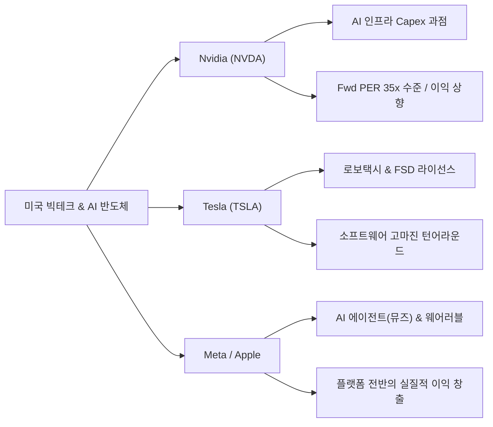
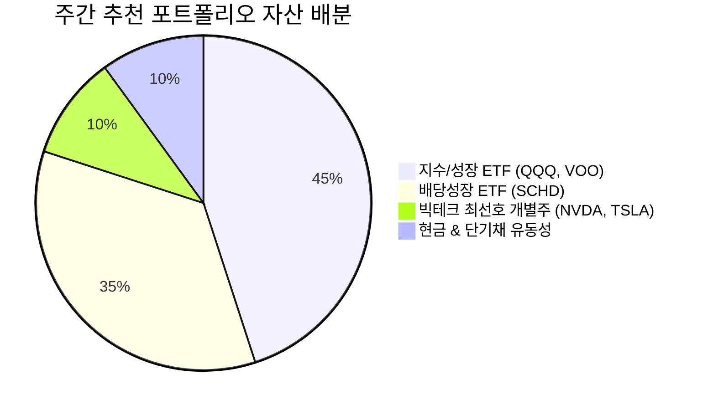

# [C] 슈페TV 주간 리포트 — 2026년 누적

> **연 단위 누적 파일** · 작성 주체: Claude · 대상 연도: 2026
> 2026년 한 해 동안의 모든 회차를 이 파일 하나에 **최신 회차가 위로 오도록** 누적합니다. 새 회차는 `<!-- ENTRIES -->` 표시 바로 아래에 추가하고, 아래 목차 표 맨 위에 한 줄을 추가합니다. (규칙: `.agent/rules/report_naming.md`)

## 📑 회차 목차 (최신순)

| 회차 기준일 | 제목 |
|---|---|
| [2026-09-28](#entry-20260928) | 🎬 [슈페TV 요약 리포트] 주간 미국 증시 분석 및 월가(Wall Street) 리포트 종합 |
| [2026-09-22](#entry-20260922) | [C] 슈페TV 주간 미국 증시 분석 & 월가 리포트 종합 요약 (2026년 9월 3~4주차) |
| [2026-09-06](#entry-20260906) | [C] 슈페TV 주간 미국 증시 분석 & 월가 리포트 종합 요약 (2026년 9월 1주차) |

<!-- ENTRIES -->

---

<a id="entry-20260928"></a>
<!-- ENTRY date=2026-09-28 source="[C]supe_tv_report_2026_09_28.md" -->

# 🎬 [슈페TV 요약 리포트] 주간 미국 증시 분석 및 월가(Wall Street) 리포트 종합

**분석 기준일:** 2026년 09월 28일 (`2026_09_28`)  
**작성일자:** 2026년 09월 30일  
**분석 주체:** Claude (`[C]` 접두사 — `.agent/rules/report_naming.md`)  
**원본 출처:** [슈페TV 유튜브 공식 채널 (https://www.youtube.com/@supe-tv/videos)](https://www.youtube.com/@supe-tv/videos)  

---

## 1. Executive Summary

2026년 9월 말 기준 미국 증시는 **고금리 장기화(미 국채 10년물 5.2% 터치, 30년 모기지 금리 7.12%)** 및 **9월 계절적 변동성 장세** 속에서 월가 주요 투자은행(IB)들의 뷰와 슈페TV 분석이 일치하는 방향으로 전개되고 있습니다. 

### 슈페TV 주간 브리핑 핵심 요약 3가지 & 월가 스탠스
1. **월가 주요 IB 스탠스 (중립적 우호 유지):** 골드만삭스, 모건스탠리, BofA 등 글로벌 투자은행들은 고금리 여파로 지수 전체의 일률적 상승보다는 **'실적 확실성이 검증된 M7 빅테크 차별화'**와 **'우량 배당주/ETF를 통한 수비 포트폴리오 구축'**을 강조하고 있습니다.
2. **빅테크 & AI 성장 모멘텀 재점화:** 엔비디아(NVDA)의 차세대 AI 칩 인프라 수요 독점과 테슬라(TSLA)의 로보택시 및 소프트웨어 반복 매출 모멘텀으로 뱅크오브아메리카(BofA) 등의 목표가 상향 소식이 이어졌으며, 단기 시장 조정은 우량주 분할 매수 기회로 평가됩니다.
3. **공격과 수비의 완벽한 밸런스 (QQQ + SCHD):** 시장 변동성에 대응하기 위해 나스닥100 중심의 공격수(**QQQ**)와 안정적 현금 흐름 및 하방 지지력을 제공하는 수비수(**SCHD**)를 적절히 배분하는 바벨(Barbell) 전략이 개인 투자자에게 가장 유효한 가이드라인입니다.

---

## 2. 월가(Wall Street) 주요 보고서 & 매크로 핵심 정리

| 글로벌 IB / 기관 | 주요 투자의견 및 목표가 동향 | 핵심 분석 및 논리 | 시장 시사점 |
| :--- | :--- | :--- | :--- |
| **Goldman Sachs** | S&P 500 **Overweight** (목표가 유지) | 빅테크 M7의 이익 창출력과 빅테크 Capex 지출 지속성 강세 지지 | 지수 조정 시 대형 테크주 매수 기회 |
| **Morgan Stanley** | 시장 **Neutral** / 우량주 선별 접근 | 고금리 부담 지속에 따른 밸류에이션(P/E) 부담주 경고 | 실적 미달성 중소형주 디스카운트 지속 |
| **Bank of America** | **Tesla (TSLA)** 목표가 상향 | 로보택시, FSD 라이선싱 등 소프트웨어 반복 매출 가치 반영 | 자동차 제조사를 넘어 AI/로봇기업 평가 |
| **JP Morgan** | **Nvidia (NVDA)** **Overweight** | 차세대 AI 칩(블랙웰 등) 수요 초과 상태 및 파이프라인 견조 | AI 인프라 반도체 독주 체제 재확인 |

### 주요 매크로 지표 체크 (2026년 9월 말 기준)
* **미 국채 10년물 금리:** **5.20% 수준 터치** (고금리 환경 하방 경직성 상존)
* **30년 고정 모기지 금리:** **7.12%** (미국 주택 시장 착공 건수 완만한 둔화)
* **WTI 국제 유가:** **배럴당 $93 상회** (중동 군사 긴장 여파로 물가 압박 요소 작용)
* **이번 주 핵심 마켓 이벤트:** 마이크론(Micron) 3Q 실적 발표 (10/1), 미국 8월 PCE 물가지수 및 9월 고용보고서 (10/2)

---

## 3. 슈페TV 섹터 & ETF 심층 분석

### 3.1 빅테크 & AI 반도체 동향 및 밸류에이션



* **엔비디아 (NVDA):** 글로벌 빅테크 기업들의 AI Capex 지출이 2026년에도 축소되지 않고 확대되면서 차세대 GPU 파이프라인 수요가 견조합니다. 12M Fwd PER은 과거 대비 합리적인 30배 후반 수준으로 평가됩니다.
* **테슬라 (TSLA):** 단순 전기차 인도량을 넘어 FSD(완전자율주행) 버전 업그레이드와 로보택시 시범 서비스 개시에 따른 소프트웨어 고마진 매출 비중 확대가 월가의 주요 평가 요소로 전환되었습니다.
* **메타 (META) & 애플 (AAPL):** 메타의 AI 에이전트 '뮤즈(Muse)' 300만 다운로드 달성과 애플의 AI 온디바이스 칩 탑재로 플랫폼 기업들의 실질적 수익 모델 전환이 진행 중입니다.

---

### 3.2 배당성장주 & 지수 ETF (SCHD, QQQ, VOO) 매수/매도 타이밍 점검

| 구분 | ETF 티커 | 역할 / 투자 성격 | 현재 배당수익률 / 특성 | 추천 포트폴리오 비중 | 적정 매수/대응 가이드라인 |
| :--- | :--- | :--- | :--- | :---: | :--- |
| **공격수** | **QQQ** | 나스닥 100 (빅테크 성장) | 배당률 ~0.6% / 고성능 성장 | **30% ~ 40%** | 50일 이평선 터치 시 적립식 분할 매수 |
| **코어** | **VOO** | S&P 500 (미국 시장 전체) | 배당률 ~1.4% / 시장 평균 | **20% ~ 30%** | 거시경제 변동성 국면마다 주 단위 분할 적립 |
| **수비수** | **SCHD** | 배당성장 (우량 100개 기업) | 배당률 **~3.6%** / 배당성장 10% | **30% ~ 40%** | 주가 하락 시 배당수익률 극대화 구간 매수 |
| **현금** | **CMM / 단기채** | 유동성 및 마진 확보 | 연 4.5%~5.0% 약정 이자 | **10% ~ 15%** | 시장 급락 시 저가 매수용 대기 자금 |

#### SCHD vs QQQ 수비와 공격의 조화 (Barbell Strategy)
* **QQQ (성장 동력):** 기술주 중심의 강력한 상승 파동을 추종하나 고금리 및 매크로 악재 시 변동성이 커질 수 있음.
* **SCHD (현금흐름 방어):** 장기 우량 재무구조 기업 100개 분산으로 하락장에서 주가 하방 경직성을 제공하고, 연 10% 수준의 배당 성장으로 안정적 현금 흐름을 재투자할 수 있음.

---

### 3.3 주간 히트맵 및 자금 유출입 핵심 차트 분석
* **자금 유입 섹터:** AI 반도체(NVDA, AVGO), 대형 빅테크(META, AMZN), 미국 우량 배당성장 ETF(SCHD).
* **자금 유출 섹터:** 고금리 장기화 부담을 받는 중소형주(Russell 2000 / IWM) 및 재무구조가 취약한 순수 전기차 스타트업.

---

## 4. 주간 포커스 종목 & 관전 포인트

### 1. 마이크론 테크놀로지 (Micron Technology - MU)
* **관전 포인트:** 10월 1일 목요일 오전 6시(한국시간) 발표될 3분기 실적에서 HBM3E 공급 스케줄 및 메모리 반도체 턴어라운드 폭 확인.
* **월가 뷰:** AI 서버용 고성능 메모리 공급 부족으로 서프라이즈 기대감 우세.

### 2. 테슬라 (Tesla - TSLA)
* **관전 포인트:** 로보택시 상용화 일정 및 FSD 수수료 매출 증가 추세.
* **월가 뷰:** 뱅크오브아메리카(BofA) 목표가 상향 리포트 발간 이후 기관 패시브 자금 재유입 여부.

### 3. 알트리아 / 오리온 리츠 / JEPI (고배당 커버드콜)
* **관전 포인트:** 국채 금리 5.2% 고점 형성 시 고배당주(연 7~9% 배당률)의 채권 대체 투자 매력 부각.

---

## 5. 개인 투자자를 위한 주간 미국 주식 실전 대응 가이드

### 5.1 추천 포트폴리오 비중 모델



### 5.2 실전 행동 가이드라인
1. **9월 말~10월 초 계절적 변동성 활용:** 9월 말 국채 금리 및 고유가 이슈로 지수가 일시적 조정을 받을 때는 공포에 매도하기보다 **QQQ 및 SCHD 적립식 분할 매수** 기회로 활용하세요.
2. **마이크론 실적 발표 직후 반도체 섹터 대응:** 10월 1일 마이크론 실적 결과에 따라 엔비디아, 브로드컴 등 AI 반도체 체인의 추가 상승 여력이 결정되므로 발표 직후 수급 확인 후 대응하세요.
3. **현금 비중 10~15% 유지:** 미 연준의 금리 인하 속도 조율 및 10월 PCE 물가지수 발표 전까지는 10% 이상의 대기 현금을 확보하여 갑작스러운 시장 하락에 대비하세요.

---

<a id="entry-20260922"></a>
<!-- ENTRY date=2026-09-22 source="[C]supe_tv_report_2026_09_22.md" -->

# [C] 슈페TV 주간 미국 증시 분석 & 월가 리포트 종합 요약 (2026년 9월 3~4주차)

> **작성일자**: 2026년 9월 23일 (수)
> **분석 주체**: Claude (`[C]` 접두사 — `.agent/rules/report_naming.md`)
> **TARGET_DATE**: `2026_09_22` (슈페TV 최신 공개 영상 업로드일)
> **분석 대상 영상**: 직전 리포트(9/6) 이후 공개된 주간 영상 4편
>
> | 업로드(KST) | 제목 | URL |
> | :--- | :--- | :--- |
> | 9/12 | 금리 오르면 AI 꺾일까? 드러켄밀러 AI 주식 80% 줄였다. | https://youtu.be/WZfneQ2xwiA |
> | 9/15 | 이제 진짜 돈버는 AI에 집중할 때입니다. | https://youtu.be/t4C6A2-_bjc |
> | 9/19 | "59조 담고도 더 산다" 버핏의 마지막 선택은 적중할까? | https://youtu.be/TNnGllsuxCA |
> | 9/22 | 노후준비는 독이다? 딱 이만큼만 모으면 끝납니다. | https://youtu.be/8ZObNM1xeGo |
>
> **원본 채널**: [슈페TV 공개 동영상 목록](https://www.youtube.com/@supe-tv/videos)
> **데이터 출처**: 영상 한국어 자동자막(ASR)·설명란 / FRED(지수·금리·VIX·환율, `src/data/fred_provider.py`) / Yahoo Finance 일봉(ETF·개별주, 9/21 종가) / Reuters·CNBC·Yahoo Finance·Morgan Stanley 등 웹 기사
> **저장 위치**: `reports/youtube_supe/[C]supe_tv_report_2026_09_22.md`

---

## 1. Executive Summary

### 이번 2주 시장 총평: "금리는 올랐는데 AI가 이겼다"
- 연준이 **9/16 FOMC에서 3년 만에 25bp 인상**(3.75~4.00%, 12-0 만장일치)했고 10년물은 9/18 **5.01%**로 5%를 넘겼다. 그런데도 나스닥은 **9/21·9/22 이틀 연속 사상 최고치(27,244.28)**를 경신했다. 9/18 이후 이틀간 나스닥 **+2.72%**, S&P 500 **+1.49%**(7,764.64), 다우 **+0.35%**다.
- 반등을 이끈 것은 **AI 에이전트**다. 메타는 개인 AI 에이전트 '뮤즈(Muse)'가 미국 앱스토어 1위에 오르고 Wells Fargo가 목표가를 $796로 올리자 9/21 하루 **+11.3%** 올랐다(2025년 4월 이후 최대 일간 상승). 반도체(SOXX)는 9/18 이후 **+4.9%**로 6거래일 연속 상승했다.
- 반대로 **금리 인상의 피해는 성장주가 아니라 '고정 인컴형' 가치·배당주**에 집중됐다. 리얼티 인컴(O) 주간 -4.8%, 버라이즌(VZ) -5.0%, SCHD -1.3%다.

### 슈페TV 4편의 핵심 메시지 3가지
1. **"금리 인상에 더 약한 쪽은 AI가 아니라 저성장·고부채 가치주"** (9/12 영상 예측 → 9/19 영상에서 확인): 버라이즌(부채비용 ~5%, 매출성장 5%)과 아이렌(IREN, 선순위채 5.96%, 매출성장 47%)을 비교했다. 이익 성장으로 금리 부담을 덮을 수 있는 기업이 버틴다는 논리다. 금리 피해 3대 업종으로 **주택(로우스), 통신·레거시 미디어(차터), 성숙 소비 브랜드(나이키·룰루레몬)**를 꼽았다.
2. **"AI를 파는 회사에서 AI로 돈 버는 회사로"** (9/15): S&P 500 EPS 성장의 72%가 기술 섹터에서 나왔지만 AI 효과가 이익에 반영된 기업은 2%에 불과하다. 다음 급등은 AI 활용 기업에서 나온다는 주장이며, 4개 유형으로 **월마트(대체), 데이터독(에이전트), 팔란티어(통합·통제), 일라이 릴리(발견)**를 제시했다.
3. **"드러켄밀러의 '실적 버블' 경고는 새겨듣되 따라 팔지는 말라"** (9/12): 드러켄밀러가 말한 버블은 주가가 아니라 **이익 성장률이 꺾이는 시점**을 뜻한다. 그 시점을 알려줄 선행 신호로 GPU 신규 주문·납기 단축, 메모리 가격 상승 둔화, 데이터센터 착공 연기를 추적하라고 했다. 다만 드러켄밀러는 분기마다 포트폴리오를 크게 바꾸므로 추종 매매는 위험하다는 입장이다.

### 월가 스탠스 한 줄
대형 IB 대부분은 **연말 S&P 500 8,000~8,100**을 유지한다(현재 대비 약 +3~4%). 다만 Morgan Stanley 윌슨은 **단기 7,100까지 조정 가능성**을, JPMorgan 기술적 분석가는 **닷컴 버블 직전과 닮은 AI주 괴리**를 경고했다. 강세론과 경계론이 동시에 나오는 구간이다.

### 주간 핵심 키워드
**`금리 인상 = 가치주 리스크` · `AI 에이전트(메타 뮤즈·데이터독)` · `실적 버블 선행지표 추적` · `S&P70/나스닥30 적립`**

---

## 2. 월가(Wall Street) 주요 보고서 & 매크로 핵심 정리

### 2.1 대형 투자은행(IB) 투자의견 및 목표치

| 기관 | 2026 연말 S&P 500 목표 | 최근 핵심 뷰 | 출처 |
| :--- | :--- | :--- | :--- |
| **Goldman Sachs** | **8,000** (7,600에서 상향) | 2026 EPS **$340**(+24%). AI 인프라 투자가 S&P 500 이익 성장의 약 절반을 차지한다. 9월 FOMC의 매파적 성명 이후 **10월 추가 25bp 인상 가능성**을 제기했다. | Reuters Factbox(9/16), 검색 요약 |
| **Morgan Stanley** | **8,000** | 윌슨(9/15 팟캐스트): 강한 실적이 10년물 5%를 버티게 해 줬고 S&P 밸류에이션은 3월 이후 최저다. 금융여건이 더 조이거나 에너지 가격이 급등하면 **단기 7,100까지 하락 가능**하다고 봤다. | [Morgan Stanley](https://www.morganstanley.com/insights/podcasts/thoughts-on-the-market/market-shift-mid-cycle-transition-mike-wilson), [Yahoo](https://finance.yahoo.com/markets/stocks/articles/morgan-stanley-wilson-says-us-082353803.html) |
| **JPMorgan** | **8,000** | 수석 기술적 분석가 제이슨 헌터는 AI주 간 괴리가 **2000년 닷컴 붕괴 직전과 유사**하다고 경고했다. 할인율(금리)이 오르면 장기 이익 가정에 기댄 AI 밸류에이션 계산이 불리해진다는 지적도 나왔다. | [Fortune(9/14)](https://fortune.com/2026/09/14/is-ai-stock-market-bubble-federal-reserve-interest-rates/) |
| **Wells Fargo** | 7,700 | **메타 목표가 $640 → $796 (+$156)** 상향(9/21). 뮤즈의 초기 확산 속도를 근거로 들었다. | [Motley Fool](https://www.fool.com/coverage/stock-market-today/2026/09/21/stock-market-today-sept-21-meta-surges-on-excitement-over-muse-personal-ai-agent/), [TipRanks](https://www.tipranks.com/news/why-meta-stock-jumped-over-11-today-september-21-2026) |
| **최저 / 최고** | BofA **7,400** / UBS·Citi·HSBC **8,100** | 주요 20개 기관 중 약 절반이 8,000~8,100이다. | [Investing.com/Reuters](https://www.investing.com/news/economy-news/factboxmajor-brokerages-forecasts-for-sp-500-index-in-2026-4903081) |

**현재 위치**: S&P 500 7,764.64(9/22) 기준으로 8,000까지 **+3.0%**, 모건스탠리 하단 시나리오 7,100까지 **-8.6%**다. 상승 여력보다 하방 폭이 더 크게 제시돼 있어, 월가 컨센서스는 "추세는 우상향, 단기 위험보상비는 평범"으로 읽힌다.

### 2.2 슈페TV가 인용한 '큰손' 발언

| 인물 | 발언 요지 | 슈페TV 해석 |
| :--- | :--- | :--- |
| **스탠리 드러켄밀러** | AI 관련 보유를 **6개월 전 대비 20% 수준으로 축소**했다. AI가 '실적 버블'을 만들고 있으며 금리는 "기껏해야 너무 낮다", 베센트의 바이백은 실망스럽다고 했다. | 2분기 13F 공개 이후 대량 축소한 것으로 추정된다. 버블이 꺼지는 시점은 실적이 마이너스로 돌 때가 아니라 **성장률이 꺾일 때**다(예: 3Q +40% → 4Q +7%). 구매자 측 GPU 감가상각이 뒤늦게 비용으로 잡히는 **회계 시간차**가 후폭풍을 부를 수 있다. |
| **제프리 건들락** | 연준이 힘을 써도 인플레와 재정적자는 사라지지 않는다. | 10년물이 실제로 5%대까지 오르며 건들락의 말대로 움직였다. |
| **케빈 워시(연준 의장)** | 장기금리 상승의 원인 중 하나로 **빅테크의 막대한 CAPEX**를 지목했다. 예측성 점도표 폐지를 주장하며 본인은 점을 찍지 않았다. | "AI 호황이 금리를 올려 AI 밸류에이션을 누르는 역설"이다. 이익 성장으로 금리를 덮을 수 있는 기업만 살아남는다. |
| **워런 버핏 / 그렉 에이블** | 버핏은 회장직에서 물러난다는 마지막 주주서한을 냈다. 버크셔는 일본 5대 상사 지분 추가 확대를 검토 중(블룸버그)이고, **도쿄해상 지분 2.5%**를 보유하고 있다. | 도쿄해상은 5년간 배당 약 3배(연 24% 성장), 올해 자사주 매입 3.5조 원, 65건의 M&A 이력을 가진 **'일본판 버크셔'**다. |
| **젠슨 황 / 트럼프** (AI 인프라 서밋, 9/15) | 엔비디아는 내년 칩 판매가 2배가 될 것이라고 했다. 트럼프는 전화 연결로 "AI 공포는 과장됐고 AI는 인터넷보다 큰 산업"이라고 말했다. | 싸움의 초점이 '더 좋은 모델'에서 **전력·토지·인프라를 확보해 빨리 산업화하는 싸움**으로 옮겨가고 있다. |

### 2.3 매크로 지표 스냅샷 (FRED·시장 종가)

| 지표 | 9/11 | 9/18 | 최신 | 코멘트 |
| :--- | :--- | :--- | :--- | :--- |
| 연방기금 실효금리 | 3.63% | 3.88% | 3.88% (9/21) | 9/16 인상이 9/17부터 반영됨 |
| 미 10년물 | 4.96% | **5.01%** | 4.96% (9/21) | 5% 선에서 공방 중 |
| 미 2년물 | 4.63% | 4.76% | 4.76% (9/21) | 추가 인상 기대 반영 |
| 10년 기대인플레(BEI) | 2.36% | 2.33% | 2.33% (9/22) | 장기 기대인플레는 안정적 |
| VIX | 15.84 | 14.81 | 14.87 (9/21) | FOMC를 넘기며 공포 완화 |
| 하이일드 스프레드 | 2.65% | 2.68% | 2.66% (9/21) | 신용 스트레스 없음 |
| WTI | $101.27 | ~$100.30* | 하락세 | 9/15 $107.02 고점 후 사우디 송유관 복구 소식에 반락 |
| 원/달러 | 1,340.3 | **1,387.97** | — | **주간 +3.6% 급등** (달러 강세) |
| S&P 500 | 7,656.98 | 7,650.50 | **7,764.64** (9/22) | 9/18 이후 +1.49% |
| 나스닥 종합 | 26,333.04 | 26,522.55 | **27,244.28** (9/22) | 이틀 연속 사상 최고치 |
| 다우 | 52,573.29 | 51,682.64 | 51,863.69 (9/22) | 가치주 부진으로 상대 약세 |

\* WTI 9/18 값은 FRED 미반영(9/15까지)으로 언론 종가 사용 (`[C]usa_macro_economic_report_2026_09_3주차_20260919.md`와 동일 기준).

**다음 FOMC(10/28) 추가 인상 확률**: CME FedWatch 기준 **59.7%**(9/22). 슈페TV 9/19 영상은 53%를 언급해 그 사이 확률이 올라갔다. 점도표는 소스마다 다르게 전해진다. 영상은 "19명 중 18명이 추가 인상 시사"라고 했고, 직전 USA 매크로 리포트는 "18명 중 16명"(검색 요약), 다른 요약은 "4명이 연내 2회 추가 인상"이라고 전한다. 이 수치는 원문 미확인이다.

---

## 3. 슈페TV 섹터 & ETF 심층 분석

### 3.1 빅테크 & AI 반도체 동향 및 밸류에이션

```
[슈페TV 'AI 2라운드' 투자 지도 — 9/15·9/19 영상 종합]
① AI를 파는 곳 (1라운드, 이미 급등)   : NVDA · TSM · MU · AVGO · SOXX
② 인프라 병목 (전력·토지·데이터센터) : GRID ETF · IREN · Nebius
③ AI를 쓰는 곳 (2라운드, 다음 급등 후보)
   ├─ 대체형 (인건비 → AI)          : WMT  → ETF: XLP
   ├─ 에이전트형 (AI가 새 고객)      : DDOG · OKTA · CRWD · NET · META(뮤즈)  → ETF: CLOU, AIQ
   ├─ 통합·통제형 (AI 주권)          : PLTR  → ETF: IGV
   └─ 발견형 (신약)                  : LLY · NVO  → ETF: XLV
④ 보안 (AI 속도 조절 논쟁의 반사이익) : CRWD · ZS  → ETF: CIBR
```

| 종목 | 9/21 종가 | 9/11→9/18 | 9/18→9/21 | 슈페TV 시그널 |
| :--- | ---: | ---: | ---: | :--- |
| **NVDA** | $227.38 | +1.8% | +2.3% | **5개월째 박스권**이다. 9월 초 고점 돌파에 실패하고 더블탑을 만든 뒤 반등 중이다. 젠슨 황은 "내년 판매량 2배"를 말했다. 박스 상단($230) 돌파 여부가 관건이다. |
| **META** | $741.25 | +2.7% | **+11.3%** | 뮤즈 출시 이후 연속 상승했다. 9/12 영상 시점 고점 대비 -18.6%였던 낙폭을 대부분 되돌렸다. **Meta Connect(9/23~24)**가 다음 이벤트다. |
| **GOOGL** | $354.97 | +3.3% | +1.6% | 한국 개인 순매수 1위(9/12 영상, 150억 원)다. AI로 줄 것이라던 검색량이 오히려 4분기 연속 반등했고, ChatGPT 점유율은 13%에서 10%로 줄었다. 삼각수렴을 상방으로 이탈했다. |
| **AMZN** | $258.45 | -1.2% | +1.9% | 상승채널 하단까지 내려왔다. 최근 12개월 잉여현금흐름은 **-76억 달러**다. 매수 근거는 AWS 성장, 데이터센터 증설, 앤트로픽 지분이다. |
| **AAPL** | $338.98 | +1.2% | +0.9% | 첫 폴더블 '아이폰 듀오'(330만~509만 원)는 가격 논란이 있다. 존 터너스 신임 CEO의 첫 시험대이며 점검 항목은 ① 신규 수요, ② 시리 AI, ③ 마진 방어다. |
| **PLTR** | $183.09 | +6.2% | +3.1% | 엔비디아가 온톨로지를 도입했고 **협력사까지 확산**하기로 했다. 반도체 공급망 전반이 새 시장이 된다. $110에서 $170대로 회복했다. |
| **MU** | $1,043.96 | +4.2% | +2.8% | 한국 개인 순매도 1위(9/12)였다. **실적은 9/30 발표**로 '실적 버블' 선행지표를 확인할 시험대다. |
| **SOXX** | $559.34 | +1.1% | +4.9% | 9/19 영상 시점에는 저점 유지, 고점 하락의 수렴 구간 말단이었는데 9/21 한 달 최고치로 상방 이탈했다. |

> **밸류에이션 관점**: 슈페TV는 AI 1라운드(반도체)가 이미 한 번 급등했다고 본다. 다만 **TSMC 월매출(8월 +53% YoY, 사상 최대)이 꺾이지 않는 한 'AI 버블의 끝'은 아니다**라며 TSMC를 버블 판단 기준으로 삼으라고 했다. 토큰 사용량이 **월평균 +31%, 전년 대비 +2,434%**로 아직 가속 중이라는 점도 근거로 들었다.

### 3.2 배당성장주 & 지수 ETF(SCHD, QQQ, VOO) 매수/매도 타이밍 점검

| ETF | 9/21 종가 | 9/11→9/18 | 9/18→9/21 | 1개월 고점 대비 | 슈페TV 관점 & 타이밍 |
| :--- | ---: | ---: | ---: | ---: | :--- |
| **VOO** (S&P 500) | $712.78 | -0.1% | +1.6% | 고점 | 포트폴리오 **메인 70%**. 9/22 영상은 S&P 70 + 나스닥100 30 조합(과거 연 14% 가정)으로 월 50만 원씩 25년 적립하면 약 11.6억 원이 된다고 계산했다. **타이밍보다 300회 적립을 지속하는 게 핵심**이다. |
| **QQQ** (나스닥100) | $741.47 | +0.9% | +2.8% | 고점 | **보조 30%**. 사상 최고치 구간이라 거치식 일시 투입은 분할로 나눈다. 적립식은 그대로 유지한다. |
| **SCHD** (배당성장) | $33.72 | **-1.3%** | +0.1% | **-4.2%** | 금리 인상 국면에서 2주 연속 조정받았다(9/12 영상 -2%, 9/19 영상 -1.2%). 영상 기준 고점 대비 -4.7%다. **"아직 배당주는 보수적으로"**가 슈페TV 입장이며, 신규 매수는 추가 인상 여부(10/28)를 확인한 뒤 분할하는 게 합리적이다. |
| **JEPI** (커버드콜) | $56.65 | -0.7% | +0.7% | -2.6% | 9/22 영상 경고: 커버드콜 몰빵 조기은퇴는 금지다. 5,000만 원 기준 월 약 46만 원 현금흐름은 **'현생 경험용'**으로 쓰라고 했다. 국내 지수형 커버드콜은 삼성전자·SK하이닉스 의존도가 높고, 과거 7~13년 횡보장 위험이 있다. |
| **O** (리얼티 인컴) | $56.65 | **-4.8%** | 0.0% | -10.3% | 주봉 **채널 하단을 이탈**했다. 배당률 5.68%는 매력적이지만 금리 인상의 '실질적 피해주'다. 이탈 구간 회복을 확인하기 전까지 관망한다. |

**배당 투자 실전 규칙 (9/22 영상)**
- 연간 배당소득 상한: **직장인 2,000만 원 / 자영업자 1,000만 원**. 넘으면 건보료가 추가로 붙는다.
- 고정비를 대체하려면 **50년 이상 배당을 늘려 온 '배당왕'**을 쓴다(예: 알트리아, 배당률 6.4%). 1,000만 원이면 통신비, 3,000만 원이면 대출이자, 5,000만 원이면 관리비를 대체할 수 있다.
- **50대 버킷 분리**: 1~3년 안에 쓸 돈은 일반계좌(현금·단기채), 5~10년 자금은 ISA, 조기은퇴 브리지 자금은 IRP로 나눈다. 은퇴 직전 -35% 폭락을 맞으면 5억 원이 3.25억 원으로 줄고, 여기서 인출까지 겹치면 회복이 불가능해진다. **가까운 시기에 쓸 돈은 성장주에 넣지 않는다.**

**배당락 캘린더 (영상 기준)**
- 9/14~9/25: 알트리아(MO), 도미노피자(DPZ), 코카콜라(KO), 베스트바이(BBY), 브로드컴(AVGO)
- 9/21~10/2: 램리서치(LRCX), 리얼티 인컴(O), US뱅코프(USB), 몬델리즈(MDLZ), 시스코(CSCO)

### 3.3 주간 히트맵 및 자금 유출입 핵심 차트 분석

**(1) 섹터 로테이션: "반도체·AI 소프트웨어 ↑ / 가치·배당·유틸리티 ↓"**

| 구분 | 9/12 영상 (9/5~9/11 주간) | 9/19 영상 (9/12~9/18 주간) | Yahoo 실측 9/11→9/18 |
| :--- | :--- | :--- | :--- |
| 상승 | 에너지 **신고가**, SOXX +1.1%, 메타 +6.1%, 엑슨 +3.7% | 헬스케어 +1.8%, 클라우드 +2.1%, 사이버보안 **신고가**, 비트코인 +3.2%, 팔란티어 +5% | CRWD **+15.0%**, COIN +10.8%, IREN +6.5%, PLTR +6.2%, DDOG +3.9%, IGV +2.8% |
| 하락 | 헬스케어 -3.5%, 중형가치 -1.4%, SCHD -2%, 비트코인 -2.1%, UNH -2.9% | 유틸리티 **-3.7%**, 중형가치 -1.5%, SCHD -1.2%, 리얼티인컴 -3.8% | VZ -5.0%, O -4.8%, SCHD -1.3%, XLE -1.3% |
| 지수 | 다우 -2.1%, S&P -1.2%, 나스닥 -0.4%, 장기채 -1.5% | 다우 -1.9%, S&P -0.3%, 나스닥 +0.9%, 장기채 +0.5% | 다우 -1.69%, S&P -0.08%, 나스닥 +0.72% |

> 영상과 실측 수치는 집계 기준일(영상은 목요일 또는 ETF 기준으로 추정) 차이로 일부 다르다. 예를 들어 영상은 IREN +11%, VZ -6%이고 실측은 IREN +6.5%, VZ -5.0%다. **방향성은 모두 일치**한다.

**(2) 원화 투자자 계좌 효과 (영상 핵심 차트)**
- 9/12 주간: S&P -1.2%, 환율 -0.3% → 원화 계좌 **-1.5%**
- 9/19 주간: S&P -0.3%, **환율 +3.4%(1,388원)** → 원화 계좌 **+3.1%**
- 금리 인상으로 달러가 강해지면서 **환율이 주가 손실을 덮는 구간**이 됐다. 9/12 영상은 "미국·일본이 금리를 올리면 환율 하락이 멈출 계기가 된다"고 예고했고 그대로 됐다. 2026년 국가별 인상 횟수는 ECB·한국은행 2회, 일본 1회, 미국 0회에서 이번에 1회로 바뀌었다.

**(3) 한국 개인(서학개미) 자금 흐름**
- 9/12 영상: 순매수 1위 **구글(150억 원, 매수 강도 약화)**, 순매도 1위 **마이크론**(2주 연속 반도체 매도)
- 9/19 영상: 순매수·순매도 1위가 모두 같은 반도체 3배 레버리지 ETF(자막 'SOL', **SOXL로 추정**, 순매수 6,340억 원)였다. **단기 매매 과열** 신호다. 순매수 2위는 아마존이다.
- 국내 상장 해외 ETF: 9/12 주간은 광통신·반도체 강세, 중국테크·비만치료제 약세. 9/19 주간은 중국 반도체·미국 테크 강세, 에너지 약세였다.

**(4) 일본 자금 환류 리스크 점검 (9/19 영상)**
- 일본 금리가 30년 만의 최고치다. 올해 **2.9조 엔이 일본으로 환류**했지만 해외 **채권**에서 빠진 돈이고, 해외 주식은 오히려 늘었다.
- 미 10년물이 5%여도 환헤지 비용을 빼면 약 3%다. 그래서 일본 보험사·기관이 해외채를 줄이고 있다. GPIF(4자산 각 25%)는 아직 움직이지 않았다. **현재는 위험 수준이 아니지만 다음 GPIF 리밸런싱은 체크해야 한다.**

---

## 4. 주간 포커스 종목 & 관전 포인트

### 4.1 슈페TV가 짚은 관심 종목

| 유형 | 종목 | 투자 포인트 | 슈페TV 타이밍 코멘트 |
| :--- | :--- | :--- | :--- |
| **AI 에이전트** | **데이터독 (DDOG)** $245.05 | 에이전트 매출 비중이 2022년 1%에서 작년 말 11%로 늘었다. 데이터 처리량은 6개월 새 10배, 장애 분석 시간은 70% 단축됐다. 7월 S&P 500에 편입됐다. | 영상 당시 "박스권 하단 = 기회"였으나 이후 +10.8%(9/11→9/21) 올라 1개월 고점에 있다. **추격보다 눌림을 대기**한다. |
| **AI 통합·통제** | **팔란티어 (PLTR)** $183.09 | 엔비디아와 그 협력사로 온톨로지가 확산된다. 에어버스 항공기 인도 속도 +33%, 노바티스 분석 2시간 등 사례가 있다. | "매력은 높지만 주가에 일부 반영됐다"며 **시장 전체 조정 시 매수**를 권했다. |
| **AI 발견(신약)** | **일라이 릴리 (LLY)** $1,164.89 vs **노보 (NVO)** | 릴리는 엔비디아와 5년 최대 10억 달러 AI 팩토리를 짓고, 노보는 앤트로픽과 협업한다. 주사제 점유율은 릴리 70%, 경구제는 노보 79%다. | 장기적으로 매력적이다. 다음 신약 경쟁이 관건이다. |
| **AI 대체형** | **월마트 (WMT)** $107.44 | 인력은 유지하면서 AI로 직무를 전환했다(10만 개, 내년 20만 개). 이커머스와 광고가 고성장 중이다. | 5월 이후 하락 추세다(소비 둔화, 유가 $100). **악재가 해소되는 날이 기회**다. |
| **보안** | **크라우드스트라이크 (CRWD)** $249.35 | AI 속도 조절 논쟁의 반사이익으로 주간 +15%, 사이버보안 ETF는 신고가다. | 급등 이후라 신규는 분할로 들어간다. ETF(CIBR)도 대안이다. |
| **24시간 거래** | **코인베이스 (COIN)** $201.05 | SEC 조건부 면제(5년)로 미국 주식 24시간 거래와 블록체인 결제가 열린다. 한국 사례를 보면 거래시간을 늘린 뒤 일평균 거래량 +18.6%였다. | 스테이블코인과 24시간 거래라는 두 모멘텀이 있다. 연초 이후 눌림에서 반등하는지 본다. ETF 대안은 FINX(주문), IAI(데이터) 등이다. |
| **버핏 픽** | **도쿄해상 (8766.T)** | 버크셔가 지분 2.5%를 보유하고 추가 확대를 검토 중이다. 배당 연 24% 성장, 자사주 매입 3.5조 원이다. | 관심 종목에 두고 지켜본다. |

### 4.2 금리 인상 피해 경계 종목 (9/12 영상)

| 종목 | 리스크 | 슈페TV 코멘트 |
| :--- | :--- | :--- |
| **로우스 (LOW)** | 모기지 금리 상승으로 이사가 줄고 수요가 위축된다. | 배당률 2.47%(10년 평균 1.77%)로 매력적이지만, 인상이 이어지면 **더 길게 보고** 접근한다. |
| **차터 (CHTR)** | 저성장·고부채이고, 콕스 인수 후 리스크가 늘었으며 인터넷 가입자가 줄었다. | $240에서 $140으로 내려왔다. **악재에도 안 빠지는 시점이 바닥 신호**다. |
| **나이키·룰루레몬 (NKE·LULU)** | 성숙 브랜드로 구매층이 줄고 있다. | LULU는 $200대에서 $96까지 내려왔다(9/21 $101.30). 마이클 버리는 $100 아래에서 추가 매수를 예고했다. |
| **버라이즌 (VZ)** | 고정 인컴 구조라 금리에 민감하다. | 9/19 주간 약 -5~6%로 '예측 적중' 사례가 됐다. |
| **유나이티드헬스 (UNH)** $377.56 | 의료비 공포에 금리가 겹쳤다. | 7월 고점 이후 하락 전환했다. **$350 지지선 형성 여부**를 확인한다. |

### 4.3 이번 주·다음 주 관전 포인트 캘린더

| 일자 | 이벤트 | 체크 포인트 |
| :--- | :--- | :--- |
| 9/23~24 | **Meta Connect** | 뮤즈 후속, 웨어러블. +11% 급등 뒤 '소문에 사서 뉴스에 판다'가 나올지 본다. |
| **9/24** | **트럼프-시진핑 백악관 정상회담** | 관세·기술규제·대만·핵심광물이 의제다. **반도체 6연속 상승 랠리의 분기점**이 될 수 있다. |
| 9/22~25 | S&P 글로벌 PMI(속보치), 내구재 주문, 코스트코 실적 | 소비·마진 체력을 확인한다. |
| **9/30** | **8월 PCE + 마이크론 실적** | 10월 인상 확률(현재 59.7%)의 방향을 정한다. 마이크론 실적은 **'실적 버블' 선행지표**(메모리 가격 둔화 여부)다. |
| 10/28 | FOMC | 추가 25bp 인상 여부를 결정한다. |

---

## 5. 개인 투자자를 위한 주간 미국 주식 실전 대응 가이드

> 아래는 슈페TV 영상의 원칙에 이번 주 월가 뷰와 매크로 수치를 결합한 **Claude의 종합 제안**이며, 투자 권유가 아닙니다.

### 5.1 핵심 판단
- **추세**: 나스닥은 사상 최고치이고 VIX는 14대, 하이일드 스프레드는 2.66%로 위험선호가 살아 있다. 월가 목표치(8,000)까지 여력은 +3% 수준이다.
- **리스크**: 10년물 5% 공방, 10월 추가 인상 확률 약 60%, WTI $100 안팎, 9/24 미중 회담, 반도체 6연속 상승 뒤의 과열이 겹쳐 있다.
- **결론**: **"적립은 계속, 일시 투입은 분할, 가치·배당은 10/28 FOMC 확인 후"**다.

### 5.2 투자자 유형별 비중 가이드

| 유형 | 지수 코어 (VOO:QQQ = 7:3) | 배당 (SCHD·배당왕) | AI 2라운드 위성 | 현금·단기채 | 대응 |
| :--- | :---: | :---: | :---: | :---: | :--- |
| **적립식 장기 (20~40대)** | 70~80% | 5~10% | 10~15% | 5% | 월 적립금과 비율을 유지한다. 사상 최고치라고 멈추지 않는다(300회 적립 원칙). |
| **거치식·목돈 투입** | 55~60% | 10% | 10% | **20~25%** | 3~4회로 나눠 분할 매수한다. 모건스탠리 하단 시나리오(7,100, -8.6%)를 감안해 현금을 남긴다. |
| **50대·은퇴 준비** | 40~50% | 20~25% | 5% | **25~30%** (1~3년 생활비) | 버킷을 분리한다. 가까운 시기에 쓸 돈은 성장주에서 뺀다. 커버드콜은 일부만 담는다. |

### 5.3 실행 체크리스트
1. **환율**: 원/달러가 1,388원까지 오른 달러 강세 구간이다. 달러 신규 환전은 분할로 하고, 원화 계좌 수익이 환율 효과로 부풀려졌는지(9/19 주간 +3.1% 중 대부분이 환율) 구분해서 본다.
2. **AI 보유분**: 팔지 말고 **선행지표를 모니터링**한다. 마이크론 실적(9/30), TSMC 9월 매출(10월 초), 하이퍼스케일러 CAPEX 가이던스를 본다. 성장률이 꺾이면 비중을 줄인다(드러켄밀러 기준).
3. **신규 AI 위성**: 개별주가 부담스러우면 ETF를 쓴다. 에이전트는 CLOU·AIQ, 통합은 IGV, 신약은 XLV, 보안은 CIBR, 전력 인프라는 GRID다. 이미 급등한 DDOG·CRWD·PLTR은 **시장 조정 시** 들어간다.
4. **배당주**: O·VZ·유틸리티는 추가 인상이 확정되기 전 성급하게 물타기하지 않는다. SCHD는 적립만 유지한다. 배당소득 연 2,000만 원(직장인) 한도를 체크한다.
5. **방어 트리거** (직전 USA 매크로 리포트와 정합):
   - 10년물 **5.10% 상회**, 또는 WTI **$105 상회**, 또는 10월 인상 확률 **75% 이상** → 거치식 현금 +5%p 확대, 위성 비중 축소
   - 미중 회담 결렬로 SOXX가 **-5% 이상** 하락 → 반도체 위성은 손절(-6%) 원칙을 적용하고, 코어 지수 적립은 유지한다.
   - 반대로 10년물이 **4.90% 아래로 안착**하고 PCE가 둔화하면 → 배당·가치주 분할 재진입을 검토한다.

### 5.4 이번 주 슈페TV 한 줄 메시지
> **"AI가 금리를 올리는 시대다. 이익 성장으로 금리를 이길 수 있는 기업을 담고, 노후는 S&P70·나스닥30 월 50만 원 25년 적립으로 끝내며, 남는 에너지는 지금의 삶에 쓰자."**
> — 버핏 인용: *"시간은 훌륭한 기업의 친구이며 평범한 기업의 적이다."*

---

## 부록: 데이터 검증 메모
- **자막 품질**: 영상 내용은 YouTube 한국어 **자동자막(ASR)** 기반이다. 고유명사 오인식이 있어 문맥으로 보정했다. 예: '아스트라'(OpenAI 신규 에이전트 제품명으로 추정), '듀어/듀오'(애플 폴더블), '존터너스'(존 터너스 CEO), 'SOL'(SOXL로 추정), 'CLU'(CLOU로 추정), 'CBR'(CIBR로 추정), 'IAIE'(IAI로 추정), 'KCE'(KCE ETF, 원문 확인 필요). 영상 수치는 원문 발언 기준이며 독립 검증하지 않았다.
- **가격 데이터**: ETF·개별주는 Yahoo Finance 9/21 종가, 지수는 FRED 9/22 종가다. 9/22 개별주 종가는 반영하지 않았다.
- **IB 목표치**: Reuters Factbox(9/16 게재)를 기준으로 했다. Goldman EPS $340과 10월 인상 전망은 검색 요약 기준이며 원문(TheStreet)은 403으로 열람하지 못했다.
- **FOMC 점도표 세부**: 소스 간 불일치(18/19명, 16/18명, 4명 2회)로 원문 확인이 필요하다.
- **미확보**: 슈페 멤버쉽 전용 '9월 투자전략' 영상(비공개), 주간 ETF 자금유출입 실측치(영상 내 순매수 순위로 대체).

### Sources
- [슈페TV 채널](https://www.youtube.com/@supe-tv/videos) · [9/12](https://youtu.be/WZfneQ2xwiA) · [9/15](https://youtu.be/t4C6A2-_bjc) · [9/19](https://youtu.be/TNnGllsuxCA) · [9/22](https://youtu.be/8ZObNM1xeGo)
- [Reuters/Investing.com — Brokerages' S&P 500 2026 forecasts](https://www.investing.com/news/economy-news/factboxmajor-brokerages-forecasts-for-sp-500-index-in-2026-4903081)
- [Morgan Stanley — Thoughts on the Market (Wilson)](https://www.morganstanley.com/insights/podcasts/thoughts-on-the-market/market-shift-mid-cycle-transition-mike-wilson) · [Yahoo — Wilson near-term 7% drop risk](https://finance.yahoo.com/markets/stocks/articles/morgan-stanley-wilson-says-us-082353803.html)
- [Fortune — late-stage AI bubble (9/14)](https://fortune.com/2026/09/14/is-ai-stock-market-bubble-federal-reserve-interest-rates/) · [BigGo — Druckenmiller](https://finance.biggo.com/news/7424a42e-2bc5-4ac4-b798-cde97117ea11)
- [Motley Fool — Meta surges on Muse (9/21)](https://www.fool.com/coverage/stock-market-today/2026/09/21/stock-market-today-sept-21-meta-surges-on-excitement-over-muse-personal-ai-agent/) · [TipRanks — META +11%](https://www.tipranks.com/news/why-meta-stock-jumped-over-11-today-september-21-2026)
- [Yahoo — Nasdaq record (9/22)](https://finance.yahoo.com/markets/live/stock-market-today-tuesday-september-22-nasdaq-dow-sp-500-080625961.html) · [BBN Times — Nasdaq 27,244](https://www.bbntimes.com/technology/nasdaq-sets-back-to-back-record-at-27-244-as-ai-stocks-rebound-oil-and-yields-fall)
- [CNBC — Week ahead 9/21–25](https://www.cnbc.com/2026/09/18/stock-market-next-week-outlook-for-sept-21-25-2026.html) · [Yahoo — Trump-Xi & Meta Connect week](https://finance.yahoo.com/markets/article/trump-and-xi-dine-with-ai-titans-and-meta-takes-the-stage-what-to-watch-this-week-100000383.html)
- [Charles Schwab — Fed hikes 12-0](https://www.schwab.com/learn/story/fomc-meeting) · [CME FedWatch](https://www.cmegroup.com/markets/interest-rates/cme-fedwatch-tool.html)
- FRED (SP500, NASDAQCOM, DJIA, DGS10, DGS2, VIXCLS, DCOILWTICO, DEXKOUS, DFF, BAMLH0A0HYM2, T10YIE)

---

<a id="entry-20260906"></a>
<!-- ENTRY date=2026-09-06 source="[C]supe_tv_report_2026_09_06.md" -->

# [C] 슈페TV 주간 미국 증시 분석 & 월가 리포트 종합 요약 (2026년 9월 1주차)

> **작성일자**: 2026년 9월 6일 (일요일 주말 리포트)  
> **분석 주체**: Claude (`[C]` 접두사 — `.agent/rules/report_naming.md`)  
> **분석 채널**: 슈페TV (Supe TV) - 미국 증시 공개 영상 분석 시리즈  
> **원본 출처 영상/채널**: [슈페TV 공개 동영상 목록 (https://www.youtube.com/@supe-tv/videos)](https://www.youtube.com/@supe-tv/videos)  
> **저장 위치**: `reports/youtube_supe/[C]supe_tv_report_2026_09_06.md`  

---

## 1. Executive Summary

- **이번 주 월가(Wall Street) 및 시장 총평 (9월 계절적 변동성 & FOMC 경계)**:  
  2026년 9월 첫째 주는 역사적으로 변동성이 큰 '9월 징크스'와 함께 중동 정세에 따른 유가 변동성, 미 국채 금리 움직임, 9월 16일 FOMC 금리 결정을 앞둔 경계감이 작용했습니다. 월가는 빅테크의 AI CAPEX 지출이 실질적 수익성(ROI)으로 연결되는지 증명하는 시험대로 9월 시장을 진단하고 있습니다.
- **슈페TV 이번 주 공개 영상 핵심 브리핑 3대 요약**:
  1. **지수 중심 적립식 투자 기조 원칙 재확인 (VOO / QQQM)**: 마켓 타이밍을 맞추려 무리한 매매를 하기보다, S&P500(VOO/SPLG)을 포트폴리오 메인 축으로 삼고 나스닥100(QQQM)을 보조 성장 엔진으로 운용하는 원칙 유지.
  2. **조정장에서의 배당성장(SCHD) 방어 효과**: 변동성 국면 및 금리 인하 기대감 형성 시 SCHD와 고배당 ETF의 분배금 재투자가 포트폴리오 하방을 타이트하게 지원함.
  3. **AI 빅테크 & 밸류체인 옥석 가리기**: 엔비디아, 브로드컴, 델 테크놀로지스 등 AI 실적 가시성이 입증된 종목 중심의 밸류체인 접근 및 기술적 눌림목 분할 매수 전략.
- **주간 핵심 투자 키워드**: **`운용보수 최적화(VOO/QQQM)` + `SCHD 배당 100% 재투자` + `9월 변동성 현금(5~10%) 보유`**

---

## 2. 월가(Wall Street) 주요 보고서 & 매크로 핵심 정리

### 2.1 대형 투자은행(IB) 투자의견 및 목표가 동향

| 투자은행 (IB) | S&P500 목표치 / 관점 | 핵심 리포트 요약 및 톱픽 (Top Picks) |
| :--- | :--- | :--- |
| **Goldman Sachs** | **S&P500 5,900~6,100pt** (Overweight) | AI 하드웨어 설비투자(CAPEX)가 하반기 B2B 소프트웨어 및 전력 인프라 수익으로 전이 중. **Nvidia, Broadcom, Microsoft** 최선호. |
| **Morgan Stanley** | **S&P500 5,600pt** (Neutral) | 9월 계절적 둔화 및 고금리 여파 지속. **방어적 성장주 및 재무건전성 우수 우량주(SCHD 상위 종목)** 비중 확대 권고. |
| **JPMorgan** | **S&P500 5,750pt** (Cautious) | 9/16 FOMC 전까지는 금리 인하 기대감으로 반등할 수 있으나, 발표 이후 차익실현 물량 경계. **배당성장 및 퀄리티 주식** 분산 필요. |

### 2.2 주요 매크로 경제 지표 & 캘린더 (2026년 9월)
* **미 연준(Fed) 9/16 FOMC 금리 결정**: 25bp 인하 vs 50bp 빅컷 논의 및 향후 점도표(Dot Plot) 공개 예정.
* **8월 CPI / PPI (9월 9일~10일 발표)**: 주거비 및 서비스 물가 둔화 속도가 기술주 밸류에이션 부담 완화의 관건.
* **국제 유가 및 국채 금리**: 지정학적 리스크에 따른 유가 움직임이 인플레이션 재점화 우려를 낳지 않는지 점검.

---

## 3. 슈페TV 섹터 & ETF 심층 분석

### 3.1 미국 빅테크 & AI 반도체 밸류에이션 점검

```
[빅테크 밸류체인 투자 지도]
├── AI 하드웨어 / 반도체 : Nvidia (NVDA), Broadcom (AVGO), Dell Technologies (DELL)
├── AI 클라우드 / 플랫폼 : Microsoft (MSFT), Alphabet (GOOGL), Amazon (AMZN)
└── Physical AI / 자율주행: Tesla (TSLA), Apple (AAPL)
```

* **엔비디아 (NVIDIA / NVDA)**:
  * 블랙웰(Blackwell) 아키텍처 수주 및 하이퍼스케일러들의 수요 견조. 단기 매크로 조정 시 12개월 선행 P/E 부담 완화 구간 진입.
* **테슬라 (Tesla / TSLA)**:
  * FSD 자율주행 및 로보택시(Cybercab) 상용화 모멘텀 부각. 에너지 저장장치(Megapack) 실적 성장세가 EV 가격 경쟁 부담을 상쇄.
* **브로드컴 (Broadcom / AVGO) & 델 (Dell Technologies / DELL)**:
  * 하이퍼스케일러 자체 커스텀 ASIC 칩 수주 및 AI 서버 매출 가시화로 이번 주 시장 강세 주도.

### 3.2 3대 핵심 ETF (S&P500, QQQ, SCHD) 매수/매도 타이밍 점검

| 구분 | 추천 ETF | 현재 관점 및 운용 팁 | 슈페TV 매수/배분 가이드 |
| :--- | :--- | :--- | :--- |
| **지수 대장 (S&P500)** | **VOO / SPLG** | 미국 대표 500개 우량 기업 포괄. 운용보수가 저렴(0.02~0.03%)하여 SPY 대비 장기 복리 수익률 우수. | **전체 포트폴리오의 40~50%** (메인 코어) |
| **기술 성장 (Nasdaq 100)** | **QQQM / QQQ** | 빅테크 기술주 집중 투자. QQQM은 QQQ(보수 0.20%) 대비 저렴한 보수(0.15%)로 적립식 투자에 최적화. | **전체 포트폴리오의 25~35%** (성장 엔진) |
| **배당 성장 (Dividend)** | **SCHD** | 10년 이상 배당 유지 및 재무구조 우수 100개 기업. 현금흐름 재투자로 하락장 방어력 우수. | **전체 포트폴리오의 20~30%** (현금 흐름) |

### 3.3 히트맵 & 자금 유출입 핵심 차트 분석
* **S&P500 히트맵 동향**: AI 반도체/서버 관련주 상승세 속에 에너지/금융 섹터 간 순환매(Rotation) 진행.
* **현금성 자산(SGOV/BIL)**: 9월 변동성에 대비해 5~10% 수준의 현금을 확보하여 눌림목 기회 대기.

---

## 4. 주간 포커스 종목 & 관전 포인트

### 1. Broadcom (`AVGO`) — AI 커스텀 칩 및 네트워킹 핵심
* **관전 포인트**: 빅테크 기업들의 자체 ASIC 칩 개발 수요 폭증 및 네트워킹 스위치 장비 매출 호조.

### 2. Dell Technologies (`DELL`) — AI 서버 실적 가시화
* **관전 포인트**: 기업용 AI 서버 주문량 급증 및 실적 가이던스 상향으로 AI 인프라 수혜주 입지 강화.

### 3. SCHD 주요 구성 종목 (Home Depot, Broadcom, Texas Instruments 등)
* **관전 포인트**: 금리 하향 안정화 시 고배당 및 배당성장주의 가치 재평가 진행.

---

## 5. 개인 투자자를 위한 주간 미국 주식 실전 대응 가이드

1. **원칙 기반 적립식 투자 유지**:
   * 단기 시장 방향성을 예측하려 하지 말고, **매월/매주 정해진 날짜에 VOO/QQQM/SCHD를 분할 매수**하는 코스트 애버리징(Cost Averaging) 전략 유지.
2. **운용 보수 최적화**:
   * 동일 지수 추종 시 운용 보수가 비싼 SPY/QQQ 대신 **VOO/SPLG, QQQM**으로 세팅하여 장기 복리 수익률 제고.
3. **배당금 100% 재투자 스노우볼**:
   * SCHD 및 지수 ETF에서 인출되는 배당금을 소비하지 않고 전액 재투자하여 지분 수량 확대.
4. **9월 변동성 대비 현금 비중 관리**:
   * 전통적 9월 둔화 장세에 대비해 **5~10% 현금 비중(SGOV 등)**을 유지하며 우량주 눌림목 포착.

---

*※ 본 리포트는 슈페TV 공개 동영상 분석 및 증시 공개 데이터를 바탕으로 작성된 주말 투자 참고용 문서이며, 특정 종목의 매수·매도 추천이 아닙니다. 투자에 대한 최종 판단과 책임은 투자자 본인에게 있습니다.*
